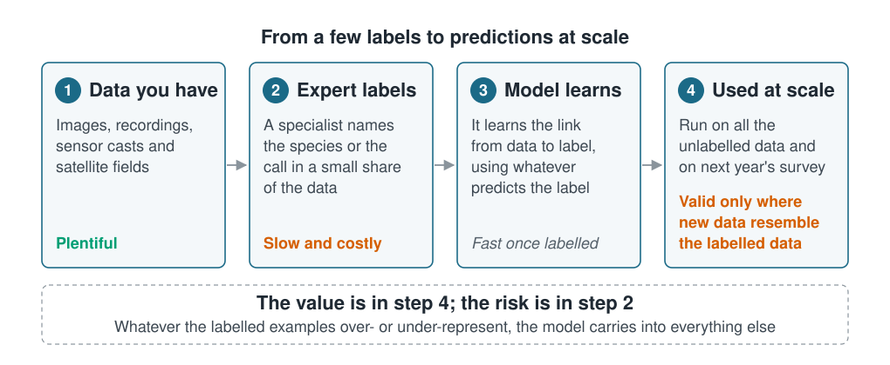

## Beyond a list of applications

Lists of applications are easy to find and mostly useless, because they are organised
by subdiscipline. Knowing that "machine learning is used in fisheries" tells you
nothing about whether it suits your problem.

What transfers is the *shape* of the task. A model that identifies plankton from
images and a model that identifies whale calls from recordings are, underneath, doing
the same thing, and they fail in the same ways. Once you can recognise the shape of
your own problem, the rest of this course tells you which tools apply and which
assumptions you are taking on.

## The idea

Nearly every supervised application in marine science follows one pipeline, and its
economics are always the same.

::: {.diagram}
{fig-alt="A four-stage pipeline. Stage 1, data you already have: imagery, echosounder returns, call recordings, CTD casts, tracks, satellite fields, all abundant. Stage 2, labels from experts: a specialist names the species, water mass or call; slow, costly, never complete, marked as the bottleneck. Stage 3, the model learns the mapping, finding whatever predicts the label, not necessarily what a specialist would use. Stage 4, applied at scale to unlabelled data and to next year's survey, valid only where the new data resembles the labelled data."}
:::

You have far more data than you have expert time. The model is a way of spending a
specialist's judgement once and applying it a million times. That is the genuine and
often dramatic win.

It is also where the danger lives. The model learns from the labelled subset, and a
labelled subset is rarely a random sample of anything. It is whichever images were
clear, whichever casts someone had funding to classify, whichever season the
postgraduate worked on.

## A tour, by what the model is doing

### Naming things in sensor data

The largest and most successful category. A specialist labels a sample; the model
takes over.

- **Benthic and pelagic imagery**: annotating seabed photographs or video for
  substrate type, habitat class or visible taxa.
- **Plankton imaging**: imaging instruments generate far more particle images than
  anyone can classify by hand.
- **Passive acoustics**: detecting and classifying marine mammal calls in recordings
  that run for months.
- **Active acoustics**: assigning echosounder backscatter to species or groups.
- **Otoliths, scales and shells**: ageing and stock discrimination from shape.

*What the label is:* a category assigned by a specialist.
*The catch:* your classes are wildly imbalanced. Most frames are empty water, most
recordings are quiet. A model that predicts "nothing here" every time scores
extremely well and is worthless; see [section 7](../07-validation/index.qmd) on why
accuracy is the wrong measure.

### Predicting across space

- **Species distribution and habitat suitability**: relating occurrence records to
  environmental layers, then predicting across an unsurveyed area.
- **Benthic habitat mapping**: turning multibeam bathymetry and backscatter into
  habitat maps.
- **Bycatch and interaction risk**: estimating where a fishery is likely to encounter
  a protected species.

*What the label is:* a measurement or occurrence at a location.
*The catch:* this is the category where marine work most often goes wrong. Survey
effort is clustered, nearby stations are not independent observations, and the whole
point is to predict where you have not sampled. Ordinary cross-validation reports
excellent performance for models that cannot do this at all.
[Sections 6](../06-assumptions-limitations/index.qmd) and
[7](../07-validation/index.qmd) exist largely for this case.

### Filling in what the instrument missed

- **Gap-filling satellite fields**: cloud cover removes much of an ocean-colour or
  SST image; a model reconstructs the missing pixels from surrounding water and time.
- **Reconstructing profiles**: inferring a full depth profile from surface
  observations plus sparse subsurface data.

*What the label is:* the value at a place the instrument *did* see, withheld on
purpose so the model can learn to reconstruct it.
*The catch:* gaps are not random. Cloud follows weather, which follows season. The
model is trained on cloud-free conditions and applied to cloudy ones.

### Forecasting in time

- **Harmful algal bloom warning**: predicting bloom risk days to weeks ahead.
- **Recruitment and stock indicators**: relating year-class strength to environmental
  conditions.
- **Short-term ocean state**: emulating or post-processing physical model output.

*What the label is:* what happened next.
*The catch:* random train/test splits are invalid: a random split lets the model see
the future while predicting the past. And the number of independent observations is
usually far smaller than the row count suggests: forty years of annual recruitment is
forty observations, not forty thousand.

### Finding structure with no labels at all

- **Water mass classification** from profile data, without a predetermined scheme.
- **Community typologies**: grouping stations by assemblage composition.
- **Regionalisation**: dividing a region into provinces from environmental fields.

*What the label is:* nothing. That is the point.
*The catch:* these methods return groups whether or not groups exist. See
[section 8](../08-unsupervised-learning/index.qmd).

### Standing in for something expensive

- **Emulators**: training a fast model to mimic a slow physical simulation, so that
  thousands of scenarios become affordable.

*What the label is:* the expensive model's own output.
*The catch:* the emulator inherits every bias of the model it imitates, and adds its
own. It is valid only across the range of conditions it was trained on.

## The rest of the course

| If your problem is… | It is… | Covered mainly in |
| --- | --- | --- |
| Naming things in sensor data | Classification | [§3](../03-supervised-learning/index.qmd), [§7](../07-validation/index.qmd), [§9](../09-neural-networks/index.qmd) |
| Predicting a quantity across space | Regression with spatial dependence | [§3](../03-supervised-learning/index.qmd), [§6](../06-assumptions-limitations/index.qmd), [§7](../07-validation/index.qmd) |
| Filling gaps | Regression with non-random missingness | [§2](../02-marine-data/index.qmd), [§6](../06-assumptions-limitations/index.qmd) |
| Forecasting | Regression with temporal dependence | [§6](../06-assumptions-limitations/index.qmd), [§7](../07-validation/index.qmd) |
| Finding groups | Unsupervised learning | [§8](../08-unsupervised-learning/index.qmd) |
| Explaining a driver | Possibly not machine learning at all | [§1](prediction-and-explanation.qmd), [§10](../10-interpretation/index.qmd) |

That last row is deliberate. If your question is "does temperature drive abundance,
and by how much", a machine-learning model is often the wrong instrument, as
[the previous page](prediction-and-explanation.qmd) showed.

## Limits of this survey

**Published success is a biased sample.** Applications that worked get written up;
the habitat model that collapsed on the following year's survey does not. Assume the
practical hit rate is lower than the literature suggests.

**Reported performance is usually optimistic**, often because of the validation
problems in [section 7](../07-validation/index.qmd) rather than any dishonesty. Two
studies quoting the same accuracy on the same task can differ in real-world
performance by a wide margin, depending entirely on how they split their data.

**The bottleneck is almost always labels, not algorithms.** Teams routinely spend
months on model architecture when the binding constraint was a few hundred more
annotated frames. Before choosing a method, ask how many labelled examples you can
realistically obtain, and whether they will resemble the data you mean to apply the
model to.

::: {.callout-tip}
## Key points
- Organise applications by the *shape of the task*, not by subdiscipline. Plankton
  images and whale calls are the same problem wearing different clothes.
- The pipeline is always the same: abundant data, scarce expert labels, a model that
  scales those labels up. The value is in the scaling; the risk is in the labels.
- A labelled subset is almost never a random sample. Whatever it over-represents, the
  model inherits and then applies everywhere.
- The two marine specialities, spatial and temporal dependence, break standard
  validation, which is why two later sections are devoted to them.
- If your question is about *why*, rather than *what next*, check first whether you
  want machine learning at all.
:::

## Try it yourself

1. Write down your own problem in the pipeline's terms: what is the abundant data,
   what is the label, who assigns it, and how many labelled examples could you
   actually get this year?
2. Then answer the uncomfortable one: in what way is your labelled subset *not* a
   random sample of the data you intend to apply the model to? Season, depth, gear,
   observer, weather: name the specific one.
