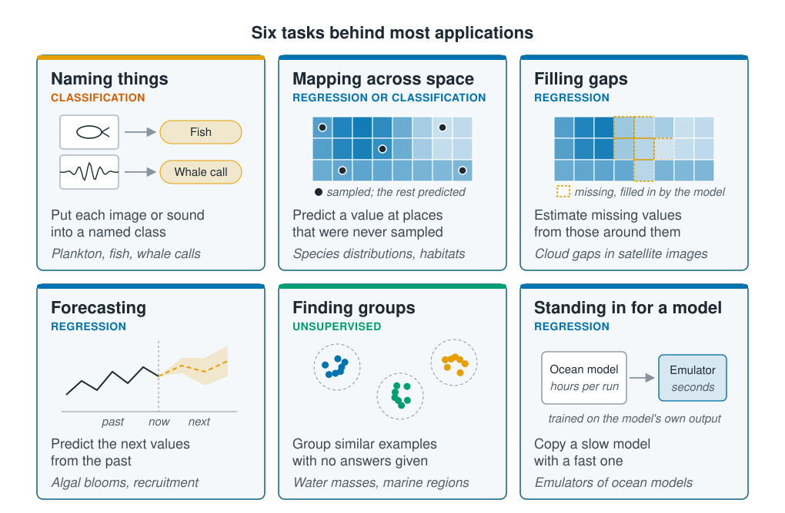

## Six tasks cover most applications

Identifying plankton in images and identifying whale calls in recordings belong to
different fields, but the model does the same job in both: it puts each example into
a named class. The two use the same methods and fail in the same ways. Grouping
applications by the task, rather than by field, shows which parts of the course apply
to a given problem.

::: {.diagram}
{fig-alt="Six cards in two rows. Naming things, classification: an image of a fish and a sound recording, each with an arrow to a named label; the model puts each image or sound into a named class, as for plankton, fish and whale calls. Mapping across space, regression or classification: a gridded map shaded from light to dark blue with a few sampled cells marked by dots and the rest predicted; used for species distributions and habitats. Filling gaps, regression: a similar grid with a patch of missing cells outlined in orange and filled in by the model; used for cloud gaps in satellite images. Forecasting, regression: a line through the past up to a line marked now, continued as a dashed line with a widening band; used for algal blooms and recruitment. Finding groups, unsupervised: points in three coloured clusters, each in a dashed circle; similar examples are grouped with no answers given, as for water masses and marine regions. Standing in for a model, regression: an ocean model taking hours per run with an arrow to an emulator taking seconds, trained on the ocean model's own output."}
:::

Each task has a typical way of going wrong, and later sections deal with each one:

| Task | Typical way of going wrong | Sections |
| --- | --- | --- |
| Naming things | Most images are empty water, so a model that always says "nothing here" scores well and is useless | [§3](../03-supervised-learning/index.qmd), [§7](../07-validation/index.qmd), [§9](../09-neural-networks/index.qmd) |
| Mapping across space | Nearby sites are alike, so the usual checks overstate accuracy in areas never sampled | [§6](../06-assumptions-limitations/index.qmd), [§7](../07-validation/index.qmd) |
| Filling gaps | The gaps are not random: cloud comes with particular weather | [§2](../02-marine-data/index.qmd), [§6](../06-assumptions-limitations/index.qmd) |
| Forecasting | A random split lets the model learn from the future; 40 years of annual data is only 40 observations | [§6](../06-assumptions-limitations/index.qmd), [§7](../07-validation/index.qmd) |
| Finding groups | The methods return groups whether or not real groups exist | [§8](../08-unsupervised-learning/index.qmd) |
| Standing in for a model | The copy is valid only within the conditions it was trained on | [§6](../06-assumptions-limitations/sampling-and-extrapolation.qmd) |

A question about cause, such as whether warming reduces a species, is left out of
the six on purpose. As [the previous page](prediction-and-explanation.qmd) showed,
a model that predicts well may still answer it wrongly, and the answer often needs a
statistical model and a good study design instead.

## Labelled examples limit most applications

Apart from finding groups, all six tasks are supervised: the model learns from
examples that already carry an answer, and those answers usually come from a
specialist.

::: {.diagram}
{fig-alt="Four boxes in a row joined by arrows. Box 1, data you already have: images, recordings, sensor casts and satellite fields, marked plentiful. Box 2, labels from a specialist, who names the species or the call in a small share of the data, marked slow and costly. Box 3, the model learns the link from data to label, using whatever predicts the label, marked fast once labelled. Box 4, applied at scale to all the unlabelled data and next year's survey, valid only where the new data resemble the labelled data. Below: the value is in step 4 and the risk is in step 2; whatever the labelled examples over- or under-represent, the model carries into everything else."}
:::

The model applies a specialist's judgement to far more data than the specialist
could ever see. The labelled examples, though, are rarely a random sample: they are
the clearest images, or the casts someone had time to classify. The model inherits
their gaps and applies them everywhere.

For the same reason, more labelled examples that resemble the target data usually
help more than a cleverer algorithm. Published accuracy is also often optimistic,
mostly because of the checking problems covered in [section 7](../07-validation/index.qmd).

::: {.callout-tip}
## Key points
- Group applications by the task the model performs, not by field. Plankton images
  and whale calls are the same task.
- Six tasks cover most applications, and each has a typical way of going wrong.
- Supervised applications turn scarce expert labels into predictions for plentiful
  unlabelled data.
- The labelled examples are rarely a random sample, and the model carries their gaps
  into everything it predicts.
- A question about cause may need a statistical model and a study design rather than
  machine learning.
:::

## Try it yourself

1. Which of the six tasks is your own problem, and what is the label?
2. How many labelled examples could you obtain this year, and in what way do they
   differ from the data you want to apply the model to: season, depth, gear, observer?
