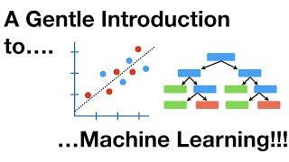

## Overview

Machine learning builds a model from examples: instead of writing down the rule that
links water temperature to where a species lives, you give a method many stations where
the answer is known, and it finds the rule itself. This section sets out the ideas the
rest of the course builds on: the main kinds of learning, the difference between
predicting and explaining, the tasks machine learning does in marine science, and the
two things a model can learn. Every page works on the same simulated coastal survey, and
the pages build on each other, so read them in order.

## A short tour



## Lecture notes

- [Summary slides](../../slides/01-introduction.qmd) cover each page of the section in
  two or three slides, with speaker notes, for teaching the section or a quick review.

## Pages in this section

::: {#pages}
:::

## Further resources

**Documentation**

- [Get Started](https://www.tidymodels.org/start/), tidymodels. Five short articles that build one model from scratch, in the order this course uses.
- [Getting started](https://scikit-learn.org/stable/getting_started.html), scikit-learn. The same ground in one page, for readers who work in Python.
- [Choosing the right estimator](https://scikit-learn.org/stable/machine_learning_map.html), scikit-learn. A flowchart from the size and shape of your data to a method. Treat it as a starting point rather than an answer.

**Video**

::: {.video-list}
- [{.video-thumb fig-alt="A Gentle Introduction to Machine Learning, on YouTube" loading="lazy"}](https://www.youtube.com/watch?v=Gv9_4yMHFhI)

  [A Gentle Introduction to Machine Learning](https://www.youtube.com/watch?v=Gv9_4yMHFhI), StatQuest with Josh Starmer. Training and testing, and why the distinction is the whole subject.
:::
