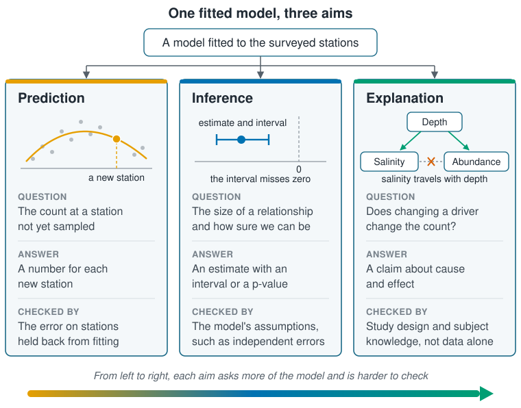

```{r}
#| label: setup
#| include: false
library(tidymodels)
source(here::here("R/theme.R"))
source(here::here("R/data.R"))
set.seed(123)
```

## One fitted model, three aims

[The previous page](what-is-machine-learning.qmd) set prediction against explanation.
Between the two sits a third aim, inference. All three can use the same fitted model;
they differ in the question put to it.

- **Prediction** estimates the outcome for new cases the model has not seen. It is
  checked directly: hold some cases back from fitting, predict them, and measure the
  error.
- **Inference** uses a sample to draw conclusions about the wider population it came
  from. It estimates the size of a relationship between an input and the outcome, and
  states the uncertainty as an interval or a p-value. That uncertainty is only as
  trustworthy as the model's assumptions.
- **Explanation** claims a cause: changing an input, with everything else held fixed,
  changes the outcome. The data alone cannot settle that. It needs a study design,
  such as an experiment, or knowledge of the system.

Uncertainty can be attached to a prediction or a cause as well. On this page,
inference means estimating an association: two variables moving together, which on
its own says nothing about one driving the other.

In the simulated coastal survey used throughout this section, the three aims put
three different questions to the same stations:

- **Prediction:** the number of animals at a station not yet sampled, from its
  temperature, salinity and depth.
- **Inference:** the difference in abundance between stations one unit of salinity
  apart, across the whole shelf, with an interval around it.
- **Explanation:** whether warmer water, by itself, would change the count.

::: {.diagram}
{fig-alt="At the top, one box reads 'One model fitted to the data', with arrows to three columns. Prediction, in orange: a curve through scattered points with a new case marked on it; the question is the outcome for a case the model has not seen, the answer is a value for each new case, and it is checked by the error on cases held back from fitting. Inference, in blue: an estimate with an interval that does not reach zero; the question is the size of a relationship and how sure we can be, the answer is an estimate with an interval or p-value, and it is checked by the model's assumptions. Explanation, in green: depth points to both salinity and the outcome, and a crossed-out dashed line joins salinity to the outcome; the question is whether changing a driver changes the outcome, the answer is a claim about cause and effect, and it is checked by study design and subject knowledge, not data alone. A bar along the bottom runs from orange to green: from left to right, each aim asks more of the model and is harder to check."}
:::

A model can succeed at one aim and fail at the next, and its output gives no warning.
The example below shows salinity doing exactly that.

## Three aims on the same stations



In this simulated survey salinity has no effect on the species. It rises with depth,
though, and depth does matter: the species is most common around 80 m. Three models
are fitted to the same training stations. Each bends the temperature line with a
squared term, as the previous page suggested trying.

```{r}
#| label: fit-three
survey <- load_coastal_survey()
split  <- initial_split(survey, prop = 0.75)
train  <- training(split)
test   <- testing(split)

formulas <- list(
  "Temperature"                    = abundance ~ temperature_c + I(temperature_c^2),
  "Temperature + salinity"         = abundance ~ temperature_c + I(temperature_c^2) +
    salinity_psu,
  "Temperature + salinity + depth" = abundance ~ temperature_c + I(temperature_c^2) +
    salinity_psu + depth_m + I(depth_m^2)
)
fits <- map(formulas, \(f) fit(linear_reg(), f, data = train))
```

### Prediction: salinity lowers the test error

Adding salinity lowers the error on the test stations, and adding depth lowers it
further:

```{r}
#| label: test-error
imap(fits, \(fit, name) {
  augment(fit, test) |>
    rmse(abundance, .pred) |>
    transmute(model = name, test_rmse = round(.estimate, 2))
}) |>
  list_rbind()
```

For prediction, salinity has earned its place. If depth had not been recorded, the
second model would be the one to use.

### Inference: saltier stations hold fewer animals

The salinity slope in the second model is about −2.2 animals per unit of salinity, and
its interval sits well away from zero (@fig-salinity). As inference this is correct:
across the shelf, stations with saltier water really do hold fewer animals.

```{r}
#| label: fig-salinity
#| fig-cap: "The salinity slope, with its 95% interval, in the two models that include salinity. Without depth, salinity appears to matter. With depth, its slope shrinks to near zero, which is the true value built into the simulation."
#| fig-alt: "Two horizontal interval bars on an axis of salinity slope. For the model without depth, the estimate is about minus 2.2 with an interval from about minus 3.3 to minus 1.2, clear of the dashed zero line. For the model with depth, the estimate is about minus 0.2 with an interval from about minus 1.6 to 1.2, spanning zero."
#| fig-width: 7
#| fig-height: 2.8
slopes <- imap(fits[-1], \(fit, name) {
  tidy(fit, conf.int = TRUE) |>
    filter(term == "salinity_psu") |>
    mutate(model = name)
}) |>
  list_rbind()

ggplot(slopes, aes(estimate, model)) +
  geom_vline(xintercept = 0, linetype = "dashed", colour = ml_palette[["grey"]]) +
  geom_errorbarh(aes(xmin = conf.low, xmax = conf.high), height = 0.15,
                 colour = ml_palette[["blue"]], linewidth = 1) +
  geom_point(size = 3, colour = ml_palette[["blue"]]) +
  labs(x = "Salinity slope (animals per unit of salinity)", y = NULL)
```

### Explanation: salinity only travels with depth

Read as a cause, the same slope is wrong. Freshening the water would not bring more
animals, because salinity only travels with depth. Once depth enters the model, the salinity slope shrinks to about −0.2 and its interval spans zero.

### Salinity predicts abundance and does nothing

The data could tell inference and explanation apart here only because depth was
measured. With an
unmeasured driver, the second model would be the best available, its interval would
still be narrow, and nothing in the output would say the cause lay elsewhere. The
check came from knowing that salinity rises with depth on this shelf, not from the
test error or the p-value.

## Limits of this separation

**A good test score says nothing about cause.** The salinity model predicted better
than the temperature model, and its salinity slope is still not a cause.

**An interval depends on the model.** The salinity interval was narrow and correct as
a statement about association. It was not a statement about what would happen if
salinity changed, and a wrong model shape or correlated errors make even the interval
unreliable. [Section 6](../06-assumptions-limitations/index.qmd) covers those
assumptions. An interval can also be put on a causal effect; that is causal
inference, and it needs the study design and system knowledge of explanation as well
as the model's assumptions.

**A curve through counts can go below zero.** The third model places the temperature
optimum, the top of its curve, at the first number below, close to the 9 °C built into
the simulation. The same curve predicts a negative count at the number of stations
given by the second:

```{r}
#| label: optimum
b <- coef(extract_fit_engine(fits[["Temperature + salinity + depth"]]))
-b[["temperature_c"]] / (2 * b[["I(temperature_c^2)"]])

sum(predict(fits[["Temperature + salinity + depth"]], survey)$.pred < 0)
```

A model can recover a real optimum and still make impossible predictions.
[Section 3](../03-supervised-learning/index.qmd) fixes this with a model built for
counts.

**Choosing the variables is a question about the system.** Which variables belong in
an explanatory model is decided with subject knowledge, not by keeping whichever set
scores best. [Section 10](../10-interpretation/index.qmd) returns to this.

::: {.callout-tip}
## Key points
- Prediction gives values for new cases and is checked on held-back data.
- Inference gives the size of a relationship with its uncertainty, and rests on the
  model's assumptions. On its own it is a statement about association.
- Explanation claims a cause, and rests on study design and knowledge of the system.
- A variable can predict well and carry a confident interval while causing nothing.
  Salinity, which travels with depth, is such a variable here.
- Decide which aim you have before choosing a model.
:::

## Try it yourself

Drop `salinity_psu` from the third model. Does the test error change, and do the
depth terms move? Then fit `abundance ~ salinity_psu` alone and compare its slope with
the one in @fig-salinity.
