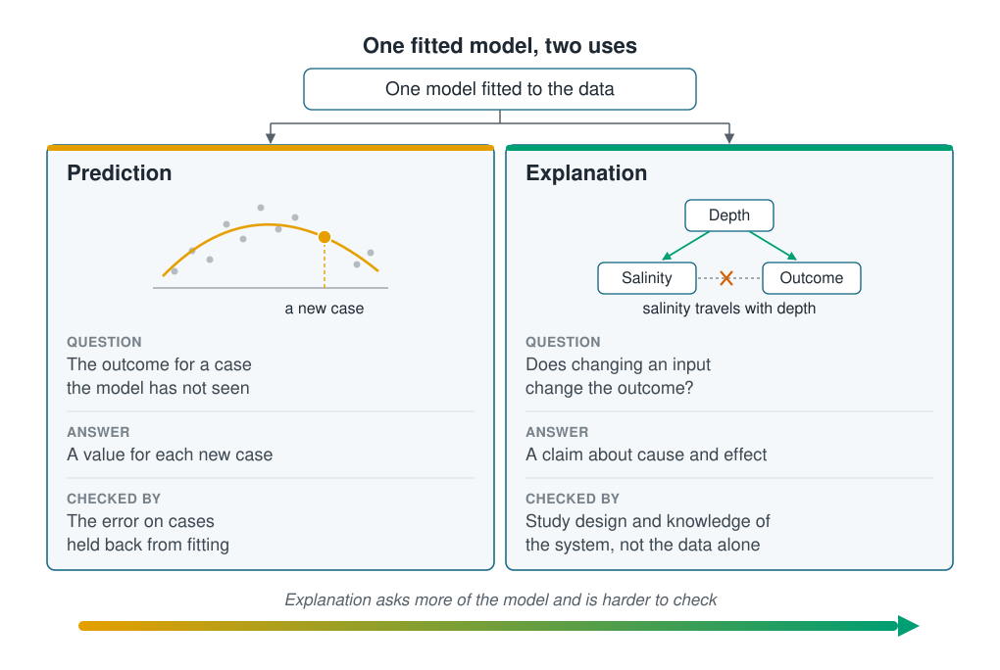

```{r}
#| label: setup
#| include: false
library(tidymodels)
source(here::here("R/theme.R"))
source(here::here("R/data.R"))
set.seed(123)
# Numbers in the text, with a true minus sign.
num <- function(x, digits = 1) sub("^-", "−", format(round(x, digits), nsmall = digits))
```



You can fit a model to understand what drives an outcome, or to predict cases you
have not seen yet. Statistical modelling and machine learning often use the same
models; what mostly separates them is which of these two aims comes first. This page
shows that the two aims check a model in different ways, and that a model can serve
one aim well while misleading you about the other.

## One model can serve two aims

Statistical modelling and machine learning are not two separate subjects. Both start
from a table of measurements, and both fit a model by making its errors on that
table as small as possible. Linear regression belongs to both. The difference is
mostly what the fitted model is for.

- **Explanation** asks what drives the outcome: if an input changed, with everything
  else held fixed, would the outcome change? This is the usual aim of **statistical
  modelling**. The answer is a claim about cause, and the data alone cannot check it.
  It needs an experiment or knowledge of the system.
- **Prediction** asks what the outcome will be for a case the model has not seen.
  This is the usual aim of **machine learning**. It can be checked directly: hold some
  cases back from fitting, predict them, and measure how far the predictions miss.

The two aims also differ in who chooses the shape of the relationship. For
explanation you usually write it down, such as a straight line in each input, so
that each part of the model means something. For prediction the shape only has to
work, so most machine-learning methods find it from the data.

::: {.diagram}
{fig-alt="At the top, one box reads 'One model fitted to the data', with arrows to two columns. Prediction, in orange, the usual aim of machine learning: a curve through scattered points with a new case marked on it; the question is the outcome for a case the model has not seen, the answer is a value for each new case, it is checked by the error on cases held back from fitting, and the shape is usually found by the algorithm. Explanation, in green, the usual aim of statistical modelling: depth points to both salinity and the outcome, and a crossed-out dashed line joins salinity to the outcome; the question is whether changing an input changes the outcome, the answer is a claim about cause and effect, it is checked by study design and knowledge of the system, not by the data alone, and the shape is usually written down by you. A bar along the bottom runs from orange to green: explanation asks more of the model and is harder to check."}
:::

## A straight line misses a temperature optimum



The examples use the coastal survey from [Types of learning](types-of-learning.qmd):
the water temperature, salinity and depth at each station, and the number of animals
counted there.

First, a quarter of the stations are held back as the **test set**. No model sees
them during fitting, so the error on them shows how a model does on new stations. The
other three quarters, the **training set**, are what the models learn from.
[Splitting the data](../02-marine-data/splitting-data.qmd) covers the split in full.

```{r}
#| label: split
survey <- load_coastal_survey()

split <- initial_split(survey, prop = 0.75)
train <- training(split)
test  <- testing(split)
```

### Linear regression gives one slope per input

A **linear regression** predicts the count by adding up a fixed amount for each input.
That amount is the input's **slope**, also called its **coefficient**: the change in
the predicted count for one unit more of the input, with the other inputs held fixed.

```{r}
#| label: fit-linear
linear <- linear_reg() |>
  fit(abundance ~ temperature_c + salinity_psu + depth_m, data = train)

tidy(linear) |>
  filter(term != "(Intercept)") |>
  select(term, slope = estimate) |>
  mutate(slope = round(slope, 3))
```

The temperature slope is close to zero: one degree warmer lowers the predicted count
by only `r num(abs(tidy(linear)$estimate[2]), 2)` animals. Read as an explanation, temperature
hardly matters to this species.

### A decision tree finds its own shape

A **decision tree** splits the training stations in two at the threshold that best
separates high counts from low ones, then splits each half again. Here it stops after
three rounds of splits and predicts the average count in each final group. Nobody
writes down the shape; the splits find it.
[Decision trees](../03-supervised-learning/decision-trees.qmd) explains trees in full.

```{r}
#| label: fit-tree
tree <- decision_tree(mode = "regression", tree_depth = 3) |>
  fit(abundance ~ temperature_c + salinity_psu + depth_m, data = train)
```

The tree's first split is "temperature below
`r round(tree$fit$splits[1, "index"], 1)` °C": temperature mattered most to it,
although the linear regression's slope said it hardly mattered at all.

@fig-shapes shows what each model predicts across the range of temperature, with
salinity and depth held at their typical values.

```{r}
#| label: fig-shapes
#| fig-cap: "Predicted abundance against temperature, with salinity and depth held at their medians. The linear regression is nearly flat; the decision tree finds low counts in cold and warm water and the most animals in between."
#| fig-alt: "Scatter of abundance against temperature for the training stations, with counts highest between about 6 and 11 degrees. A nearly flat straight line, the linear regression, runs through the points. A stepped line, the decision tree, sits low below about 6.4 degrees, rises to its highest level between about 6.4 and 11 degrees, and drops again above."
#| fig-width: 7
#| fig-height: 4.5
grid <- tibble(
  temperature_c = seq(min(survey$temperature_c), max(survey$temperature_c), by = 0.05),
  salinity_psu  = median(train$salinity_psu),
  depth_m       = median(train$depth_m)
)

curves <- bind_rows(
  mutate(grid, model = "Linear regression", .pred = predict(linear, grid)$.pred),
  mutate(grid, model = "Decision tree",     .pred = predict(tree, grid)$.pred)
)

ggplot(train, aes(temperature_c, abundance)) +
  geom_point(alpha = 0.25, colour = ml_palette[["grey"]]) +
  geom_line(data = curves, aes(y = .pred, colour = model), linewidth = 1.2) +
  scale_colour_manual(values = c("Linear regression" = ml_palette[["blue"]],
                                 "Decision tree"     = ml_palette[["orange"]])) +
  coord_cartesian(ylim = c(0, 15)) +
  labs(x = "Temperature (°C)", y = "Abundance (animals per station)", colour = NULL)
```

The species does best in middling water and thins out in colder and warmer water. A
straight line through a hump is flat, so the linear regression reports almost no
effect. The tree was never asked for a slope, so the hump costs it nothing.

## The test error is a typical miss

To say which model predicts better, we need one number for how far its predictions
miss on the test stations. The course uses the **root mean squared error**, or
**RMSE**, so it is worth building once by hand. Each test station has an observed
count and a prediction, and the miss is the difference between them. Here are the
first five test stations, predicted by the tree:

```{r}
#| label: rmse-by-hand
misses <- augment(tree, test) |>
  transmute(observed = abundance, predicted = .pred,
            miss = observed - predicted, squared = miss^2)
head(misses, 5) |> mutate(across(predicted:squared, \(x) round(x, 2)))
```

The RMSE takes three steps over all `r nrow(misses)` test stations:

1. **Square** each miss. A miss of −3 and a miss of +3 both become 9, so misses in
   opposite directions cannot cancel out. A large miss counts for much more than a
   small one: the first station, `r round(misses$miss[1], 1)` animals out, adds `r round(misses$squared[1])`.
2. Take the **mean** of the squares: `r round(mean(misses$squared), 2)` here.
3. Take the **square root**, which brings the answer back to animals:
   `r round(sqrt(mean(misses$squared)), 2)`.

The result reads as a typical miss, in the outcome's own units: the tree's predictions
for new stations are usually off by about `r round(sqrt(mean(misses$squared)))`
animals, in either direction. Lower is better, and 0 would mean every prediction was
exact.

::: {.callout-note collapse="true"}
## The maths, if you want it

With $y_i$ the observed count at test station $i$, $\hat{y}_i$ the prediction and $n$
test stations,

$$\text{RMSE} = \sqrt{\frac{1}{n}\sum_{i=1}^{n} (y_i - \hat{y}_i)^2}$$

Squaring weighs a miss of 10 a hundred times a miss of 1, so the RMSE listens hardest
to the largest misses. [Loss functions](../04-how-algorithms-learn/loss-functions.qmd)
shows what that does to a fit, and
[Regression performance measures](../07-validation/regression-metrics.qmd) compares the
RMSE with other measures.
:::

A typical miss means little on its own. It needs a **baseline**: the score of the
simplest prediction there is, here the training stations' average count, predicted
for every test station whatever its water.

```{r}
#| label: test-error
baseline <- mean(train$abundance)

test_rmse <- tibble(
  model = c("Average count", "Linear regression", "Decision tree"),
  test_rmse = c(
    rmse_vec(test$abundance, rep(baseline, nrow(test))),
    rmse_vec(test$abundance, predict(linear, test)$.pred),
    rmse_vec(test$abundance, predict(tree, test)$.pred)
  )
)
test_rmse |> mutate(test_rmse = round(test_rmse, 2))
```

Both models beat the average, so the water does carry information about the species.
The tree beats it by `r with(test_rmse, round(test_rmse[1] - test_rmse[3], 2))`
animals, the linear regression by only
`r with(test_rmse, round(test_rmse[1] - test_rmse[2], 2))`. A model that cannot beat
the baseline has learned nothing useful.

Neither model is simply better. The tree predicts better but gives no single number
for "the effect of temperature". The linear regression gives that number, but the
number is wrong because the shape was wrong. The fix for explanation is to bend the
line, and the next example does.

## Depth confounds the salinity slope

A **confounder** is a variable that affects both an input and the outcome, so the two
move together even when neither affects the other. In the survey, salinity rises with
depth, and depth may matter to the species. If it does, depth confounds salinity.

Three linear regressions are fitted to the same training stations. Each adds a
**squared term** for temperature, which lets the line bend into a curve that rises
and then falls, the hump the tree found.
[Linear and polynomial regression](../03-supervised-learning/linear-and-polynomial-regression.qmd)
covers squared terms.

```{r}
#| label: fit-three
formulas <- list(
  "Temperature"                    = abundance ~ temperature_c + I(temperature_c^2),
  "Temperature + salinity"         = abundance ~ temperature_c + I(temperature_c^2) +
    salinity_psu,
  "Temperature + salinity + depth" = abundance ~ temperature_c + I(temperature_c^2) +
    salinity_psu + depth_m + I(depth_m^2)
)
fits <- map(formulas, \(f) fit(linear_reg(), f, data = train))
```

### For prediction, salinity can stand in for depth

```{r}
#| label: test-error-three
three_rmse <- imap(fits, \(fit, name) {
  tibble(model = name,
         test_rmse = rmse_vec(test$abundance, predict(fit, test)$.pred))
}) |>
  list_rbind()
three_rmse |> mutate(test_rmse = round(test_rmse, 2))
```

All three curves beat both models above. Adding salinity lowers the error a little,
because salinity carries some of depth's information. For prediction that is
allowed: nothing more is asked of an input than that it helps. Adding depth itself
helps most.

### For explanation, the salinity slope misleads

```{r}
#| label: salinity-slopes
slopes <- imap(fits[-1], \(fit, name) {
  tidy(fit, conf.int = TRUE) |>
    filter(term == "salinity_psu") |>
    mutate(model = name)
}) |>
  list_rbind()
without_depth <- slopes$estimate[1]
with_depth    <- slopes$estimate[2]
```

Without depth, the salinity slope is `r num(without_depth)`: each extra unit of
salinity goes with about `r round(abs(without_depth), 1)` fewer animals. Each slope
comes with a **95% confidence interval**, a range that shows how precisely the data
pin the slope down: if the survey were repeated many times, 95 in 100 intervals built
this way would contain the true slope. An interval that stays clear of zero, the value
for no relationship, is usually read as a real effect, and this one does
(@fig-salinity).

Read as a cause, that slope says freshening the water would bring more animals. Once
depth enters the model, the salinity slope shrinks to `r num(with_depth)` and its
interval includes zero. Because the survey is simulated, we can check the answer: the
program that generated it gives salinity no effect at all, and the species' count
depends on depth.

```{r}
#| label: fig-salinity
#| fig-cap: "The salinity slope, with its 95% confidence interval, in the two models that include salinity. Without depth, salinity appears to matter. With depth, its slope shrinks to near zero, the true value built into the simulation."
#| fig-alt: "Two horizontal interval bars on an axis of salinity slope. For the model without depth, the estimate is about minus 2.2 with an interval from about minus 3.3 to minus 1.2, clear of the dashed zero line. For the model with depth, the estimate is about minus 0.2 with an interval from about minus 1.6 to 1.2, spanning zero."
#| fig-width: 7
#| fig-height: 2.8
ggplot(slopes, aes(estimate, model)) +
  geom_vline(xintercept = 0, linetype = "dashed", colour = ml_palette[["grey"]]) +
  geom_errorbar(aes(xmin = conf.low, xmax = conf.high), width = 0.15,
                orientation = "y", colour = ml_palette[["blue"]], linewidth = 1) +
  geom_point(size = 3, colour = ml_palette[["blue"]]) +
  labs(x = "Salinity slope (animals per unit of salinity)", y = NULL)
```

### Test error cannot reveal a confounder

Had depth not been recorded, the model with salinity would have the lower test error
and a confident salinity slope, and nothing in its output would point to depth. A
confounder can be dealt with only by measuring it, as here, by knowing from the system
that it is there, or by an experiment that changes the input alone. That is why
explanation needs study design and knowledge of the system, and prediction does not.

## Key points

::: {.key-points}
- Statistical modelling and machine learning share their models and their fitting.
  They differ in aim: explanation for the first, prediction for the second.
- Prediction is checked on a test set, stations held back from fitting.
  Explanation claims a cause and rests on study design and knowledge of the system.
- For explanation you choose the shape of the relationship; most machine-learning
  methods find it. A flat slope can mean "no relationship" or "a shape the model
  cannot draw".
- The RMSE is a typical miss in the outcome's own units: square the misses, average
  them, take the square root. Compare it with a baseline such as the average.
- A confounder affects both an input and the outcome. It can give an input a
  confident slope while the input causes nothing, and test error cannot reveal it.
:::

## Try it yourself

Drop `salinity_psu` from the third model. Does the test error change, and do the
depth terms move? Then fit `abundance ~ salinity_psu` alone and compare its slope with
the ones in @fig-salinity.
