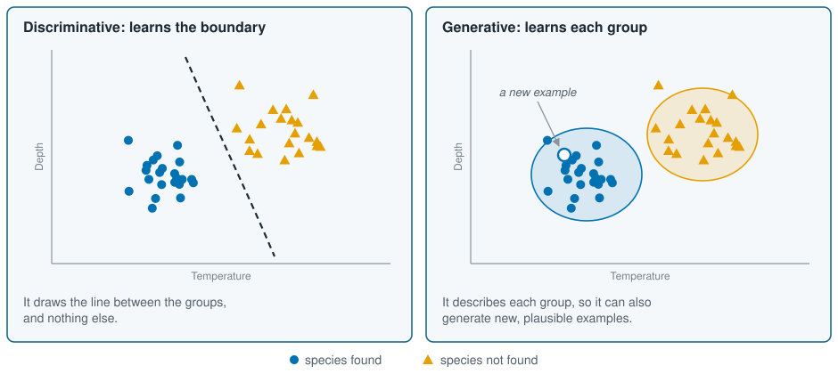
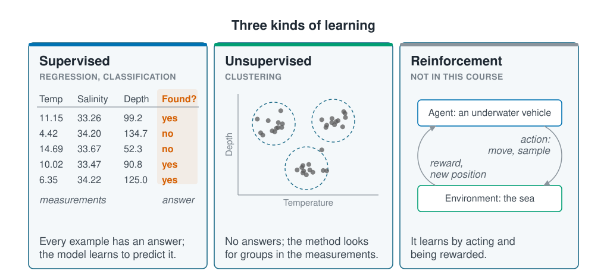

```{r}
#| label: setup
#| include: false
library(tidymodels)
library(tidyclust)
library(patchwork)
source(here::here("R/theme.R"))
source(here::here("R/data.R"))
set.seed(123)
```

## A map before the methods

Machine learning comes with a long list of names: regression, classification,
clustering, random forests, neural networks. They are easier to hold on to once you can
place them on a map. This page draws that map with two divisions. The first separates
models by the thing they learn. The second separates tasks by the data you have.

## One coastal survey runs through the course

Every example in this course uses the same dataset: a survey of 800 stations on a
temperate coastal shelf, visited between 2018 and 2023. At each station the survey
measured the water and sampled the seabed, and counted one species of seabed animal.
This page uses five of its columns:

- **temperature**, the water temperature, in °C;
- **salinity**, in practical salinity units (PSU), close to grams of salt per kilogram
  of seawater;
- **depth**, in metres;
- **abundance**, the number of animals counted at the station;
- **present**, "yes" if at least one animal was found, "no" otherwise.

```{r}
#| label: survey
survey <- load_coastal_survey()

survey |>
  select(station_id, temperature_c, salinity_psu, depth_m, abundance, present) |>
  head(5)
```

The survey is simulated: we wrote the program that generated it, so we know the true
relationships and can check whether a model finds them. It records more than these five
columns, including chlorophyll, the type of seabed, the season and each station's
position. [Section 2](../02-marine-data/index.qmd) introduces the full dataset and the
work needed before modelling it.



## The idea

### Two things a model can learn

Suppose the question is whether a seabed species is present at a station, given the
water temperature there. A model can learn one of two things.

A **discriminative model** learns the answer directly: the chance that the species is
present, for each temperature. It draws the boundary between "present" and "absent" and
nothing else. Most models in this course are discriminative, including linear and
logistic regression.

A **generative model** learns the data themselves. It describes the temperatures at
stations where the species was found, and separately the temperatures where it was not.
To classify a new station, it asks which of the two descriptions fits that station's
temperature better. Because it has learned the data, it can also *generate* new ones:
plausible temperatures for a station where the species occurs. The tools that write
text or draw pictures are generative models of the same kind, on a vastly larger scale.

::: {.diagram}
{fig-alt="Two panels showing the same scatter of stations by temperature and depth: blue dots where the species was found, orange triangles where it was not. In the left panel, labelled discriminative, a dashed line separates the two groups. In the right panel, labelled generative, a shaded oval surrounds each group, and a hollow dot inside the blue oval is marked as a new example."}
:::

Both can answer the same question. They differ in the thing they learn, and so in the
assumptions they make and the extra jobs they can do.

### Two kinds of data

The second division depends on the data you hold rather than the model you choose.

**Supervised learning** learns from examples with a known answer. Each row has
measurements and an outcome, such as a station with a recorded catch, and the model
learns to get from one to the other. The outcome sets the task: *regression* for a
quantity (how many animals), *classification* for a category (present or absent).

**Unsupervised learning** has no outcome at all. It receives a table of measurements
and looks for structure in it: groups of similar stations, or variables that move
together. Nothing tells it which answer is right, so its results need extra care.

A third kind, **reinforcement learning**, learns from the consequences of its own
actions: an autonomous underwater vehicle might learn a sampling route by trial,
rewarded for each useful measurement. It needs a way to act and a reward, not a table
of data, and this course does not cover it.

::: {.diagram}
{fig-alt="Three panels. The supervised panel shows a table of five stations with columns for temperature, salinity and depth, and a highlighted answer column, found, reading yes, no, no, yes, yes. The unsupervised panel shows grey points by temperature and depth, falling into three dashed circles. The reinforcement panel shows a box for an underwater vehicle above a box for the sea, joined in a loop: an arrow labelled action, move and sample, runs down to the sea, and an arrow labelled reward and new position runs back up."}
:::

## Worked example

Each idea above gets its own short example, followed by a comparison of each pair.
Three quarters of the stations are kept for fitting and a quarter set aside for later
pages. Three new stations, one shallow, one mid-depth and one deep, serve as the test
case every model is asked about.

```{r}
#| label: data
split  <- initial_split(survey, prop = 0.75, strata = present)
train  <- training(split)
test   <- testing(split)

new_stations <- tibble(
  station      = c("shallow", "mid-depth", "deep"),
  temperature_c = c(12, 9, 5),
  salinity_psu  = c(33.4, 33.7, 34.2),
  depth_m       = c(40, 90, 150)
)
```

These three stations are made up for illustration; they are not part of the survey. The
names shallow, mid-depth and deep are labels we gave them from their depths (40, 90 and
150 m) so the text can refer to them. The models never see the names, only the three
measurements.

### A discriminative model

The question is whether the species is present, given the water temperature. The
discriminative model here is **logistic regression**: linear regression adapted to a
yes-or-no outcome, so that its answer is a probability between 0 and 1. A squared
temperature term lets that probability rise and then fall again.

```{r}
#| label: fit-discriminative
discriminative <- logistic_reg() |>
  fit(present ~ temperature_c + I(temperature_c^2), data = train)

bind_cols(select(new_stations, station, temperature_c),
          predict(discriminative, new_stations, type = "prob"))
```

For each new station it returns one thing: the chance of presence, and its complement.
The species is likely at 9 °C and at 12 °C, and closer to a coin toss at 5 °C. That
is all the model knows.

### A generative model

The generative model answers the same question by learning the data instead. It
describes the temperatures at stations with the species by a bell curve (a *Normal
distribution*) with its own mean and spread, does the same for stations without the
species, and records how common each group is.

```{r}
#| label: fit-generative
generative <- train |>
  group_by(present) |>
  summarise(mean = mean(temperature_c), sd = sd(temperature_c), share = n() / nrow(train))

generative |> mutate(across(where(is.numeric), \(x) round(x, 2)))
```

The two groups have similar mean temperatures, but the stations without the species
spread much more widely: the species is missing mainly from the coldest and the warmest
water.

To classify a new station, **Bayes' rule** weighs the two descriptions: how well each
bell curve fits the station's temperature, times how common that group is.

```{r}
#| label: predict-generative
p_present_generative <- function(temperature) {
  yes <- filter(generative, present == "yes")
  no  <- filter(generative, present == "no")
  fit_yes <- yes$share * dnorm(temperature, yes$mean, yes$sd)
  fit_no  <- no$share  * dnorm(temperature, no$mean,  no$sd)
  fit_yes / (fit_yes + fit_no)
}

new_stations |>
  mutate(.pred_yes = p_present_generative(temperature_c)) |>
  select(station, temperature_c, .pred_yes)
```

Because it holds a description of the data, it can also generate new data. Here are
five plausible temperatures for stations where the species lives, drawn from its bell
curve:

```{r}
#| label: generate
with(filter(generative, present == "yes"), round(rnorm(5, mean, sd), 1))
```

### Discriminative and generative compared

@fig-two-models puts the two side by side. The left panel is the generative model's
view: the data of each group, and the bell curve it fitted. The right panel shows the
answer both models give, the chance of presence at every temperature.

```{r}
#| label: fig-two-models
#| fig-cap: "Left: the generative view, the temperatures at stations with and without the species, each summarised by a bell curve. Right: the chance of presence against temperature from both models, with the observed proportion in each one-degree band as points. The two models agree where most stations lie and part company at the edges."
#| fig-alt: "Two panels. The left panel shows two histograms of temperature with a bell curve over each: stations with the species cluster between about 6 and 12 degrees, stations without it spread from about 3 to 15 degrees. The right panel shows two curves of the probability of presence against temperature, both rising from low values at 2 degrees to a peak near 0.85 to 0.9 around 9 degrees and falling again towards 16 degrees; the logistic curve falls more steeply at both ends. Points for the observed proportions follow the curves in the middle."
#| fig-width: 8.5
#| fig-height: 4.2
curves <- tibble(temperature_c = seq(2, 16, by = 0.1)) |>
  mutate(
    Discriminative = predict(discriminative, pick(temperature_c), type = "prob")$.pred_yes,
    Generative     = p_present_generative(temperature_c)
  ) |>
  pivot_longer(-temperature_c, names_to = "model", values_to = "p")

bell <- generative |>
  reframe(temperature_c = seq(0, 18, by = 0.1),
          density = dnorm(temperature_c, mean, sd), .by = present) |>
  mutate(group = if_else(present == "yes", "Species found", "Species not found"))

observed <- train |>
  mutate(band = round(temperature_c)) |>
  summarise(p = mean(present == "yes"), stations = n(), .by = band) |>
  filter(stations >= 10)

p_data <- ggplot(mutate(train, group = if_else(present == "yes", "Species found", "Species not found")),
                 aes(temperature_c, fill = group)) +
  geom_histogram(aes(y = after_stat(density)), binwidth = 1, alpha = 0.45,
                 position = "identity", colour = NA) +
  geom_line(data = bell, aes(temperature_c, density, colour = group),
            linewidth = 1, inherit.aes = FALSE) +
  labs(x = "Temperature (°C)", y = "Density", fill = NULL, colour = NULL,
       title = "The generative model learns the data")

p_chance <- ggplot(curves, aes(temperature_c, p, colour = model)) +
  geom_point(data = observed, aes(band, p), inherit.aes = FALSE, colour = "grey55", size = 2) +
  geom_line(linewidth = 1.1) +
  scale_colour_manual(values = unname(ml_palette[c("green", "purple")])) +
  scale_y_continuous(limits = c(0, 1)) +
  labs(x = "Temperature (°C)", y = "Chance the species is present", colour = NULL,
       title = "Both give a chance of presence")

p_data + p_chance
```

| | Discriminative | Generative |
| --- | --- | --- |
| Learns | The chance of presence at each temperature | The temperatures in each group, and how common each group is |
| Answers "present or absent?" | Directly | Through Bayes' rule |
| Can generate new stations | No | Yes |
| Relies on | The shape of the probability curve | The shape of each group's data |

Where most stations lie, between about 6 and 12 °C, the two agree closely. At the edges
they part company, and the three new stations show it: at 5 °C the generative model is
the more hopeful of the two. There the generative answer rests on its bell curves, and
the stations without the species are not really bell-shaped: they sit at both ends of
the range, not around a single middle. The discriminative model never had to describe
them, so the wrong shape costs it nothing.

### Supervised learning

Both presence models above were already supervised: every training station came with
its answer, present or absent, so each was a *classification*. Here is one on all three
variables:

```{r}
#| label: fit-classification
classifier <- logistic_reg() |>
  fit(present ~ temperature_c + I(temperature_c^2) + salinity_psu + depth_m, data = train)

bind_cols(select(new_stations, station), predict(classifier, new_stations, type = "prob"))
```

Change the outcome to the number of animals counted and the same survey becomes a
*regression* problem. An ordinary linear regression:

```{r}
#| label: fit-regression
regression <- linear_reg() |>
  fit(abundance ~ temperature_c + salinity_psu + depth_m, data = train)

tidy(regression)

bind_cols(select(new_stations, station), predict(regression, new_stations))
```

Abundance falls with depth, by about 0.03 animals per metre. Salinity has no clear
effect, which is correct: we built none into the simulation. The temperature slope is
close to zero, even though the classification showed a strong link with temperature.
[The next page](what-is-machine-learning.qmd) takes up that puzzle.

### Unsupervised learning

Now remove the answers entirely: no abundance, no presence, only temperature, salinity
and depth. We ask **k-means clustering** to sort the 800 stations into three groups. It
works in four steps:

1. Place three group centres among the stations, at random.
2. Assign every station to its nearest centre.
3. Move each centre to the average of the stations assigned to it.
4. Repeat steps 2 and 3 until no station changes group.

"Nearest" is measured across all three variables at once, so they must be on a common
scale first. Depth spans nearly 200 metres and salinity about two units; without
rescaling, depth alone would decide every group.
[Section 2](../02-marine-data/index.qmd) returns to this.

```{r}
#| label: fit-clusters
cluster_recipe <- recipe(~ temperature_c + salinity_psu + depth_m, data = survey) |>
  step_normalize(all_numeric_predictors())

clusters <- workflow() |>
  add_recipe(cluster_recipe) |>
  add_model(k_means(num_clusters = 3) |> set_engine("stats")) |>
  fit(survey)

clustered <- bind_cols(survey, extract_cluster_assignment(clusters))

clustered |>
  summarise(
    stations         = n(),
    `depth (m)`      = round(mean(depth_m)),
    `temp (°C)`      = round(mean(temperature_c), 1),
    `salinity (PSU)` = round(mean(salinity_psu), 2),
    .by = .cluster
  ) |>
  arrange(`depth (m)`)
```

The three groups follow depth: shallow and warm, mid-depth, and deep and cold. That is
no surprise, because in this survey the three variables move together: salinity rises
with depth, and temperature falls with it. The cluster numbers themselves mean nothing;
k-means numbers its groups in whatever order it happens to find them.

### Supervised and unsupervised compared

Ask both kinds of model about the three new stations. The supervised classifier gives a
chance of presence; k-means gives a group.

```{r}
#| label: compare-new
bind_cols(
  select(new_stations, station),
  predict(classifier, new_stations, type = "prob") |> select(.pred_yes),
  predict(clusters, new_stations)
)
```

The classifier's answer is about the species, because the species was its target.
k-means returns only a number, `Cluster_1` to `Cluster_3`, which says nothing on its
own. To give the groups names, the code below sorts them by the average depth of their
stations, 45, 89 and 133 m in the table above, and calls them Shallow, Mid-depth and
Deep. The names are ours; k-means knows only the numbers. With names attached, the groups
can be compared with something k-means never saw:

```{r}
#| label: name-groups
# Name each cluster after the average depth of its stations.
depth_order <- clustered |>
  summarise(depth = mean(depth_m), .by = .cluster) |>
  arrange(depth) |>
  mutate(group = c("Shallow", "Mid-depth", "Deep"))

clustered <- clustered |>
  left_join(select(depth_order, .cluster, group), by = ".cluster") |>
  mutate(group = factor(group, levels = depth_order$group))

clustered |>
  summarise(stations = n(),
            `species present` = round(mean(present == "yes"), 2),
            `mean abundance`  = round(mean(abundance), 2),
            .by = group) |>
  arrange(group)
```

The species turns up at about four in five shallow and mid-depth stations, and at 69%
of deep ones, where the average catch is half that of the shallow group (@fig-clusters).

```{r}
#| label: fig-clusters
#| fig-cap: "Left: stations by depth and temperature, coloured by the group k-means assigned. Right: abundance in each group. The clustering never saw abundance, yet the shallow group holds about twice as many animals as the deep one."
#| fig-alt: "Two panels. The left panel is a scatter plot of temperature against depth, with points coloured into three groups that mostly follow depth, with some overlap: shallow and warm on the left, mid-depth in the middle, deep and cold on the right. The right panel is a boxplot of abundance for each group; the shallow group has the highest median and the deep group the lowest."
#| fig-width: 8.5
#| fig-height: 4.5
p_space <- ggplot(clustered, aes(depth_m, temperature_c, colour = group)) +
  geom_point(alpha = 0.7, size = 1.6) +
  labs(x = "Depth (m)", y = "Temperature (°C)", colour = NULL,
       title = "The groups k-means found")

p_abund <- ggplot(clustered, aes(group, abundance, fill = group)) +
  geom_boxplot(alpha = 0.8, outlier.alpha = 0.3) +
  coord_cartesian(ylim = c(0, 20)) +
  guides(fill = "none") +
  labs(x = NULL, y = "Abundance", title = "Abundance in each group",
       subtitle = "k-means did not use abundance")

p_space + p_abund + plot_layout(widths = c(1.25, 1))
```

| | Supervised | Unsupervised |
| --- | --- | --- |
| Needs | An answer for every training station | Only the measurements |
| Returns | A prediction of the answer | A group, with no meaning attached |
| Can be checked | Against stations held back, whose answers are known | Only indirectly, against things it never saw |
| Example here | The chance of presence | Shallow, mid-depth and deep groups |

So the groups do differ in the species, although k-means never saw a single catch. This
is unsupervised learning at its most useful and its most tempting. Ask for six groups and
you get six, each just as confidently defined.
[Section 8](../08-unsupervised-learning/index.qmd) covers the checks that tell a real
structure from an artefact of the method.

## Limits of these divisions

**Generative models depend on their description of the data.** A bell curve suited the
stations with the species and misdescribed those without it. A discriminative model
makes fewer assumptions about the data, which is one reason it is the usual default.

**Unsupervised does not mean assumption-free.** Choosing k-means, choosing three groups,
choosing the variables and their scaling: each is a modelling decision, and each shapes
the groups.

**Labels are often less solid than they look.** Two specialists classifying the same
seabed images disagree more often than most people expect. A supervised model can never
be more reliable than the labels it learned from.

**The boundaries blur in practice.** Semi-supervised learning combines a few labels with
many unlabelled examples; self-supervised learning builds labels from the data's own
structure. The divisions on this page are a teaching map, not a law.

::: {.callout-tip}
## Key points
- A discriminative model learns the answer: the chance of an outcome at each value of the
  predictors. A generative model learns the data themselves, and can generate new
  examples.
- Supervised learning needs examples with known answers. Regression predicts a quantity,
  classification a category.
- Unsupervised learning has no answers. Methods such as k-means find groups, and will
  always return as many as you ask for.
- Reinforcement learning learns from the consequences of actions, and is outside this
  course.
:::

## Try it yourself

1. Refit the clustering with `num_clusters = 6`, then with `num_clusters = 2`. Do the
   groups still look like real habitats? Which evidence would make you prefer one
   answer over another?
2. Replace temperature with depth in both presence models. Do the discriminative and
   generative curves still agree where most stations lie?
