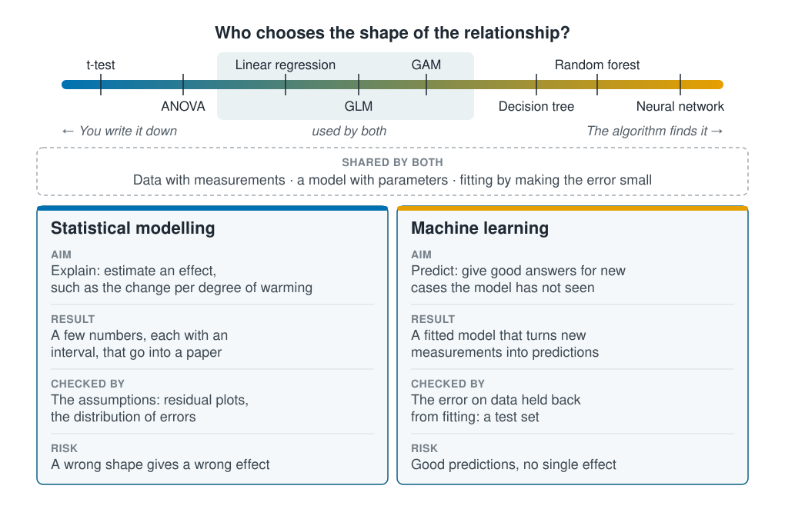

```{r}
#| label: setup
#| include: false
library(tidymodels)
source(here::here("R/theme.R"))
source(here::here("R/data.R"))
set.seed(123)
```

## One toolbox, two aims

Statistical modelling and machine learning are not two separate subjects. Both start
from a table of measurements, both fit a model with parameters, and both fit it by
making some measure of error as small as possible. Linear regression belongs to both.

The difference is mostly one of aim. A statistical model is usually fitted to
**estimate an effect**, such as the change in growth per degree of warming, and to
report it with an interval. A machine-learning model is usually fitted to **predict**
well for new cases it has not seen. That aim changes who chooses the shape of the
relationship and how the model is checked.

::: {.diagram}
{fig-alt="At the top, a scale coloured from blue to orange runs from 'you write it down' to 'the algorithm finds it', with methods marked along it: t-test, ANOVA, linear regression, GLM, GAM, decision tree, random forest and neural network. A shaded patch over linear regression, GLM and GAM reads 'used by both'. Below it, a dashed band lists what the two share: data with measurements, a model with parameters, and fitting by making the error small. At the bottom, two boxes. Statistical modelling: the aim is to explain by estimating an effect, the result is a few numbers with intervals, it is checked by its assumptions, and the risk is that a wrong shape gives a wrong effect. Machine learning: the aim is to predict new cases the model has not seen, the result is a fitted model that turns new measurements into predictions, it is checked by the error on held-back data, and the risk is good predictions with no single effect."}
:::

## Both approaches on the same stations

[The previous page](types-of-learning.qmd) ended with a puzzle: the linear regression
found a temperature slope close to zero, yet presence depended strongly on
temperature. Here the same question is answered both ways.



First, a quarter of the stations are held back as a **test set**. Neither model sees
them during fitting, so they show how each model does on new stations.

```{r}
#| label: split
survey <- load_coastal_survey()

split <- initial_split(survey, prop = 0.75)
train <- training(split)
test  <- testing(split)
```

### Statistical approach: a straight line

The statistical approach writes down a straight line in each variable and reads the
slopes:

```{r}
#| label: fit-linear
linear <- linear_reg() |>
  fit(abundance ~ temperature_c + salinity_psu + depth_m, data = train)

tidy(linear, conf.int = TRUE) |>
  select(term, estimate, conf.low, conf.high, p.value)
```

The temperature slope is again close to zero, and its interval spans zero. Read as
usual, temperature has no detectable effect on abundance.

### Machine-learning approach: a decision tree

The machine-learning approach uses a **decision tree**. It splits the stations in two
at the threshold that best separates high counts from low ones, such as "temperature
below 6.4 °C", then splits each half again. Here it stops after three rounds of
splits and predicts the average count in each final group. Nobody writes down the
shape; the splits find it.
[Section 3](../03-supervised-learning/decision-trees.qmd) explains trees in
full.

```{r}
#| label: fit-tree
tree <- decision_tree(mode = "regression", tree_depth = 3) |>
  fit(abundance ~ temperature_c + salinity_psu + depth_m, data = train)
```

### A straight line misses a temperature optimum

@fig-shapes shows what each model predicts across the range of temperature, with
salinity and depth held at their typical values.

```{r}
#| label: fig-shapes
#| fig-cap: "Predicted abundance against temperature, with salinity and depth held at their medians. The straight line is nearly flat; the tree finds low counts in cold and warm water and the most animals in between."
#| fig-alt: "Scatter of abundance against temperature for the training stations, with counts highest between about 6 and 11 degrees. A nearly flat straight line runs through the points. A stepped line, the tree, sits low below 6.4 degrees, rises to its highest level between 6.4 and 11.1 degrees, and drops again above."
#| fig-width: 7
#| fig-height: 4.5
grid <- tibble(
  temperature_c = seq(min(survey$temperature_c), max(survey$temperature_c), by = 0.05),
  salinity_psu  = median(train$salinity_psu),
  depth_m       = median(train$depth_m)
)

curves <- bind_rows(
  mutate(grid, model = "Linear regression", .pred = predict(linear, grid)$.pred),
  mutate(grid, model = "Decision tree",     .pred = predict(tree, grid)$.pred)
)

ggplot(train, aes(temperature_c, abundance)) +
  geom_point(alpha = 0.25, colour = ml_palette[["grey"]]) +
  geom_line(data = curves, aes(y = .pred, colour = model), linewidth = 1.2) +
  scale_colour_manual(values = c("Linear regression" = ml_palette[["blue"]],
                                 "Decision tree"     = ml_palette[["orange"]])) +
  coord_cartesian(ylim = c(0, 15)) +
  labs(x = "Temperature (°C)", y = "Abundance (animals per station)", colour = NULL)
```

The species does best in middling water and thins out in colder and warmer water. A
straight line through a hump is flat, so the linear model reports no effect. The tree
was never asked for a slope, so the hump costs it nothing. On the test set it predicts
a little better:

```{r}
#| label: test-error
bind_rows(
  augment(linear, test) |> rmse(abundance, .pred) |> mutate(model = "Linear regression"),
  augment(tree, test)   |> rmse(abundance, .pred) |> mutate(model = "Decision tree")
) |>
  select(model, test_rmse = .estimate)
```

### The test error is a typical miss

`test_rmse` is the **root mean squared error**, or **RMSE**, on the test stations. The
course uses it throughout to score predictions of a quantity, so it is worth building
once by hand. Each test station has an observed count and a prediction, and the miss is
the difference between them. Here are the first five test stations and the tree:

```{r}
#| label: rmse-by-hand
misses <- augment(tree, test) |>
  transmute(observed = abundance, predicted = .pred,
            miss = observed - predicted, squared = miss^2)
head(misses, 5) |> mutate(across(predicted:squared, \(x) round(x, 2)))
```

The RMSE takes three steps over all `r nrow(misses)` test stations:

1. **Square** each miss. A miss of −3 and a miss of +3 both become 9, so misses in
   opposite directions cannot cancel out. A large miss counts for much more than a
   small one: the first station, `r round(misses$miss[1], 1)` animals out, adds
   `r round(misses$squared[1])`.
2. Take the **mean** of the squares: `r round(mean(misses$squared), 2)` here.
3. Take the **square root**, which brings the answer back to animals:
   `r round(sqrt(mean(misses$squared)), 2)`, the tree's `test_rmse` above.

The result reads as a typical miss, in animals per station. The tree's predictions for
new stations are usually off by about `r round(sqrt(mean(misses$squared)))` animals, in
either direction. Lower is better, and 0 would mean every prediction was exact.

A typical miss means little on its own; it needs something to compare with. The
simplest prediction of all ignores the water and predicts the training stations'
average count everywhere:

```{r}
#| label: rmse-baseline
baseline <- mean(train$abundance)
rmse_vec(test$abundance, rep(baseline, nrow(test))) |> round(2)
```

Both models beat that, if not by much, so temperature, salinity and depth carry some
information about the species. A model that cannot beat the average has learned
nothing useful.

::: {.callout-note collapse="true"}
## The maths, if you want it

With $y_i$ the observed count at test station $i$, $\hat{y}_i$ the prediction and $n$
test stations,

$$\text{RMSE} = \sqrt{\frac{1}{n}\sum_{i=1}^{n} (y_i - \hat{y}_i)^2}$$

Squaring weighs a miss of 10 a hundred times a miss of 1, so the RMSE listens hardest
to the largest misses. [How algorithms learn](../04-how-algorithms-learn/loss-functions.qmd)
shows what that does to a fit, and
[Regression performance measures](../07-validation/regression-metrics.qmd) compares the
RMSE with other measures.
:::

Neither model is simply better. The tree found the shape but gives no single number for "the
effect of temperature". The linear model gives that number, but the number is wrong
because the shape was wrong. A statistician would bend the line instead, which
[the next page](prediction-and-explanation.qmd) does.

## Key points

::: {.key-points}
- Statistical modelling and machine learning share their data, their models and their
  fitting. Linear regression belongs to both.
- They differ in aim: a statistical model estimates an effect, a machine-learning
  model predicts new cases.
- In a statistical model you choose the shape of the relationship; in most
  machine-learning methods the algorithm finds it.
- A flat, non-significant slope can mean "no relationship" or "a relationship the
  model cannot draw". The output looks the same.
- Machine-learning models are checked on a test set: stations held back from fitting.
- The RMSE (root mean squared error) is a typical miss in the outcome's own units:
  square the misses, average them, take the square root. Compare it with the RMSE of
  predicting the average.
:::

## Try it yourself

Add a squared temperature term to the linear model
(`abundance ~ temperature_c + I(temperature_c^2) + salinity_psu + depth_m`). Is the
temperature effect detectable now, and how does the test error compare with the tree's?
