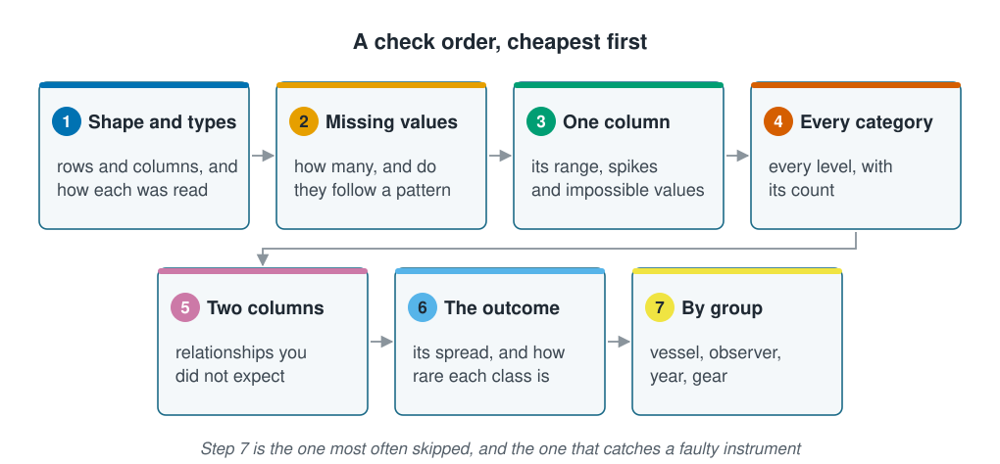
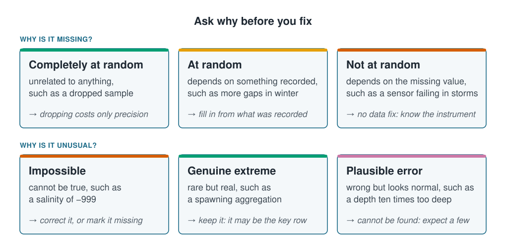

```{r}
#| label: setup
#| include: false
library(tidyverse)
library(patchwork)
source(here::here("R/theme.R"))
source(here::here("R/data.R"))
source(here::here("R/python-tabs.R"))
```



## A model will not tell you the data are wrong

A model fits whatever it is given. It will not say that a salinity column holds `-999`:
it reports a plausible score and builds on a mean salinity no ocean has. So before any
model comes **exploratory data analysis**, a first look at the data whose aim is not
to find results but to find what is wrong. This page runs that look on the raw survey
file (see [The coastal survey](the-coastal-survey.qmd)), then fixes what it finds.





## Check in a fixed order

A fixed order makes it harder to skip a check. This one runs roughly cheapest first:

::: {.diagram}
{fig-alt="Seven numbered cards joined by arrows. 1 Shape and types: rows and columns, and how each was read. 2 Missing values: how many, and do they follow a pattern. 3 One column: its range, spikes and impossible values. 4 Every category: every level, with its count. 5 Two columns: relationships you did not expect. 6 The outcome: its spread, and how rare each class is. 7 By group: vessel, observer, year, gear. A note says step 7 is the one most often skipped, and the one that catches a faulty instrument."}
:::

```{r}
#| label: facts
#| include: false
raw <- load_coastal_survey_raw()
n_sal_999  <- sum(raw$salinity_psu == -999)
n_temp_999 <- sum(raw$temperature_c == -999)
chl_missing <- raw |>
  group_by(season) |>
  summarise(missing = 100 * mean(is.na(chlorophyll_mg_m3)))
winter_missing <- round(chl_missing$missing[chl_missing$season == "winter"])
vessel_salinity <- raw |>
  filter(salinity_psu != -999) |>
  group_by(vessel) |>
  summarise(mean_salinity = round(mean(salinity_psu), 2))
vessel_gap <- round(diff(range(vessel_salinity$mean_salinity)), 2)
rare_pct <- round(100 * mean(raw$rare_species == "yes"))
deep <- raw |> filter(depth_m > 250)
shelf_max <- max(raw$depth_m[raw$depth_m <= 250])
```

## The ranges show impossible values

The quickest useful check of all: the smallest, average and largest value of every
numeric column, read as a scientist would.

::: {.panel-tabset group="language"}

## R

```{r}
#| label: ranges
raw <- load_coastal_survey_raw()

raw |>
  summarise(across(where(is.numeric),
                   list(min = \(x) min(x, na.rm = TRUE),
                        mean = \(x) mean(x, na.rm = TRUE),
                        max = \(x) max(x, na.rm = TRUE)))) |>
  pivot_longer(everything(), names_to = c("variable", "stat"), names_sep = "_(?=[^_]+$)") |>
  pivot_wider(names_from = stat, values_from = value) |>
  mutate(across(where(is.numeric), \(x) round(x, 2)))
```

## Python

```{python}
import pandas as pd

from mlbasic_data import load_coastal_survey_raw

raw = load_coastal_survey_raw()

(raw.select_dtypes("number")
    .agg(["min", "mean", "max"])   # pandas skips missing values by default
    .T
    .round(2)
    .reset_index(names="variable"))
```

:::

Three things should stop you:

- **Salinity has a minimum of −999 and a mean of `r round(mean(raw$salinity_psu), 2)`.**
  No ocean is that fresh. Some instrument or export wrote `-999` to mean "missing", a
  **sentinel value**, and because it is a number nothing complained. Temperature has
  it too.
- **Depth reaches `r max(raw$depth_m)` m**, where every other station is shallower
  than `r ceiling(shelf_max)` m.
- **Chlorophyll** has `r sum(is.na(raw$chlorophyll_mg_m3))` values recorded as `NA`,
  R's code for a **missing value** and the honest way to record one.

A histogram makes the sentinel impossible to miss, and a count by season shows that
the missing chlorophyll has a pattern:

```{r}
#| label: fig-damage
#| fig-cap: "Left: every salinity value. The real ocean is the narrow cluster near 34; the bar at −999 is missing values disguised as a number. Right: chlorophyll is missing far more often in winter, a pattern that can bias results."
#| fig-alt: "Two panels. The left panel is a histogram of salinity with a bar at minus 999 and a narrow cluster of real values near 34, separated by a wide empty gap. The right panel is a bar chart of the percentage of missing chlorophyll by season: about 1 percent in autumn, 2 in spring, 4 in summer and 19 in winter."
#| fig-width: 8.5
#| fig-height: 4
p_sentinel <- ggplot(raw, aes(salinity_psu)) +
  geom_histogram(bins = 60, fill = ml_palette[["blue"]]) +
  annotate("text", x = -999, y = 30,
           label = paste0("−999\n(", sum(raw$salinity_psu == -999), " rows)"),
           hjust = -0.15, colour = ml_palette[["vermilion"]], size = 3.5) +
  labs(x = "Salinity (PSU)", y = "Stations",
       title = "A number that is not a measurement")

p_missing <- raw |>
  group_by(season) |>
  summarise(missing = 100 * mean(is.na(chlorophyll_mg_m3))) |>
  mutate(season = fct_reorder(season, missing)) |>
  ggplot(aes(missing, season)) +
  geom_col(fill = ml_palette[["orange"]], width = 0.62) +
  geom_text(aes(label = paste0(round(missing), "%")), hjust = -0.2, size = 3.6) +
  scale_x_continuous(expand = expansion(mult = c(0, 0.18))) +
  labs(x = "Chlorophyll missing (%)", y = NULL,
       title = "Missing, but not at random")

p_sentinel + p_missing
```

## Counts find misspellings, and vessel comparisons find a faulty instrument

Count every level of every category, not a sample of them, and compare the groups the
data were collected in, here the two vessels, with the sentinel values left out:

::: {.panel-tabset group="language"}

## R

```{r}
#| label: categories
raw |> count(substrate, sort = TRUE)
```

```{r}
#| label: by-vessel
raw |>
  filter(salinity_psu != -999) |>
  group_by(vessel) |>
  summarise(stations = n(),
            mean_salinity = round(mean(salinity_psu), 2),
            mean_temperature = round(mean(temperature_c[temperature_c != -999]), 2))
```

## Python

```{python}
raw["substrate"].value_counts().reset_index()
```

```{python}
valid = raw.assign(
    temperature_c=raw["temperature_c"].where(raw["temperature_c"] != -999)
).query("salinity_psu != -999")

(valid.groupby("vessel")
    .agg(stations=("salinity_psu", "size"),
         mean_salinity=("salinity_psu", "mean"),
         mean_temperature=("temperature_c", "mean"))
    .round(2)
    .reset_index())
```

:::

Four kinds of seabed come in `r n_distinct(raw$substrate)` spellings. A model treats
`Sand`, `SAND`, `sand` and `sandy` as four unrelated categories, and splits the
evidence for sand four ways.

The two vessels differ by `r vessel_gap` PSU in mean salinity, with no matching
difference in temperature. Two ships sampling the same shelf should not disagree like
that: one instrument is off, and every plot that pooled the two vessels hid it.

The checks found six problems, and each forces a decision from someone who knows how
the data were collected:

| Finding | The decision it forces |
| --- | --- |
| `-999` in salinity (`r n_sal_999` rows) and temperature (`r n_temp_999`) | Convert to missing, then decide how to handle missing values |
| Depths up to `r max(raw$depth_m)` m | Error or real? Correct, drop or flag |
| `r n_distinct(raw$substrate)` spellings of four substrates | Standardise, without merging a real distinction |
| Chlorophyll missing in `r winter_missing`% of winter stations | Dropping those rows would delete a large part of winter |
| A rare species at `r rare_pct`% of stations | Always answering "absent" already scores `r 100 - rare_pct`%; see [Class imbalance](../06-assumptions-limitations/class-imbalance.qmd) |
| One vessel reads `r vessel_gap` PSU high | Correct it, give the model `vessel` as an input, or leave salinity out |

## The reason a value is missing decides the fix

Every quick fix has a default that sometimes does damage. Dropping incomplete rows can
quietly delete much of a season; filling gaps with the average invents data nobody
measured; removing **outliers**, values far from the rest, erases real extreme events.
The fix depends on why a value is missing or strange:

::: {.diagram}
{fig-alt="Two rows of three cards. Why is it missing: completely at random, unrelated to anything, such as a dropped sample, where dropping costs only precision; at random, depending on something recorded, such as more gaps in winter, where you fill in from what was recorded; not at random, depending on the missing value itself, such as a sensor failing in storms, where no data fix exists and you must know the instrument. Why is it unusual: impossible, such as a salinity of minus 999, to correct or mark missing; a genuine extreme, such as a spawning aggregation, to keep; a plausible error, such as a depth ten times too deep that still looks normal, which cannot be found."}
:::

The three kinds of missing value have statisticians' names. **Missing completely at
random** means the gaps follow nothing at all, like a dropped sample bottle. **Missing
at random** means the gaps follow something you did record: the survey's chlorophyll
is missing most often in winter, and the season is in the table, so the recorded
columns can fill those gaps well. **Missing not at random** means the gaps depend on
the missing value itself. If cloud blocked the chlorophyll sensor, and cloud also
lowers chlorophyll, then nothing in the data can repair the gaps.

Far from the average is not the same as wrong. A rule such as "more than three
standard deviations from the mean" finds rare values, and in marine counts the rare
values are often the real and important ones. Remove a value only when you can say
what is wrong with it.

## Four fixes, each with a judgement

One pipeline makes the fixes for the problems that have a clear answer. It removes
the duplicated rows ([The coastal survey](the-coastal-survey.qmd#repeat-visits-to-the-same-sites-are-not-independent)),
turns `-999` into a missing value, merges the spellings, and corrects the deep
stations:

::: {.panel-tabset group="language"}

## R

```{r}
#| label: clean
clean <- raw |>
  distinct() |>
  mutate(
    salinity_psu  = na_if(salinity_psu, -999),
    temperature_c = na_if(temperature_c, -999),
    substrate     = str_to_lower(str_trim(substrate)),
    substrate     = fct_collapse(substrate,
                                 sand   = c("sand", "sandy"),
                                 mud    = c("mud", "muddy"),
                                 gravel = "gravel",
                                 rock   = c("rock", "rocky")),
    depth_m       = if_else(depth_m > 250, depth_m / 10, depth_m)
  )

clean |>
  summarise(rows = n(),
            salinity_missing = sum(is.na(salinity_psu)),
            salinity_mean = round(mean(salinity_psu, na.rm = TRUE), 2),
            substrates = n_distinct(substrate),
            deepest = max(depth_m))
```

## Python

```{python}
import numpy as np

clean = raw.drop_duplicates().copy()
clean["salinity_psu"] = clean["salinity_psu"].replace(-999, np.nan)
clean["temperature_c"] = clean["temperature_c"].replace(-999, np.nan)
clean["substrate"] = (clean["substrate"].str.strip().str.lower()
    .replace({"sandy": "sand", "muddy": "mud", "rocky": "rock"}))
clean["depth_m"] = clean["depth_m"].where(clean["depth_m"] <= 250,
                                          clean["depth_m"] / 10)

pd.DataFrame({
    "rows": [len(clean)],
    "salinity_missing": [clean["salinity_psu"].isna().sum()],
    "salinity_mean": [round(clean["salinity_psu"].mean(), 2)],   # skips NaN
    "substrates": [clean["substrate"].nunique()],
    "deepest": [clean["depth_m"].max()],
})
```

:::

Each line holds a judgement worth writing down:

- **The sentinels.** Salinity's mean moves from
  `r round(mean(raw$salinity_psu), 2)` to
  `r round(mean(clean$salinity_psu, na.rm = TRUE), 1)`. The values are still
  missing, but now honestly so.
- **The spellings.** Is `sandy` the same as `sand`, or was one observer recording
  "sandy mud"? Here they are merged; on a real survey, ask whoever recorded them.
- **The depths.** All `r nrow(deep)` deep stations lie between `r min(deep$depth_m)`
  and `r max(deep$depth_m)` m, about ten times a shelf depth, and their temperatures,
  `r min(deep$temperature_c)` to `r max(deep$temperature_c)` °C, are ordinary shelf
  temperatures. Dividing by ten has evidence behind it. A correction that makes the
  data fit expectations is also how confirmation bias works, so state the rule, apply
  it to every row, and report how many rows it changed.
- **The vessel offset** is neither missing nor an outlier: it shifts every reading one
  vessel took. Correct it against a calibration record if one exists, or give the
  model `vessel` as an input so it can learn the offset.

## Dropping incomplete rows deletes winter

The missing values remain. Most modelling functions silently drop any row with one,
and here is what that costs:

```{r}
#| label: fig-deletion
#| fig-cap: "Stations per season before and after dropping every row with a missing value. Winter loses far more than the other seasons, so the data become less wintry than the survey that produced them."
#| fig-alt: "Grouped bar chart of stations per season, with all rows and with complete cases only. Autumn, spring and summer barely change, while winter drops visibly."
#| fig-width: 7.5
#| fig-height: 4
comparison <- bind_rows(
  clean |> count(season) |> mutate(dataset = "All rows"),
  clean |> drop_na() |> count(season) |> mutate(dataset = "Complete rows only")
)

ggplot(comparison, aes(season, n, fill = dataset)) +
  geom_col(position = position_dodge(width = 0.75), width = 0.68) +
  geom_text(aes(label = n), position = position_dodge(width = 0.75),
            vjust = -0.4, size = 3.4) +
  scale_y_continuous(expand = expansion(mult = c(0, 0.12))) +
  labs(x = NULL, y = "Stations", fill = NULL,
       title = "Where the dropped rows come from")
```

```{r}
#| label: deletion-numbers
#| include: false
complete <- drop_na(clean)
lost_pct <- round(100 * (1 - nrow(complete) / nrow(clean)))
winter_lost_pct <- round(100 * (1 - sum(complete$season == "winter") /
                                    sum(clean$season == "winter")))
```

Dropping incomplete rows loses `r lost_pct`% of the stations overall, but
`r winter_lost_pct`% of winter. A question about winter conditions has just lost a
large part of its evidence, without a warning.

The alternative is **imputation**: predicting each missing value from the columns that
were recorded. The `recipes` package has steps for it, such as `step_impute_median()`
and `step_impute_knn()`, which fills a gap from the most similar stations, as
[k-nearest neighbours](../03-supervised-learning/nearest-neighbours.qmd) does. Two rules apply:

- **Impute as part of the model, not beforehand.** Filling gaps with the average of the
  whole dataset lets the data that will test the model shape the data that trains it;
  [Avoiding information leakage](information-leakage.qmd) explains why that matters,
  and [Scaling and encoding](scaling-and-encoding.qmd) puts the steps into a recipe.
- **An imputed value is a guess, not a measurement.** A column recording which values
  were filled in lets the model, and you, see where the gaps were.

Imputation cannot create information that was never collected: winter chlorophyll
stays less certain than summer's whatever method is used. Some errors also survive any
amount of looking: a depth recorded ten times too deep is obvious at 1,500 m but not
at 150 m. And every choice on this page changes the results, so each belongs in the
methods section of a paper.

This whole look used every row, including those that will later test a model. That is
unavoidable, since data cannot be cleaned unseen, and harmless as long as it stays
about data quality. Choices about the outcome and the model belong to the training
data alone.

## Key points

::: {.key-points}
- A first look is a search for problems, in a fixed order. Its output is a list of
  decisions.
- Ranges show sentinel values and impossible depths, counts show spelling variants,
  and comparing groups such as vessels shows a faulty instrument.
- Ask why a value is missing or strange before fixing it: gaps that follow a recorded
  column can be filled in, and genuine extremes are kept.
- Dropping incomplete rows is a silent default, and here it removes far more of
  winter than of any other season.
- Impute as part of the model, and record every correction and how many rows it
  changed.
:::

## Try it yourself

1. Take the depths above 250 m and divide them by ten. Do the corrected values fit the
   relationship between depth and temperature in the rest of the survey? That kind of
   evidence turns a guess about an error into a defensible correction.
2. If cloud causes the missing chlorophyll, and cloud also lowers chlorophyll, which
   kind of missing value is it? Could any imputation method fix it?
