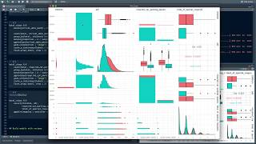

## Overview

A model learns only from the table it is given, errors included, and nothing in its
output says when the table was wrong. This section introduces the simulated coastal
survey the course works on and takes its raw file to a table ready for a model: the
kinds of variable it holds, the checks that find its problems, the scaling and encoding
many methods need, and the split that keeps stations back for testing. It ends on
information leakage, where the test set reaches the model before the model is tested and
makes it look better than it is. The pages build on each other, so read them in order.

## A short tour



## Lecture notes

- [Summary slides](../../slides/02-marine-data.qmd) cover each page of the section in
  two or three slides, with speaker notes, for teaching the section or a quick review.

## Pages in this section

::: {#pages}
:::

## Further resources

**Documentation**

- [Preprocess your data with recipes](https://www.tidymodels.org/start/recipes/), tidymodels. A recipe built one step at a time.
- [recipes reference](https://recipes.tidymodels.org/), tidymodels. Every `step_*()` there is, which is the fastest way to find out whether the transformation you want already exists.
- [Preprocessing data](https://scikit-learn.org/stable/modules/preprocessing.html) and [imputation](https://scikit-learn.org/stable/modules/impute.html), scikit-learn user guide.
- [Common pitfalls and recommended practices](https://scikit-learn.org/stable/common_pitfalls.html), scikit-learn. The leakage section is the best short statement of the problem this section ends on.

**Video**

::: {.video-list}
- [{.video-thumb fig-alt="Modeling hotel bookings in R using tidymodels and recipes, on YouTube" loading="lazy"}](https://www.youtube.com/watch?v=dbXDkEEuvCU)

  [Modeling hotel bookings in R using tidymodels and recipes](https://www.youtube.com/watch?v=dbXDkEEuvCU), Julia Silge. A recipe assembled from scratch with the reasoning spoken aloud, which is hard to get from documentation.
:::
