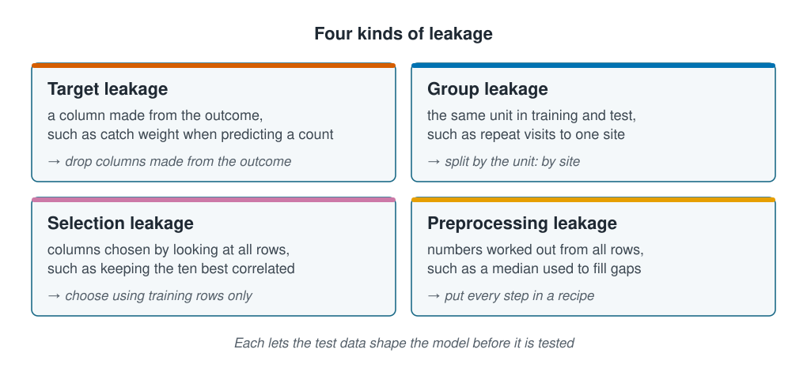

```{r}
#| label: setup
#| include: false
library(tidymodels)
library(tidyverse)
source(here::here("R/theme.R"))
source(here::here("R/data.R"))
source(here::here("R/python-tabs.R"))
set.seed(123)
```

## A failure that leaves no trace

**Leakage** is information from the test data reaching the model before it is tested.
It makes every score look better than it is, and it leaves no trace: a leaky model's
output looks just like an honest one's, only better. The usual cause is not cheating
but one line of code in the wrong place. This page shows the four kinds, each on the
survey, so you can recognise them in your own code.





## Four kinds of leakage

::: {.diagram}
{fig-alt="Four cards. Target leakage: a column made from the outcome, such as catch weight when predicting a count; drop columns made from the outcome. Group leakage: the same unit in training and test, such as repeat visits to one site; split by the unit, by site. Selection leakage: columns chosen by looking at all rows, such as keeping the ten best correlated; choose using training rows only. Preprocessing leakage: numbers worked out from all rows, such as a median used to fill gaps; put every step in a recipe. A note says each lets the test data shape the model before it is tested."}
:::

The rule behind all four: the test data must be untouched by every decision, not just
by the fitting.

## A model to test

Each demonstration fits a linear regression of `abundance` and scores it on test data
with two measures. The **RMSE** is roughly how far a prediction usually lands from the
true count. **$R^2$** is the share of the variation in the test counts that the
predictions follow, from 0 (none) to 1 (all of it).

::: {.panel-tabset group="language"}

## R

```{r}
#| label: prepare
survey <- load_coastal_survey_clean()

split <- initial_split(survey, prop = 0.75)
train <- training(split)
test  <- testing(split)

fit_and_test <- function(formula, train_data, test_data) {
  workflow() |>
    add_recipe(
      recipe(formula, data = train_data) |>
        step_impute_median(all_numeric_predictors()) |>
        step_dummy(all_nominal_predictors())
    ) |>
    add_model(linear_reg()) |>
    fit(train_data) |>
    augment(test_data) |>
    metrics(truth = abundance, estimate = .pred) |>
    filter(.metric %in% c("rmse", "rsq")) |>
    select(.metric, .estimate) |>
    pivot_wider(names_from = .metric, values_from = .estimate) |>
    mutate(across(everything(), \(x) round(x, 2)))
}

honest <- abundance ~ depth_m + temperature_c + salinity_psu +
  chlorophyll_mg_m3 + substrate + season
```

## Python

```{python}
import numpy as np
import pandas as pd
from sklearn.compose import ColumnTransformer
from sklearn.impute import SimpleImputer
from sklearn.linear_model import LinearRegression
from sklearn.metrics import root_mean_squared_error
from sklearn.model_selection import GroupShuffleSplit, train_test_split
from sklearn.pipeline import Pipeline
from sklearn.preprocessing import OneHotEncoder

from mlbasic_data import load_coastal_survey_clean

survey = load_coastal_survey_clean()

honest = ["depth_m", "temperature_c", "salinity_psu",
          "chlorophyll_mg_m3", "substrate", "season"]

train, test = train_test_split(survey, train_size=0.75, random_state=123)

def fit_and_test(predictors, train_data, test_data):
    categorical = [c for c in predictors if c in ("substrate", "season")]
    numeric = [c for c in predictors if c not in categorical]
    model = Pipeline([
        ("recipe", ColumnTransformer([
            ("numeric", SimpleImputer(strategy="median"), numeric),
            ("categorical", OneHotEncoder(drop="first", sparse_output=False),
             categorical),
        ])),
        ("model", LinearRegression()),
    ]).fit(train_data[predictors], train_data["abundance"])

    predicted = model.predict(test_data[predictors])
    truth = test_data["abundance"]
    return {
        "rmse": round(root_mean_squared_error(truth, predicted), 2),
        # yardstick's rsq is the squared correlation, not 1 - SSE/SST.
        "rsq": round(np.corrcoef(predicted, truth)[0, 1] ** 2, 2),
    }
```

:::

## Target leakage: the answer in disguise

The survey recorded `catch_weight_kg` alongside the count. Adding it to the model takes
one word:

::: {.panel-tabset group="language"}

## R

```{r}
#| label: target-leakage
target <- bind_rows(
  `Environment only`  = fit_and_test(honest, train, test),
  `Plus catch weight` = fit_and_test(update(honest, ~ . + catch_weight_kg), train, test),
  .id = "model"
)

target
```

## Python

```{python}
pd.DataFrame([
    {"model": "Environment only", **fit_and_test(honest, train, test)},
    {"model": "Plus catch weight",
     **fit_and_test(honest + ["catch_weight_kg"], train, test)},
])
```

:::

$R^2$ jumps from `r target$rsq[1]` to `r target$rsq[2]`, but the model has learnt
nothing about habitat. Catch weight is the weight of the animals that were counted, so it
is the count again, in other units (correlation
`r round(cor(survey$abundance, survey$catch_weight_kg), 2)`). For every test station,
the model is handed the answer it should predict: the `r target$rsq[2]` measures
copying, not predicting.

Real target leaks are rarely this obvious: a total from the same haul, a note written
after the catch was sorted. Each is made from the outcome, so each carries part of the
answer. The test is one question: **is this column worked out from the thing I am
predicting?**

## Group leakage: the same site twice

A random split puts visits to the same site in both training and test (see
[Splitting the data](splitting-data.qmd)). Keeping each site whole:

::: {.panel-tabset group="language"}

## R

```{r}
#| label: group-leakage
grouped <- group_initial_split(survey, group = site_id, prop = 0.75)

group <- bind_rows(
  Random            = fit_and_test(honest, train, test),
  `Grouped by site` = fit_and_test(honest, training(grouped), testing(grouped)),
  .id = "split"
)

group
```

## Python

```{python}
grouper = GroupShuffleSplit(n_splits=1, train_size=0.75, random_state=123)
group_train, group_test = next(grouper.split(survey, groups=survey["site_id"]))

pd.DataFrame([
    {"split": "Random", **fit_and_test(honest, train, test)},
    {"split": "Grouped by site",
     **fit_and_test(honest, survey.iloc[group_train], survey.iloc[group_test])},
])
```

:::

The obvious reading is wrong. The RMSE *falls*, from `r group$rmse[1]` to
`r group$rmse[2]`, but that is not the model improving: the two rows are scored on
**different test sets**, and the grouped one happens to hold stations with less
variable counts. RMSEs from different test sets cannot be compared.

$R^2$ can be, roughly, because each is measured against its own test set's variation.
It falls from `r group$rsq[1]` to `r group$rsq[2]`: predicting a site the model has
never seen is much harder than predicting another visit to a familiar one. That gap is
the size of the group leak.

## Selection leakage: skill from noise

Give the procedure nothing but noise: 200 columns of random numbers with no link to
abundance at all. Then pick the ten columns most correlated with abundance, once using
all the rows and once using only the training rows:

::: {.panel-tabset group="language"}

## R

```{r}
#| label: selection-leakage
set.seed(7)

noise <- as_tibble(matrix(rnorm(nrow(survey) * 200), nrow(survey), 200,
                          dimnames = list(NULL, paste0("v", 1:200))))
fake <- bind_cols(tibble(abundance = survey$abundance), noise)

rows   <- sample(nrow(fake), 0.75 * nrow(fake))
ftrain <- fake[rows, ]
ftest  <- fake[-rows, ]

best_ten <- function(data) {
  correlations <- sapply(select(data, -abundance),
                         \(x) abs(cor(x, data$abundance)))
  names(sort(correlations, decreasing = TRUE))[1:10]
}

evaluate <- function(variables) {
  model <- lm(reformulate(variables, "abundance"), data = ftrain)
  round(cor(predict(model, ftest), ftest$abundance)^2, 3)
}

selection <- tibble(
  chosen_using = c("All rows", "Training rows only"),
  test_rsq     = c(evaluate(best_ten(fake)), evaluate(best_ten(ftrain)))
)

selection
```

## Python

```{python}
rng = np.random.default_rng(7)

noise = pd.DataFrame(
    rng.standard_normal((len(survey), 200)),
    columns=[f"v{i}" for i in range(1, 201)],
)
fake = noise.assign(abundance=survey["abundance"].to_numpy())

fake_train, fake_test = train_test_split(fake, train_size=0.75, random_state=7)

def best_ten(data):
    correlations = data.drop(columns="abundance").corrwith(data["abundance"]).abs()
    return list(correlations.sort_values(ascending=False).index[:10])

def evaluate(variables):
    model = LinearRegression().fit(fake_train[variables], fake_train["abundance"])
    predicted = model.predict(fake_test[variables])
    return round(np.corrcoef(predicted, fake_test["abundance"])[0, 1] ** 2, 3)

pd.DataFrame({
    "chosen_using": ["All rows", "Training rows only"],
    "test_rsq": [evaluate(best_ten(fake)), evaluate(best_ten(fake_train))],
})
```

:::

The true $R^2$ is zero, and choosing on the training rows reports close to that
(`r sprintf("%.3f", selection$test_rsq[2])`). Choosing on all the rows reports
`r sprintf("%.3f", selection$test_rsq[1])` from pure noise: small, but skill that does
not exist. The effect grows with the number of
candidate columns and shrinks with the number of rows, so a dataset with thousands of
columns and a hundred samples can manufacture far more.

## Preprocessing leakage: numbers from every row

Filling gaps with a median computed from every row lets the test rows shape the
training data. The fix is the recipe from [Scaling and encoding](scaling-and-encoding.qmd):

```r
# Leaks: the median comes from every row, test rows included.
survey$chlorophyll_mg_m3[is.na(survey$chlorophyll_mg_m3)] <-
  median(survey$chlorophyll_mg_m3, na.rm = TRUE)
split <- initial_split(survey)

# Safe: the median is estimated from the training rows, then applied to the test rows.
split <- initial_split(survey)
recipe(honest, data = training(split)) |>
  step_impute_median(all_numeric_predictors())
```

With 800 rows and a median the harm is small. The same mistake with target encoding, or
on a dataset of forty casts, is not; and the safe version costs nothing.

## The question to ask of every line

One question catches all four kinds:

> **Does this line use any information from rows I intend to test on?**

If it does, it belongs after the split, or inside the recipe. Some leakage cannot be
removed, only reported: the whole dataset was explored in order to clean it, and that
shaped the choices that followed. And keeping sites whole does not stop two *nearby*
sites sharing their water;
[Spatial and temporal dependence](../06-assumptions-limitations/spatial-and-temporal-dependence.qmd)
holds out whole areas for that.

## Key points

::: {.key-points}
- Leakage is information from the test data reaching the model; it inflates every score
  and leaves no trace.
- Target leakage: drop any column made from the outcome. Catch weight, the count in
  other units, took $R^2$ from `r target$rsq[1]` to `r target$rsq[2]`.
- Group leakage: keep a site's rows together. Here $R^2$ fell from `r group$rsq[1]` to
  `r group$rsq[2]` once sites were kept whole.
- RMSEs from different test sets cannot be compared; a relative measure such as $R^2$
  roughly can.
- Selection leakage made skill out of pure noise; preprocessing leakage is avoided by
  putting every step in a recipe.
:::

## Try it yourself

1. Re-run the noise experiment with 1,000 columns instead of 200, and again with 100
   rows instead of 800. How large can the manufactured $R^2$ get?
2. List every column in your own data with where each value came from and when it
   became known. Any column that depends on the outcome is a target leak.
