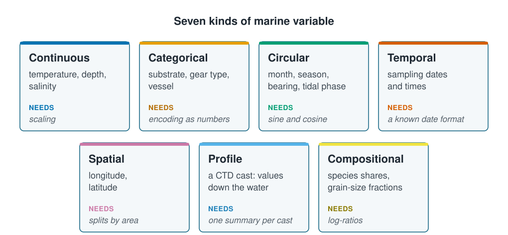

```{r}
#| label: setup
#| include: false
library(tidyverse)
library(patchwork)
source(here::here("R/theme.R"))
source(here::here("R/data.R"))
source(here::here("R/python-tabs.R"))
```



## A model sees only numbers

A model does not know that one column is a month and another a position on a map. It
sees numbers and does arithmetic on them, whatever they mean. Knowing what kind of
variable each column holds lets you hand it to a model in a form where that
arithmetic makes sense, and spot a column that would mislead it.





## Marine data holds seven kinds of variable

Most introductions stop at two kinds, numbers and categories. Marine data has more:

::: {.diagram}
{fig-alt="Seven cards. Continuous: temperature, depth, salinity; needs scaling. Categorical: substrate, gear type, vessel; needs encoding as numbers. Circular: month, season, bearing, tidal phase; needs sine and cosine. Temporal: sampling dates and times; needs a known date format. Spatial: longitude, latitude; needs splits by area. Profile: a CTD cast, values down the water; needs one summary per cast. Compositional: species shares, grain-size fractions; needs log-ratios."}
:::

A **continuous variable** is a measured quantity, where a difference of one unit means
the same everywhere on the scale: temperature, depth, salinity. A **categorical
variable** puts each row into one of a fixed set of groups: a seabed type, a vessel.
[Scaling and encoding](scaling-and-encoding.qmd) puts continuous columns on a common
scale, which methods that measure distance need, and turns categories into numbers.
The rest of this page covers the kinds that are easy to get wrong.

## A number is not always a quantity

A column stored as numbers is not necessarily a quantity. Seabed types are often
recorded as codes: 1 for sand, 2 for mud, 3 for gravel, 4 for rock. A model given that
column treats rock as four times sand and gravel as halfway between mud and rock, and
fits a trend through codes someone chose.

Categories come in two kinds. A **nominal** category has no order: sand, mud, gravel,
rock. An **ordinal** category has an order but no known spacing: a disturbance score
of low, medium or high. Coding it 1, 2, 3 claims that medium sits exactly halfway
between the other two, which is a guess.

## Cycles belong on a circle

A **circular variable** returns to where it started: month, day of the year, tidal
phase, current direction, time of day. December is month 12 and January month 1:
eleven apart on a number line, but neighbours in the ocean. The usual fix replaces the
column with two new ones, its sine and cosine, which place each value on a circle:

$$x_1 = \sin\!\left(\frac{2\pi t}{T}\right), \qquad x_2 = \cos\!\left(\frac{2\pi t}{T}\right)$$

where $t$ is the position in the cycle and $T$ its length: 12 for months, 365 for days
of the year, 360 for a bearing in degrees.

```{r}
#| label: fig-circular
#| fig-cap: "The same twelve months, encoded two ways. On a number line December and January sit at opposite ends; on a circle they are neighbours, as they are in the ocean."
#| fig-alt: "Two panels. The left panel places months 1 to 12 along a straight horizontal line, with a long arrow showing the distance of 11 between December and January. The right panel places the same months around a circle, with December and January adjacent."
#| fig-width: 8.5
#| fig-height: 4
months <- tibble(
  month = 1:12,
  name  = month.abb,
  x     = sin(2 * pi * month / 12),
  y     = cos(2 * pi * month / 12)
)

p_line <- ggplot(months, aes(month, 0)) +
  geom_hline(yintercept = 0, colour = "#d7dde2") +
  geom_point(size = 3, colour = ml_palette[["blue"]]) +
  geom_text(aes(label = name), vjust = -1.4, size = 3.2) +
  annotate("segment", x = 1, xend = 12, y = -0.35, yend = -0.35,
           colour = ml_palette[["vermilion"]], linewidth = 0.8,
           arrow = arrow(ends = "both", length = unit(0.15, "cm"))) +
  annotate("text", x = 6.5, y = -0.5, label = "The model thinks these are 11 apart",
           colour = ml_palette[["vermilion"]], size = 3.4) +
  coord_cartesian(ylim = c(-0.7, 0.5)) +
  scale_x_continuous(breaks = seq(2, 12, 2)) +
  labs(x = "Month number", y = NULL, title = "As a raw number") +
  theme(axis.text.y = element_blank(),
        panel.grid.major = element_blank(), panel.grid.minor = element_blank())

p_circle <- ggplot(months, aes(x, y)) +
  geom_path(data = tibble(x = sin(seq(0, 2 * pi, length.out = 200)),
                          y = cos(seq(0, 2 * pi, length.out = 200))),
            colour = "#d7dde2") +
  geom_point(size = 3, colour = ml_palette[["blue"]]) +
  geom_text(aes(label = name, x = x * 1.18, y = y * 1.18), size = 3.2) +
  annotate("text", x = 0, y = 0, label = "Dec and Jan\nare neighbours",
           colour = ml_palette[["vermilion"]], size = 3.4) +
  coord_fixed(xlim = c(-1.35, 1.35), ylim = c(-1.35, 1.35)) +
  labs(x = NULL, y = NULL, title = "As sine and cosine") +
  theme(axis.text = element_blank(),
        panel.grid.major = element_blank(), panel.grid.minor = element_blank())

p_line + p_circle
```

The encoding spends two columns on one variable and assumes the cycle is smooth. A
quantity that jumps at a boundary, such as a quota year that starts in April, does not
belong on a circle.

## Dates need a known format

Dates arrive as text, in whatever format the logging software wrote. The survey's two
vessels used two formats:

::: {.panel-tabset group="language"}

## R

```{r}
#| label: dates
raw <- load_coastal_survey_raw()

raw |>
  distinct(vessel, sample_date) |>
  slice_head(n = 2, by = vessel)
```

## Python

```{python}
import pandas as pd

from mlbasic_data import load_coastal_survey_raw

raw = load_coastal_survey_raw()

raw[["vessel", "sample_date"]].drop_duplicates().groupby("vessel").head(2)
```

:::

A date such as `05/10/2022` is 5 October in most of the world and 10 May in the United
States, and nothing in the text says which. Read the wrong way, it moves a station into
another season without any error. So find out which format each source used, and parse
each format explicitly:

::: {.panel-tabset group="language"}

## R

```{r}
#| label: parse-dates
dated <- raw |>
  mutate(
    sample_date = coalesce(ymd(sample_date, quiet = TRUE),
                           dmy(sample_date, quiet = TRUE)),
    day_of_year = yday(sample_date)
  )

sum(is.na(dated$sample_date))
```

## Python

```{python}
# One vessel logged ISO dates, the other day-first. Parse each format on its
# own and take whichever succeeded, rather than letting pandas guess per row.
iso = pd.to_datetime(raw["sample_date"], format="%Y-%m-%d", errors="coerce")
dayfirst = pd.to_datetime(raw["sample_date"], format="%d/%m/%Y", errors="coerce")

dated = raw.assign(sample_date=iso.fillna(dayfirst))
dated["day_of_year"] = dated["sample_date"].dt.dayofyear

int(dated["sample_date"].isna().sum())
```

:::

No date is left unparsed, and `day_of_year` is ready for the sine and cosine above.

## Time and position say which rows are alike

Time and position can be inputs, but they matter more for another reason: they say
which rows are close to each other, and so likely to be alike. Samples a day apart, or
a few kilometres apart, share information, as repeat visits to one site do
([The coastal survey](the-coastal-survey.qmd#repeat-visits-to-the-same-sites-are-not-independent)).
That limits how the data can be split to test a model, which
[Splitting the data](splitting-data.qmd) takes up.

As inputs, longitude and latitude often improve predictions while explaining nothing,
because they stand in for whatever the other columns missed, just as salinity stood in
for depth in [Prediction and explanation](../01-introduction/prediction-and-explanation.qmd).
Variables built from position, such as distance to the coast or the slope of the
seabed, are usually more useful than raw coordinates.

## Profiles and shares need reshaping

A **profile** is a series of measurements down the water at one place and time, such
as a CTD cast: a curve, not a single row. The usual start is one row per cast, with
summaries chosen for the biology: surface temperature, mixed layer depth, total
chlorophyll. Splitting a cast into one row per depth band instead multiplies rows that
are not independent, so a cast's rows must then stay together when the data are split.

**Compositional data** are shares of a whole, such as the proportion of each species
in a sample, and sum to one: if one share rises, others must fall. Methods that ignore
this can report links between shares that come from the arithmetic, not the ecology.
The usual remedy is a **log-ratio**, the log of each share divided by another share or
by their average, which removes the sum-to-one constraint.

## The survey holds five of the seven kinds

The raw survey file holds five of the seven kinds in its `r ncol(raw)` columns, plus
identifiers and outcomes:

| Kind or role | Columns | Stored as | Before a model uses it |
| --- | --- | --- | --- |
| Continuous | `depth_m`, `temperature_c`, `salinity_psu`, `chlorophyll_mg_m3` | numbers | A common scale, for methods that measure distance |
| Categorical | `vessel`, `substrate` | text | Dummy columns ([Scaling and encoding](scaling-and-encoding.qmd)) |
| Circular | `season` | text | Sine and cosine of `day_of_year`, or four categories |
| Temporal | `sample_date`, `survey_year` | text; whole numbers | Parse each date format explicitly |
| Spatial | `longitude`, `latitude` | numbers | Mostly for splitting by place |
| Identifiers | `station_id`, `site_id` | text | Never an input; `site_id` keeps a site's rows together |
| Outcomes | `abundance`, `present`, `rare_species`, `catch_weight_kg` | numbers; text | What a model predicts, never an input |

Two columns are easy to misread. `season` stored as text looks like four unrelated
categories and hides that spring comes between winter and summer. `catch_weight_kg`
is a number like any other, but it is weighed from the same catch that is counted, so
it is another measure of the outcome; [Avoiding information leakage](information-leakage.qmd)
shows what happens when a model is given it. Nothing in the file says either: knowing
what a column means is knowledge you bring.

## Key points

::: {.key-points}
- A model does arithmetic on whatever it is given; a column stored as numbers is not
  necessarily a quantity.
- Circular variables such as month, bearing and tidal phase need sine and cosine, or
  December ends up far from January.
- Ambiguous date formats silently move stations between seasons: find out the format
  and parse it explicitly.
- Time and position say which rows are alike, which limits how the data can be split.
- Profiles need summarising, usually one row per cast; compositional shares need
  log-ratios.
:::

## Try it yourself

1. Encode `day_of_year` as sine and cosine, and plot `abundance` against each. Does the
   seasonal pattern look clearer than against `season` as four categories?
2. List the columns in your own data and write next to each what it *means*, not how
   it is stored. How many are circular, compositional, or a name stored as a number?
