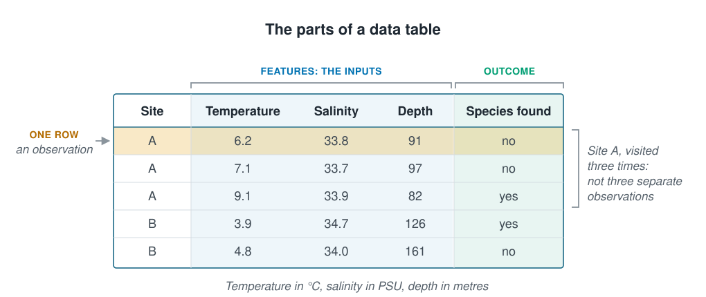

```{r}
#| label: setup
#| include: false
library(tidyverse)
source(here::here("R/theme.R"))
source(here::here("R/data.R"))
```

## Every method learns from a table

Every method in this course learns from a table of data. This page names the parts of
that table, so later pages can use the words freely, and shows why a table of several
hundred rows can hold far fewer independent observations. How many you really have
decides how far you can trust any score a model gets.





## Rows are observations and columns are features

A data table has one **observation** in each row: one thing that was measured, such as
one water sample. Each column records one property of it. The columns a model learns
from are its **features**, which this course also calls its **inputs**. The column it
learns to predict is the **outcome**. When the outcome is a category, such as present
or absent, each of its values is a **label**.

::: {.diagram}
{fig-alt="A table with five rows and the columns site, temperature, salinity, depth and species found. A bracket over temperature, salinity and depth labels them features, the inputs; a bracket over species found labels it the outcome. The first row is highlighted and labelled one row, an observation. A bracket beside the first three rows, all from site A, says site A was visited three times, so they are not three separate observations. A note gives the units: temperature in degrees Celsius, salinity in PSU, depth in metres."}
:::

Machine learning grew up in computer science and statistics separately, so each part
has several names. The literature uses all of them:

| In this course | Also called | What it is |
| --- | --- | --- |
| **Observation** | row, instance, example, sample, case | One thing that was measured |
| **Feature** or **input** | predictor, covariate, independent variable, attribute | Something known about it |
| **Outcome** | response, target, dependent variable, $y$ | What the model predicts |
| **Label** | class, annotation, ground truth | The outcome when it is a category |

Beware of "sample": in machine learning it means one observation, in field science the
whole collection.

## One observation is a scientific choice

The harder question is what one row should be. A survey that returns to the same
sites could have one row for each:

- **sample**, as the database stores it;
- **visit** to a site, averaging the samples taken that day;
- **site**, if the question is about the site's character and not the visit;
- **animal**, if the question is about individual growth.

The right choice follows from the scientific question, not from how the database
stores the data. It matters because a model treats every row as independent evidence.

## The survey returns to the same sites

The raw survey file (see [The coastal survey](the-coastal-survey.qmd)) has columns the
clean one leaves out. One of them is `site_id`: the survey returns to fixed sites, and
each visit to a site is one station.

::: {.panel-tabset group="language"}

## R

```{r}
#| label: load
raw <- load_coastal_survey_raw()

tibble(
  rows              = nrow(raw),
  `unique rows`     = nrow(distinct(raw)),
  `distinct sites`  = n_distinct(raw$site_id)
)
```

## Python

```{python}
import pandas as pd

from mlbasic_data import load_coastal_survey_raw

raw = load_coastal_survey_raw()

pd.DataFrame({
    "rows": [len(raw)],
    "unique rows": [len(raw.drop_duplicates())],
    "distinct sites": [raw["site_id"].nunique()],
})
```

:::

The file has `r nrow(raw)` rows, `r nrow(distinct(raw))` once exact duplicates are
removed, and only `r n_distinct(raw$site_id)` sites. Counting the visits to each site
shows why:

::: {.panel-tabset group="language"}

## R

```{r}
#| label: site-visits
raw |>
  distinct() |>
  count(site_id, name = "visits") |>
  count(visits, name = "sites")
```

## Python

```{python}
(raw.drop_duplicates()["site_id"]
    .value_counts()
    .value_counts()
    .sort_index()
    .rename_axis("visits")
    .reset_index(name="sites"))
```

:::

```{r}
#| label: visit-numbers
#| include: false
visits <- raw |> distinct() |> count(site_id, name = "visits")
```

Most sites, `r paste0(round(100 * mean(between(visits$visits, 3, 7))), "%")`, were
visited three to seven times, and one site `r max(visits$visits)` times.

## Rows that share information

A model given this table treats all `r nrow(raw)` rows as independent evidence. They
are not, in three ways:

- **Duplicates.** `r nrow(raw) - nrow(distinct(raw))` rows are the same station entered
  twice. They add no information but count double, and a duplicate can land in the
  training and the test data at once, where the model predicts it perfectly without
  having learned anything. That is [information leakage](information-leakage.qmd).
- **Repeat visits.** Visits to the same site share the water, the seabed and often the
  season, so they are closer to repeats of one observation than to separate ones.
  Ecologists call treating them as separate **pseudo-replication**.
- **Nearby sites.** Two sites a few kilometres apart share a water mass and a depth.
  [Section 6](../06-assumptions-limitations/index.qmd) comes back to this.

So the number of independent observations here is nearer `r n_distinct(raw$site_id)`
than `r nrow(raw)`, and any score computed as if it were `r nrow(raw)` will look
better than it should.

## Keep the rows and group them

This does not mean throwing rows away: repeat visits show how much a site varies from
one visit to the next. The fix is to remove the duplicates and keep each site's rows
together when the data is split to test a model, so that a site is never in both the
training and the test data. [Splitting the data](splitting-data.qmd) shows how.

## Key points

::: {.key-points}
- Each row is an **observation**; the model learns from the **features** (inputs) and
  predicts the **outcome**. A category outcome's values are **labels**.
- What one row represents is a scientific choice, not a database default.
- The row count is not the number of independent observations: here
  `r nrow(raw)` rows, `r nrow(distinct(raw))` unique, `r n_distinct(raw$site_id)` sites.
- Duplicates, repeat visits and nearby sites all make rows share information.
- Keep the rows, but keep each site's rows together when splitting.
:::

## Try it yourself

1. Find the site visited `r max(visits$visits)` times and look at its rows. How much do
   they differ, compared with rows from two different sites?
2. For your own data, write one sentence saying what one observation is, and one naming
   what makes two of your rows share information.
