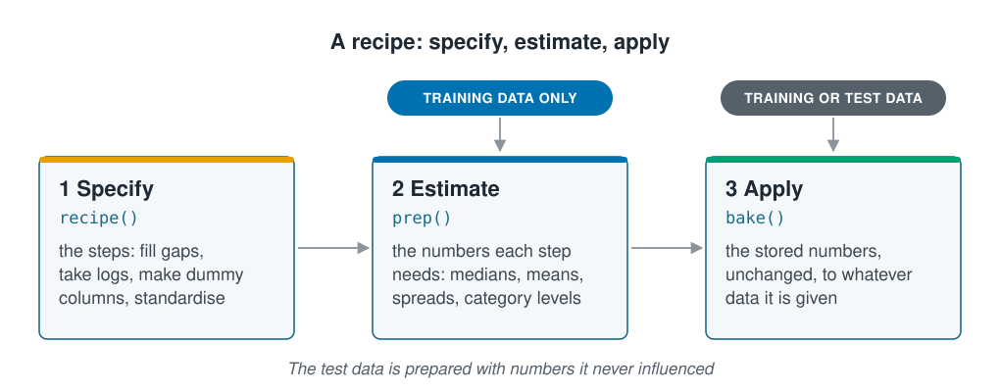

```{r}
#| label: setup
#| include: false
library(tidymodels)
library(tidyverse)
library(patchwork)
source(here::here("R/theme.R"))
source(here::here("R/data.R"))
source(here::here("R/python-tabs.R"))
set.seed(123)
```



## Units a model cannot see past

Depth runs to 200 m, salinity sits near 34 and chlorophyll is mostly under 2. To you
these are three measurements in three units; to many models they are just three
numbers, and depth, simply by being large, can drown out the other two. Preparing the
columns first lets every input count, and doing the preparation inside a recipe keeps
the test data from shaping it.





## Depth decides every distance before standardising

**Standardising** a column subtracts its mean and divides by its standard deviation,
so every column ends up centred on 0 with a spread of 1, whatever its units. It is the
usual form of the scaling that
[k-nearest neighbours](../01-introduction/types-of-learning.qmd) needed.

The distance between two stations adds up the squared difference in each column.
Averaged over every pair of stations, each column's part of that sum is proportional
to its variance, so the spreads alone show which column decides:

::: {.panel-tabset group="language"}

## R

```{r}
#| label: distance-shares
survey <- load_coastal_survey_clean()

survey |>
  summarise(across(c(depth_m, temperature_c, salinity_psu),
                   \(x) sd(x, na.rm = TRUE))) |>
  pivot_longer(everything(), names_to = "input", values_to = "sd") |>
  mutate(
    share_raw          = round(100 * sd^2 / sum(sd^2), 1),
    share_standardised = round(100 * 1 / n(), 1),
    sd                 = round(sd, 2)
  )
```

## Python

```{python}
import numpy as np
import pandas as pd

from mlbasic_data import load_coastal_survey_clean

survey = load_coastal_survey_clean()

sd = survey[["depth_m", "temperature_c", "salinity_psu"]].std()
shares = pd.DataFrame({
    "input": sd.index,
    "sd": sd.round(2).values,
    # Each column's share of the squared distance, in per cent; standardising
    # gives every column a standard deviation of 1, so equal shares.
    "share_raw": (100 * sd**2 / (sd**2).sum()).round(1).values,
    "share_standardised": round(100 / len(sd), 1),
})
shares
```

:::

```{r}
#| label: distance-facts
#| include: false
sds <- map_dbl(survey[c("depth_m", "temperature_c", "salinity_psu")], sd, na.rm = TRUE)
depth_share <- round(100 * sds[["depth_m"]]^2 / sum(sds^2), 1)
```

In metres, degrees and PSU, depth makes up `r depth_share`% of every distance, so the
"nearest" stations are simply those of similar depth, whatever their temperature and
salinity. After standardising, each input has an equal share.

Whether this matters depends on the method. Methods that measure distances between
rows, such as k-nearest neighbours and k-means, need it, and so do methods that
penalise large coefficients. Methods that split a column at a threshold, such as
decision trees, do not: standardising keeps every value in the same order, so the
splits are the same. Linear regression makes the same predictions either way; only its
coefficients change units. Later sections say which kind each method is as it appears.

## Skewed columns are logged

Many marine variables have a long right tail: most chlorophyll values are small, and a
few are ten times larger. Those few pull averages around and dominate any method that
squares its errors. A **log transform** replaces each value by its logarithm, which
pulls the tail in:

```{r}
#| label: fig-transform
#| fig-cap: "Chlorophyll before and after a log transform. The raw values have a long right tail; on a log scale they are close to symmetric."
#| fig-alt: "Two histograms of chlorophyll. The left is strongly right-skewed with most values below 2 and a long thin tail reaching past 10. The right, after a log transform, is broadly symmetric and bell-shaped."
#| fig-width: 8.5
#| fig-height: 3.8
chl <- load_coastal_survey_clean() |> drop_na(chlorophyll_mg_m3)

p_raw <- ggplot(chl, aes(chlorophyll_mg_m3)) +
  geom_histogram(bins = 45, fill = ml_palette[["blue"]]) +
  labs(x = "Chlorophyll (mg m⁻³)", y = "Stations", title = "As measured")

p_log <- ggplot(chl, aes(log(chlorophyll_mg_m3 + 0.01))) +
  geom_histogram(bins = 45, fill = ml_palette[["green"]]) +
  labs(x = "log chlorophyll", y = NULL, title = "After a log transform")

p_raw + p_log
```

A log also turns effects that multiply into effects that add, which is often closer to
how the ecology works. The log of zero does not exist, so a small constant is added
first; its size changes the low end of the scale, so choose it deliberately.

## Categories become columns of 0s and 1s

Models need numbers, so a category is turned into **dummy columns**: one column of 0s
and 1s for each level except the first, which becomes the baseline. Four substrates,
in alphabetical order, become three columns:

| substrate | substrate_mud | substrate_rock | substrate_sand |
| --- | --- | --- | --- |
| gravel | 0 | 0 | 0 |
| mud | 1 | 0 | 0 |
| rock | 0 | 1 | 0 |
| sand | 0 | 0 | 1 |

That works for a handful of levels. A column with hundreds, such as the observer or
the fishing vessel in a national logbook, becomes hundreds of mostly-zero columns.
Rare levels can be grouped into one "other" level, or each level replaced by a number
summarising its outcome (**target encoding**), which uses the outcome and so risks the
leakage described in [Avoiding information leakage](information-leakage.qmd). An
ordinal category is coded 1, 2, 3 only if equal steps between its levels make sense
([Kinds of marine data](marine-data-types.qmd)).

## A recipe specifies then estimates then applies

Standardising needs a mean and a standard deviation, and filling gaps needs a median.
Compute those from every row and the rows set aside to test the model have shaped the
data it learned from. A **recipe** from the `recipes` package, the list of a model's
inputs and the steps that prepare them, avoids this by keeping three stages apart:

::: {.diagram}
{fig-alt="Three cards joined by arrows. 1 Specify, recipe(): the steps, such as fill gaps, take logs, make dummy columns and standardise. 2 Estimate, prep(): the numbers each step needs, such as medians, means, spreads and category levels; an arrow from a label reading training data only points into it. 3 Apply, bake(): the stored numbers, unchanged, applied to whatever data it is given; an arrow from a label reading training or test data points into it. A note says the test data is prepared with numbers it never influenced."}
:::

The worked example uses the cleaned survey from
[Exploring and cleaning the data](exploring-and-cleaning.qmd), loaded above, and sets
a quarter of the stations aside for testing before anything else.
[Splitting the data](splitting-data.qmd) explains the split itself.

::: {.panel-tabset group="language"}

## R

```{r}
#| label: prepare
split <- initial_split(survey, prop = 0.75)
train <- training(split)
test  <- testing(split)
```

## Python

```{python}
from sklearn.compose import ColumnTransformer
from sklearn.impute import SimpleImputer
from sklearn.model_selection import train_test_split
from sklearn.pipeline import Pipeline
from sklearn.preprocessing import FunctionTransformer, OneHotEncoder, StandardScaler

predictors = ["depth_m", "temperature_c", "salinity_psu",
              "chlorophyll_mg_m3", "substrate", "season"]

X_train, X_test, y_train, y_test = train_test_split(
    survey[predictors], survey["abundance"], train_size=0.75, random_state=123
)
```

:::

The recipe lists the steps. Nothing is computed yet:

::: {.panel-tabset group="language"}

## R

```{r}
#| label: recipe
prep_recipe <- recipe(abundance ~ depth_m + temperature_c + salinity_psu +
                        chlorophyll_mg_m3 + substrate + season,
                      data = train) |>
  step_impute_median(all_numeric_predictors()) |>
  step_log(chlorophyll_mg_m3, offset = 0.01) |>
  step_dummy(all_nominal_predictors()) |>
  step_normalize(all_numeric_predictors())

prep_recipe
```

## Python

```{python}
numeric = ["depth_m", "temperature_c", "salinity_psu"]
categorical = ["substrate", "season"]

log_chlorophyll = Pipeline([
    ("impute", SimpleImputer(strategy="median")),
    ("log", FunctionTransformer(lambda x: np.log(x + 0.01),
                                feature_names_out="one-to-one")),
])

# A ColumnTransformer is a recipe: a list of steps, each naming the columns it
# applies to. Wrapping it with the scaler reproduces step_normalize() running
# last over everything, dummy columns included.
prep_recipe = Pipeline([
    ("columns", ColumnTransformer([
        ("numeric", SimpleImputer(strategy="median"), numeric),
        ("chlorophyll", log_chlorophyll, ["chlorophyll_mg_m3"]),
        # sparse_output=False so the scaler can centre the dummies.
        ("categorical", OneHotEncoder(drop="first", sparse_output=False),
         categorical),
    ])),
    ("normalise", StandardScaler()),
])

prep_recipe
```

:::

`prep()` estimates the numbers from the training data. The first step's medians, which
will fill gaps in the training *and* the test data:

::: {.panel-tabset group="language"}

## R

```{r}
#| label: prep
estimated <- prep(prep_recipe)

tidy(estimated, number = 1)
```

## Python

```{python}
# prep() is fit(): it is where the medians, means and standard deviations are
# estimated, and it must see the training rows only.
estimated = prep_recipe.fit(X_train)

imputer = estimated["columns"].named_transformers_["numeric"]
pd.DataFrame({"terms": numeric, "value": imputer.statistics_})
```

:::

`bake()` applies them. The first few prepared training rows:

::: {.panel-tabset group="language"}

## R

```{r}
#| label: bake
bake(estimated, new_data = NULL) |>
  slice_head(n = 5) |>
  mutate(across(everything(), \(x) round(x, 2)))
```

## Python

```{python}
# bake() is transform(). get_feature_names_out() recovers the column names that
# the array on its own has lost.
baked = pd.DataFrame(
    estimated.transform(X_train),
    columns=estimated[:-1].get_feature_names_out(),
).round(2)

baked.head()
```

:::

Four substrates have become three `substrate_*` columns and four seasons three
`season_*` columns, and every input now has mean 0 and standard deviation 1 in the
training data. The same call with `new_data = test` prepares the test data with the
training numbers.

## Preparation travels with the model

A recipe and a model are usually joined in a **workflow**, which fits them together and
applies both to new data together; later sections do this throughout. In scikit-learn
the same job is done by a `Pipeline` that ends in the model. Any
transformation done by hand to the whole table beforehand escapes that protection.

Two costs to keep in mind. Every transformation makes a model harder to read: a
coefficient on standardised log chlorophyll is a change per standard deviation of log
chlorophyll, which is fine for prediction and awkward for explanation (see
[Prediction and explanation](../01-introduction/prediction-and-explanation.qmd)). And
a category level that never appears in the training data has no dummy column;
`step_novel()` handles it, which matters in surveys where rare habitats are genuinely
rare.

## Key points

::: {.key-points}
- Unstandardised, the column with the largest spread decides every distance: depth
  makes up nearly all of it in the survey.
- Standardising puts every column on a mean of 0 and a spread of 1. Methods based on
  distances or penalties need it; tree methods do not.
- A log transform pulls in a long right tail; categories become dummy columns, one
  per level after the first.
- A recipe is specified, then estimated on the training data (`prep()`), then applied
  to any data (`bake()`), so the test data never shapes the preparation.
- Preparation belongs with the model in a workflow, not done by hand beforehand.
:::

## Try it yourself

1. Change the constant added before the log from 0.01 to 1 and plot `log(chlorophyll_mg_m3 + 1)`. What
   happens to the low end of the distribution?
2. Run `prep()` on the test data instead of the training data and compare the medians
   from `tidy(..., number = 1)`. They differ only a little; why does it still matter
   which rows they come from?
