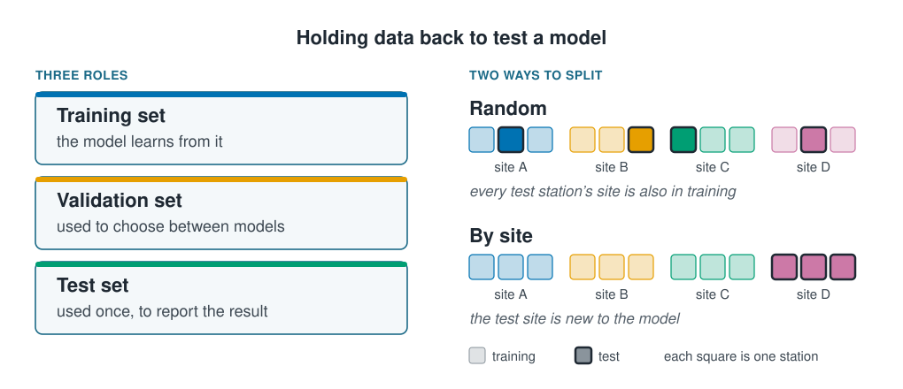

```{r}
#| label: setup
#| include: false
library(tidymodels)
library(tidyverse)
source(here::here("R/theme.R"))
source(here::here("R/data.R"))
source(here::here("R/python-tabs.R"))
set.seed(123)
```



## A model must be tested on data it has not seen

A model always looks good on the data it learned from; the only honest measure of how
it will do on new stations is data it has never seen.
[Prediction and explanation](../01-introduction/prediction-and-explanation.qmd) compared
two models that way, on a training set and a test set. Which rows are held back
decides what the test score means, and for a marine survey a random draw usually
answers a different question from the one the model is built for.





## Training fits, validation chooses, test reports

::: {.diagram}
{fig-alt="Two panels. Three roles: the training set, which the model learns from; the validation set, used to choose between models; the test set, used once to report the result. Two ways to split: four sites, A to D, each visited three times and drawn as three squares. In the random split one visit from every site is marked as test, so every test station's site is also in training. In the split by site all three visits to site D are test, so the test site is new to the model."}
:::

- The **training set**: the model learns from it.
- The **validation set**: used to *choose*, between models or between settings of one
  model. Choosing is a kind of learning, so it must not use the test set.
- The **test set**: used once, at the end, to report how well the chosen model does.

The validation set is the one most often skipped. Try eight models and report the
best one's test score, and that score is the best of eight noisy numbers, which is too
high. The test set answers "how good is this model?", never "which model is best?".
When data are scarce, **cross-validation** takes the validation role by letting parts
of the training set take turns at being held back;
[Hyperparameter selection](../05-generalisation/hyperparameter-selection.qmd) covers it.

Common splits keep 70 to 80% for training. The exact share is a trade-off between
training the model well and measuring it precisely; how the rows are chosen matters
far more.

## A random split is the starting point

The cleaned survey (see [Exploring and cleaning the data](exploring-and-cleaning.qmd)),
split at random, three quarters for training:

::: {.panel-tabset group="language"}

## R

```{r}
#| label: random-split
survey <- load_coastal_survey_clean()

plain <- initial_split(survey, prop = 0.75)

tibble(training = nrow(training(plain)), testing = nrow(testing(plain)))
```

## Python

```{python}
import pandas as pd
from sklearn.model_selection import GroupShuffleSplit, train_test_split

from mlbasic_data import load_coastal_survey_clean

survey = load_coastal_survey_clean()

plain_train, plain_test = train_test_split(survey, train_size=0.75, random_state=123)

pd.DataFrame({"training": [len(plain_train)], "testing": [len(plain_test)]})
```

:::

## Stratifying keeps a rare class in both parts

```{r}
#| label: rare-numbers
#| include: false
rare_pct <- round(100 * mean(survey$rare_species == "yes"), 1)
rare_n   <- sum(survey$rare_species == "yes")
```

The rare species is present at `r rare_pct`% of stations, `r rare_n` in all. A random
split can easily leave very few of them in the test set. A **stratified split**
(`strata =` in R, `stratify=` in Python) draws each class separately, so both parts
keep the same share. Or it should:

::: {.panel-tabset group="language"}

## R

```{r}
#| label: stratify
set.seed(2026)

unstratified <- initial_split(survey, prop = 0.75)
stratified   <- initial_split(survey, prop = 0.75, strata = rare_species)

share <- function(split) {
  tibble(train_pct = round(100 * mean(training(split)$rare_species == "yes"), 1),
         test_pct  = round(100 * mean(testing(split)$rare_species == "yes"), 1))
}

bind_rows(Unstratified = share(unstratified), Stratified = share(stratified),
          .id = "split")
```

## Python

```{python}
unstrat_train, unstrat_test = train_test_split(
    survey, train_size=0.75, random_state=2026)
strat_train, strat_test = train_test_split(
    survey, train_size=0.75, random_state=2026, stratify=survey["rare_species"])

def share(frame):
    return round(100 * (frame["rare_species"] == "yes").mean(), 1)

pd.DataFrame([
    {"split": "Unstratified",
     "train_pct": share(unstrat_train), "test_pct": share(unstrat_test)},
    {"split": "Stratified",
     "train_pct": share(strat_train), "test_pct": share(strat_test)},
])
```

:::

In R the "stratified" split is no better than the plain one. `rsample` quietly merges
any class smaller than its `pool` argument, 10% by default, so a class at
`r rare_pct`% is not stratified at all, with no error. scikit-learn has no such
threshold, so the Python tab is already balanced. Lowering `pool` fixes the R split:

::: {.panel-tabset group="language"}

## R

```{r}
#| label: stratify-properly
#| warning: true
set.seed(2026)

properly <- initial_split(survey, prop = 0.75, strata = rare_species, pool = 0.01)

share(properly)
```

## Python

```{python}
# scikit-learn's stratify has no pooling step: it already split the rare class
# directly, which the R tab needs pool = 0.01 to do.
pd.DataFrame({"train_pct": [share(strat_train)], "test_pct": [share(strat_test)]})
```

:::

R now warns that the class is small, which is fair: `r rare_n` stations is thin
ground to stratify on. The wider lesson: **check that a safeguard did what you asked**,
by looking at the result rather than the code.

A rare class causes more trouble than the split: accuracy rewards a model that never
predicts it, and the fit leans towards the common class.
[Class imbalance](../06-assumptions-limitations/class-imbalance.qmd) shows both, and
that moving the threshold does what rebalancing the data does without distorting the
probabilities.

## A random split puts each site on both sides

A random split treats rows as interchangeable. Survey rows are not: visits to the same
site are alike ([The coastal survey](the-coastal-survey.qmd#repeat-visits-to-the-same-sites-are-not-independent)). If one
visit lands in training and another in test, the model has, in effect, already seen
the test station. A **grouped split** assigns whole groups, here whole sites, to one
side or the other:

::: {.panel-tabset group="language"}

## R

```{r}
#| label: group-split
grouped <- group_initial_split(survey, group = site_id, prop = 0.75)

sites_in_both <- function(split) {
  length(intersect(training(split)$site_id, testing(split)$site_id))
}

tibble(split = c("Random", "By site"),
       sites_in_both = c(sites_in_both(plain), sites_in_both(grouped)))
```

## Python

```{python}
grouper = GroupShuffleSplit(n_splits=1, train_size=0.75, random_state=123)
train_rows, test_rows = next(grouper.split(survey, groups=survey["site_id"]))
group_train, group_test = survey.iloc[train_rows], survey.iloc[test_rows]

def sites_in_both(train, test):
    return len(set(train["site_id"]) & set(test["site_id"]))

pd.DataFrame({
    "split": ["Random", "By site"],
    "sites_in_both": [sites_in_both(plain_train, plain_test),
                      sites_in_both(group_train, group_test)],
})
```

:::

```{r}
#| label: seen-numbers
#| include: false
seen_pct <- round(100 * mean(testing(plain)$site_id %in% training(plain)$site_id))
```

Under the random split, `r seen_pct`% of the test stations sit at a site the model
trained on. Whatever that test measures, it is not how well the model predicts a new
place, which is what a habitat map is for.

## Split along what you will predict

The two splits answer different questions:

| Split | Question it answers |
| --- | --- |
| Random | How well does the model predict *another visit to a site already surveyed*? |
| By site | How well does the model predict *a site never surveyed*? |

Both are legitimate, but marine work usually claims the second while measuring the
first. The rule is short: **split along whatever you intend to predict for.** New
sites, split by site; next year, split by year; a new vessel, split by vessel. Splitting
by site has a cost too: `r n_distinct(survey$site_id)` sites give only about
`r round(n_distinct(survey$site_id) / 4)` test sites, so the test score is honest but
uncertain.

## Key points

::: {.key-points}
- The training set fits, the validation set chooses, the test set reports once.
  Choosing on the test set makes its score too high.
- Stratify a rare class, and check the result: in R a class under 10% is silently not
  stratified unless `pool` is lowered.
- Visits to the same site are alike, so a random split tests a model on places it has
  already seen.
- Split along what you will predict for: new sites, new years, new vessels. A split by
  site gives an honest score from few test sites.
:::

## Try it yourself

1. Run the random split with three different seeds and record the share of the rare
   species in each test set. How much does it move?
2. Fit a linear regression of `abundance` on depth, temperature and salinity under
   `initial_split()` and under `group_initial_split()`, and compare the test RMSE. The
   difference is what the random split was hiding.
   [Spatial and temporal cross-validation](../07-validation/spatial-and-temporal-cv.qmd)
   measures it with folds of stations, sites and blocks.
