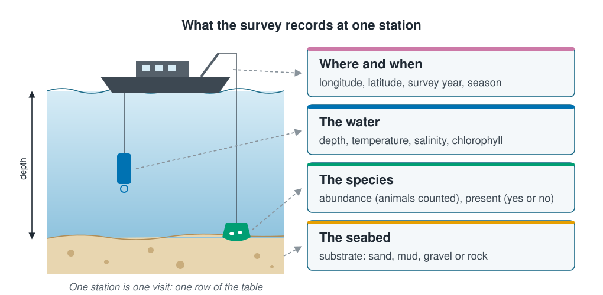
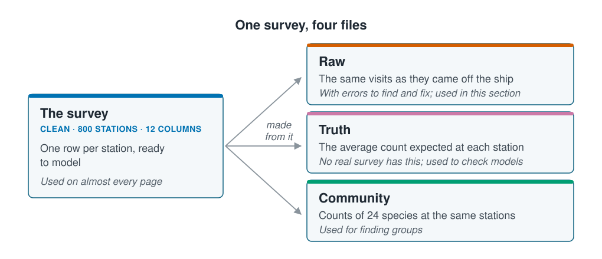

```{r}
#| label: setup
#| include: false
library(tidyverse)
library(patchwork)
source(here::here("R/theme.R"))
source(here::here("R/data.R"))

survey <- load_coastal_survey()

# "min to max" for a numeric column, for the table of columns below.
span <- function(x, digits = 0) {
  paste(format(round(min(x), digits), nsmall = digits),
        "to", format(round(max(x), digits), nsmall = digits))
}
pct <- function(x) paste0(round(100 * mean(x)), "%")
```

## Most examples come from this survey

Almost every example in this course comes from one dataset, a survey of the seabed
along a stretch of coast. Once you know it well, later pages can spend your attention
on the method instead of the data. By the end of this page you will be able to read
any row of the survey, know which of its columns tend to move together, and know
which file to load for which job.





## A station is one visit

At each **station** a ship stops, measures the water from the surface to the seabed,
records what the seabed is made of, and takes a sample of the seabed to count one
species of animal. One station is one row of the table.

::: {.diagram}
{fig-alt="On the left, a ship at the sea surface lowers an instrument through the water and a sampler to the seabed, with an arrow down the side marking depth. On the right, four cards: where and when (longitude, latitude, survey year, season); the water (depth, temperature, salinity, chlorophyll); the species (abundance, the animals counted, and present, yes or no); and the seabed (substrate: sand, mud, gravel or rock). Dashed lines join the ship, the instrument, the sampler and the seabed to their cards."}
:::

## Twelve columns describe each station

The survey has `r nrow(survey)` stations, visited between `r min(survey$survey_year)`
and `r max(survey$survey_year)`, in all four seasons.

::: {.panel-tabset group="language"}

## R

```{r}
#| label: load
survey <- load_coastal_survey()

glimpse(survey)
```

## Python

```{python}
from mlbasic_data import load_coastal_survey

survey = load_coastal_survey()

survey.info()
```

:::

| Column | What it is | Values in the survey |
| --- | --- | --- |
| `station_id` | A label for the station | `r survey$station_id[1]`, `r survey$station_id[2]`, … |
| `survey_year` | The year of the visit | `r span(survey$survey_year)` |
| `season` | The season of the visit | spring, summer, autumn, winter |
| `longitude`, `latitude` | Where the station is, in degrees | a box about `r round(diff(range(survey$longitude)) * 111 * cos(42 * pi / 180))` by `r round(diff(range(survey$latitude)) * 111)` km |
| `depth_m` | Depth of the seabed, in metres | `r span(survey$depth_m)` |
| `temperature_c` | Water temperature, in °C | `r span(survey$temperature_c, 1)` |
| `salinity_psu` | How salty the water is, in practical salinity units (PSU), close to grams of salt per kilogram of seawater | `r span(survey$salinity_psu, 1)` |
| `chlorophyll_mg_m3` | Chlorophyll, in mg per m³: a measure of how much phytoplankton the water holds | `r span(survey$chlorophyll_mg_m3, 1)` |
| `substrate` | What the seabed is made of | sand, mud, gravel, rock |
| `abundance` | The number of animals of the species counted in the sample | `r span(survey$abundance)` |
| `present` | Whether the species was found at all | yes at `r pct(survey$present == "yes")` of stations |

Most columns are **numbers**; `season`, `substrate` and `present` are **categories**,
which a model has to handle differently (see
[Scaling and encoding](scaling-and-encoding.qmd)). The last two columns describe the
species, and most pages use one of them as the **outcome**, the thing a model
predicts. The other columns are the candidate **inputs**.

## The shelf deepens offshore

```{r}
#| label: fig-map
#| fig-cap: "Where the stations are. Depth rises steadily from west to east, so the survey runs from the coast out across the shelf."
#| fig-alt: "A map of 800 points in a rectangle of longitude 140 to 142.5 and latitude 41 to 43. The points are coloured by depth: pale yellow in the west, at about 10 to 40 metres, shading through green to dark purple in the east, at 150 to 195 metres."
#| fig-width: 7
#| fig-height: 5
ggplot(survey, aes(longitude, latitude, colour = depth_m)) +
  geom_point(size = 1.6) +
  scale_colour_viridis_c(direction = -1, name = "Depth (m)") +
  coord_quickmap() +
  labs(x = "Longitude (°E)", y = "Latitude (°N)",
       title = "Stations coloured by depth") +
  theme(legend.position = "right")
```

The stations are spread evenly over the area rather than laid on a grid. Stations
close together share more than their depth: they sit in the same patch of sea, so
their counts tend to be alike. That matters when a page holds stations back to test a
model, and [Splitting the data](splitting-data.qmd) comes back to it.

## Depth shapes the water

The water measurements do not vary independently. Deeper water here is colder and
saltier:

```{r}
#| label: fig-depth
#| fig-cap: "Temperature and salinity against depth. Both change with depth, so a model given all three is given partly the same information three times."
#| fig-alt: "Two scatter plots against depth from 0 to 200 metres. Left: temperature falls from mostly 8 to 16 °C in shallow water to 2 to 8 °C near 200 metres, with wide scatter. Right: salinity rises from about 33 PSU in shallow water to about 34.5 in deep water, in a tighter band."
#| fig-width: 8.5
#| fig-height: 3.8
p_temp <- ggplot(survey, aes(depth_m, temperature_c)) +
  geom_point(alpha = 0.35, colour = ml_palette[["vermilion"]]) +
  labs(x = "Depth (m)", y = "Temperature (°C)", title = "Colder with depth")

p_sal <- ggplot(survey, aes(depth_m, salinity_psu)) +
  geom_point(alpha = 0.35, colour = ml_palette[["blue"]]) +
  labs(x = "Depth (m)", y = "Salinity (PSU)", title = "Saltier with depth")

p_temp + p_sal
```

```{r}
#| label: correlations
#| include: false
r_ds <- cor(survey$depth_m, survey$salinity_psu)
r_dt <- cor(survey$depth_m, survey$temperature_c)
```

A **correlation** puts a number on this, from −1 (one always falls as the other rises)
through 0 (no straight-line link) to 1 (they always rise together). Depth and salinity
have a correlation of `r round(r_ds, 2)`; depth and temperature
`r sub("-", "−", round(r_dt, 2))`. Variables that move together like this are
normal in marine data, and they are behind the warning in
[Prediction and explanation](../01-introduction/prediction-and-explanation.qmd): a
column can help a model predict simply because it travels with another one.

## Most stations hold only a few animals

```{r}
#| label: fig-abundance
#| fig-cap: "The count of the species at each station. Most counts are small, zero is common, and a few stations hold many more animals than the rest."
#| fig-alt: "A bar chart of abundance from 0 to 40. The tallest bar is at 0, with about 180 stations, then 1 with about 140 and 2 with about 95; the bars shrink steadily after that, and only a handful of stations have more than 20 animals."
#| fig-width: 7
#| fig-height: 3.8
ggplot(survey, aes(abundance)) +
  geom_bar(fill = ml_palette[["green"]]) +
  labs(x = "Animals counted at the station", y = "Stations",
       title = "Many small counts, a few large ones")
```

The species was absent at `r pct(survey$abundance == 0)` of stations, half the
stations hold `r median(survey$abundance)` animals or fewer, and the largest count is
`r max(survey$abundance)`. Counts shaped like this, piled up near zero with a long
tail, are typical of survey catches, and they are why the course treats abundance with
some care.

## One survey in four files

The clean survey is the one on this page. Three more files are made from it, each for
a particular job:

::: {.diagram}
{fig-alt="A card on the left for the clean survey, 800 stations and 12 columns, used on almost every page. Arrows labelled made from it lead to three cards on the right: raw, the same visits as they came off the ship, with errors to find and fix, used in this section; truth, the average count expected at each station, which no real survey has, used to check models; and community, counts of 24 species at the same stations, used for finding groups."}
:::

Each has its own loader, so a page never reads a file directly:

- `load_coastal_survey()`: the clean survey, used on this page.
- `load_coastal_survey_raw()`: the same visits with the errors of a real field file,
  such as impossible depths and misspelt categories. The rest of this section finds
  and fixes them, starting with
  [Exploring the data first](exploratory-analysis.qmd).
- `load_coastal_survey_truth()`: the average count the simulation expected at each
  station, before chance added its noise.
- `load_coastal_community()`: counts of 24 species at the same stations, for finding
  groups of stations.

## The true answers are known

The survey is **simulated**: a script decided how the species responds to its
surroundings, then drew counts that follow those rules with realistic noise added. So
unlike a real survey, this one has known answers. Later pages fit a model, read what
it found, and only then check it against the rules the simulation used.

This page leaves those rules out on purpose. The skill the course teaches is reading a
model without knowing the answer in advance, which is the only way a real survey is
ever read.

## Key points

::: {.key-points}
- One station is one visit and one row: where and when, the water, the seabed, and
  the count of one species.
- Numbers and categories need different handling; most pages predict `abundance` or
  `present` from the other columns.
- Depth, temperature and salinity move together, so they partly carry the same
  information.
- Counts are small, often zero, and occasionally large.
- The clean survey has three companion files: raw, truth and community, each with its
  own loader.
:::

## Try it yourself

Plot `abundance` against `depth_m`, then against `temperature_c`. Does the species
seem to prefer a particular depth, or a particular temperature? Write your guess down;
later pages will let you check it.
