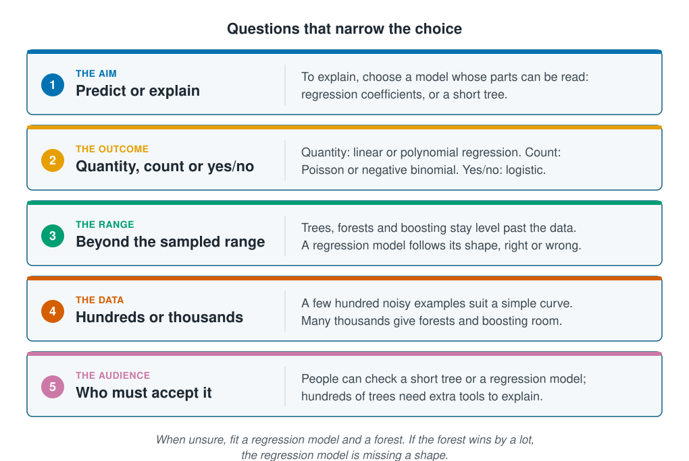

```{r}
#| label: setup
#| include: false
library(tidymodels)
library(tidyverse)
library(poissonreg)
source(here::here("R/theme.R"))
source(here::here("R/data.R"))
source(here::here("R/python-tabs.R"))
set.seed(123)
```

## The question comes before the method

The section's methods range from a straight line to hundreds of trees. None of them is
best everywhere, and the most flexible one is often not the right one. A few questions
about the aim, the data and the people who will use the result narrow the choice before
any model is fitted. This page sets out those questions and then scores the section's
methods for counts on the same new sites.





## Five questions narrow the choice

[Prediction and explanation](../01-introduction/prediction-and-explanation.qmd)
separated the two aims: explaining needs a model whose parts can be read, while
predicting can use anything that works on new data. The kind of outcome comes next. A
quantity suits [linear regression](linear-and-polynomial-regression.qmd), a count
[Poisson regression](count-regression.qmd) and a yes-or-no answer
[logistic regression](logistic-regression.qmd). k-nearest neighbours, trees, forests
and boosting handle any kind of outcome, but they assume no shape, so they must learn
it from the data.

The other three questions depend on how the model will be used. Beyond its data, a
regression model follows its fitted shape, which may or may not be true, while the
neighbours and the tree models stay level;
[Uneven sampling and extrapolation](../06-assumptions-limitations/sampling-and-extrapolation.qmd)
deals with predicting outside the data. Flexible models need many examples to learn
their shape; with a few hundred noisy ones, a curve with a few terms often does as
well. And a model that has to convince a manager or a reviewer must be one they can
check.

::: {.diagram}
{fig-alt="Five cards, one question each. The aim, predict or explain: to explain, choose a model whose parts can be read, regression coefficients or a short tree. The outcome, quantity, count or yes/no: quantity, linear or polynomial regression; count, Poisson or negative binomial; yes/no, logistic. The range, beyond the sampled range: neighbours and tree models stay level past the data; a regression model follows its shape, right or wrong. The data, hundreds or thousands: a few hundred noisy examples suit a simple curve; many thousands give the flexible methods room. The audience, who must accept it: people can check a short tree or a regression model; hundreds of trees need extra tools to explain. A note says: when unsure, fit a regression model and a forest; if the forest wins by a lot, the regression model is missing a shape."}
:::

## Worked example

The outcome is the count of the species at each station. The data, the split by site
and the fitting and validation sites are those of the last four pages. Seven models are
compared: linear and polynomial regression, Poisson regression, k-nearest neighbours,
the decision tree, the random forest and boosting. The number of neighbours, the tree's
depth and the boosted model's number of trees are chosen on the validation sites, as on
the pages that introduced them.

::: {.panel-tabset group="language"}

## R

```{r}
#| label: prepare
survey <- load_coastal_survey_clean()

split <- group_initial_split(survey, group = site_id, prop = 0.75)
train <- training(split)
test  <- testing(split)

fit_split  <- group_initial_split(train, group = site_id, prop = 0.75)
fitting    <- training(fit_split)
validation <- testing(fit_split)

predictors <- abundance ~ depth_m + temperature_c + chlorophyll_mg_m3 +
  salinity_psu + substrate + season

line_recipe <- recipe(predictors, data = train) |>
  step_impute_median(all_numeric_predictors())
curve_recipe <- line_recipe |>
  step_poly(depth_m, temperature_c, degree = 2, options = list(raw = TRUE))
knn_recipe <- line_recipe |>
  step_dummy(all_nominal_predictors()) |>
  step_normalize(all_numeric_predictors())
tree_recipe <- line_recipe
boost_recipe <- line_recipe |>
  step_dummy(all_nominal_predictors())

knn_model <- function(k) {
  nearest_neighbor(neighbors = k, weight_func = "rectangular") |>
    set_mode("regression")
}
tree_model <- function(depth) {
  decision_tree(mode = "regression", tree_depth = depth,
                min_n = 2, cost_complexity = 0)
}
boost_model <- function(trees) {
  boost_tree(mode = "regression", trees = trees,
             tree_depth = 3, learn_rate = 0.05)
}

validation_rmse <- function(workflow) {
  fitted <- fit(workflow, fitting)
  rmse_vec(validation$abundance, predict(fitted, validation)$.pred)
}
best_of <- function(values, make) {
  scores <- map_dbl(values, \(v) validation_rmse(make(v)))
  values[which.min(scores)]
}

ks <- c(1, 2, 3, 5, 7, 10, 15, 20, 30, 50, 70, 100, 150, 200, 300)
best_k     <- best_of(ks, \(k) workflow(knn_recipe, knn_model(k)))
best_depth <- best_of(1:15, \(d) workflow(tree_recipe, tree_model(d)))
best_boost <- best_of(c(1, 5, 10, 25, 50, 100, 200, 400, 800, 1600),
                      \(n) workflow(boost_recipe, boost_model(n)))

models <- list(
  "Linear regression"     = workflow(line_recipe, linear_reg()),
  "Polynomial regression" = workflow(curve_recipe, linear_reg()),
  "Poisson regression"    = workflow(curve_recipe, poisson_reg()),
  "k-nearest neighbours"  = workflow(knn_recipe, knn_model(best_k)),
  "Decision tree"         = workflow(tree_recipe, tree_model(best_depth)),
  "Random forest"         = workflow(tree_recipe,
                                     rand_forest(mode = "regression", trees = 400) |>
                                       set_engine("ranger", seed = 123)),
  "Boosting"              = workflow(boost_recipe, boost_model(best_boost))
)

c(k = best_k, depth = best_depth, trees = best_boost)
```

## Python

```{python}
import numpy as np
import pandas as pd
from sklearn.base import clone
from sklearn.compose import ColumnTransformer
from sklearn.ensemble import GradientBoostingRegressor, RandomForestRegressor
from sklearn.impute import SimpleImputer
from sklearn.linear_model import LinearRegression, PoissonRegressor
from sklearn.metrics import r2_score, root_mean_squared_error
from sklearn.model_selection import GroupShuffleSplit
from sklearn.neighbors import KNeighborsRegressor
from sklearn.pipeline import Pipeline
from sklearn.preprocessing import OneHotEncoder, PolynomialFeatures, StandardScaler
from sklearn.tree import DecisionTreeRegressor

from mlbasic_data import load_coastal_survey_clean

survey = load_coastal_survey_clean()

numeric = ["depth_m", "temperature_c", "chlorophyll_mg_m3", "salinity_psu"]
categorical = ["substrate", "season"]
predictors = numeric + categorical

grouper = GroupShuffleSplit(n_splits=1, train_size=0.75, random_state=123)
train_rows, test_rows = next(grouper.split(survey, groups=survey["site_id"]))
train, test = survey.iloc[train_rows], survey.iloc[test_rows]

inner = GroupShuffleSplit(n_splits=1, train_size=0.75, random_state=123)
fit_rows, val_rows = next(inner.split(train, groups=train["site_id"]))
fitting, validation = train.iloc[fit_rows], train.iloc[val_rows]

dummies = OneHotEncoder(drop=["gravel", "spring"], sparse_output=False)

line_recipe = ColumnTransformer([
    ("numeric", SimpleImputer(strategy="median"), numeric),
    ("categorical", dummies, categorical),
])

def squared(column):
    return (column, Pipeline([
        ("impute", SimpleImputer(strategy="median")),
        ("poly", PolynomialFeatures(degree=2, include_bias=False)),
    ]), [column])

curve_recipe = ColumnTransformer([
    squared("depth_m"),
    squared("temperature_c"),
    ("numeric", SimpleImputer(strategy="median"),
     ["chlorophyll_mg_m3", "salinity_psu"]),
    ("categorical", dummies, categorical),
])

knn_recipe = Pipeline([("columns", line_recipe), ("standardise", StandardScaler())])

tree_recipe = ColumnTransformer([
    ("numeric", SimpleImputer(strategy="median"), numeric),
    ("categorical", OneHotEncoder(sparse_output=False), categorical),
])

def pipeline(recipe, model):
    return Pipeline([("recipe", clone(recipe)), ("model", model)])

def validation_rmse(workflow):
    fitted = workflow.fit(fitting[predictors], fitting["abundance"])
    return root_mean_squared_error(validation["abundance"],
                                   fitted.predict(validation[predictors]))

def best_of(values, make):
    scores = [validation_rmse(make(v)) for v in values]
    return values[int(np.argmin(scores))]

def boost_model(trees):
    return GradientBoostingRegressor(n_estimators=trees, max_depth=3,
                                     learning_rate=0.05, random_state=123)

best_k = best_of([1, 2, 3, 5, 7, 10, 15, 20, 30, 50, 70, 100, 150, 200, 300],
                 lambda k: pipeline(knn_recipe, KNeighborsRegressor(n_neighbors=k)))
best_depth = best_of(list(range(1, 16)), lambda d: pipeline(
    tree_recipe, DecisionTreeRegressor(max_depth=d, random_state=123)))
best_boost = best_of([1, 5, 10, 25, 50, 100, 200, 400, 800, 1600],
                     lambda n: pipeline(tree_recipe, boost_model(n)))

models = {
    "Linear regression": pipeline(line_recipe, LinearRegression()),
    "Polynomial regression": pipeline(curve_recipe, LinearRegression()),
    "Poisson regression": pipeline(curve_recipe, PoissonRegressor(
        alpha=0, solver="newton-cholesky")),
    "k-nearest neighbours": pipeline(knn_recipe, KNeighborsRegressor(n_neighbors=best_k)),
    "Decision tree": pipeline(tree_recipe, DecisionTreeRegressor(
        max_depth=best_depth, random_state=123)),
    "Random forest": pipeline(tree_recipe, RandomForestRegressor(
        n_estimators=400, max_features="sqrt", min_samples_leaf=5, random_state=123)),
    "Boosting": pipeline(tree_recipe, boost_model(best_boost)),
}

{"k": best_k, "depth": best_depth, "trees": best_boost}
```

:::

### Validation and test sites rank the models differently

Each model is fitted twice: on the fitting sites and scored on the validation sites,
and on all the training sites and scored once on the test sites, with the
[RMSE](../01-introduction/prediction-and-explanation.qmd#the-test-error-is-a-typical-miss)
and
[$R^2$](../02-marine-data/information-leakage.qmd#one-linear-regression-shows-each-kind).
The last column counts the test stations predicted to hold fewer than zero animals.

::: {.panel-tabset group="language"}

## R

```{r}
#| label: comparison
predictions <- map(models, \(w) list(
  validation = predict(fit(w, fitting), validation)$.pred,
  test       = predict(fit(w, train), test)$.pred
))

results <- imap(predictions, \(p, model) tibble(
  model           = model,
  validation_rmse = rmse_vec(validation$abundance, p$validation),
  test_rmse       = rmse_vec(test$abundance, p$test),
  test_rsq        = rsq_trad_vec(test$abundance, p$test),
  below_zero      = sum(p$test < 0)
)) |>
  list_rbind() |>
  arrange(test_rmse)

results |> mutate(across(where(is.double), \(x) round(x, 2)))
```

## Python

```{python}
def predict(workflow, data, new_data):
    fitted = workflow.fit(data[predictors], data["abundance"])
    return fitted.predict(new_data[predictors])

predictions = {name: {"validation": predict(w, fitting, validation),
                      "test": predict(w, train, test)}
               for name, w in models.items()}

results = pd.DataFrame([{
    "model": name,
    "validation_rmse": root_mean_squared_error(validation["abundance"], p["validation"]),
    "test_rmse": root_mean_squared_error(test["abundance"], p["test"]),
    "test_rsq": r2_score(test["abundance"], p["test"]),
    "below_zero": int((p["test"] < 0).sum()),
} for name, p in predictions.items()]).sort_values("test_rmse")

results.round(2)
```

:::

```{r}
#| label: comparison-numbers
#| include: false
row <- function(name) filter(results, model == name)
f2 <- function(x) sub("^-", "−", sprintf("%.2f", x))
n_test_sites <- n_distinct(test$site_id)
n_val_sites  <- n_distinct(validation$site_id)
```

::: {.panel-tabset group="language"}

## R

```{r}
#| label: fig-comparison
#| fig-cap: "The RMSE of each model on the validation sites (fitted on the fitting sites) and on the test sites (fitted on all the training sites), ordered by the test score. The number of neighbours, the tree's depth and the boosted model's number of trees were chosen on the validation sites."
#| fig-alt: "Dot chart of RMSE for seven models, one row each, with a validation point and a test point joined by a line. Poisson regression is at the top with the lowest test error, followed by polynomial and linear regression and k-nearest neighbours. The random forest, boosting and the decision tree come last on the test sites, although the tree has the lowest validation error of all seven."
#| fig-width: 8
#| fig-height: 4.5
results |>
  mutate(model = fct_rev(fct_inorder(model))) |>
  pivot_longer(c(validation_rmse, test_rmse), names_to = "sites", values_to = "rmse") |>
  mutate(sites = if_else(sites == "test_rmse", "test", "validation")) |>
  ggplot(aes(rmse, model)) +
  geom_line(aes(group = model), colour = "#c9d1d7", linewidth = 1.6) +
  geom_point(aes(colour = sites), size = 3.4) +
  scale_colour_manual(values = c(validation = ml_palette[["orange"]],
                                 test = ml_palette[["blue"]]),
                      breaks = c("validation", "test"),
                      labels = c("Validation sites", "Test sites")) +
  labs(x = "RMSE (individuals)", y = NULL, colour = NULL,
       title = "Two sets of new sites rank the models differently")
```

:::

On the `r n_test_sites` test sites, Poisson regression comes first, with an RMSE of
`r f2(row("Poisson regression")$test_rmse)` and an $R^2$ of
`r f2(row("Poisson regression")$test_rsq)`. Polynomial regression is close behind at
`r f2(row("Polynomial regression")$test_rmse)`, but it predicted fewer than zero
animals at `r row("Polynomial regression")$below_zero` test stations, which Poisson
regression cannot do. Linear regression and k-nearest neighbours follow, and the three
tree models come last; the single tree and boosting have an $R^2$ below zero.

The validation sites tell a different story. There the tree scores best of all, at
`r f2(row("Decision tree")$validation_rmse)`. Part of that is because its depth was
chosen to suit those same sites, so its validation score flatters it; the test sites
were kept apart for exactly this reason. The rest is chance: `r n_val_sites`
validation sites and `r n_test_sites` test sites are small samples, and close models
can swap places on the next set. The Python tab, with its own split, puts polynomial
regression and the forest ahead of Poisson regression.
[Uncertainty and stability](../07-validation/uncertainty-and-stability.qmd) shows how far
such differences can be trusted.

What the survey does show is the pattern in the diagram: `r nrow(train)` noisy
training stations are too few for the flexible methods to learn a shape that a curve
with a few terms already describes, and matching the model to the kind of outcome,
counts here, helped at least as much as flexibility.

### Beyond the sampled temperatures each model follows its own rule

The training stations span `r round(min(train$temperature_c, na.rm = TRUE), 1)` to
`r round(max(train$temperature_c, na.rm = TRUE), 1)` °C. @fig-extrapolate asks three of
the models for predictions from 0 to 22 °C, with the other inputs held at typical
values.

::: {.panel-tabset group="language"}

## R

```{r}
#| label: fig-extrapolate
#| fig-cap: "Predicted count across temperature from linear regression, Poisson regression and the random forest, all fitted on the training sites, with the other inputs held at typical values (sand, summer, median depth, chlorophyll and salinity). The shaded ends lie beyond the temperatures of the training stations."
#| fig-alt: "Three lines of predicted count against temperature from 0 to 22 degrees. The Poisson regression curve is a smooth hump peaking near 8 degrees; the forest is a jagged line with its highest values in the same middle region; the linear regression line falls steadily from left to right. In the shaded regions beyond the training temperatures the forest stays level at either end, the Poisson regression curve flattens towards zero, and the linear regression line keeps falling until it predicts fewer than zero animals near 20 degrees."
#| fig-width: 7.5
#| fig-height: 4.5
temp_range <- range(train$temperature_c, na.rm = TRUE)
grid <- tibble(
  temperature_c     = seq(0, 22, length.out = 300),
  depth_m           = median(train$depth_m, na.rm = TRUE),
  chlorophyll_mg_m3 = median(train$chlorophyll_mg_m3, na.rm = TRUE),
  salinity_psu      = median(train$salinity_psu, na.rm = TRUE),
  substrate         = factor("sand", levels = levels(train$substrate)),
  season            = factor("summer", levels = levels(train$season))
)

shown <- c("Linear regression", "Poisson regression", "Random forest")
curves <- map(shown, \(m) augment(fit(models[[m]], train), grid) |>
                mutate(model = m)) |>
  list_rbind() |>
  mutate(model = factor(model, levels = shown))

ggplot(curves, aes(temperature_c, .pred, colour = model)) +
  annotate("rect", xmin = -Inf, xmax = temp_range[1], ymin = -Inf, ymax = Inf,
           fill = ml_palette[["grey"]], alpha = 0.12) +
  annotate("rect", xmin = temp_range[2], xmax = Inf, ymin = -Inf, ymax = Inf,
           fill = ml_palette[["grey"]], alpha = 0.12) +
  geom_line(linewidth = 1.2) +
  scale_colour_manual(values = c("Linear regression" = ml_palette[["blue"]],
                                 "Poisson regression" = ml_palette[["green"]],
                                 "Random forest" = ml_palette[["orange"]])) +
  labs(x = "Temperature (°C)", y = "Predicted count", colour = NULL,
       title = "Beyond the data each model follows its own rule")
```

:::

```{r}
#| label: extrapolate-numbers
#| include: false
at_22 <- curves |> filter(temperature_c == 22) |> select(model, .pred) |> deframe()
line_zero <- curves |>
  filter(model == "Linear regression", .pred < 0) |>
  slice_min(temperature_c) |>
  pull(temperature_c)
at_edge <- curves |>
  filter(temperature_c <= temp_range[2]) |>
  slice_max(temperature_c, by = model) |>
  select(model, .pred) |>
  deframe()
```

Inside the sampled range Poisson regression and the forest share a peak in the middle
temperatures, and the linear regression line cuts across it. Beyond the range, each
does what its form dictates. The forest stays level at about
`r round(at_22[["Random forest"]], 1)`, because no tree has a question about warmer
water. Poisson regression flattens towards zero, from
`r round(at_edge[["Poisson regression"]], 1)` at the edge of the data to
almost nothing at 22 °C. Linear regression keeps falling at its
fitted rate and predicts fewer than zero animals from `r round(line_zero, 1)` °C. Nothing in the
data says which of the first two is right. A forecast for warmer water rests on the
assumption built into the model, so choose a model whose assumption you can defend, and
say what it is.

## Key points

::: {.key-points}
- Choose a method from the aim, the kind of outcome, whether predictions are needed
  beyond the sampled range, the amount of data and who must accept the result, not
  from which method is most flexible.
- On the survey's test sites Poisson regression predicted best and the tree models
  came last: `r nrow(train)` noisy stations are too few for the flexible methods to
  beat a curve with a few terms.
- Polynomial regression came close, but predicted fewer than zero animals at
  `r row("Polynomial regression")$below_zero` test stations. A model that matches the
  outcome cannot make that mistake.
- The validation and test sites ranked the models differently. One split cannot
  separate models that are close, and a model tuned on the validation sites looks
  best there.
- Beyond the data the neighbours and the tree models stay level and a regression model
  follows its fitted shape; the data check neither.
:::

## Try it yourself

1. Change `set.seed(123)` to `set.seed(456)` and re-run the page. Which models change
   places on the test sites, and does Poisson regression still come first?
2. Give the random forest `curve_recipe` in place of `tree_recipe`, so it also sees
   the squared depth and temperature. Does its test RMSE change? A tree can already
   cut an input at any value, so think about what a squared column adds.
