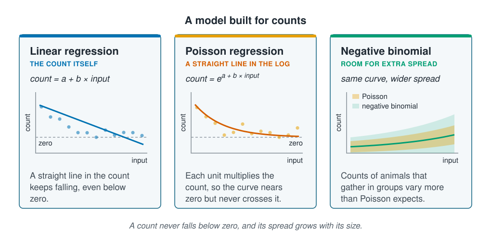

```{r}
#| label: setup
#| include: false
library(tidymodels)
library(tidyverse)
library(poissonreg)
source(here::here("R/theme.R"))
source(here::here("R/data.R"))
source(here::here("R/python-tabs.R"))
set.seed(123)
```



## A count never falls below zero

Polynomial regression on [Linear and polynomial regression](linear-and-polynomial-regression.qmd)
found the temperature a species prefers, then predicted fewer than zero animals. A
count has two properties that linear regression ignores: it never falls below zero,
and the larger it is, the more it varies. Poisson regression is built for the first and
the negative binomial for the second. Both keep what made linear regression easy to
read, one coefficient per input, and change only how the coefficients become a
prediction.





## Poisson regression predicts the log of the count

**Poisson regression** keeps the weighted sum of linear regression, a starting value
plus a fixed amount for each input, but uses it to predict the logarithm of the
expected count, $\hat{\mu}$ (the average count for those inputs):

$$\log(\hat{\mu}) = a + b_1 x_1 + b_2 x_2 + \dots \qquad\text{so}\qquad \hat{\mu} = e^{a + b_1 x_1 + b_2 x_2 + \dots}$$

$e$ raised to any power is above zero, so the prediction can come close to zero but
never cross it. Nothing is cut off afterwards; the shape of the model rules negative
counts out.

Adding an amount to a logarithm multiplies the number itself, so each coefficient
becomes a **multiplier** once raised as a power of $e$. A coefficient of 0.4 means each
extra unit of the input multiplies the expected count by $e^{0.4}$ =
`r round(exp(0.4), 2)`, whether the count is 2 or 200. A coefficient of 0 gives a
multiplier of 1, no change, and a negative one a multiplier below 1. A squared input
works as it did for linear regression: the curve has one peak, still at $-b / 2c$.

Linear, polynomial and Poisson regression share one design: a weighted sum of the
inputs, passed through a function that keeps the prediction in range. For linear
regression the function does nothing; for counts it is $e$ raised to the sum.
[Logistic regression](logistic-regression.qmd) uses the same design for a probability,
which must stay between 0 and 1.

## Counts of animals vary more than Poisson expects

```{r}
#| label: spread-numbers
#| include: false
survey <- load_coastal_survey_clean()
count_mean <- mean(survey$abundance)
count_var  <- var(survey$abundance)
```

Poisson regression also fixes how widely the counts scatter around each prediction:
their variance equals the expected count. Where the model expects 4 animals, the counts
should have a variance of about 4. Animals that gather in groups vary more than that,
because a station either finds the group or misses it. This is **overdispersion**, and
it is normal in ecological counts. The survey's counts have a variance of
`r round(count_var, 1)` against a mean of `r round(count_mean, 1)`, about
`r round(count_var / count_mean)` times as much, though part of that comes from the
inputs: some stations sit in better habitat than others.

The **negative binomial** model adds one number for the extra spread, estimated from
the data along with the coefficients. Its predictions follow the same kind of curve as
Poisson's; what changes is how much scatter it expects around each one. That matters
whenever a model reports a range: under Poisson, the confidence intervals for the
coefficients and the ranges for new stations come out too narrow
([Communicating uncertainty](../10-interpretation/communicating-uncertainty.qmd)).

::: {.diagram}
{fig-alt="Three cards. Linear regression, the count itself: count equals a plus b times the input; a straight line through falling counts crosses a dashed line marking zero; a straight line in the count keeps falling, even below zero. Poisson regression, a straight line in the log: count equals e to the power a plus b times the input; a curve falls towards the zero line and levels off above it; each unit multiplies the count, so the curve nears zero but never crosses it. Negative binomial, room for extra spread: the same rising curve with two shaded bands, a narrow one for Poisson and a wider one for the negative binomial, both growing as the count grows; counts of animals that gather in groups vary more than Poisson expects. A note says a count never falls below zero, and its spread grows with its size."}
:::

## Worked example

The data, the split by site and the recipe with squared depth and temperature are those
of [Linear and polynomial regression](linear-and-polynomial-regression.qmd). Each
seabed type is compared with sand and each season with spring.

::: {.panel-tabset group="language"}

## R

```{r}
#| label: prepare
split <- group_initial_split(survey, group = site_id, prop = 0.75)
train <- training(split)
test  <- testing(split)

predictors <- abundance ~ depth_m + temperature_c + chlorophyll_mg_m3 +
  salinity_psu + substrate + season

curve_recipe <- recipe(predictors, data = train) |>
  step_impute_median(all_numeric_predictors()) |>
  step_relevel(substrate, ref_level = "sand") |>
  step_poly(depth_m, temperature_c, degree = 2, options = list(raw = TRUE))
```

## Python

```{python}
import numpy as np
import pandas as pd
from sklearn.compose import ColumnTransformer
from sklearn.impute import SimpleImputer
from sklearn.model_selection import GroupShuffleSplit
from sklearn.pipeline import Pipeline
from sklearn.preprocessing import OneHotEncoder, PolynomialFeatures

from mlbasic_data import load_coastal_survey_clean

survey = load_coastal_survey_clean()

numeric = ["depth_m", "temperature_c", "chlorophyll_mg_m3", "salinity_psu"]
categorical = ["substrate", "season"]
predictors = numeric + categorical

grouper = GroupShuffleSplit(n_splits=1, train_size=0.75, random_state=123)
train_rows, test_rows = next(grouper.split(survey, groups=survey["site_id"]))
train, test = survey.iloc[train_rows], survey.iloc[test_rows]

def squared(column):
    return (column, Pipeline([
        ("impute", SimpleImputer(strategy="median")),
        ("poly", PolynomialFeatures(degree=2, include_bias=False)),
    ]), [column])

# The dropped level of each column is its baseline: sand, and spring as in R.
curve_recipe = ColumnTransformer([
    squared("depth_m"),
    squared("temperature_c"),
    ("numeric", SimpleImputer(strategy="median"),
     ["chlorophyll_mg_m3", "salinity_psu"]),
    ("categorical", OneHotEncoder(drop=["sand", "spring"], sparse_output=False),
     categorical),
])
```

:::

### Poisson regression levels off above zero

In tidymodels, Poisson regression is `poisson_reg()`, from the poissonreg package; in
scikit-learn it is `PoissonRegressor`, where `alpha=0` turns off a penalty that
[Regularisation](../05-generalisation/regularisation.qmd) explains. Both take the same
recipe as linear regression, and polynomial regression is fitted beside it.

::: {.panel-tabset group="language"}

## R

```{r}
#| label: fit-poisson
curve_fit   <- workflow(curve_recipe, linear_reg())  |> fit(train)
poisson_fit <- workflow(curve_recipe, poisson_reg()) |> fit(train)
```

## Python

```{python}
from sklearn.base import clone
from sklearn.linear_model import LinearRegression, PoissonRegressor

def fit(model):
    return Pipeline([("recipe", clone(curve_recipe)), ("model", model)]).fit(
        train[predictors], train["abundance"])

curve_fit = fit(LinearRegression())
poisson_fit = fit(PoissonRegressor(alpha=0, solver="newton-cholesky"))
```

:::

```{r}
#| label: poisson-numbers
#| include: false
optimum <- function(fitted) {
  coefs <- tidy(fitted) |> select(term, estimate) |> deframe()
  -coefs[["temperature_c_poly_1"]] / (2 * coefs[["temperature_c_poly_2"]])
}
poisson_optimum <- optimum(poisson_fit)
curve_optimum   <- optimum(curve_fit)
temp_range <- range(train$temperature_c, na.rm = TRUE)
```

Poisson regression puts the temperature peak at `r round(poisson_optimum, 1)` °C, close
to the `r round(curve_optimum, 1)` °C of polynomial regression. The two part company
after the peak. The polynomial curve falls ever faster and crosses zero; the Poisson
curve levels off towards zero and stays above it.

::: {.panel-tabset group="language"}

## R

```{r}
#| label: fig-shapes
#| fig-cap: "The predicted count across the survey's temperatures, with the other inputs held at their typical values (sand, summer, median depth, chlorophyll and salinity). The ticks along the bottom are the training stations. Poisson regression finds a peak close to polynomial regression's and levels off above zero in warm water."
#| fig-alt: "Two lines of predicted count against temperature, with a horizontal line marking zero and ticks along the bottom showing the temperatures of the training stations. The polynomial regression curve rises to a peak in the middle of the range, then falls steeply and crosses zero before the warm end. The Poisson regression curve rises to a similar peak, then falls more gently and flattens just above zero."
#| fig-width: 7.5
#| fig-height: 4.5
grid <- tibble(
  temperature_c     = seq(temp_range[1], temp_range[2], length.out = 200),
  depth_m           = median(train$depth_m, na.rm = TRUE),
  chlorophyll_mg_m3 = median(train$chlorophyll_mg_m3, na.rm = TRUE),
  salinity_psu      = median(train$salinity_psu, na.rm = TRUE),
  substrate         = factor("sand", levels = levels(train$substrate)),
  season            = factor("summer", levels = levels(train$season))
)

curves <- bind_rows(
  augment(curve_fit, grid)   |> mutate(model = "Polynomial regression"),
  augment(poisson_fit, grid) |> mutate(model = "Poisson regression")
)

ggplot(curves, aes(temperature_c, .pred, colour = model)) +
  geom_hline(yintercept = 0, colour = ml_palette[["grey"]], linewidth = 0.6) +
  geom_rug(data = train, aes(temperature_c), inherit.aes = FALSE,
           sides = "b", alpha = 0.3, colour = ml_palette[["grey"]]) +
  geom_line(linewidth = 1.1) +
  scale_colour_manual(values = c("Polynomial regression" = ml_palette[["orange"]],
                                 "Poisson regression" = ml_palette[["vermilion"]]),
                      breaks = c("Polynomial regression", "Poisson regression")) +
  labs(x = "Temperature (°C)", y = "Predicted count", colour = NULL,
       title = "Poisson regression levels off above zero")
```

:::

Beyond the sampled temperatures the Poisson curve keeps its shape too, close to zero on
both sides, whether or not the species is there;
[Uneven sampling and extrapolation](../06-assumptions-limitations/sampling-and-extrapolation.qmd)
deals with predicting outside the data.

### Each coefficient is a multiplier

Raising each coefficient as a power of $e$ gives its multiplier. For a seabed type or a
season, the multiplier compares it with the baseline, sand or spring, with the other
inputs held fixed.

::: {.panel-tabset group="language"}

## R

```{r}
#| label: multipliers
multipliers <- tidy(poisson_fit) |>
  filter(str_detect(term, "substrate|season")) |>
  transmute(term, multiplier = round(exp(estimate), 2))

multipliers
```

## Python

```{python}
multipliers = pd.DataFrame({
    "term": poisson_fit[:-1].get_feature_names_out(),
    "multiplier": np.exp(poisson_fit[-1].coef_).round(2),
})

multipliers[multipliers["term"].str.contains("substrate|season")]
```

:::

```{r}
#| label: multiplier-numbers
#| include: false
mud  <- multipliers |> filter(term == "substratemud") |> pull(multiplier)
rock <- multipliers |> filter(term == "substraterock") |> pull(multiplier)
```

A muddy station is expected to hold `r mud` times the count of a sandy one, and a
rocky one `r rock` times, fewer than on sand. A multiplier reads the same whatever the
count: mud adds `r scales::percent(mud - 1)` to 2 animals or to 200.

### Both count models beat polynomial regression on new sites

scikit-learn has no negative binomial model, so the Python tab takes it from
statsmodels; in R it comes from the MASS package. Both are fitted on the recipe's
output, as in [Scaling and encoding](../02-marine-data/scaling-and-encoding.qmd). The
three models are then scored on the test sites as on the previous page.

::: {.panel-tabset group="language"}

## R

```{r}
#| label: compare
prepared <- prep(curve_recipe)
nb_fit <- MASS::glm.nb(abundance ~ ., data = bake(prepared, new_data = NULL))

score <- function(predicted, label) {
  tibble(
    model      = label,
    rmse       = rmse_vec(test$abundance, predicted),
    rsq        = rsq_trad_vec(test$abundance, predicted),
    lowest     = min(predicted),
    below_zero = sum(predicted < 0)
  )
}

scores <- bind_rows(
  score(predict(curve_fit, test)$.pred,   "Polynomial regression"),
  score(predict(poisson_fit, test)$.pred, "Poisson regression"),
  score(predict(nb_fit, bake(prepared, new_data = test), type = "response"),
        "Negative binomial model")
)
scores |> mutate(across(rmse:lowest, \(x) round(x, 2)))
```

## Python

```{python}
import statsmodels.api as sm
from sklearn.metrics import r2_score, root_mean_squared_error

prepared = clone(curve_recipe).fit(train[predictors])

def design(data):
    return sm.add_constant(prepared.transform(data[predictors]))

nb_fit = sm.NegativeBinomial(train["abundance"].to_numpy(), design(train)).fit(
    method="newton", disp=0)

def score(predicted, label):
    predicted = np.asarray(predicted)
    truth = test["abundance"]
    return {
        "model": label,
        "rmse": round(root_mean_squared_error(truth, predicted), 2),
        "rsq": round(r2_score(truth, predicted), 2),
        "lowest": round(predicted.min(), 2),
        "below_zero": int((predicted < 0).sum()),
    }

pd.DataFrame([
    score(curve_fit.predict(test[predictors]), "Polynomial regression"),
    score(poisson_fit.predict(test[predictors]), "Poisson regression"),
    score(nb_fit.predict(design(test)), "Negative binomial model"),
])
```

:::

```{r}
#| label: compare-numbers
#| include: false
get_score <- function(label) scores |> filter(model == label)
curve_score   <- get_score("Polynomial regression")
poisson_score <- get_score("Poisson regression")
nb_score      <- get_score("Negative binomial model")
```

The two count models make no negative predictions; the lowest is
`r round(poisson_score$lowest, 2)` animals. They also score better than polynomial
regression on new sites: $R^2$ is `r round(poisson_score$rsq, 2)` for Poisson
regression and `r round(nb_score$rsq, 2)` for the negative binomial, against
`r round(curve_score$rsq, 2)`. The two count models predict almost the same counts, so for
prediction alone the choice between them hardly matters; the negative binomial earns
its place when the model must also say how far a new count may stray.

## Key points

::: {.key-points}
- Poisson regression predicts the log of the expected count, so its predictions never
  fall below zero.
- Each coefficient becomes a multiplier: on the survey, a muddy station holds
  `r mud` times the count of a sandy one.
- Counts of animals vary more than Poisson expects. The negative binomial allows for
  this overdispersion; it changes the ranges a model reports far more than its
  predictions.
- On new sites both count models beat polynomial regression and predict almost the
  same counts.
:::

## Try it yourself

1. Replace `curve_recipe` with a recipe that has no `step_poly()` and refit
   `poisson_reg()`. It is a straight line in the log of the count: what shape does it
   make across temperature?
2. Compute the mean and variance of `abundance` for each `substrate`. Is the count
   overdispersed on every seabed type, or on some more than others?
