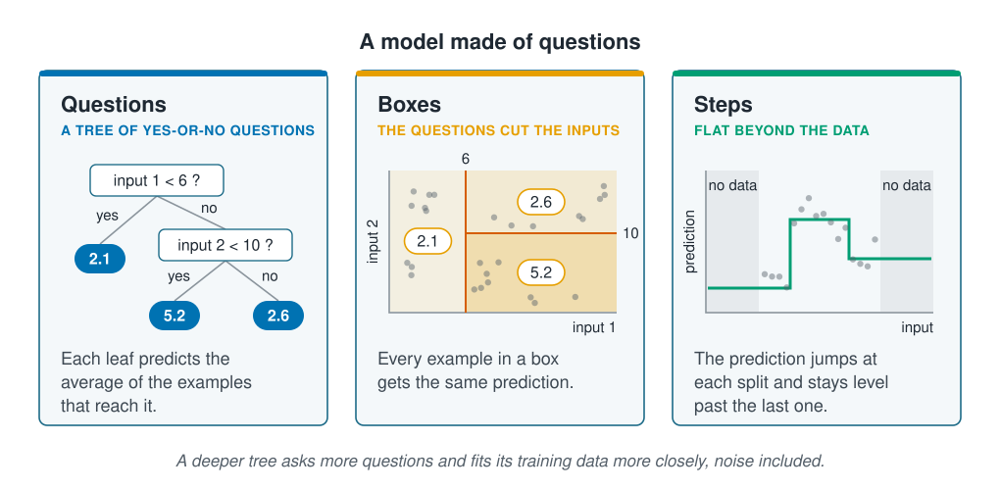

```{r}
#| label: setup
#| include: false
library(tidymodels)
library(tidyverse)
library(poissonreg)
library(rpart.plot)
source(here::here("R/theme.R"))
source(here::here("R/data.R"))
source(here::here("R/python-tabs.R"))
set.seed(123)
```

## A model made of questions

Every model so far in this section weights the inputs and adds them up. A decision
tree works differently: it asks a series of yes-or-no questions about the inputs, such
as whether the water is colder than 6 °C, and predicts from the answers. Nobody
writes down the shape of the relationship; the questions find it.
[Prediction and explanation](../01-introduction/prediction-and-explanation.qmd)
fitted one to three inputs. This page shows how a tree is grown, how to read one, and
how deep to let it grow. The random forests and boosting on the
[next page](forests-and-boosting.qmd) are built from many trees.





## Growing a tree one question at a time

A tree starts with all the training data together. Its first question splits them in
two on one input: every example below a threshold goes one way, every example above it
the other. Each half is then split again with its own question, and so on. A group that
is split no further is a **leaf**, and its prediction is the average outcome of the
training examples in it. For a category, a leaf gives the share of each category
instead, which serves as a probability, so the same method does classification.

To choose each question, the algorithm tries every input and every threshold and keeps
the split that brings the predictions closest to the training data: for a quantity,
the smallest total of squared errors. It then moves on and never revisits a choice.
The tree stops growing when it reaches a set **depth**, the number of questions from
the top to a leaf, or when a group is too small to split.

::: {.diagram}
{fig-alt="Three cards. Questions, a tree of yes-or-no questions: the first asks whether input 1 is below 6; if yes, a leaf predicts 2.1; if no, a second question asks whether input 2 is below 10, with leaves predicting 5.2 and 2.6. Each leaf predicts the average of the examples that reach it. Boxes, the questions cut up the inputs: a square of input 1 against input 2 is cut by a vertical line at 6, and its right part by a horizontal line at 10, giving three boxes labelled 2.1, 5.2 and 2.6; every example in a box gets the same prediction. Steps, flat beyond the data: the prediction against one input is a staircase, low, then high, then middle, and it stays level in the shaded regions beyond the data at either end. A note says a deeper tree asks more questions and fits its training data more closely, noise included."}
:::

## Deeper trees fit more closely

Each extra level of questions cuts the data into smaller groups, so the leaves follow
the training data more closely. Grown until every leaf holds a single example, a tree
reproduces its training data exactly, including the chance ups and downs that will not
recur, and predicts new data badly. Fitting the training data so closely that
predictions on new data get worse is **overfitting**, and
[Underfitting and overfitting](../05-generalisation/underfitting-and-overfitting.qmd)
covers it in full. The depth is therefore chosen on validation data, the role
[Splitting the data](../02-marine-data/splitting-data.qmd) set aside for choosing
between models.

## Worked example

The data and the split by site are those of the earlier pages. A tree needs no squared
terms, since its questions can find a peak, and no dummy columns: rpart, the package
tidymodels uses for trees, asks questions about a category directly, such as whether
the seabed is mud or rock. The recipe only fills the gaps. The training stations are
split once more by site, into fitting and validation sites, for choosing the depth
later.

### Preparing the data

::: {.panel-tabset group="language"}

## R

```{r}
#| label: prepare
survey <- load_coastal_survey_clean()

split <- group_initial_split(survey, group = site_id, prop = 0.75)
train <- training(split)
test  <- testing(split)

fit_split  <- group_initial_split(train, group = site_id, prop = 0.75)
fitting    <- training(fit_split)
validation <- testing(fit_split)

predictors <- abundance ~ depth_m + temperature_c + chlorophyll_mg_m3 +
  salinity_psu + substrate + season

tree_recipe <- recipe(predictors, data = train) |>
  step_impute_median(all_numeric_predictors())
```

## Python

```{python}
import numpy as np
import pandas as pd
from sklearn.compose import ColumnTransformer
from sklearn.impute import SimpleImputer
from sklearn.metrics import root_mean_squared_error
from sklearn.model_selection import GroupShuffleSplit
from sklearn.pipeline import Pipeline
from sklearn.preprocessing import OneHotEncoder
from sklearn.tree import DecisionTreeRegressor, export_text

from mlbasic_data import load_coastal_survey_clean

survey = load_coastal_survey_clean()

numeric = ["depth_m", "temperature_c", "chlorophyll_mg_m3", "salinity_psu"]
categorical = ["substrate", "season"]
predictors = numeric + categorical

grouper = GroupShuffleSplit(n_splits=1, train_size=0.75, random_state=123)
train_rows, test_rows = next(grouper.split(survey, groups=survey["site_id"]))
train, test = survey.iloc[train_rows], survey.iloc[test_rows]

inner = GroupShuffleSplit(n_splits=1, train_size=0.75, random_state=123)
fit_rows, val_rows = next(inner.split(train, groups=train["site_id"]))
fitting, validation = train.iloc[fit_rows], train.iloc[val_rows]

# scikit-learn's trees need numbers, so each category becomes 0/1 columns.
tree_recipe = ColumnTransformer([
    ("numeric", SimpleImputer(strategy="median"), numeric),
    ("categorical", OneHotEncoder(sparse_output=False), categorical),
], verbose_feature_names_out=False)
```

:::

### A tree you can read

`decision_tree()` sets the depth. rpart normally also stops at a split that improves
the fit only a little; `cost_complexity = 0` turns that off, and `min_n = 2` lets it
split any group of two or more, so the depth alone sets the size of the tree.

::: {.panel-tabset group="language"}

## R

```{r}
#| label: fit-tree
tree_model <- function(depth) {
  decision_tree(mode = "regression", tree_depth = depth,
                min_n = 2, cost_complexity = 0)
}

tree_fit <- workflow(tree_recipe, tree_model(3)) |> fit(train)
```

## Python

```{python}
def tree_model(depth, data):
    model = DecisionTreeRegressor(max_depth=depth, random_state=123)
    return Pipeline([("recipe", tree_recipe), ("model", model)]).fit(
        data[predictors], data["abundance"])

tree_fit = tree_model(3, train)
print(export_text(tree_fit["model"], decimals=1,
                  feature_names=list(tree_fit["recipe"].get_feature_names_out())))
```

:::

```{r}
#| label: tree-numbers
#| include: false
tree_engine <- extract_fit_engine(tree_fit)
nodes <- tree_engine$frame |>
  rownames_to_column("node") |>
  mutate(node = as.integer(node),
         cut  = as.numeric(str_extract(labels(tree_engine, digits = 4), "[0-9.]+$")))
node <- function(k) filter(nodes, node == k)
```

::: {.panel-tabset group="language"}

## R

```{r}
#| label: fig-tree
#| fig-cap: "The depth-3 tree for the count. Each box shows the average count of the training stations that reach it, how many stations that is, and their share of all training stations. Follow the answer yes to the left and no to the right."
#| fig-alt: !expr glue::glue("A decision tree three questions deep. The first question asks whether chlorophyll is below {round(node(2)$cut, 1)}; the {node(3)$n} stations above it average {round(node(3)$yval, 1)} animals. The rest are split on temperature at {round(node(4)$cut, 1)} and {round(node(10)$cut, 1)} degrees, giving leaves for cold, middle and warm water, with the most animals in the middle.")
#| fig-width: 9
#| fig-height: 5.5
rpart.plot(tree_engine, roundint = FALSE, type = 2, extra = 101,
           box.palette = "Blues", branch.lty = 3, cex = 0.8)
```

:::

Read it from the top. The first question sets apart the `r node(3)$n` training
stations with more than `r round(node(2)$cut, 1)` mg m⁻³ of chlorophyll, which average
`r round(node(3)$yval, 1)` animals against `r round(node(2)$yval, 1)` for the rest.
Squared errors weigh large counts heavily, so a question that sets apart a few stations
with many animals can reduce them more than any other.

The remaining stations are split twice on temperature. Below
`r round(node(4)$cut, 1)` °C they average `r round(node(4)$yval, 1)` animals, above
`r round(node(10)$cut, 1)` °C `r round(node(10)$yval, 1)`, and in between
`r round(node(11)$yval, 1)`, across `r node(11)$n` stations. The tree has found a
temperature band with the most animals, and it took two questions to do it: one
threshold can only say "more above" or "more below", so a peak needs one question for
each side.

A short tree can be printed and read like an identification key, which makes it
easy to explain to someone who does not model. The thresholds are where this sample
happened to split best, though, not values with a biological meaning; the first
exercise below shows how much they move.

### Predictions come in steps

@fig-steps sets the tree beside Poisson regression from
[Regression for counts](count-regression.qmd), fitted to the same training stations,
across a wider range of temperatures than the survey sampled.

```{r}
#| label: poisson-fit
#| include: false
poisson_recipe <- tree_recipe |>
  step_relevel(substrate, ref_level = "sand") |>
  step_poly(depth_m, temperature_c, degree = 2, options = list(raw = TRUE))
poisson_fit <- workflow(poisson_recipe, poisson_reg()) |> fit(train)
temp_range <- range(train$temperature_c, na.rm = TRUE)
```

::: {.panel-tabset group="language"}

## R

```{r}
#| label: fig-steps
#| fig-cap: "The predicted count across temperature, with the other inputs held at their typical values (sand, summer, median depth, chlorophyll and salinity). The shaded ends lie beyond the temperatures of the training stations, shown as ticks along the bottom."
#| fig-alt: "Two lines of predicted count against temperature from 0 to 20 degrees. The tree is a staircase: low in cold water, a step up to its highest level in the middle of the range, and a step down in warm water, after which it stays level through the shaded region beyond the warmest training station. The Poisson regression curve rises smoothly to a peak in the same middle range and falls towards zero on both sides, continuing to fall in the shaded regions."
#| fig-width: 7.5
#| fig-height: 4.5
grid <- tibble(
  temperature_c     = seq(0, 20, length.out = 400),
  depth_m           = median(train$depth_m, na.rm = TRUE),
  chlorophyll_mg_m3 = median(train$chlorophyll_mg_m3, na.rm = TRUE),
  salinity_psu      = median(train$salinity_psu, na.rm = TRUE),
  substrate         = factor("sand", levels = levels(train$substrate)),
  season            = factor("summer", levels = levels(train$season))
)

curves <- bind_rows(
  augment(tree_fit, grid)    |> mutate(model = "Decision tree"),
  augment(poisson_fit, grid) |> mutate(model = "Poisson regression")
)

ggplot(curves, aes(temperature_c, .pred, colour = model)) +
  annotate("rect", xmin = -Inf, xmax = temp_range[1], ymin = -Inf, ymax = Inf,
           fill = ml_palette[["grey"]], alpha = 0.12) +
  annotate("rect", xmin = temp_range[2], xmax = Inf, ymin = -Inf, ymax = Inf,
           fill = ml_palette[["grey"]], alpha = 0.12) +
  geom_rug(data = train, aes(temperature_c), inherit.aes = FALSE,
           sides = "b", alpha = 0.3, colour = ml_palette[["grey"]]) +
  geom_line(linewidth = 1.1) +
  scale_colour_manual(values = c("Decision tree" = ml_palette[["green"]],
                                 "Poisson regression" = ml_palette[["vermilion"]])) +
  labs(x = "Temperature (°C)", y = "Predicted count", colour = NULL,
       title = "The tree predicts in steps and stays level beyond the data")
```

:::

Both models find the most animals in the middle of the range, but the tree gets there
in steps: every station on the same side of each threshold gets the same prediction,
however far it is from the threshold. Beyond the warmest training station, at
`r round(temp_range[2], 1)` °C, the tree keeps predicting what it predicted for the
warmest stations it saw. It has no rule for going further, so it predicts no change.
Poisson regression continues its shape instead. Neither has any data there, and
[Uneven sampling and extrapolation](../06-assumptions-limitations/sampling-and-extrapolation.qmd)
returns to predicting beyond the data.

### Choosing the depth

Trees of each depth from 1 to 15 are fitted on the fitting sites, three quarters of the
training sites, and scored on the validation sites, the rest.

::: {.panel-tabset group="language"}

## R

```{r}
#| label: depths
score_depth <- function(depth) {
  fitted <- workflow(tree_recipe, tree_model(depth)) |> fit(fitting)
  error <- function(data) {
    rmse_vec(data$abundance, predict(fitted, data)$.pred)
  }
  tibble(depth = depth, training = error(fitting),
         validation = error(validation))
}

depths <- map(1:15, score_depth) |> list_rbind()
depths |> slice_min(validation) |> mutate(across(-depth, \(x) round(x, 2)))
```

## Python

```{python}
def rmse(fitted, data):
    return root_mean_squared_error(data["abundance"],
                                   fitted.predict(data[predictors]))

rows = []
for depth in range(1, 16):
    fitted = tree_model(depth, fitting)
    rows.append({"depth": depth, "training": rmse(fitted, fitting),
                 "validation": rmse(fitted, validation)})
depths = pd.DataFrame(rows)

depths.loc[[depths["validation"].idxmin()]].round(2)
```

:::

::: {.panel-tabset group="language"}

## R

```{r}
#| label: fig-depth
#| fig-cap: "The RMSE of trees of each depth on the stations they were fitted to and on the validation sites. The dashed line marks the depth with the lowest validation error."
#| fig-alt: "Two lines of RMSE against tree depth from 1 to 15. The training line falls steadily, close to zero at depth 15. The validation line falls a little over the first few depths, reaches its lowest point at a middle depth marked by a dashed line, then rises well above where it started."
#| fig-width: 7
#| fig-height: 4.2
best_depth <- depths |> slice_min(validation) |> pull(depth)

depths |>
  pivot_longer(c(training, validation), names_to = "data", values_to = "rmse") |>
  ggplot(aes(depth, rmse, colour = data)) +
  geom_vline(xintercept = best_depth, linetype = "dashed",
             colour = ml_palette[["grey"]]) +
  geom_line(linewidth = 1.1) +
  geom_point(size = 2) +
  scale_colour_manual(values = c(training = ml_palette[["blue"]],
                                 validation = ml_palette[["orange"]])) +
  scale_x_continuous(breaks = seq(1, 15, 2)) +
  expand_limits(y = 0) +
  labs(x = "Tree depth", y = "RMSE", colour = NULL,
       title = "Deeper trees fit their own stations better, new sites worse")
```

:::

```{r}
#| label: depth-numbers
#| include: false
at_depth <- function(d) filter(depths, depth == d)
```

The training error falls with every level, from `r round(at_depth(1)$training, 2)` at
depth 1 to `r round(at_depth(15)$training, 2)` at depth 15, where the tree nearly
reproduces the counts it was fitted to. The validation error falls only from
`r round(at_depth(1)$validation, 2)` to `r round(at_depth(best_depth)$validation, 2)`
at depth `r best_depth`, then climbs to `r round(at_depth(15)$validation, 2)`: past
that depth, the extra questions fit chance patterns in the fitting sites.

### The chosen tree on new sites

The tree is refitted at depth `r best_depth` on all the training stations and scored
once on the test sites.

::: {.panel-tabset group="language"}

## R

```{r}
#| label: test-score
final_fit <- workflow(tree_recipe, tree_model(best_depth)) |> fit(train)
predicted <- predict(final_fit, test)$.pred

tibble(rmse = round(rmse_vec(test$abundance, predicted), 2),
       rsq  = round(rsq_vec(test$abundance, predicted), 2))
```

## Python

```{python}
best_depth = int(depths.loc[depths["validation"].idxmin(), "depth"])
final_fit = tree_model(best_depth, train)
predicted = final_fit.predict(test[predictors])

pd.DataFrame({
    "rmse": [root_mean_squared_error(test["abundance"], predicted)],
    "rsq": [np.corrcoef(predicted, test["abundance"])[0, 1] ** 2],
}).round(2)
```

:::

```{r}
#| label: test-numbers
#| include: false
tree_rmse    <- rmse_vec(test$abundance, predicted)
tree_rsq     <- rsq_vec(test$abundance, predicted)
poisson_pred <- predict(poisson_fit, test)$.pred
poisson_rmse <- rmse_vec(test$abundance, poisson_pred)
poisson_rsq  <- rsq_vec(test$abundance, poisson_pred)
```

On the test sites the tree's RMSE is `r round(tree_rmse, 2)`, worse than its
validation error of `r round(at_depth(best_depth)$validation, 2)`, and its $R^2$ is
`r round(tree_rsq, 2)`. Poisson regression, from
[Regression for counts](count-regression.qmd), scored `r round(poisson_rmse, 2)` and
`r round(poisson_rsq, 2)` on the same sites. Two things are at work. A few validation
sites are a noisy guide to the best depth, and
[Hyperparameter selection](../05-generalisation/hyperparameter-selection.qmd) chooses it
by cross-validation instead. And a
single tree is unstable: a small change in the training data can change the first
question, and everything below it changes too. The
[next page](forests-and-boosting.qmd) averages many trees to steady them.

## Key points

::: {.key-points}
- A decision tree predicts by asking yes-or-no questions about the inputs; each leaf
  predicts the average outcome of the training examples in it, or for a category the
  share of each.
- The tree is grown one question at a time, each the best available at that step, and
  a short tree can be read like an identification key.
- A peak takes two questions, one for each side: the survey's tree found a band from
  `r round(node(4)$cut, 1)` to `r round(node(10)$cut, 1)` °C with the most animals.
- Predictions change in steps and stay level beyond the data.
- Deeper trees fit their training data ever more closely and new data worse, so the
  depth is chosen on validation data. The chosen tree predicted the test sites less
  well than Poisson regression.
:::

## Try it yourself

1. Change the seed before the split to 124 and refit the depth-3 tree. Which question
   comes first now, and how far do the temperature thresholds move?
2. Fit a depth-3 classification tree to `present` with
   `decision_tree(mode = "classification", tree_depth = 3)`. Which question comes
   first, and what share of the stations in each leaf are present?
