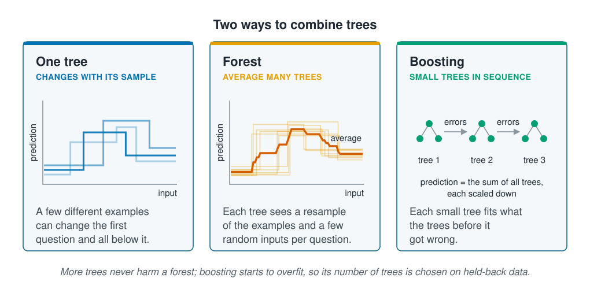

```{r}
#| label: setup
#| include: false
library(tidymodels)
library(tidyverse)
library(poissonreg)
library(patchwork)
source(here::here("R/theme.R"))
source(here::here("R/data.R"))
source(here::here("R/python-tabs.R"))
set.seed(123)
```



## Many trees are steadier than one

A single [decision tree](decision-trees.qmd) is easy to read but unstable: a few
different training examples can change its first question, and every question below it
changes too. Combining many trees steadies the prediction, and there are two common
ways to do it. A **random forest** grows many trees side by side and averages them.
**Boosting** grows small trees one after another, each correcting the ones before it.





## A random forest averages trees grown on resampled data

Each tree in a forest is grown on a **bootstrap sample** of the training data: a sample
of the same size drawn with replacement. Picture each station written on a slip of
paper; a slip is drawn, noted and put back, as many times as there are stations. Some
stations are drawn twice or more and about `r round(100 * exp(-1))`% not at all, so
each sample is a slightly different survey, one that could as well have been
collected. The bootstrap returns in
[Uncertainty and stability](../07-validation/uncertainty-and-stability.qmd), where it
measures how far a score would move with another sample.

Every tree therefore asks slightly different questions, and the forest's prediction is
the average of all the trees' predictions. Where one tree guesses too high and another
too low, the errors partly cancel. A forest adds one more source of variety: at each
question, a tree may choose only among a few inputs picked at random. Without that
rule, one strong input would open almost every tree, the trees would be too alike, and
averaging them would gain little. Adding trees makes the average steadier, up to a
point where more trees change nothing; too many cost computing time but do no harm.

Predicting every station from only the trees whose samples left it out gives the
**out-of-bag error**: a score on stations each tree never saw, which a forest produces
without holding any data back.
It leaves out stations rather than sites, as a
[random split](../02-marine-data/splitting-data.qmd#a-random-split-puts-each-site-on-both-sides)
does, so a station can be scored by trees that saw others from its site. On survey data
it can therefore flatter a forest, and held-back sites remain the fair test.

## Boosting adds small trees in sequence

Boosting starts from a simple prediction, such as the average outcome, and adds trees
one at a time. Each new tree is fitted to the errors that remain: the gaps between the
outcome and the current prediction. Its predictions are scaled down by a
**learning rate**, such as 0.05, and added to the running total, so each tree corrects
only a small part of what is still wrong. The trees are small, often only two or
three questions deep, and the model's prediction is the sum of all of them.

Every tree fits some of what the earlier trees missed, so the training error keeps
falling as trees are added. Eventually the trees are fitting the noise, and the error on
new data rises again. Unlike a forest, then, boosting has a number of trees that is too
many: it is a hyperparameter, chosen on validation data as the depth of a single tree
was. Either way the prediction is built from trees. Averaging turns their large jumps
into many small steps, but beyond the data every tree stays level, and so does the
forest or the boosted sum;
[Uneven sampling and extrapolation](../06-assumptions-limitations/sampling-and-extrapolation.qmd)
deals with predicting outside the data.

::: {.diagram}
{fig-alt="Three cards. One tree changes with its sample: three staircase predictions from trees fitted to slightly different samples of the same data step up at different places. A few different examples can change the first question and everything below it. Forest, average many trees: many faint staircases and their average, a thick line that rises more gradually. Each tree sees a resample of the examples and a few random inputs at each question. Boosting, small trees in sequence: three small trees in a row, each arrow labelled errors, and the prediction is the sum of all the trees, each scaled down. Each small tree fits what the trees before it got wrong. A note says adding trees to a forest stops helping but does no harm; boosting starts to overfit, so its number of trees is chosen on held-back data."}
:::

## Worked example

The data, the split by site, the fitting and validation sites and the recipe are those
of [Decision trees](decision-trees.qmd#worked-example). xgboost, the package tidymodels
uses for boosting, needs numbers only, so its recipe also turns each category into 0/1
columns.

::: {.panel-tabset group="language"}

## R

```{r}
#| label: prepare
survey <- load_coastal_survey_clean()

split <- group_initial_split(survey, group = site_id, prop = 0.75)
train <- training(split)
test  <- testing(split)

fit_split  <- group_initial_split(train, group = site_id, prop = 0.75)
fitting    <- training(fit_split)
validation <- testing(fit_split)

predictors <- abundance ~ depth_m + temperature_c + chlorophyll_mg_m3 +
  salinity_psu + substrate + season

tree_recipe <- recipe(predictors, data = train) |>
  step_impute_median(all_numeric_predictors())

boost_recipe <- tree_recipe |>
  step_dummy(all_nominal_predictors())
```

## Python

```{python}
import numpy as np
import pandas as pd
from sklearn.compose import ColumnTransformer
from sklearn.ensemble import GradientBoostingRegressor, RandomForestRegressor
from sklearn.impute import SimpleImputer
from sklearn.metrics import r2_score, root_mean_squared_error
from sklearn.model_selection import GroupShuffleSplit
from sklearn.pipeline import Pipeline
from sklearn.preprocessing import OneHotEncoder
from sklearn.tree import DecisionTreeRegressor

from mlbasic_data import load_coastal_survey_clean

survey = load_coastal_survey_clean()

numeric = ["depth_m", "temperature_c", "chlorophyll_mg_m3", "salinity_psu"]
categorical = ["substrate", "season"]
predictors = numeric + categorical

grouper = GroupShuffleSplit(n_splits=1, train_size=0.75, random_state=123)
train_rows, test_rows = next(grouper.split(survey, groups=survey["site_id"]))
train, test = survey.iloc[train_rows], survey.iloc[test_rows]

inner = GroupShuffleSplit(n_splits=1, train_size=0.75, random_state=123)
fit_rows, val_rows = next(inner.split(train, groups=train["site_id"]))
fitting, validation = train.iloc[fit_rows], train.iloc[val_rows]

# scikit-learn's trees need numbers, so one recipe serves all three models.
tree_recipe = ColumnTransformer([
    ("numeric", SimpleImputer(strategy="median"), numeric),
    ("categorical", OneHotEncoder(sparse_output=False), categorical),
], verbose_feature_names_out=False)

def fit(model, data):
    return Pipeline([("recipe", tree_recipe), ("model", model)]).fit(
        data[predictors], data["abundance"])

def rmse(fitted, data):
    return root_mean_squared_error(data["abundance"],
                                   fitted.predict(data[predictors]))
```

:::

### One tree changes with its sample

Six bootstrap samples of the training stations each grow a depth-3 tree, and the
first question of each is printed.

::: {.panel-tabset group="language"}

## R

```{r}
#| label: first-questions
tree_model <- function(depth) {
  decision_tree(mode = "regression", tree_depth = depth,
                min_n = 2, cost_complexity = 0)
}

first_question <- function(data) {
  fitted <- workflow(tree_recipe, tree_model(3)) |> fit(data)
  labels(extract_fit_engine(fitted), digits = 3)[2]
}

samples <- bootstraps(train, times = 6)
first_questions <- map_chr(samples$splits, \(s) first_question(analysis(s)))
first_questions
```

## Python

```{python}
names = tree_recipe.fit(train[predictors]).get_feature_names_out()
rng = np.random.default_rng(123)

for _ in range(6):
    sample = train.iloc[rng.integers(0, len(train), len(train))]
    tree = fit(DecisionTreeRegressor(max_depth=3, random_state=123), sample)
    first = tree["model"].tree_
    print(f"{names[first.feature[0]]} < {first.threshold[0]:.3g}")
```

:::

```{r}
#| label: question-numbers
#| include: false
thresholds <- as.numeric(str_extract(first_questions, "[0-9.]+$"))
first_inputs <- unique(str_remove(first_questions, "[<>=].*$"))
stopifnot(length(first_inputs) == 1)
f2 <- function(x) sub("^-", "−", sprintf("%.2f", x))
```

Every sample opens with a question about `r str_remove(first_inputs, "_mg_m3")`,
but the threshold moves from `r min(thresholds)` to `r max(thresholds)` mg m⁻³. Each
threshold sends different stations down each branch, so the questions below it differ
too. The data barely changed; the tree changed a lot.

### More trees steady a forest but overfit boosting

Forests and boosted models of 1 to 1600 trees are fitted on the fitting sites and
scored with the
[RMSE](../01-introduction/prediction-and-explanation.qmd#rmse-measures-a-typical-miss-on-the-test-stations)
on the validation sites. The forest keeps ranger's defaults: two of the six inputs to
choose from at each question, and leaves of at least five stations. The boosted trees are
three questions deep with a learning rate of 0.05.

::: {.panel-tabset group="language"}

## R

```{r}
#| label: tree-counts
forest_model <- function(trees) {
  rand_forest(mode = "regression", trees = trees) |>
    set_engine("ranger", seed = 123)
}

boost_model <- function(trees) {
  boost_tree(mode = "regression", trees = trees,
             tree_depth = 3, learn_rate = 0.05)
}

score <- function(recipe, model, trees) {
  fitted <- workflow(recipe, model) |> fit(fitting)
  error <- function(data) {
    rmse_vec(data$abundance, predict(fitted, data)$.pred)
  }
  tibble(trees = trees, training = error(fitting),
         validation = error(validation))
}

sizes <- c(1, 5, 10, 25, 50, 100, 200, 400, 800, 1600)
forest_scores <- map(sizes, \(n) score(tree_recipe, forest_model(n), n)) |>
  list_rbind()
boost_scores <- map(sizes, \(n) score(boost_recipe, boost_model(n), n)) |>
  list_rbind()

bind_rows(`Random forest` = slice_min(forest_scores, validation),
          Boosting = slice_min(boost_scores, validation), .id = "model") |>
  mutate(across(c(training, validation), \(x) round(x, 2)))
```

## Python

```{python}
def forest_model(trees):
    # max_features="sqrt" draws a few inputs at each question, as ranger does.
    return RandomForestRegressor(n_estimators=trees, max_features="sqrt",
                                 min_samples_leaf=5, random_state=123)

def boost_model(trees):
    return GradientBoostingRegressor(n_estimators=trees, max_depth=3,
                                     learning_rate=0.05, random_state=123)

def score(model, trees):
    fitted = fit(model, fitting)
    return {"trees": trees, "training": rmse(fitted, fitting),
            "validation": rmse(fitted, validation)}

sizes = [1, 5, 10, 25, 50, 100, 200, 400, 800, 1600]
forest_scores = pd.DataFrame([score(forest_model(n), n) for n in sizes])
boost_scores = pd.DataFrame([score(boost_model(n), n) for n in sizes])

pd.concat({
    "Random forest": forest_scores.loc[[forest_scores["validation"].idxmin()]],
    "Boosting": boost_scores.loc[[boost_scores["validation"].idxmin()]],
}).round(2)
```

:::

::: {.panel-tabset group="language"}

## R

```{r}
#| label: fig-trees
#| fig-cap: "The RMSE of forests and boosted models of each size on the stations they were fitted to and on the validation sites. The number of trees is on a log scale."
#| fig-alt: "Two panels of RMSE against the number of trees, from 1 to 1600 on a log scale. In the forest panel both lines fall over the first few trees and then stay flat, the training line well below the validation line. In the boosting panel the training line falls steadily towards zero, while the validation line falls to a low point at a middle number of trees and then rises slowly."
#| fig-width: 8.5
#| fig-height: 4.2
plot_scores <- function(scores, title) {
  scores |>
    pivot_longer(c(training, validation), names_to = "data", values_to = "rmse") |>
    ggplot(aes(trees, rmse, colour = data)) +
    geom_line(linewidth = 1.1) +
    geom_point(size = 2) +
    scale_x_log10() +
    scale_colour_manual(values = c(training = ml_palette[["blue"]],
                                   validation = ml_palette[["orange"]]),
                        breaks = c("training", "validation"),
                        labels = c("Fitting stations", "Validation sites")) +
    expand_limits(y = 0) +
    labs(x = "Number of trees (log scale)", y = "RMSE (individuals)",
         colour = NULL, title = title)
}

plot_scores(forest_scores, "Forest: more trees stop helping") +
  plot_scores(boost_scores, "Boosting: too many trees fit the noise") +
  plot_layout(guides = "collect", axes = "collect") &
  theme(legend.position = "bottom")
```

:::

```{r}
#| label: count-numbers
#| include: false
at_size <- function(scores, n) filter(scores, trees == n)
best_boost <- boost_scores |> slice_min(validation) |> pull(trees)
```

The forest's validation error falls from `r f2(at_size(forest_scores, 1)$validation)`
with one tree to `r f2(at_size(forest_scores, 100)$validation)` with 100, and
then barely moves: `r f2(at_size(forest_scores, 1600)$validation)` with 1600.
Its training error settles well below that, because every tree has seen most of the
fitting stations. The page uses 400 trees from here on.

Boosting behaves differently. Its training error falls with every tree added, to
`r f2(at_size(boost_scores, 1600)$training)` at 1600 trees. Its validation error
is lowest, `r f2(at_size(boost_scores, best_boost)$validation)`, at
`r best_boost` trees and rises after that, to
`r f2(at_size(boost_scores, 1600)$validation)` at 1600. The later trees are
fitting chance patterns in the fitting sites, the overfitting a deep single tree
showed.

ranger also records the forest's out-of-bag error as it grows the trees.

::: {.panel-tabset group="language"}

## R

```{r}
#| label: out-of-bag
forest_400 <- workflow(tree_recipe, forest_model(400)) |> fit(fitting)
# ranger's prediction.error is the out-of-bag mean squared error
tibble(training   = at_size(forest_scores, 400)$training,
       out_of_bag = sqrt(extract_fit_engine(forest_400)$prediction.error)) |>
  round(2)
```

## Python

```{python}
forest_400 = fit(forest_model(400).set_params(oob_score=True), fitting)
out_of_bag = forest_400["model"].oob_prediction_
pd.DataFrame({
    "training": [rmse(forest_400, fitting)],
    "out_of_bag": [root_mean_squared_error(fitting["abundance"], out_of_bag)],
}).round(2)
```

:::

```{r}
#| label: out-of-bag-numbers
#| include: false
oob_rmse <- sqrt(extract_fit_engine(forest_400)$prediction.error)
stopifnot(oob_rmse > at_size(forest_scores, 400)$validation)
```

On the fitting stations the 400-tree forest misses by
`r f2(at_size(forest_scores, 400)$training)` animals, but by `r f2(oob_rmse)` when each
station is predicted only by the trees that never drew it. The out-of-bag error is the
more honest of the two. It is higher than the validation error, but the two score
different stations, and
[RMSEs from different test sets cannot be compared](../02-marine-data/information-leakage.qmd#group-leakage-the-same-site-twice).

### The ensembles beat one tree but not Poisson regression

The forest of 400 trees and the boosted model of `r best_boost` trees are refitted on
all the training stations and scored once on the test sites, beside the depth-5 tree
from [Decision trees](decision-trees.qmd) and Poisson regression from
[Regression for counts](count-regression.qmd).
[$R^2$](../02-marine-data/information-leakage.qmd#one-linear-regression-shows-each-kind)
is the share of the variation in the test counts that the predictions follow.

::: {.panel-tabset group="language"}

## R

```{r}
#| label: compare
forest_fit <- workflow(tree_recipe, forest_model(400)) |> fit(train)
boost_fit  <- workflow(boost_recipe, boost_model(best_boost)) |> fit(train)
tree_fit   <- workflow(tree_recipe, tree_model(5)) |> fit(train)

curve_recipe <- tree_recipe |>
  step_poly(depth_m, temperature_c, degree = 2, options = list(raw = TRUE))
poisson_fit <- workflow(curve_recipe, poisson_reg()) |> fit(train)

test_score <- function(fitted, label) {
  predicted <- predict(fitted, test)$.pred
  tibble(model = label,
         rmse  = rmse_vec(test$abundance, predicted),
         rsq   = rsq_trad_vec(test$abundance, predicted))
}

scores <- bind_rows(test_score(tree_fit, "Decision tree"),
                    test_score(boost_fit, "Boosting"),
                    test_score(forest_fit, "Random forest"),
                    test_score(poisson_fit, "Poisson regression"))
scores |> mutate(across(-model, \(x) round(x, 2)))
```

## Python

```{python}
from sklearn.linear_model import PoissonRegressor
from sklearn.preprocessing import PolynomialFeatures

best_boost = int(boost_scores.loc[boost_scores["validation"].idxmin(), "trees"])

def squared(column):
    return (column, Pipeline([
        ("impute", SimpleImputer(strategy="median")),
        ("poly", PolynomialFeatures(degree=2, include_bias=False)),
    ]), [column])

curve_recipe = ColumnTransformer([
    squared("depth_m"),
    squared("temperature_c"),
    ("numeric", SimpleImputer(strategy="median"),
     ["chlorophyll_mg_m3", "salinity_psu"]),
    ("categorical", OneHotEncoder(drop=["gravel", "spring"], sparse_output=False),
     categorical),
])
poisson_fit = Pipeline([
    ("recipe", curve_recipe),
    ("model", PoissonRegressor(alpha=0, solver="newton-cholesky")),
]).fit(train[predictors], train["abundance"])

def test_score(fitted, label):
    predicted = fitted.predict(test[predictors])
    return {"model": label,
            "rmse": root_mean_squared_error(test["abundance"], predicted),
            "rsq": r2_score(test["abundance"], predicted)}

pd.DataFrame([
    test_score(fit(DecisionTreeRegressor(max_depth=5, random_state=123), train),
               "Decision tree"),
    test_score(fit(boost_model(best_boost), train), "Boosting"),
    test_score(fit(forest_model(400), train), "Random forest"),
    test_score(poisson_fit, "Poisson regression"),
]).round(2)
```

:::

```{r}
#| label: compare-numbers
#| include: false
# The depth-5 tree is the one Decision trees chose on the same validation sites.
depth_rmse <- map_dbl(1:15, \(d) {
  fitted <- workflow(tree_recipe, tree_model(d)) |> fit(fitting)
  rmse_vec(validation$abundance, predict(fitted, validation)$.pred)
})
stopifnot(which.min(depth_rmse) == 5)
get_score <- function(label) scores |> filter(model == label)
tree_score    <- get_score("Decision tree")
boost_score   <- get_score("Boosting")
forest_score  <- get_score("Random forest")
poisson_score <- get_score("Poisson regression")
```

Both ensembles predict the test sites better than the single tree, which misses by
`r f2(tree_score$rmse)` animals. Boosting misses by `r f2(boost_score$rmse)`, with an
$R^2$ of `r f2(boost_score$rsq)`, still below zero; the forest misses by
`r f2(forest_score$rmse)`, with `r f2(forest_score$rsq)`. Poisson regression, at
`r f2(poisson_score$rmse)` and `r f2(poisson_score$rsq)`, is still the best. The
`r nrow(train)` noisy training stations do not hold enough information for many trees to learn a
shape that a smooth curve with a few terms describes as well; with far more stations,
the balance can shift towards the ensembles. The Python tab, with its own split of the
sites, puts the forest just ahead of Poisson regression. A gap that small could change
with another set of test sites, which
[Uncertainty and stability](../07-validation/uncertainty-and-stability.qmd) measures.
[Choosing a method](choosing-a-method.qmd) compares the section's models together.

A forest or a boosted model cannot be printed and read like a single tree: its answer
is the sum of hundreds of trees.
[Feature importance](../10-interpretation/feature-importance.qmd) shows which inputs
such a model relies on, and [Partial effects](../10-interpretation/partial-effects.qmd)
how its predictions change with each.

## Key points

::: {.key-points}
- A single tree is unstable: resampling the survey kept the first input but moved its
  threshold from `r min(thresholds)` to `r max(thresholds)` mg m⁻³.
- A random forest averages many trees, each grown on a bootstrap sample and choosing
  among a few random inputs at each question. Adding trees steadies it and never makes
  it worse, and the stations each tree left out give an out-of-bag error for free.
- Boosting adds small trees in sequence, each fitted to the remaining errors and scaled
  down by a learning rate. Too many trees fit the noise, so the number is chosen on
  validation data.
- On the test sites both ensembles beat the single tree, the forest by most, and
  neither beat Poisson regression.
:::

## Try it yourself

1. Refit the boosted model with `learn_rate = 0.3`. How many trees give the lowest
   validation error now, and is that error lower or higher than with 0.05?
2. Set `mtry = 6` in `rand_forest()`, so every question may use any input, and score
   the forest of 400 trees on the validation sites. How much does the random choice of
   inputs matter here?
