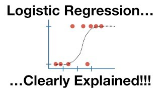
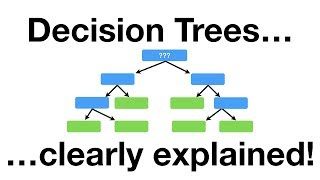
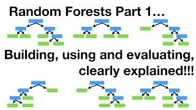

Supervised learning means learning from examples where you already know the answer:
casts where the water mass was identified, hauls where the catch was recorded, images
where a specialist labelled the species. The model learns the relationship, then
applies it to cases where the answer is unknown.

This is the family of methods most marine work needs. This section covers the
workhorses, from linear regression through to boosted trees and, more importantly,
how to pick one.

Two earlier pages left debts here. [Section
1](../01-introduction/prediction-and-explanation.qmd) built a model that recovered a
species' thermal optimum and predicted negative fish; [section
2](../02-marine-data/index.qmd) pointed here for a model that respects what a count is.
Both are paid on the [linear, polynomial and count regression
page](linear-and-polynomial-regression.qmd), and the fix turns out to predict better as
well as more plausibly.

::: {.callout-note}
The closing page runs all ten models on the same survey with identical features. The
winner is a generalised linear model with two quadratic terms, ahead of the random
forest and both boosted models. That ordering is a fact about this dataset, not a
general ranking, and the page says why it turned out that way.
:::

## Pages in this section

::: {#pages}
:::

## Further resources

**Documentation**

- [Build a model](https://www.tidymodels.org/start/models/), tidymodels. One model specification, several engines.
- [Search parsnip models](https://www.tidymodels.org/find/parsnip/), tidymodels. Which methods have a `parsnip` interface and what each engine needs.
- [Supervised learning](https://scikit-learn.org/stable/supervised_learning.html), scikit-learn user guide. The whole menu, with [linear models](https://scikit-learn.org/stable/modules/linear_model.html) and [ensembles](https://scikit-learn.org/stable/modules/ensemble.html) as the two that matter here.

**Video**

::: {.video-list}
- [{.video-thumb fig-alt="StatQuest: Logistic Regression, on YouTube" loading="lazy"}](https://www.youtube.com/watch?v=yIYKR4sgzI8)

  [StatQuest: Logistic Regression](https://www.youtube.com/watch?v=yIYKR4sgzI8), StatQuest with Josh Starmer.

- [{.video-thumb fig-alt="StatQuest: Decision Trees, on YouTube" loading="lazy"}](https://www.youtube.com/watch?v=7VeUPuFGJHk)

  [StatQuest: Decision Trees](https://www.youtube.com/watch?v=7VeUPuFGJHk), StatQuest with Josh Starmer.

- [{.video-thumb fig-alt="StatQuest: Random Forests Part 1, on YouTube" loading="lazy"}](https://www.youtube.com/watch?v=J4Wdy0Wc_xQ)

  [StatQuest: Random Forests Part 1](https://www.youtube.com/watch?v=J4Wdy0Wc_xQ), StatQuest with Josh Starmer. Bagging and out-of-bag error, which is where the forest's self-validation comes from.
:::
