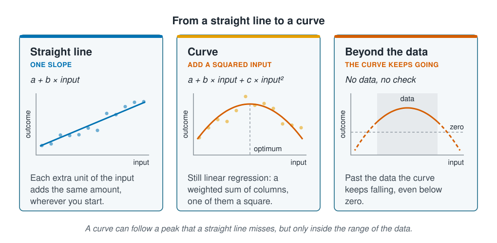

```{r}
#| label: setup
#| include: false
library(tidymodels)
library(tidyverse)
source(here::here("R/theme.R"))
source(here::here("R/data.R"))
source(here::here("R/python-tabs.R"))
set.seed(123)
```

## A straight line is where regression starts

Linear regression is the model most scientists already know, and most of this section
builds on it. This page sets out what it assumes, then bends the straight line into a
curve that can find the temperature a species prefers. The curve fits better, and it
shows the first problem with modelling counts: it predicts fewer than zero animals.





## A straight line and its assumptions

Linear regression predicts the outcome as a starting value plus a fixed amount for each
input:

$$\hat{y} = a + b_1 x_1 + b_2 x_2 + \dots$$

Each **coefficient** ($b_1$, $b_2$, ...) is the change in the prediction for one extra
unit of that input, with the other inputs held fixed. If the coefficient for
temperature is 0.5, each extra degree adds half a unit to the prediction, in cold water
and in warm.

That one sentence carries the model's assumptions. One extra unit has the same effect
everywhere, so the relationship is a straight line. The errors, the gaps between the
data and the line, are assumed independent of one another and about equally large
everywhere. And nothing stops the prediction from taking any value, negative ones
included.

## Bending the line into a curve

A straight line cannot rise and then fall. Adding the square of an input as one more
column lets it:

$$\hat{y} = a + b x + c x^2$$

This is **polynomial regression**, and it is still linear regression. The prediction
is still a starting value plus a coefficient times each column; one of the columns
happens to be a square. "Linear" refers to how the coefficients combine, not to the
shape of the curve.

When $c$ is negative the curve has one peak, at $x = -b / 2c$. That is the shape of an
optimum: a species that does best at one temperature or depth and less well on either
side. The same property causes trouble at the edges. Outside the range of the data, a
curve keeps rising or falling, and nothing in the model checks where it goes.

::: {.diagram}
{fig-alt="Three cards. Straight line: a plus b times the input; each extra unit of the input adds the same amount, wherever you start. Curve: a plus b times the input plus c times the input squared; the curve rises to a peak, marked optimum, and falls again; it is still linear regression, a weighted sum of columns, one of them a square. Beyond the data: a shaded band marks the range of the data, the curve peaks inside it and, dashed, keeps falling outside it on both sides, below a line marking zero. A note says a curve can follow a peak that a straight line misses, but only inside the range of the data."}
:::

## Worked example

The survey's count of one species is the outcome, with depth, temperature, chlorophyll,
salinity, seabed type and season as inputs. Each model is fitted once as a straight line
and once with a squared term for depth and temperature.

### Preparing the data

The survey visits each site several times, so the data are split by site, as
[Splitting the data](../02-marine-data/splitting-data.qmd) recommends: the test sites
are new to the models. In the recipe, `step_poly()` adds the squared columns;
`raw = TRUE` keeps them as plain squares, so the coefficients mean what they do in the
equation above.

::: {.panel-tabset group="language"}

## R

```{r}
#| label: prepare
survey <- load_coastal_survey_clean()

split <- group_initial_split(survey, group = site_id, prop = 0.75)
train <- training(split)
test  <- testing(split)

predictors <- abundance ~ depth_m + temperature_c + chlorophyll_mg_m3 +
  salinity_psu + substrate + season

line_recipe <- recipe(predictors, data = train) |>
  step_impute_median(all_numeric_predictors()) |>
  step_relevel(substrate, ref_level = "sand")

curve_recipe <- line_recipe |>
  step_poly(depth_m, temperature_c, degree = 2, options = list(raw = TRUE))
```

## Python

```{python}
import numpy as np
import pandas as pd
from sklearn.compose import ColumnTransformer
from sklearn.impute import SimpleImputer
from sklearn.model_selection import GroupShuffleSplit
from sklearn.pipeline import Pipeline
from sklearn.preprocessing import OneHotEncoder, PolynomialFeatures

from mlbasic_data import load_coastal_survey_clean

survey = load_coastal_survey_clean()

numeric = ["depth_m", "temperature_c", "chlorophyll_mg_m3", "salinity_psu"]
categorical = ["substrate", "season"]
predictors = numeric + categorical

grouper = GroupShuffleSplit(n_splits=1, train_size=0.75, random_state=123)
train_rows, test_rows = next(grouper.split(survey, groups=survey["site_id"]))
train, test = survey.iloc[train_rows], survey.iloc[test_rows]

# The dropped level of each column is its baseline: sand, and spring as in R.
dummies = OneHotEncoder(drop=["sand", "spring"], sparse_output=False)

line_recipe = ColumnTransformer([
    ("numeric", SimpleImputer(strategy="median"), numeric),
    ("categorical", dummies, categorical),
])

# One PolynomialFeatures per column, as step_poly() does: given both columns
# at once, it would also add depth times temperature.
def squared(column):
    return (column, Pipeline([
        ("impute", SimpleImputer(strategy="median")),
        ("poly", PolynomialFeatures(degree=2, include_bias=False)),
    ]), [column])

curve_recipe = ColumnTransformer([
    squared("depth_m"),
    squared("temperature_c"),
    ("numeric", SimpleImputer(strategy="median"),
     ["chlorophyll_mg_m3", "salinity_psu"]),
    ("categorical", dummies, categorical),
])
```

:::

### Linear regression

::: {.panel-tabset group="language"}

## R

```{r}
#| label: fit-line
line_fit <- workflow(line_recipe, linear_reg()) |> fit(train)

tidy(line_fit) |>
  filter(term %in% c("depth_m", "temperature_c")) |>
  transmute(term, estimate = as.character(signif(estimate, 3)))
```

## Python

```{python}
from sklearn.linear_model import LinearRegression

def fit(recipe):
    return Pipeline([("recipe", recipe), ("model", LinearRegression())]).fit(
        train[predictors], train["abundance"])

def coefficients(fitted):
    table = pd.DataFrame({"term": fitted[:-1].get_feature_names_out(),
                          "estimate": fitted[-1].coef_})
    table = table[table["term"].str.contains("depth|temperature")]
    return table.assign(estimate=table["estimate"].map(lambda v: float(f"{v:.3g}"))
                        ).reset_index(drop=True)

line_fit = fit(line_recipe)
coefficients(line_fit)
```

:::

```{r}
#| label: line-numbers
#| include: false
line_coef <- tidy(line_fit) |> select(term, estimate) |> deframe()
```

The straight line gives temperature a coefficient of
`r signif(line_coef[["temperature_c"]], 2)`: each extra degree lowers the predicted
count by `r abs(signif(line_coef[["temperature_c"]], 2))` animals, with the other inputs
held fixed. Read on its own, the line says warmer water always means fewer animals, at
the same rate from the coldest station to the warmest.

### Polynomial regression

::: {.panel-tabset group="language"}

## R

```{r}
#| label: fit-curve
curve_fit <- workflow(curve_recipe, linear_reg()) |> fit(train)

tidy(curve_fit) |>
  filter(str_detect(term, "depth|temperature")) |>
  transmute(term, estimate = as.character(signif(estimate, 3)))
```

## Python

```{python}
curve_fit = fit(curve_recipe)
coefficients(curve_fit)
```

:::

```{r}
#| label: curve-numbers
#| include: false
curve_coef <- tidy(curve_fit) |> select(term, estimate) |> deframe()
temp_b <- curve_coef[["temperature_c_poly_1"]]
temp_c <- curve_coef[["temperature_c_poly_2"]]
optimum <- -temp_b / (2 * temp_c)
temp_range <- range(train$temperature_c, na.rm = TRUE)
```

In R the columns are named `_poly_1` for the input and `_poly_2` for its square. For
temperature, $b$ is `r signif(temp_b, 3)` and $c$ is `r signif(temp_c, 3)`: negative, so
the curve has a peak, at $-b / 2c$ = `r round(optimum, 1)` °C. The survey's
temperatures run from `r round(temp_range[1], 1)` to `r round(temp_range[2], 1)` °C, so
the peak sits well inside the data.

The curve tells a different story from the line: the count rises with temperature up
to the peak and falls after it. A straight line cannot show that. Fitted through a
hump, it averages the rising side with the falling side, and its one slope describes
neither.

::: {.panel-tabset group="language"}

## R

```{r}
#| label: fig-shapes
#| fig-cap: "The predicted count across the survey's temperatures, with the other inputs held at their typical values (sand, summer, median depth, chlorophyll and salinity). The ticks along the bottom are the training stations. Linear regression falls steadily; polynomial regression finds the peak and falls below zero in warm water."
#| fig-alt: "Two lines of predicted count against temperature, with a horizontal line marking zero and ticks along the bottom showing the temperatures of the training stations. The linear regression line declines slowly. The polynomial regression curve rises from the cold end to a peak in the middle of the range, then falls steeply and crosses zero before the warm end of the data."
#| fig-width: 7.5
#| fig-height: 4.5
grid <- tibble(
  temperature_c     = seq(temp_range[1], temp_range[2], length.out = 200),
  depth_m           = median(train$depth_m, na.rm = TRUE),
  chlorophyll_mg_m3 = median(train$chlorophyll_mg_m3, na.rm = TRUE),
  salinity_psu      = median(train$salinity_psu, na.rm = TRUE),
  substrate         = factor("sand", levels = levels(train$substrate)),
  season            = factor("summer", levels = levels(train$season))
)

curves <- bind_rows(
  augment(line_fit, grid)  |> mutate(model = "Linear regression"),
  augment(curve_fit, grid) |> mutate(model = "Polynomial regression")
)

ggplot(curves, aes(temperature_c, .pred, colour = model)) +
  geom_hline(yintercept = 0, colour = ml_palette[["grey"]], linewidth = 0.6) +
  geom_rug(data = train, aes(temperature_c), inherit.aes = FALSE,
           sides = "b", alpha = 0.3, colour = ml_palette[["grey"]]) +
  geom_line(linewidth = 1.1) +
  scale_colour_manual(values = c("Linear regression" = ml_palette[["blue"]],
                                 "Polynomial regression" = ml_palette[["orange"]]),
                      breaks = c("Linear regression", "Polynomial regression")) +
  labs(x = "Temperature (°C)", y = "Predicted count", colour = NULL,
       title = "Polynomial regression finds a peak the straight line misses")
```

:::

### The two compared on new sites

Both models are scored on the test sites with the two measures from
[Avoiding information leakage](../02-marine-data/information-leakage.qmd): the **RMSE**, roughly
how far a prediction usually lands from the true count, and **$R^2$**, the share of the
variation in the test counts that the predictions follow. The last two columns give
the lowest prediction and the number below zero.

::: {.panel-tabset group="language"}

## R

```{r}
#| label: compare
score <- function(fitted, label) {
  predictions <- augment(fitted, test)
  tibble(
    model      = label,
    rmse       = rmse_vec(predictions$abundance, predictions$.pred),
    rsq        = rsq_vec(predictions$abundance, predictions$.pred),
    lowest     = min(predictions$.pred),
    below_zero = sum(predictions$.pred < 0)
  )
}

scores <- bind_rows(
  score(line_fit,  "Linear regression"),
  score(curve_fit, "Polynomial regression")
)
scores |> mutate(across(rmse:lowest, \(x) round(x, 2)))
```

## Python

```{python}
from sklearn.metrics import r2_score, root_mean_squared_error

def score(fitted, label):
    predicted = fitted.predict(test[predictors])
    truth = test["abundance"]
    return {
        "model": label,
        "rmse": round(root_mean_squared_error(truth, predicted), 2),
        "rsq": round(np.corrcoef(predicted, truth)[0, 1] ** 2, 2),
        "lowest": round(predicted.min(), 2),
        "below_zero": int((predicted < 0).sum()),
    }

pd.DataFrame([score(line_fit, "Linear regression"),
              score(curve_fit, "Polynomial regression")])
```

:::

```{r}
#| label: compare-numbers
#| include: false
line_score  <- scores |> filter(model == "Linear regression")
curve_score <- scores |> filter(model == "Polynomial regression")
```

On sites the models have never seen, polynomial regression does better: $R^2$ rises from
`r round(line_score$rsq, 2)` to `r round(curve_score$rsq, 2)`, and the RMSE falls from
`r round(line_score$rmse, 2)` to `r round(curve_score$rmse, 2)` animals. Neither is
high; predicting a new site is hard, as
[Avoiding information leakage](../02-marine-data/information-leakage.qmd) found.

## Fewer than zero animals

The better model is also the more impossible one. Polynomial regression predicts a negative count
at `r curve_score$below_zero` of the `r nrow(test)` test stations, the lowest
`r round(curve_score$lowest, 1)` animals; linear regression does so at
`r line_score$below_zero`. Nothing in linear regression knows that a count
stops at zero. The curve falls steeply after its peak, so it crosses zero sooner.

Setting the negative predictions to zero hides the symptom but not the cause: the model
still assumes a count can go on falling below zero, and that its errors are the same
size at a count of 1 as at a count of 30.
[Regression for counts](count-regression.qmd) introduces a model built for counts.

## Key points

::: {.key-points}
- Linear regression predicts a starting value plus a fixed amount per unit of each
  input; each coefficient is the change for one extra unit, with the other inputs held
  fixed.
- Adding a squared input bends the line into a curve with one peak. It is still linear
  regression, and it suits a species with an optimum temperature or depth.
- A straight line can hide a peak: on the survey, the line says each degree changes
  the count by `r signif(line_coef[["temperature_c"]], 2)`, while the curve finds a
  peak at `r round(optimum, 1)` °C.
- The curve scores better on new sites, and predicts a negative count at
  `r curve_score$below_zero` of `r nrow(test)` test stations.
- Outside the range of the data, a curve keeps rising or falling; use it only inside
  that range.
:::

## Try it yourself

1. Change `degree = 2` to `degree = 3` in `curve_recipe`. Does the test RMSE improve,
   and what happens to the temperature curve at the cold and warm ends?
2. Draw the grid from 0 to 25 °C instead of the survey's range, and redraw the figure.
   Where does each model go outside the data?
