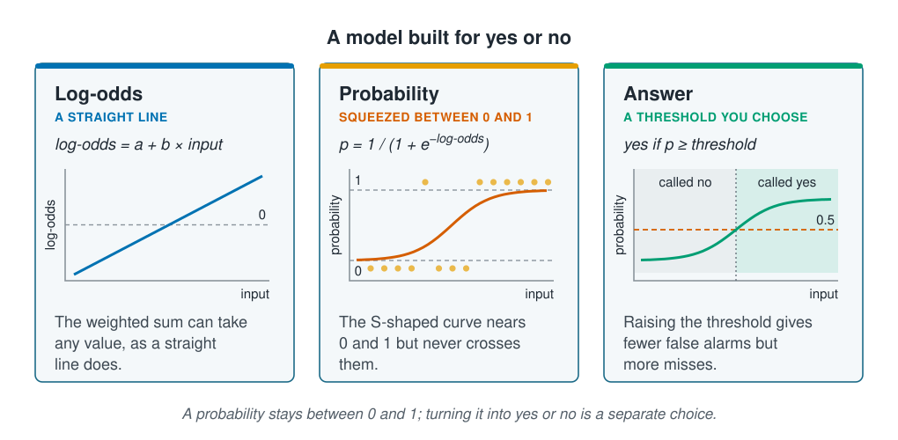

```{r}
#| label: setup
#| include: false
library(tidymodels)
library(tidyverse)
source(here::here("R/theme.R"))
source(here::here("R/data.R"))
source(here::here("R/python-tabs.R"))
set.seed(123)
```

## A probability stays between 0 and 1

Whether a species is present at a station is a yes-or-no outcome, and a useful answer
is a probability. Logistic regression gives one, with the same design as the Poisson
regression of [Regression for counts](count-regression.qmd). This page shows how to
read its coefficients as odds ratios, and that turning a probability into yes or no is
a separate choice, made from the cost of each kind of mistake.





## Predicting the log-odds

A probability $p$ must lie between 0 and 1, but a weighted sum of inputs can take any
value. Logistic regression connects the two through the **odds**: the probability that
something happens divided by the probability that it does not, $p / (1 - p)$. A
probability of 0.8 gives odds of 4, often said "four to one". The odds run from 0
upwards without limit, and their logarithm, the **log-odds**, from far below zero to far
above, the same range as a weighted sum. So logistic regression predicts the log-odds:

$$\log\!\left(\frac{\hat{p}}{1 - \hat{p}}\right) = a + b_1 x_1 + b_2 x_2 + \dots \qquad\text{so}\qquad \hat{p} = \frac{1}{1 + e^{-(a + b_1 x_1 + b_2 x_2 + \dots)}}$$

However large or small the sum, $\hat{p}$ stays between 0 and 1. Against one input it
traces an S-shaped curve, close to 0 at one end and close to 1 at the other.

As with counts, raising $e$ to the power of a coefficient gives a multiplier, here on
the odds: the **odds ratio**. A coefficient of 0.4 multiplies the odds by $e^{0.4}$ =
`r round(exp(0.4), 2)` for each extra unit of the input. What that does to the
probability depends on where it starts: an odds ratio of 2 takes a probability of 0.5
to `r round(2 / 3, 2)`, but 0.9 only to `r round(0.9 * 2 / (0.1 + 0.9 * 2), 2)`. A
squared input gives the log-odds one peak, as it did for counts, and the probability
peaks at the same place.

## A probability is not yet an answer

Many uses need yes or no: survey a site or not, protect an area or not. A **threshold**
turns the probability into an answer: yes if the probability reaches it, no if not.
`predict()` uses 0.5, but nothing in the data chooses that number.

A yes-or-no answer can be wrong in two ways. A **false alarm** says yes where the truth
is no; a **miss** says no where the truth is yes. Raising the threshold gives fewer
false alarms and more misses, and lowering it the reverse. The right balance depends on
what each mistake costs, which only the person using the model can say.

::: {.diagram}
{fig-alt="Three cards. Log-odds, a straight line: log-odds equals a plus b times the input; a rising straight line crosses a dashed line marking zero; the weighted sum can take any value, as a straight line does. Probability, squeezed between 0 and 1: p equals 1 over 1 plus e to the minus log-odds; an S-shaped curve rises from near 0 to near 1, between dashed lines at 0 and 1, with observed no answers as dots along the bottom and yes answers along the top, more of them to the right; the curve nears 0 and 1 but never crosses them. Answer, a threshold you choose: yes if p is at least the threshold; a dashed line at 0.5 cuts the curve, inputs to the left of the crossing are called no and to the right called yes; raising the threshold gives fewer false alarms but more misses. A note says a probability stays between 0 and 1, and turning it into yes or no is a separate choice."}
:::

## Worked example

The outcome is `present`: whether any animal of the species was caught at a station.
The split by site and the recipe with squared depth and temperature are those of
[Linear and polynomial regression](linear-and-polynomial-regression.qmd).

### Preparing the data

In R, `logistic_reg()` fits with `glm()`, which predicts the probability of the
outcome's second level. The survey lists `yes` before `no`, so the model would describe
absence; `fct_relevel()` puts `no` first, so it describes presence.

::: {.panel-tabset group="language"}

## R

```{r}
#| label: prepare
survey <- load_coastal_survey_clean() |>
  mutate(present = fct_relevel(present, "no"))

split <- group_initial_split(survey, group = site_id, prop = 0.75)
train <- training(split)
test  <- testing(split)

predictors <- present ~ depth_m + temperature_c + chlorophyll_mg_m3 +
  salinity_psu + substrate + season

curve_recipe <- recipe(predictors, data = train) |>
  step_impute_median(all_numeric_predictors()) |>
  step_relevel(substrate, ref_level = "sand") |>
  step_poly(depth_m, temperature_c, degree = 2, options = list(raw = TRUE))
```

## Python

```{python}
import numpy as np
import pandas as pd
import statsmodels.api as sm
from sklearn.compose import ColumnTransformer
from sklearn.impute import SimpleImputer
from sklearn.model_selection import GroupShuffleSplit
from sklearn.pipeline import Pipeline
from sklearn.preprocessing import OneHotEncoder, PolynomialFeatures

from mlbasic_data import load_coastal_survey_clean

survey = load_coastal_survey_clean()

numeric = ["depth_m", "temperature_c", "chlorophyll_mg_m3", "salinity_psu"]
categorical = ["substrate", "season"]
predictors = numeric + categorical

grouper = GroupShuffleSplit(n_splits=1, train_size=0.75, random_state=123)
train_rows, test_rows = next(grouper.split(survey, groups=survey["site_id"]))
train, test = survey.iloc[train_rows], survey.iloc[test_rows]

def squared(column):
    return (column, Pipeline([
        ("impute", SimpleImputer(strategy="median")),
        ("poly", PolynomialFeatures(degree=2, include_bias=False)),
    ]), [column])

curve_recipe = ColumnTransformer([
    squared("depth_m"),
    squared("temperature_c"),
    ("numeric", SimpleImputer(strategy="median"),
     ["chlorophyll_mg_m3", "salinity_psu"]),
    ("categorical", OneHotEncoder(drop=["sand", "spring"], sparse_output=False),
     categorical),
])

# statsmodels gives confidence intervals, as for the count models, and takes
# the outcome as 1 for present and 0 for absent, so no level order to watch.
prepared = curve_recipe.fit(train[predictors])

def design(data):
    columns = pd.DataFrame(prepared.transform(data[predictors]),
                           columns=prepared.get_feature_names_out(),
                           index=data.index)
    return sm.add_constant(columns)

def outcome(data):
    return (data["present"] == "yes").astype(int)
```

:::

### The probability curve

::: {.panel-tabset group="language"}

## R

```{r}
#| label: fit
logistic_fit <- workflow(curve_recipe, logistic_reg()) |> fit(train)
```

## Python

```{python}
logistic_fit = sm.GLM(outcome(train), design(train),
                      family=sm.families.Binomial()).fit()
```

:::

```{r}
#| label: curve-numbers
#| include: false
logistic_coef <- tidy(logistic_fit) |> select(term, estimate) |> deframe()
logistic_optimum <- -logistic_coef[["temperature_c_poly_1"]] /
  (2 * logistic_coef[["temperature_c_poly_2"]])

# Linear regression with the same inputs, on presence coded as 1 and absence as 0
train_01 <- train |> mutate(present = as.numeric(present == "yes"))
linear_01 <- workflow(
  recipe(predictors, data = train_01) |>
    step_impute_median(all_numeric_predictors()) |>
    step_relevel(substrate, ref_level = "sand") |>
    step_poly(depth_m, temperature_c, degree = 2, options = list(raw = TRUE)),
  linear_reg()
) |> fit(train_01)
linear_above_1 <- sum(predict(linear_01, test)$.pred > 1)
```

The probability of presence peaks at `r round(logistic_optimum, 1)` °C and falls away
on either side. Linear regression with the same inputs, fitted to presence coded as 1
and absence as 0, predicts a probability above 1 for `r linear_above_1` of the
`r nrow(test)` test stations; logistic regression cannot.

```{r}
#| label: fig-curve
#| fig-cap: "The predicted probability of presence across the survey's temperatures, with the other inputs held at their typical values (sand, summer, median depth, chlorophyll and salinity). The points are the training stations, where the species was present (top) or absent (bottom)."
#| fig-alt: "A curve of the predicted probability of presence against temperature. It rises from about 0.1 in the coldest water to a peak of about 0.85 in the middle of the range, then falls again in warm water. Training stations are drawn as points along the top, where the species was present, and along the bottom, where it was absent; the points along the top are far more numerous, and the ones along the bottom are spread across the whole range."
#| fig-width: 7.5
#| fig-height: 4.5
temp_range <- range(train$temperature_c, na.rm = TRUE)
grid <- tibble(
  temperature_c     = seq(temp_range[1], temp_range[2], length.out = 200),
  depth_m           = median(train$depth_m, na.rm = TRUE),
  chlorophyll_mg_m3 = median(train$chlorophyll_mg_m3, na.rm = TRUE),
  salinity_psu      = median(train$salinity_psu, na.rm = TRUE),
  substrate         = factor("sand", levels = levels(train$substrate)),
  season            = factor("summer", levels = levels(train$season))
)

ggplot(augment(logistic_fit, grid), aes(temperature_c, .pred_yes)) +
  geom_jitter(data = train, aes(temperature_c, as.numeric(present == "yes")),
              width = 0, height = 0.03, alpha = 0.3,
              colour = ml_palette[["grey"]]) +
  geom_line(colour = ml_palette[["vermilion"]], linewidth = 1.1) +
  scale_y_continuous(breaks = seq(0, 1, 0.25)) +
  labs(x = "Temperature (°C)", y = "Probability of presence",
       title = "The probability of presence rises and falls with temperature")
```

### Reading the coefficients as odds ratios

`exponentiate = TRUE` turns each coefficient into its odds ratio, with a 95% confidence
interval as on the counts page.

::: {.panel-tabset group="language"}

## R

```{r}
#| label: odds-ratios
odds_ratios <- tidy(logistic_fit, conf.int = TRUE, exponentiate = TRUE) |>
  filter(str_detect(term, "substrate|season")) |>
  transmute(term, odds_ratio = estimate,
            conf_low = conf.low, conf_high = conf.high)

odds_ratios |> mutate(across(where(is.numeric), \(x) round(x, 2)))
```

## Python

```{python}
interval = np.exp(logistic_fit.conf_int())
odds_ratios = pd.DataFrame({
    "term": logistic_fit.params.index,
    "odds_ratio": np.exp(logistic_fit.params).round(2).to_numpy(),
    "conf_low": interval[0].round(2).to_numpy(),
    "conf_high": interval[1].round(2).to_numpy(),
})

odds_ratios[odds_ratios["term"].str.contains("substrate|season")]
```

:::

```{r}
#| label: odds-numbers
#| include: false
mud <- odds_ratios |> filter(term == "substratemud")
excluding_1 <- sum(odds_ratios$conf_low > 1 | odds_ratios$conf_high < 1)
```

With the other inputs held fixed, the odds of presence on mud are
`r round(mud$odds_ratio, 2)` times those on sand, but the interval runs from
`r round(mud$conf_low, 2)` to `r round(mud$conf_high, 2)` and includes 1.
`r str_to_sentence(if (excluding_1 == 0) "none" else xfun::numbers_to_words(excluding_1))` of the six intervals leave
out 1. The count models could tell mud from sand; whether any animal was caught
carries less information than how many, as
[Regression and classification](regression-and-classification.qmd) warned.

### Choosing a threshold

**Accuracy** is the share of answers that are right. Each row below applies one
threshold to the test sites. A threshold of 0 calls every station present, the answer
a model would give if it had learned nothing.

::: {.panel-tabset group="language"}

## R

```{r}
#| label: thresholds
predicted <- augment(logistic_fit, test)

calls <- function(threshold) {
  called  <- predicted$.pred_yes >= threshold
  present <- predicted$present == "yes"
  tibble(threshold,
         called_present = sum(called),
         false_alarms   = sum(called & !present),
         misses         = sum(!called & present),
         accuracy       = round(mean(called == present), 2))
}

thresholds <- map(c(0, 0.5, 0.7, 0.9), calls) |> list_rbind()
thresholds
```

## Python

```{python}
probability = logistic_fit.predict(design(test))
present = outcome(test) == 1

def calls(threshold):
    called = probability >= threshold
    return {
        "threshold": threshold,
        "called_present": int(called.sum()),
        "false_alarms": int((called & ~present).sum()),
        "misses": int((~called & present).sum()),
        "accuracy": round((called == present).mean(), 2),
    }

pd.DataFrame([calls(threshold) for threshold in [0, 0.5, 0.7, 0.9]])
```

:::

```{r}
#| label: threshold-numbers
#| include: false
at <- function(cut) thresholds |> filter(threshold == cut)
```

Calling every station present is right `r round(100 * at(0)$accuracy)`% of the time,
because the species is common. The default threshold of 0.5 raises that only to
`r round(100 * at(0.5)$accuracy)`%, and it still gives `r at(0.5)$false_alarms` false
alarms, against `r at(0.5)$misses` misses. At 0.7, the false alarms fall to
`r at(0.7)$false_alarms` and the misses rise to `r at(0.7)$misses`; at 0.9, to
`r at(0.9)$false_alarms` and `r at(0.9)$misses`. The model is the same in every row.

If the map is used to protect the species, a miss leaves a site unprotected, and a low
threshold suits. If it sends a vessel to sample the species, a false alarm is a wasted
trip, and a higher one suits. For a rare species the default can fail completely: its
probabilities may never reach 0.5, so nothing is called present.
[Class imbalance](../06-assumptions-limitations/class-imbalance.qmd) takes this up.

## Key points

::: {.key-points}
- Logistic regression predicts the log-odds of a yes-or-no outcome, so its predicted
  probabilities stay between 0 and 1.
- Its coefficients read as odds ratios once raised as a power of $e$: multipliers on
  the odds, not on the probability.
- Check which outcome level the model describes: in R, `glm()` describes the second.
- A threshold turns a probability into yes or no. Raising it gives fewer false alarms
  and more misses; choose it from what each mistake costs.
- Compare accuracy with the answer that ignores the inputs: here, calling every
  station present was already right `r round(100 * at(0)$accuracy)`% of the time.
:::

## Try it yourself

1. Refit the model without `step_poly()`, so temperature enters as a straight line in
   the log-odds. What shape does the probability curve take on the figure?
2. Fit the same model to `rare_species`, the species caught at about 5% of stations.
   What is the highest probability it gives any test station, and how many stations
   does the default threshold of 0.5 call present?
