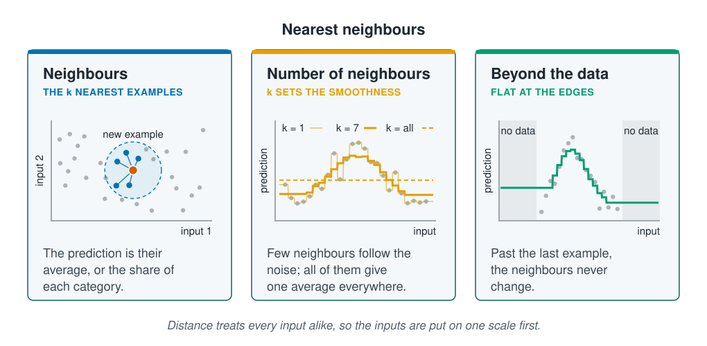

```{r}
#| label: setup
#| include: false
library(tidymodels)
library(tidyverse)
library(poissonreg)
source(here::here("R/theme.R"))
source(here::here("R/data.R"))
source(here::here("R/python-tabs.R"))
set.seed(123)
```



## Similar stations have similar counts

Every model so far in this section has a formula: a weighted sum of the inputs, passed
through a function that keeps the prediction in range. k-nearest neighbours has none.
[Types of learning](../01-introduction/types-of-learning.qmd) used it to predict for a
new station from the 15 survey stations most like it. It keeps the training data and,
for each new station, finds the *k* closest ones and averages their answers: their mean
count for a regression, or for presence the share of them where the species was found.
That share is a probability, like logistic regression's, and a threshold turns it into
yes or no. Because nothing about the shape is assumed, the neighbours can follow a
peak, a step or anything else, as long as enough stations lie close by.

"Closest" is a distance across all the inputs at once, so each input is first
standardised, as [Scaling and encoding](../02-marine-data/scaling-and-encoding.qmd)
explains; otherwise the input with the largest numbers would choose the neighbours.





## The number of neighbours sets how smooth the predictions are

With $k = 1$, each prediction copies a single station, chance highs and lows included.
Every training station is its own nearest neighbour, so the model reproduces its
training data exactly and predicts new stations badly. Fitting the training data so
closely that predictions on new data get worse is **overfitting**, which
[Underfitting and overfitting](../05-generalisation/underfitting-and-overfitting.qmd)
covers in full. At the other end, with $k$ equal to the whole training set, every
prediction is the same average and the inputs are ignored. Larger $k$ smooths more.

$k$ is a **hyperparameter**: a setting fixed before the model is fitted, not learned
from the data. The training error cannot choose it, since that always favours
$k = 1$, so it is chosen on validation data, the role
[Splitting the data](../02-marine-data/splitting-data.qmd) set aside for choosing
between models.

## Beyond the data, the prediction levels off

For a station warmer than any in the training data, the nearest stations are the
warmest ones there, and they stay the same however much warmer it gets. The prediction
levels off at the edge of the data: it never turns negative, as a polynomial can, but
it cannot carry a trend on either.
[Uneven sampling and extrapolation](../06-assumptions-limitations/sampling-and-extrapolation.qmd)
deals with predicting outside the data.

::: {.diagram}
{fig-alt="Three cards. Neighbours, the k nearest examples: a scatter of grey points on input 1 against input 2, with a new example in the middle; the five points closest to it are blue, joined to it by thin lines and ringed by a circle. The prediction is their average, or the share of each category. Number of neighbours, k sets the smoothness: points scatter around a hump against one input; with k = 1 the prediction is a jagged line that jumps to every point, with k = 7 it is a smooth hump, and with k = all it is a dashed flat line at the average. Beyond the data, flat at the edges: a smooth line rises and falls through the data, then stays level in shaded regions with no data at either end. A note says distance treats every input alike, so the inputs are put on one scale first."}
:::

## Worked example

The data and the split by site are those of the earlier pages. The training stations
are split once more by site, into fitting and validation sites, for choosing $k$. The
recipe fills the gaps, turns seabed type and season into 0/1 columns and standardises
every column, so that each counts alike in the distance. The model needs no squared
terms: the neighbours find a peak, if there is one, by themselves.

::: {.panel-tabset group="language"}

## R

```{r}
#| label: prepare
survey <- load_coastal_survey_clean()

split <- group_initial_split(survey, group = site_id, prop = 0.75)
train <- training(split)
test  <- testing(split)

fit_split  <- group_initial_split(train, group = site_id, prop = 0.75)
fitting    <- training(fit_split)
validation <- testing(fit_split)

predictors <- abundance ~ depth_m + temperature_c + chlorophyll_mg_m3 +
  salinity_psu + substrate + season

knn_recipe <- recipe(predictors, data = train) |>
  step_impute_median(all_numeric_predictors()) |>
  step_dummy(all_nominal_predictors()) |>
  step_normalize(all_numeric_predictors())
```

## Python

```{python}
import numpy as np
import pandas as pd
from sklearn.base import clone
from sklearn.compose import ColumnTransformer
from sklearn.impute import SimpleImputer
from sklearn.metrics import r2_score, root_mean_squared_error
from sklearn.model_selection import GroupShuffleSplit
from sklearn.neighbors import KNeighborsRegressor
from sklearn.pipeline import Pipeline
from sklearn.preprocessing import OneHotEncoder, StandardScaler

from mlbasic_data import load_coastal_survey_clean

survey = load_coastal_survey_clean()

numeric = ["depth_m", "temperature_c", "chlorophyll_mg_m3", "salinity_psu"]
categorical = ["substrate", "season"]
predictors = numeric + categorical

grouper = GroupShuffleSplit(n_splits=1, train_size=0.75, random_state=123)
train_rows, test_rows = next(grouper.split(survey, groups=survey["site_id"]))
train, test = survey.iloc[train_rows], survey.iloc[test_rows]

inner = GroupShuffleSplit(n_splits=1, train_size=0.75, random_state=123)
fit_rows, val_rows = next(inner.split(train, groups=train["site_id"]))
fitting, validation = train.iloc[fit_rows], train.iloc[val_rows]

# The dropped level of each category is the first, as in R: gravel and spring.
knn_recipe = Pipeline([
    ("columns", ColumnTransformer([
        ("numeric", SimpleImputer(strategy="median"), numeric),
        ("categorical", OneHotEncoder(drop=["gravel", "spring"],
                                      sparse_output=False), categorical),
    ])),
    ("standardise", StandardScaler()),
])
```

:::

### Validation sites choose the number of neighbours

In tidymodels the model is `nearest_neighbor()`, which uses the kknn package; in
scikit-learn it is `KNeighborsRegressor`. kknn gives closer neighbours more weight
unless told otherwise, so `weight_func = "rectangular"` makes every neighbour count
equally, as scikit-learn does by default. Models with $k$ from 1 to 300 are fitted on
the fitting sites and scored with the
[RMSE](../01-introduction/prediction-and-explanation.qmd#rmse-measures-a-typical-miss-on-the-test-stations),
the typical miss in animals, on the stations they were fitted to and on the validation
sites.

::: {.panel-tabset group="language"}

## R

```{r}
#| label: neighbours
knn_model <- function(k) {
  nearest_neighbor(neighbors = k, weight_func = "rectangular") |>
    set_mode("regression")
}

score_k <- function(k) {
  fitted <- workflow(knn_recipe, knn_model(k)) |> fit(fitting)
  error <- function(data) {
    rmse_vec(data$abundance, predict(fitted, data)$.pred)
  }
  tibble(k = k, training = error(fitting), validation = error(validation))
}

ks <- c(1, 2, 3, 5, 7, 10, 15, 20, 30, 50, 70, 100, 150, 200, 300)
neighbours <- map(ks, score_k) |> list_rbind()
neighbours |> slice_min(validation) |> mutate(across(-k, \(x) round(x, 2)))
```

## Python

```{python}
def knn_model(k, data):
    return Pipeline([
        ("recipe", clone(knn_recipe)),
        ("model", KNeighborsRegressor(n_neighbors=k)),
    ]).fit(data[predictors], data["abundance"])

def rmse(fitted, data):
    return root_mean_squared_error(data["abundance"],
                                   fitted.predict(data[predictors]))

rows = []
for k in [1, 2, 3, 5, 7, 10, 15, 20, 30, 50, 70, 100, 150, 200, 300]:
    fitted = knn_model(k, fitting)
    rows.append({"k": k, "training": rmse(fitted, fitting),
                 "validation": rmse(fitted, validation)})
neighbours = pd.DataFrame(rows)

neighbours.loc[[neighbours["validation"].idxmin()]].round(2)
```

:::

::: {.panel-tabset group="language"}

## R

```{r}
#| label: fig-neighbours
#| fig-cap: "The RMSE of k-nearest neighbours for each number of neighbours, on the stations it was fitted to and on the validation sites. The number of neighbours is on a log scale, and the dashed line marks the lowest validation error."
#| fig-alt: "Two lines of RMSE against the number of neighbours from 1 to 300 on a log scale. The training line starts at zero for one neighbour and rises steadily. The validation line starts high, falls quickly over the first few values, is nearly flat through the middle, with its lowest point marked by a dashed line, and rises again towards 300."
#| fig-width: 7
#| fig-height: 4.2
best_k <- neighbours |> slice_min(validation) |> pull(k)

neighbours |>
  pivot_longer(c(training, validation), names_to = "data", values_to = "rmse") |>
  ggplot(aes(k, rmse, colour = data)) +
  geom_vline(xintercept = best_k, linetype = "dashed",
             colour = ml_palette[["grey"]]) +
  geom_line(linewidth = 1.1) +
  geom_point(size = 2) +
  scale_colour_manual(values = c(training = ml_palette[["blue"]],
                                 validation = ml_palette[["orange"]]),
                      breaks = c("training", "validation"),
                      labels = c("Fitting stations", "Validation sites")) +
  scale_x_log10(breaks = c(1, 3, 10, 30, 100, 300)) +
  expand_limits(y = 0) +
  labs(x = "Number of neighbours, k", y = "RMSE (individuals)", colour = NULL,
       title = "One neighbour copies its own stations; hundreds blur the pattern")
```

:::

```{r}
#| label: neighbour-numbers
#| include: false
at_k <- function(value) filter(neighbours, k == value)
f2 <- function(x) sprintf("%.2f", x)
fitting_sd    <- sd(fitting$abundance)
validation_sd <- sd(validation$abundance)
near_best <- neighbours |>
  filter(validation <= min(validation) + 0.05) |>
  pull(k) |>
  range()
```

With one neighbour the training error is `r round(at_k(1)$training, 2)`, since every
fitting station predicts its own count, but the validation error is
`r f2(at_k(1)$validation)`, the worst of all. The validation error falls to
`r f2(at_k(best_k)$validation)` at $k$ = `r best_k`, then rises again to
`r f2(at_k(300)$validation)` at 300, where each prediction averages over stations
that are no longer alike. The curve is flat around its lowest point: every $k$ from
`r near_best[1]` to `r near_best[2]` comes within 0.05 of it, so the exact choice
matters little. Past a few neighbours the validation error sits below the training
error only because the counts at the validation sites happen to vary less: their
standard deviation is `r f2(validation_sd)`, against `r f2(fitting_sd)` at the fitting
sites.

### Poisson regression predicts new sites better than k-nearest neighbours

The neighbours are refitted at $k$ = `r best_k` on all the training stations and
scored once on the test sites, beside Poisson regression from
[Regression for counts](count-regression.qmd), with its squared depth and temperature.
[$R^2$](../02-marine-data/information-leakage.qmd#one-linear-regression-shows-each-kind)
is the share of the variation in the test counts that the predictions follow.

::: {.panel-tabset group="language"}

## R

```{r}
#| label: compare
knn_fit <- workflow(knn_recipe, knn_model(best_k)) |> fit(train)

curve_recipe <- recipe(predictors, data = train) |>
  step_impute_median(all_numeric_predictors()) |>
  step_poly(depth_m, temperature_c, degree = 2, options = list(raw = TRUE))
poisson_fit <- workflow(curve_recipe, poisson_reg()) |> fit(train)

score <- function(fitted, label) {
  predicted <- predict(fitted, test)$.pred
  tibble(model = label,
         rmse  = rmse_vec(test$abundance, predicted),
         rsq   = rsq_trad_vec(test$abundance, predicted))
}

scores <- bind_rows(score(knn_fit, "k-nearest neighbours"),
                    score(poisson_fit, "Poisson regression"))
scores |> mutate(across(-model, \(x) round(x, 2)))
```

## Python

```{python}
from sklearn.linear_model import PoissonRegressor
from sklearn.preprocessing import PolynomialFeatures

best_k = int(neighbours.loc[neighbours["validation"].idxmin(), "k"])
knn_fit = knn_model(best_k, train)

def squared(column):
    return (column, Pipeline([
        ("impute", SimpleImputer(strategy="median")),
        ("poly", PolynomialFeatures(degree=2, include_bias=False)),
    ]), [column])

curve_recipe = ColumnTransformer([
    squared("depth_m"),
    squared("temperature_c"),
    ("numeric", SimpleImputer(strategy="median"),
     ["chlorophyll_mg_m3", "salinity_psu"]),
    ("categorical", OneHotEncoder(drop=["gravel", "spring"], sparse_output=False),
     categorical),
])
poisson_fit = Pipeline([
    ("recipe", curve_recipe),
    ("model", PoissonRegressor(alpha=0, solver="newton-cholesky")),
]).fit(train[predictors], train["abundance"])

def score(fitted, label):
    predicted = fitted.predict(test[predictors])
    return {"model": label,
            "rmse": root_mean_squared_error(test["abundance"], predicted),
            "rsq": r2_score(test["abundance"], predicted)}

pd.DataFrame([score(knn_fit, "k-nearest neighbours"),
              score(poisson_fit, "Poisson regression")]).round(2)
```

:::

```{r}
#| label: compare-numbers
#| include: false
get_score <- function(label) scores |> filter(model == label)
knn_score     <- get_score("k-nearest neighbours")
poisson_score <- get_score("Poisson regression")
```

k-nearest neighbours misses by `r f2(knn_score$rmse)` animals on the test sites,
with an $R^2$ of `r f2(knn_score$rsq)`; Poisson regression misses by
`r f2(poisson_score$rmse)`, with `r f2(poisson_score$rsq)`. Poisson
regression assumes a shape, a smooth curve in each input, and fits it to every training
station at once. The neighbours assume nothing and learn from the `r best_k` stations
nearest each new one. With six inputs, even the nearest stations differ from the new
one in several of them, so their average blurs what each input does. Freedom from a
shape pays when stations are plentiful and the relationship has a shape no formula
expects; on this survey the assumed curve wins.

## Key points

::: {.key-points}
- k-nearest neighbours predicts from the *k* most similar training stations, measured
  on standardised inputs, and assumes no shape.
- One neighbour copies chance highs and lows; very many blur the pattern into one
  average. *k* is a hyperparameter, chosen on validation sites, never on the training
  error.
- Beyond the data the neighbours stop changing, so the predictions level off.
- On the survey's test sites, Poisson regression's assumed curve predicts better than
  the neighbours: flexibility needs many stations close by.
:::

## Try it yourself

1. Change the outcome to `present` and the mode to `"classification"`, choose $k$ on
   the validation sites with `accuracy_vec()`, and compare the test accuracy with the
   one on [Logistic regression](logistic-regression.qmd).
2. Refit the neighbours with depth and temperature as the only inputs and choose $k$
   again. Does the validation error improve? With fewer inputs to match, how much
   nearer are the neighbours?
