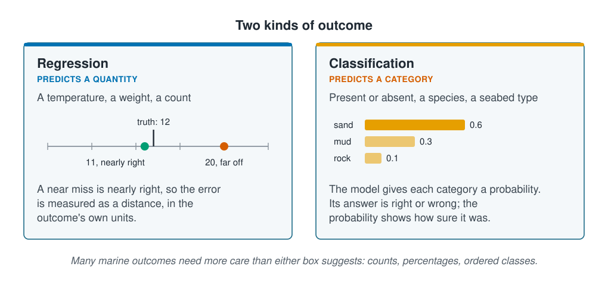

```{r}
#| label: setup
#| include: false
library(tidyverse)
library(patchwork)
source(here::here("R/theme.R"))
source(here::here("R/data.R"))
source(here::here("R/python-tabs.R"))
survey <- load_coastal_survey_clean()
```

## The outcome decides the method

Before choosing a model, decide what kind of thing the outcome is. That one decision
settles which models can be used, how their errors are measured and what their
predictions can be used for. This page sets out the two kinds, the marine outcomes that
fit neither neatly, and what is lost when a count is turned into present or absent.





## Quantities and categories

[Types of learning](../01-introduction/types-of-learning.qmd) split supervised learning
in two. **Regression** predicts a quantity, such as a temperature or a weight. A near
miss is nearly right: predicting 11 when the truth is 12 is a small error, and
predicting 20 a large one. **Classification** predicts a category, such as present or
absent, or a seabed type. Most classification models give a probability for each
category, and the answer is the most probable one. It is right or wrong, but the
probability shows how sure the model was.

::: {.diagram}
{fig-alt="Two cards. Regression predicts a quantity, such as a temperature, a weight or a count. A number line marks the truth at 12, a prediction of 11 as nearly right and one of 20 as far off; the error is measured as a distance in the outcome's own units. Classification predicts a category, such as present or absent, a species or a seabed type. Bars give each category a probability: sand 0.6, mud 0.3, rock 0.1. The answer is right or wrong, and the probability shows how sure the model was. A note says many marine outcomes need more care than either box suggests: counts, percentages and ordered classes."}
:::

## Marine outcomes rarely fit one box

Linear regression assumes the outcome can take any value, above or below zero, with
the same spread everywhere. Few marine outcomes behave like that:

| Outcome | Kind | What needs care |
| --- | --- | --- |
| Catch weight | Quantity | Skewed: a few very large catches; often modelled on a log scale |
| Count of animals | Quantity | Whole numbers, never negative, spread grows with the average |
| Count with many zeros | Quantity | A zero can mean the species is absent, or present and missed |
| Percentage cover | Quantity | Cannot go below 0 or above 100 |
| Present or absent | Category | One of the two is usually much rarer |
| Habitat class | Category | Often ordered (poor, fair, good), and the order carries information |
| Community composition | Neither | Shares of many species that add up to one |

## Worked example

The survey counted the animals of one species at each station. That count can be
treated as a quantity or turned into a category.

### The count is a quantity with a shape

::: {.panel-tabset group="language"}

## R

```{r}
#| label: count-summary
survey |>
  summarise(
    stations   = n(),
    mean_count = round(mean(abundance), 1),
    variance   = round(var(abundance), 1),
    zeros      = sum(abundance == 0),
    zero_pct   = round(100 * mean(abundance == 0), 1)
  )
```

## Python

```{python}
import pandas as pd

from mlbasic_data import load_coastal_survey_clean

survey = load_coastal_survey_clean()

pd.DataFrame({
    "stations": [len(survey)],
    "mean_count": [round(survey["abundance"].mean(), 1)],
    "variance": [round(survey["abundance"].var(), 1)],
    "zeros": [int((survey["abundance"] == 0).sum())],
    "zero_pct": [round(100 * (survey["abundance"] == 0).mean(), 1)],
})
```

:::

```{r}
#| label: count-numbers
#| include: false
count_mean <- mean(survey$abundance)
count_var  <- var(survey$abundance)
zero_pct   <- round(100 * mean(survey$abundance == 0), 1)
present_n  <- sum(survey$abundance > 0)
absent_n   <- sum(survey$abundance == 0)
```

Two things in that summary shape every model of this count.

**The variance is far larger than the mean**, `r round(count_var, 1)` against
`r round(count_mean, 1)`: about `r round(count_var / count_mean)` times. The variance
measures how widely the counts spread. If animals were scattered independently of one
another, the two would be about equal. They are not, because animals gather in groups,
so some stations catch many and most catch few. This is called **overdispersion**, and
it is normal in ecological counts.

**`r zero_pct`% of stations caught nothing.** A straight line predicts smooth numbers
and cannot reproduce a spike at zero; it will even predict negative counts. The
[next page](linear-and-polynomial-regression.qmd) shows this, and
[Regression for counts](count-regression.qmd) introduces a model built for them.

### The same count as present or absent

Recording only whether any animal was caught turns the count into a category.

::: {.panel-tabset group="language"}

## R

```{r}
#| label: fig-two-framings
#| fig-cap: "One measurement, two outcomes. Left: the count, with a spike at zero and a long right tail. Right: the same stations as present or absent."
#| fig-alt: "Two panels. The left panel is a histogram of the number of animals caught per station, with a tall bar at zero, a peak at one to three animals and a long tail past thirty. The right panel is a two-bar chart: absent, and present, which is over three times taller."
#| fig-width: 8.5
#| fig-height: 3.8
p_count <- ggplot(survey, aes(abundance)) +
  geom_histogram(binwidth = 1, fill = ml_palette[["blue"]]) +
  labs(x = "Animals caught", y = "Stations", title = "As a quantity: regression")

p_binary <- survey |>
  mutate(status = if_else(abundance > 0, "present", "absent")) |>
  count(status) |>
  ggplot(aes(status, n)) +
  geom_col(fill = ml_palette[["orange"]], width = 0.6) +
  geom_text(aes(label = n), vjust = -0.4, size = 4) +
  scale_y_continuous(expand = expansion(mult = c(0, 0.12))) +
  labs(x = NULL, y = "Stations", title = "As a category: classification")

p_count + p_binary
```

:::

The category is simpler, but it hides how many animals each present station caught:

::: {.panel-tabset group="language"}

## R

```{r}
#| label: present-catches
survey |>
  filter(abundance > 0) |>
  summarise(
    `stations present` = n(),
    `smallest catch`   = min(abundance),
    `median catch`     = median(abundance),
    `largest catch`    = max(abundance)
  )
```

## Python

```{python}
caught = survey.loc[survey["abundance"] > 0, "abundance"]

pd.DataFrame({
    "stations present": [len(caught)],
    "smallest catch": [caught.min()],
    "median catch": [caught.median()],
    "largest catch": [caught.max()],
})
```

:::

A station with one animal and a station with `r max(survey$abundance)` are both simply
"present". If the question is where the species occurs, that is a fair simplification.
If it is where the species is abundant, the answer has been thrown away.

### Cutting a quantity loses information

The opposite move is more common and does more harm: taking a quantity, choosing a
cut-off and modelling the category. Split chlorophyll at 1 mg m⁻³ into "high" and
"low", and a station at 0.99 lands in the same box as the lowest in the survey,
`r round(min(survey$chlorophyll_mg_m3, na.rm = TRUE), 2)`, but in a different box from
one at 1.01. All the variation on each side of the line is lost, and no model
can get it back.

Turn a quantity into a category only when the decision itself is yes or no, such as a
legal limit or a protocol that records only whether a species was seen.

## The outcome sets the model and the score

Once the kind of outcome is known, the rest follows:

| | Regression | Classification |
| --- | --- | --- |
| **A first model** | Linear regression | Logistic regression |
| **Output** | A number | A probability for each category |
| **Error measured by** | How far off, on average (RMSE) | How often it is wrong |

Some methods, such as the decision trees later in this section, do both. In tidymodels
the choice is then one argument, `set_mode("regression")` or
`set_mode("classification")`, which makes it easy to change the scientific question
without noticing.

## Key points

::: {.key-points}
- Decide what kind of outcome you have before choosing a model: a quantity means
  regression, a category means classification.
- Many marine outcomes need more care than either box suggests: counts, percentages,
  ordered classes and shares.
- The survey's count is overdispersed, its variance about
  `r round(count_var / count_mean)` times its mean, and `r zero_pct`% of stations
  caught nothing.
- Turning a count into present or absent keeps where a species occurs and loses how
  abundant it is.
- Cut a quantity into categories only when the decision itself is yes or no.
:::

## Try it yourself

1. Compute the mean and variance of `abundance` for each `substrate`. Is the count
   overdispersed on every seabed type, or on some more than others?
2. Split `chlorophyll_mg_m3` at 1 mg m⁻³ and find the two stations closest to the
   line on either side. How different are they, and how different are the lowest and
   highest stations in the same box?
