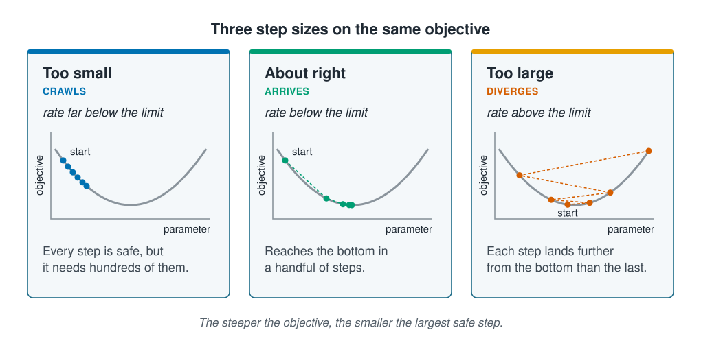

```{r}
#| label: setup
#| include: false
library(tidymodels)
library(tidyverse)
source(here::here("R/theme.R"))
source(here::here("R/data.R"))
source(here::here("R/python-tabs.R"))
set.seed(123)
```

## Downhill one step at a time

[Finding the parameters](parameter-estimation.qmd) ended with a search problem: trying
every combination of parameter values is out of reach once a model has more than a few.
**Gradient descent** is the simplest way round it. Find which direction is downhill from
where you stand, take a step that way, and repeat until the ground is flat.

This page writes it out for a straight line, where the answer is known and the walk can
be checked against it. It shows the one setting that decides whether the walk arrives,
and a reason to standardise inputs that
[Scaling and encoding](../02-marine-data/scaling-and-encoding.qmd) did not give.





## The slope and the step

The **gradient** is the slope of the objective in the direction of each parameter. For
each one it says whether nudging that parameter up makes the objective larger or
smaller, and by how much. Taken together, these slopes point uphill, so each step moves
the parameters the opposite way.

The **learning rate** sets how far each step goes: the step is the learning rate times
the slope. It is a hyperparameter, chosen before fitting, and it decides the outcome.

- Too small, and every step is safe but the walk needs hundreds of them.
- About right, and it reaches the bottom in a handful.
- Too large, and each step crosses the valley and lands higher on the far side. The walk
  climbs out instead of settling, and the parameters grow without limit.

::: {.diagram}
{fig-alt="Three cards, each with a U-shaped objective curve against a parameter. Too small, crawls, rate far below the limit: a row of closely spaced dots from a point marked start creeps a short way down the left side of the curve; every step is safe, but it needs hundreds of them. About right, arrives, rate below the limit: dots from start take large then shrinking steps to the bottom; it reaches the bottom in a handful of steps. Too large, diverges, rate above the limit: dots start near the bottom and jump from side to side, each jump landing higher up the curve; each step lands further from the bottom than the last. A note says the steeper the objective, the smaller the largest safe step."}
:::

## Worked example

### Writing the walk out

We predict abundance from chlorophyll and depth. To keep the model to two parameters, so
the walk can be drawn as a path on a map, we centre abundance and standardise both
inputs; the intercept is then zero and only the two slopes remain.

::: {.panel-tabset group="language"}

## R

```{r}
#| label: prepare
survey <- load_coastal_survey_clean()

d <- survey |>
  select(abundance, chlorophyll_mg_m3, depth_m) |>
  drop_na()

y <- d$abundance - mean(d$abundance)
X <- cbind(
  chlorophyll = as.numeric(scale(d$chlorophyll_mg_m3)),
  depth       = as.numeric(scale(d$depth_m))
)

mse <- function(X, b) mean((y - X %*% b)^2)

# Start both slopes at zero and take a fixed number of steps downhill.
gradient_descent <- function(X, y, learning_rate, steps) {
  b <- c(0, 0)
  path <- matrix(0, steps + 1, 2)
  for (k in seq_len(steps)) {
    slope <- 2 / nrow(X) * drop(t(X) %*% (X %*% b - y))
    b <- b - learning_rate * slope
    path[k + 1, ] <- b
  }
  as_tibble(path, .name_repair = ~ c("chlorophyll", "depth"))
}
```

## Python

```{python}
import numpy as np
import pandas as pd

from mlbasic_data import load_coastal_survey_clean

survey = load_coastal_survey_clean()
d = survey[["abundance", "chlorophyll_mg_m3", "depth_m"]].dropna()

def standardise(column):
    return (column - column.mean()) / column.std()   # pandas' std divides by n - 1, as R's does

y = (d["abundance"] - d["abundance"].mean()).to_numpy()
X = np.column_stack([standardise(d["chlorophyll_mg_m3"]), standardise(d["depth_m"])])

def mse(X, b):
    return np.mean((y - X @ b) ** 2)

# Start both slopes at zero and take a fixed number of steps downhill.
def gradient_descent(X, y, learning_rate, steps):
    b = np.zeros(2)
    path = [b]
    for _ in range(steps):
        slope = 2 / len(X) * X.T @ (X @ b - y)
        b = b - learning_rate * slope
        path.append(b)
    return pd.DataFrame(path, columns=["chlorophyll", "depth"])
```

:::

The line `b <- b - learning_rate * slope` is the whole algorithm. This model also has a
formula, so we know where the walk should end.

::: {.panel-tabset group="language"}

## R

```{r}
#| label: optimum
optimum <- drop(solve(t(X) %*% X, t(X) %*% y))
best_mse <- mse(X, optimum)
round(optimum, 3)
```

## Python

```{python}
optimum = np.linalg.solve(X.T @ X, X.T @ y)
best_mse = mse(X, optimum)
pd.Series(optimum, index=["chlorophyll", "depth"]).round(3)
```

:::

### Three learning rates

::: {.panel-tabset group="language"}

## R

```{r}
#| label: steps-needed
# Steps until the mean squared error is within one part in a million of the best,
# or NA if the walk never gets there.
steps_needed <- function(X, learning_rate, max_steps = 10000) {
  best <- mse(X, drop(solve(t(X) %*% X, t(X) %*% y)))
  b <- c(0, 0)
  for (k in seq_len(max_steps)) {
    b <- b - learning_rate * 2 / nrow(X) * drop(t(X) %*% (X %*% b - y))
    current <- mse(X, b)
    if (!is.finite(current) || current > 1e6 * best) return(NA_integer_)
    if (current - best < 1e-6 * best) return(k)
  }
  NA_integer_
}

rates <- tibble(`learning rate` = c(0.02, 0.3, 0.72, 0.8)) |>
  mutate(
    `MSE after 40 steps` = map_dbl(`learning rate`, \(r) {
      mse(X, unlist(tail(gradient_descent(X, y, r, 40), 1)))
    }),
    `steps to arrive` = map_int(`learning rate`, \(r) steps_needed(X, r))
  )
rates |>
  mutate(
    `MSE after 40 steps` = map_chr(`MSE after 40 steps`, \(x) format(signif(x, 4), big.mark = ",")),
    `steps to arrive` = replace_na(as.character(`steps to arrive`), "never")
  )
```

## Python

```{python}
# Steps until the mean squared error is within one part in a million of the best,
# or None if the walk never gets there. A walk that blows up overflows on the
# way; errstate keeps numpy quiet about it, since the check below catches it.
def steps_needed(X, learning_rate, max_steps=10_000):
    best = mse(X, np.linalg.solve(X.T @ X, X.T @ y))
    b = np.zeros(2)
    with np.errstate(over="ignore", invalid="ignore"):
        for k in range(1, max_steps + 1):
            b = b - learning_rate * 2 / len(X) * X.T @ (X @ b - y)
            current = mse(X, b)
            if not np.isfinite(current) or current > 1e6 * best:
                return None
            if current - best < 1e-6 * best:
                return k
    return None

rates = pd.DataFrame({"learning rate": [0.02, 0.3, 0.72, 0.8]})
rates["MSE after 40 steps"] = [
    mse(X, gradient_descent(X, y, r, 40).iloc[-1].to_numpy())
    for r in rates["learning rate"]
]
rates["steps to arrive"] = [steps_needed(X, r) or "never" for r in rates["learning rate"]]
rates.assign(**{"MSE after 40 steps": rates["MSE after 40 steps"].map(lambda x: f"{x:,.4g}")})
```

:::

::: {.panel-tabset group="language"}

## R

```{r}
#| label: fig-paths
#| fig-cap: !expr glue::glue("The first 40 steps of gradient descent from slopes of zero, at three learning rates. Each dot is one step and the cross is the answer from the formula. At 0.02 the walk is still short after 40 steps; at 0.3 it arrives in {rates[[3]][2]}; at 0.72 it zig-zags across the valley.")
#| fig-alt: !expr glue::glue("A contour plot with the chlorophyll slope on the horizontal axis and the depth slope on the vertical axis. Elongated ellipses surround a black cross at {round(optimum[1], 2)} and {round(optimum[2], 2)}. Three paths of dots start at zero. The slowest traces a short smooth arc that stops short of the cross. The middle path reaches the cross in a few steps. The fastest shoots past the cross and swings back and forth across the valley on a long diagonal, each pass slightly shorter than the last.")
#| fig-width: 7
#| fig-height: 5
grid <- expand_grid(
  chlorophyll = seq(-0.3, 2.9, length.out = 160),
  depth       = seq(-1.8, 0.7, length.out = 160)
) |>
  mutate(mse = map2_dbl(chlorophyll, depth, \(a, b) mse(X, c(a, b))))

paths <- map_dfr(c(0.02, 0.3, 0.72), \(r) {
  gradient_descent(X, y, r, 40) |>
    mutate(`learning rate` = factor(r))
})

ggplot(grid, aes(chlorophyll, depth)) +
  geom_contour(aes(z = mse), colour = "#c9d3da", bins = 30) +
  geom_path(data = paths, aes(colour = `learning rate`), linewidth = 0.5) +
  geom_point(data = paths, aes(colour = `learning rate`), size = 1.1) +
  annotate("point", x = optimum[1], y = optimum[2], shape = 4,
           size = 4, stroke = 1.2, colour = "black") +
  labs(
    x = "Chlorophyll slope (standardised)",
    y = "Depth slope (standardised)",
    colour = "Learning rate",
    title = "Same start, same objective, three step sizes"
  )
```

:::

```{r}
#| label: limit
#| include: false
limit <- function(X) 2 / max(eigen(2 / nrow(X) * t(X) %*% X)$values)
safe <- limit(X)
```

The best mean squared error is `r round(best_mse, 2)`. A learning rate of 0.3 reaches it
in `r rates[[3]][2]` steps. A rate of 0.02 needs `r rates[[3]][1]`, and 0.72 needs
`r rates[[3]][3]` because it spends most of them swinging from one side of the valley to
the other. At 0.8 the walk never arrives: after 40 steps the mean squared error is
`r format(signif(rates[[2]][4], 2), big.mark = ",", scientific = FALSE)`.

For this objective the largest rate that still arrives is about `r round(safe, 2)`.
Just below it the walk still arrives, slowly and zig-zagging; just above it the walk
fails, and nothing on the way warns you. A fit whose loss suddenly becomes enormous, or `NaN`, has usually crossed
this limit, and a smaller learning rate is the first thing to try.

### The units of the inputs set the work

The limit depends on the shape of the objective, and the shape depends on the units of
the inputs. Depth varies with a standard deviation of `r round(sd(d$depth_m), 1)` m,
chlorophyll with one of `r round(sd(d$chlorophyll_mg_m3), 2)` mg m⁻³. In raw units the
bowl is steep along depth and nearly flat along chlorophyll: the long, narrow bowl of
[Finding the parameters](parameter-estimation.qmd), stretched much further. The step has
to be small enough for the steep direction, so the walk along the flat one takes a very
long time.

We fit the same model twice, once with standardised inputs and once with the inputs
only centred, each at 90% of its own largest safe rate.

::: {.panel-tabset group="language"}

## R

```{r}
#| label: scaling
raw <- cbind(
  chlorophyll = d$chlorophyll_mg_m3 - mean(d$chlorophyll_mg_m3),
  depth       = d$depth_m - mean(d$depth_m)
)

work <- tibble(
  inputs = c("Standardised", "Raw units"),
  `largest safe rate` = c(limit(X), limit(raw)),
  `steps to arrive` = c(steps_needed(X, 0.9 * limit(X)),
                        steps_needed(raw, 0.9 * limit(raw)))
)
work |>
  mutate(`largest safe rate` = map_chr(`largest safe rate`, \(x) format(signif(x, 2))))
```

## Python

```{python}
def limit(X):
    return 2 / np.linalg.eigvalsh(2 / len(X) * X.T @ X).max()

raw = np.column_stack([d["chlorophyll_mg_m3"] - d["chlorophyll_mg_m3"].mean(),
                       d["depth_m"] - d["depth_m"].mean()])

pd.DataFrame({
    "inputs": ["Standardised", "Raw units"],
    "largest safe rate": [f"{limit(X):.2g}", f"{limit(raw):.2g}"],
    "steps to arrive": [steps_needed(X, 0.9 * limit(X)),
                        steps_needed(raw, 0.9 * limit(raw))],
})
```

:::

Standardised, the walk arrives in `r work[[3]][1]` steps; in raw units it needs
`r format(work[[3]][2], big.mark = ",")`, about `r round(work[[3]][2] / work[[3]][1], -1)`
times the work for the same model and the same answer. The predictions at the end are
identical; only the effort changes.

## Standardise for any model fitted by a walk

[Scaling and encoding](../02-marine-data/scaling-and-encoding.qmd) gave two kinds of
method that need standardised inputs: those that measure distances between rows and
those that penalise large coefficients. Methods fitted by gradient descent are a third.
Neural networks are fitted this way, as [Forward propagation and
backpropagation](../09-neural-networks/forward-and-backward.qmd) shows, which is why they
are always given standardised inputs.

`lm()` and `glm()` are not. The formula and the step-by-step search of the previous page
adjust to the units by themselves, and trees compare values within one input at a time,
so none of them needs it.

With many observations, each step can use only a small random batch of them instead of
the whole dataset. This is **stochastic gradient descent**, and [Training a
network](../09-neural-networks/training-a-network.qmd) explains how large networks are
trained with it. On any walk, a fit stops either when its steps become tiny or when it
reaches a set maximum number of steps, and [Checking a fit](reading-a-fit.qmd) shows how
to tell the two apart.

::: {.callout-note collapse="true"}
## The maths, if you want it

With $\theta$ the parameters, $J$ the objective and $\eta$ the learning rate, each step is

$$\theta_{\text{new}} = \theta_{\text{old}} - \eta \, \nabla J(\theta_{\text{old}})$$

where $\nabla J$, the gradient, collects the slope of $J$ along each parameter. For
squared error with inputs $X$, $\nabla J = \frac{2}{n} X^\top (X\theta - y)$, the line
in `gradient_descent()`. The walk arrives only if $\eta < 2/\lambda_{\max}$, where
$\lambda_{\max}$ is the largest eigenvalue of $\frac{2}{n} X^\top X$, the curvature of
the objective in its steepest direction. The number of steps grows with the ratio of the
largest to the smallest eigenvalue, which is how stretched the bowl is; standardising
brings that ratio close to one.
:::

## Key points

::: {.key-points}
- Gradient descent finds which way is downhill and takes a step, again and again.
- The **learning rate** sets the step size. Too small crawls; too large diverges. Here
  0.3 arrived in `r rates[[3]][2]` steps, and above about `r round(safe, 2)` the walk
  never arrived.
- The largest safe step is set by the steepest direction of the objective, and that
  depends on the units of the inputs.
- Standardising the inputs cut the work from
  `r format(work[[3]][2], big.mark = ",")` steps to `r work[[3]][1]` without changing
  the answer. Standardise the inputs of any model fitted by gradient descent.
- `lm()`, `glm()` and trees are not fitted by gradient descent and do not need it.
:::

## Try it yourself

1. Run `steps_needed(raw, 0.3)`, the learning rate that worked well for standardised
   inputs, on the inputs in raw units. What happens, and why?
2. Add `temperature_c`, standardised, as a third input. Change `gradient_descent()` to
   start from three zeros and find, by trying rates, the largest one that still arrives.
   Is it higher or lower than before?
