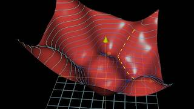
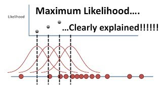

## Overview

Fitting a model sounds like a single act, but it is a search: the algorithm scores how
wrong the model is, changes its parameters to make that score a little smaller, and
repeats until further changes stop helping. The four pages in this section take that
loop apart on the same simulated survey as the rest of the course: the score being made
smaller, the ways the parameters are found, the simplest search, and where each score
and penalty comes from.

## A short tour

::: {.video-placeholder}
The video for this section is on its way.
:::

## Pages in this section

::: {#pages}
:::

## Further resources

**Documentation**

- [Stochastic gradient descent](https://scikit-learn.org/stable/modules/sgd.html), scikit-learn user guide. Includes practical tips on why these methods need standardised inputs, the point [Gradient descent](gradient-descent.qmd) makes on the survey.

**Video**

::: {.video-list}
- [{.video-thumb fig-alt="Gradient descent, how neural networks learn, on YouTube" loading="lazy"}](https://www.youtube.com/watch?v=IHZwWFHWa-w)

  [Gradient descent, how neural networks learn](https://www.youtube.com/watch?v=IHZwWFHWa-w), 3Blue1Brown. Deep Learning chapter 2. The best visual account of descending a loss surface, and it assumes no calculus you do not already have.

- [{.video-thumb fig-alt="Maximum Likelihood, clearly explained, on YouTube" loading="lazy"}](https://www.youtube.com/watch?v=XepXtl9YKwc)

  [Maximum Likelihood, clearly explained](https://www.youtube.com/watch?v=XepXtl9YKwc), StatQuest with Josh Starmer. Likelihood as a function of the parameter rather than of the data, which is the step most explanations skip.
:::
