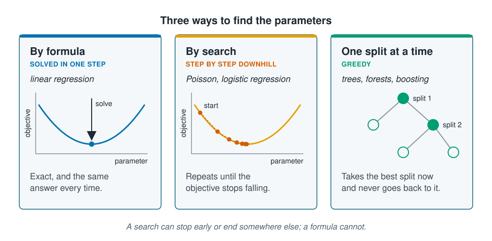

```{r}
#| label: setup
#| include: false
library(tidymodels)
library(tidyverse)
source(here::here("R/theme.R"))
source(here::here("R/data.R"))
source(here::here("R/python-tabs.R"))
set.seed(123)

# A number for the prose, with a true minus sign.
num <- function(x, digits) sub("^-", "−", format(round(x, digits), nsmall = digits))
```

## Solved in one step or found by searching

[Loss functions](loss-functions.qmd) gave each fit a number to make as small as possible.
This page shows the two ways a model finds the parameter values that do it. Linear
regression has a formula that gives them exactly, in one step. Every other model in
[Supervised learning](../03-supervised-learning/index.qmd) has to search for them, and a
search can stop too early or end in a different place on another run. Knowing which kind
of model you have tells you which of those checks it needs.





## Parameters and hyperparameters

A **parameter** is a number the fit chooses from the data: a slope in a regression, or
the value a decision tree splits at. You do not set these.

A **hyperparameter** is a number you set before fitting, which controls the fit: the
depth of a tree, or the number of trees in a forest. The fit cannot choose it, because
its job is to limit what the fit may do.
[Decision trees](../03-supervised-learning/decision-trees.qmd) chose the depth by trying
several on the validation sites;
[Hyperparameter selection](../05-generalisation/hyperparameter-selection.qmd) returns to
this.

::: {.callout-note}
## "Parameter" means different things in different fields

In this course a parameter is always a number the fit estimates from the data. Marine
science often uses the word differently, so check which meaning a paper or a help page
has in mind.

- **Oceanography and water-quality monitoring** call the measured variables
  parameters: temperature, salinity, oxygen and nutrients are "hydrographic
  parameters". In this course those are [features](../02-marine-data/observations-and-features.qmd)
  or the outcome, never parameters.
- **Population and stock-assessment models** call any constant in the model a
  parameter, including ones fixed from the literature, such as natural mortality,
  rather than estimated from the data at hand.
- **Statistics** reserves the word for a property of the population, such as the true
  mean, and calls the fitted value its estimate.
- **scikit-learn** calls the settings you pass to a model its parameters, so what this
  course calls hyperparameters come back from `get_params()`. The values it learns end
  in an underscore, as in `coef_`.
:::

## The objective as a landscape

For a straight line, the objective depends on two parameters, the intercept and the
slope. Draw it as a map, with the two parameters as the axes and the objective as the
height, and fitting means finding the lowest point.

::: {.panel-tabset group="language"}

## R

```{r}
#| label: fig-surface
#| fig-cap: !expr glue::glue("The mean squared error of a straight line of abundance against chlorophyll, for every intercept and slope on a grid. Darker is lower. The surface is a long, tilted bowl with one lowest point, marked by the cross at an intercept of {round(best[1], 2)} and a slope of {round(best[2], 2)}.")
#| fig-alt: !expr glue::glue("A filled contour plot with intercept on the horizontal axis from minus two to six and slope on the vertical axis from minus one to three. The colour shades from yellow at the edges to dark blue in a narrow valley running diagonally from upper left to lower right. A white cross marks the single lowest point, at an intercept of {round(best[1], 2)} and a slope of {round(best[2], 2)}.")
#| fig-width: 6.5
#| fig-height: 4.6
survey <- load_coastal_survey_clean()
d <- survey |> select(abundance, chlorophyll_mg_m3) |> drop_na()

grid <- expand_grid(
  intercept = seq(-2, 6, length.out = 120),
  slope     = seq(-1, 3, length.out = 120)
) |>
  mutate(mse = map2_dbl(
    intercept, slope,
    \(a, b) mean((d$abundance - (a + b * d$chlorophyll_mg_m3))^2)
  ))

best <- coef(lm(abundance ~ chlorophyll_mg_m3, data = d))

ggplot(grid, aes(intercept, slope, fill = mse)) +
  geom_raster() +
  geom_contour(aes(z = mse), colour = "white", alpha = 0.35, bins = 14) +
  annotate("point", x = best[1], y = best[2], shape = 4, size = 4,
           stroke = 1.2, colour = "white") +
  scale_fill_viridis_c(option = "viridis", trans = "log10") +
  labs(
    x = "Intercept", y = "Slope", fill = "Mean squared\nerror (log scale)",
    title = "The objective for a straight line is a bowl"
  )
```

:::

The bowl has one lowest point, so every way downhill ends there. It is also long and
narrow: along the diagonal valley, a higher intercept with a lower slope fits almost as
well, so the data pin down some combinations of the two far better than others. That
shape matters on [Gradient descent](gradient-descent.qmd).

There are three ways to find the lowest point, and each kind of model in section 3 uses
one of them.

::: {.diagram}
{fig-alt="Three cards. By formula, solved in one step, linear regression: an arrow labelled solve points straight down to the lowest point of a U-shaped objective curve; exact, and the same answer every time. By search, step by step downhill, Poisson and logistic regression: a row of dots from a point marked start steps down the curve, each step shorter, to its lowest point; repeats until the objective stops falling. One split at a time, greedy, trees, forests and boosting: a small tree with its first and second splits filled in; takes the best split now and never goes back to it. A note says a search can stop early or end somewhere else; a formula cannot."}
:::

## Worked example

### Linear regression has a formula

For linear regression under squared error, algebra gives the lowest point of the bowl
directly: the **normal equations**, solved once. We fit abundance on chlorophyll, depth
and temperature this way and compare with `lm()`.

::: {.panel-tabset group="language"}

## R

```{r}
#| label: closed-form
d3 <- survey |>
  select(abundance, chlorophyll_mg_m3, depth_m, temperature_c) |>
  drop_na()

X <- model.matrix(~ chlorophyll_mg_m3 + depth_m + temperature_c, data = d3)
y <- d3$abundance

by_formula <- drop(solve(t(X) %*% X, t(X) %*% y))
by_lm <- coef(lm(abundance ~ chlorophyll_mg_m3 + depth_m + temperature_c, data = d3))

tibble(term = names(by_lm), `by formula` = by_formula, `by lm()` = by_lm) |>
  mutate(across(where(is.numeric), \(x) round(x, 4)))
```

## Python

```{python}
import numpy as np
import pandas as pd
import statsmodels.api as sm
from sklearn.linear_model import LinearRegression

from mlbasic_data import load_coastal_survey_clean

survey = load_coastal_survey_clean()
inputs = ["chlorophyll_mg_m3", "depth_m", "temperature_c"]

d3 = survey[["abundance", *inputs]].dropna()
X = sm.add_constant(d3[inputs]).to_numpy()
y = d3["abundance"].to_numpy()

by_formula = np.linalg.solve(X.T @ X, X.T @ y)
line = LinearRegression().fit(d3[inputs], y)

pd.DataFrame({
    "term": ["intercept", *inputs],
    "by formula": by_formula,
    "by LinearRegression": [line.intercept_, *line.coef_],
}).round(4)
```

:::

The two agree: the largest difference is
`r format(max(abs(by_formula - by_lm)), digits = 1)`, rounding error in the last digits
a computer stores. `lm()` solves the same equations by a route that is safer with
awkward data. There is no starting value and nothing to converge, so the answer is the
same on every run.

::: {.callout-note collapse="true"}
## The maths, if you want it

With $X$ the table of inputs (one row per station, plus a column of ones for the
intercept), $y$ the observed values and $\beta$ the coefficients, the objective is the
sum of squared residuals, $\lVert y - X\beta \rVert^2$. Its lowest point is where its
slope in every direction is zero, which gives

$$X^\top X \hat\beta = X^\top y \qquad\Longrightarrow\qquad \hat\beta = (X^\top X)^{-1} X^\top y$$

This works because squaring makes the objective a bowl whose lowest point can be solved
for. Absolute error has no such formula, which is why
[Loss functions](loss-functions.qmd) needed `optim()` for it.
:::

### Logistic regression needs a search

[Logistic regression](../03-supervised-learning/logistic-regression.qmd) has no formula
for its lowest point, so `glm()` finds it by repeating one step. Each step replaces the
objective with a weighted linear regression that matches it near the current
coefficients, solves that by formula, and starts again from the answer. We write the
steps out, starting from coefficients of zero, and watch the log-likelihood, a measure
of fit that [Maximum likelihood](maximum-likelihood.qmd) explains; higher is better.

::: {.panel-tabset group="language"}

## R

```{r}
#| label: search-steps
d3b <- survey |>
  select(present, chlorophyll_mg_m3, depth_m, temperature_c) |>
  drop_na() |>
  mutate(present = fct_relevel(present, "no"))

Xb <- model.matrix(~ chlorophyll_mg_m3 + depth_m + temperature_c, data = d3b)
yb <- as.numeric(d3b$present == "yes")

log_likelihood <- function(b) {
  eta <- drop(Xb %*% b)
  sum(yb * eta - log1p(exp(eta)))
}

b <- rep(0, ncol(Xb))
start <- log_likelihood(b)
steps <- map_dfr(1:6, function(k) {
  eta <- drop(Xb %*% b)
  p   <- plogis(eta)
  w   <- p * (1 - p)
  z   <- eta + (yb - p) / w
  b  <<- drop(solve(t(Xb) %*% (Xb * w), t(Xb) %*% (w * z)))
  tibble(step = k, log_likelihood = log_likelihood(b),
         chlorophyll = b[2], depth = b[3], temperature = b[4])
})

steps |> mutate(across(where(is.numeric), \(x) round(x, 5)))
```

## Python

```{python}
d3b = survey[["present", *inputs]].dropna()
Xb = sm.add_constant(d3b[inputs]).to_numpy()
yb = (d3b["present"] == "yes").to_numpy(dtype=float)

def log_likelihood(b):
    eta = Xb @ b
    return np.sum(yb * eta - np.log1p(np.exp(eta)))

b = np.zeros(Xb.shape[1])
start = log_likelihood(b)
rows = []
for step in range(1, 7):
    eta = Xb @ b
    p = 1 / (1 + np.exp(-eta))
    w = p * (1 - p)
    z = eta + (yb - p) / w
    b = np.linalg.solve(Xb.T @ (Xb * w[:, None]), Xb.T @ (w * z))
    rows.append({"step": step, "log_likelihood": log_likelihood(b),
                 "chlorophyll": b[1], "depth": b[2], "temperature": b[3]})

steps = pd.DataFrame(rows)
steps.round(5)
```

:::

::: {.panel-tabset group="language"}

## R

```{r}
#| label: glm-check
glm_fit <- glm(present ~ chlorophyll_mg_m3 + depth_m + temperature_c,
               data = d3b, family = binomial)
round(coef(glm_fit), 5)
```

## Python

```{python}
# scikit-learn's LogisticRegression would not match: it adds a penalty by
# default (C=1.0), which Priors and ridge regression explains. statsmodels fits
# the model as glm() does.
glm_fit = sm.GLM(yb, sm.add_constant(d3b[inputs]), family=sm.families.Binomial()).fit()
glm_fit.params.round(5)
```

:::

```{r}
#| label: settled
#| include: false
gain <- diff(c(start, steps$log_likelihood))
settled <- which(abs(gain) < 1e-4)[1]
```

From coefficients of zero, the log-likelihood is `r num(start, 1)`. The first step
takes it to `r num(steps$log_likelihood[1], 1)` and the second to
`r num(steps$log_likelihood[2], 1)`; by step `r settled` it changes by less than
0.0001, and the coefficients match `glm()`'s. `glm()` reports `r glm_fit$iter` steps
for this model. It stops when a step changes the fit by less than a set tolerance, and
calls that converged.

### Trying every combination is out of reach

Stepping downhill can look roundabout next to the obvious alternative: try every
combination of parameter values on a grid and keep the best. The bowl figure above did
exactly that, with 120 values for each of two parameters.

::: {.panel-tabset group="language"}

## R

```{r}
#| label: grid-cost
grid_cost <- tibble(
  parameters = c(2, 4, 10),
  `grid points at 100 values each` = format(100^parameters, big.mark = ",", scientific = FALSE)
)
grid_cost
```

:::

Two parameters make ten thousand combinations, done in a moment. Four, the number in the
linear regression above, make a hundred million. Ten make $10^{20}$, which at a billion
a second takes about `r format(round(1e20 / 1e9 / (3600 * 24 * 365), -2), big.mark = ",")` years.
A search has to use the shape of the objective to go downhill instead of looking
everywhere, and [Gradient descent](gradient-descent.qmd) shows the simplest way.

## Trees search one split at a time

A decision tree does not walk down an objective at all. At each branch it tries every
input and every split value, keeps the one that lowers the squared error most, and
moves on without going back. This **greedy** search is fast, but it can miss a better
tree whose first split looks worse on its own. Random forests and boosting grow many
trees this way, and forests also draw stations and inputs at random, so without a set
seed each run gives a slightly different model.

A model found by formula has nothing to check about the fit itself. A model found by
search can stop before the bottom, stop somewhere other than the bottom, or change from
run to run, and none of these shows in its coefficients.
[Checking a fit](reading-a-fit.qmd) shows how to spot each one.

## Key points

::: {.key-points}
- **Parameters** are chosen by the fit from the data; **hyperparameters**, such as a
  tree's depth, are set before fitting and limit what the fit may do.
- Linear regression under squared error has a formula: one step, exact, and the same on
  every run.
- Poisson and logistic regression search step by step; here logistic regression settled
  in `r settled` steps from a start at zero.
- Trying every combination is out of reach: ten parameters on a modest grid take
  $10^{20}$ evaluations.
- Trees choose one split at a time and never revisit it; forests and boosting add
  randomness on top.
- A model found by search can fail in ways a formula cannot, so check which kind you
  have.
:::

## Try it yourself

1. Add `salinity_psu` to the formula fit and confirm it still matches `lm()`.
2. Add a copy of depth in other units, `depth_m * 2`, as a fourth input and give it to
   `lm()`. What does the coefficient table say, and would you have noticed without
   looking for it? Try the same with `solve()`.
