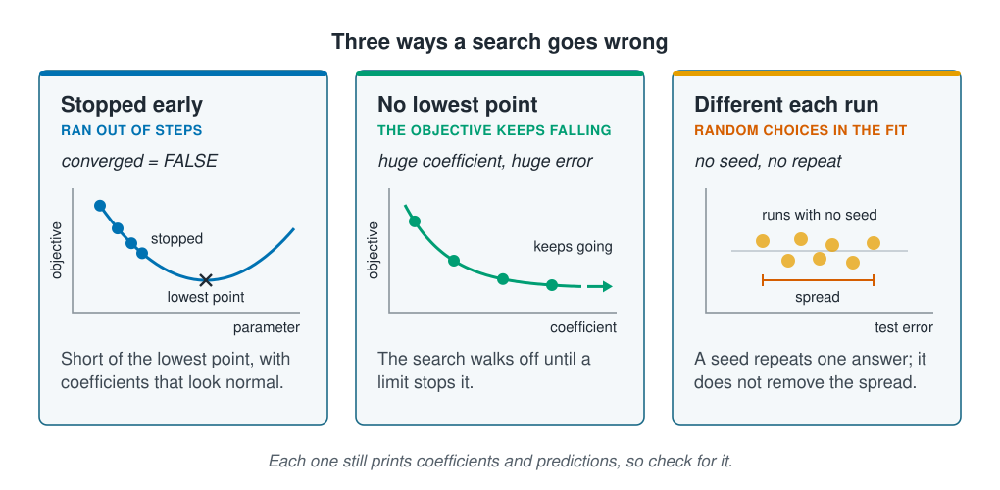

```{r}
#| label: setup
#| include: false
library(tidymodels)
library(tidyverse)
library(ranger)
source(here::here("R/theme.R"))
source(here::here("R/data.R"))
set.seed(123)

# A number for the prose, with a true minus sign.
num <- function(x, digits) sub("^-", "−", format(round(x, digits), nsmall = digits))
```

## A failed fit still prints coefficients

[Finding the parameters](parameter-estimation.qmd) split models into those solved by a
formula and those found by a search. A search can go wrong, and when it does the model
still returns coefficients, a summary and predictions, all of them plausible. Nothing
about the output looks broken. This page shows three ways a search goes wrong on the
survey, the sign each one leaves, and a short list of checks to run before reading any
coefficient.



## Three ways a search goes wrong

1. **It stopped early.** The search ran out of steps and returned wherever it had got to.
2. **There was no lowest point.** The objective kept falling in one direction, so the
   search kept going until a limit stopped it.
3. **It gives a different answer each run.** Some methods make random choices while
   fitting, so two runs on the same data give two models.

::: {.diagram}
{fig-alt="Three cards. Stopped early, ran out of steps, converged equals false: a U-shaped objective with a row of dots stepping down one side and stopping partway, short of the lowest point, which is marked with a cross; the coefficients look normal. No lowest point, the objective keeps falling, huge coefficient and huge error: a curve that falls towards a level it never reaches, with dots along it and an arrow labelled keeps going; the search walks off until a limit stops it. Different each run, random choices in the fit, no seed and no repeat: a row of dots for runs with no seed, spread along a scale of test error, with a bracket labelled spread; a seed repeats one answer but does not remove the spread. A note says each one still prints coefficients and predictions, so check for it."}
:::

## Worked example

```{r}
#| label: prepare
survey <- load_coastal_survey_clean()

d <- survey |>
  select(abundance, present, catch_weight_kg, depth_m, temperature_c,
         chlorophyll_mg_m3, salinity_psu, substrate, season) |>
  drop_na()
```

### A search that stopped early

`glm()` searches step by step and stops after 25 steps at most. We fit logistic
regression for presence twice: once allowed only two steps, and once left to finish.

```{r}
#| label: maxit
#| warning: true
stopped_early <- glm(present ~ chlorophyll_mg_m3 + depth_m, data = d,
                     family = binomial, control = glm.control(maxit = 2))

full_fit <- glm(present ~ chlorophyll_mg_m3 + depth_m, data = d, family = binomial)

tibble(
  fit         = c("two steps", "left to finish"),
  converged   = c(stopped_early$converged, full_fit$converged),
  steps       = c(stopped_early$iter, full_fit$iter),
  chlorophyll = c(coef(stopped_early)[2], coef(full_fit)[2]),
  depth       = c(coef(stopped_early)[3], coef(full_fit)[3])
) |>
  mutate(across(where(is.numeric), \(x) round(x, 4)))
```

```{r}
#| label: maxit-numbers
#| include: false
chl_off <- abs(coef(stopped_early)[[2]] / coef(full_fit)[[2]] - 1)
```

The fit stopped after two steps reports a chlorophyll coefficient of
`r num(coef(stopped_early)[[2]], 3)` against `r num(coef(full_fit)[[2]], 3)` for the
finished one, `r scales::percent(chl_off, 1)` out. On its own it would look entirely
reasonable. R does print a warning, but the table of coefficients carries no mark, and
the one place the difference shows is the `converged` field, which you have to ask for.

A search can also report success without having moved. On
[Maximum likelihood](maximum-likelihood.qmd), `optim()` fitted Poisson regression with
depth in metres and its square in the thousands. It returned the coefficients it
started from and a code saying it had finished. We repeat that fit and compare it with
`glm()` on the same inputs.

```{r}
#| label: silent-optim
Xraw <- model.matrix(~ chlorophyll_mg_m3 + depth_m + I(depth_m^2), data = d)
y <- d$abundance

raw_optim <- optim(rep(0, ncol(Xraw)),
                   \(b) -sum(dpois(y, lambda = exp(drop(Xraw %*% b)), log = TRUE)),
                   method = "BFGS", control = list(reltol = 1e-14, maxit = 5000))
raw_glm <- glm(abundance ~ chlorophyll_mg_m3 + depth_m + I(depth_m^2),
               data = d, family = poisson)

tibble(
  fit              = c("optim()", "glm()"),
  `reports success` = c(raw_optim$convergence == 0, raw_glm$converged),
  `log-likelihood` = c(-raw_optim$value, as.numeric(logLik(raw_glm)))
) |>
  mutate(across(where(is.numeric), \(x) round(x, 1)))
```

Both report success, but the log-likelihoods differ by
`r format(round(as.numeric(logLik(raw_glm)) + raw_optim$value), big.mark = ",")`, and
higher is better. `optim()` stopped at its starting point. The flag says only that the
search stopped by its own rule; checking that the answer is good takes a second route to
the same model, or a look at whether the parameters moved from where they started.

### An objective with no lowest point

`catch_weight_kg` is the leaked column from
[Information leakage](../02-marine-data/information-leakage.qmd): it is weighed from the
same catch that was counted, so every station where the species was present weighs
more than every station where it was absent. We use it to predict presence.

```{r}
#| label: separation
#| warning: true
separated <- glm(present ~ catch_weight_kg, data = d, family = binomial)

round(summary(separated)$coefficients, 3)
c(converged = separated$converged, steps = separated$iter)
```

```{r}
#| label: separation-numbers
#| include: false
sep <- summary(separated)$coefficients["catch_weight_kg", ]
```

The coefficient is `r num(sep[["Estimate"]], 1)`, its standard error is
`r format(round(sep[["Std. Error"]]), big.mark = ",")`, and the *p*-value is
`r num(sep[["Pr(>|z|)"]], 2)`. Read plainly, the table says catch weight is about the
least useful input you could have chosen. The truth is the opposite: it tells present
from absent at every station.

This is called **separation**. When one input splits the two classes completely, moving
its coefficient further from zero always makes the data a little more likely, so the objective
keeps falling and has no lowest point. The search walks off in that direction until it
reaches its limit of `r separated$iter` steps. The standard error measures how sharply
the objective curves at the answer, and far out along a nearly flat stretch it hardly
curves at all, so the error becomes enormous too.

The sign is a coefficient and a standard error that are both huge, with the error far
larger. It is not weak evidence; it means an input gives the answer away. Look for that
input, and in practice it is usually a leak. R's warning `fitted probabilities
numerically 0 or 1 occurred` points the same way.

### A different answer each run

A random forest draws stations and inputs at random for each tree, so a forest fitted
without a seed is a slightly different model every time. We fit one ten times on the
same training stations and score each on the same test stations.

```{r}
#| label: forest-runs
split <- initial_split(d |> select(-present, -catch_weight_kg), prop = 0.75)
train <- training(split)
test  <- testing(split)

unseeded <- map_dbl(1:10, \(i) {
  forest <- ranger(abundance ~ ., data = train, num.trees = 500)
  sqrt(mean((test$abundance - predict(forest, test)$predictions)^2))
})

round(unseeded, 3)
```

```{r}
#| label: fig-forest-runs
#| fig-cap: !expr glue::glue("Test RMSE of the same random forest fitted ten times without a seed. The runs spread over {num(diff(range(unseeded)), 3)} animals, and every one reported success.")
#| fig-alt: !expr glue::glue("A strip of ten dots along a horizontal axis of test RMSE, from {num(min(unseeded), 3)} to {num(max(unseeded), 3)} animals. The dots lie close together with no single run standing apart.")
#| fig-width: 7
#| fig-height: 2
tibble(rmse = unseeded) |>
  ggplot(aes(rmse, 0)) +
  geom_point(size = 3.4, alpha = 0.6, colour = ml_palette[["orange"]]) +
  labs(x = "Test RMSE (animals)", y = NULL,
       title = "One forest, ten runs without a seed") +
  theme(axis.text.y = element_blank(), panel.grid.major.y = element_blank())
```

The ten runs range from `r num(min(unseeded), 3)` to `r num(max(unseeded), 3)`, a
spread of `r num(diff(range(unseeded)), 3)` animals. That is small, and it is still
useful: two models whose test scores differ by less than this cannot be ranked on those
scores, because refitting one of them could reverse the order.
[Choosing a method](../03-supervised-learning/choosing-a-method.qmd) found its two count
models too close to rank on one split.

Setting a seed makes the forest return the same number every time. That is needed for a
paper someone else can repeat, but it says nothing about whether the number is
reliable. The only way to find out is to leave the seed out on purpose and fit several
times, as above.

## Each failure has its own fix

| Sign | What happened | What to do |
| --- | --- | --- |
| `converged` is `FALSE`, or a warning that the search did not converge | Ran out of steps | Allow more steps; if it still does not finish, rethink the model |
| A huge coefficient with an even larger standard error | No lowest point: an input gives the answer away | Find that input; suspect leakage |
| A different answer on each run | Random choices in the fit | Set a seed to repeat it; fit without one to measure the spread |
| The objective grows with every step, or becomes `NaN` | Step size too large | Take smaller steps; [standardise the inputs](gradient-descent.qmd) |
| Coefficients swing when a few stations change | Inputs that move together, a flat valley | Check how the inputs correlate; consider [a prior](map-and-priors.qmd) |

## Some mistakes print no warning

The warnings R prints loudest are not a guide to the failures that matter most. Two
examples from earlier pages print nothing at all.

- When two inputs carry the same information, such as depth in metres and depth in
  centimetres, `lm()` quietly drops one and prints `NA` in its place, with no warning.
- The stratified split on [Splitting the data](../02-marine-data/splitting-data.qmd)
  did not stratify the rare class, and gave no error. Only checking the result against
  what was asked for showed it.

"Converged" also means less than it sounds. A search stops when a step changes the fit
by less than a set amount, the **tolerance**, and each package chooses its own. Two
packages fitting the same model can disagree in the third decimal place and both report
success.

Finally, every check on this page asks whether the search did what it was told. None of
them asks whether it was told the right thing: a Poisson model of counts that vary far
more than Poisson allows converges without complaint.
[Section 6](../06-assumptions-limitations/index.qmd) takes up that question.

### A checklist before reading the coefficients

1. Did the search converge? Check the flag, not the look of the output.
2. Is any coefficient absurdly large, or `NA`?
3. Is any standard error many times larger than its coefficient?
4. If the method is random, how far does the answer move on a second run without a seed?
5. Are the predictions possible: no negative counts, and no probabilities below 0 or
   above 1?

The last check needs no statistics at all, only knowledge of the species and the survey,
and it catches many real mistakes.

## Key points

::: {.key-points}
- A search that went wrong still prints coefficients, so check the **convergence flag**,
  not how the output looks. Stopped after two steps, the chlorophyll coefficient was
  `r scales::percent(chl_off, 1)` out and looked normal.
- A reported success is not proof: `optim()` stopped where it started and still
  reported success. Check the answer by a second route.
- A huge coefficient with an even larger standard error means **separation**, an input
  that gives the answer away, not weak evidence.
- A random forest gave a different test RMSE on each unseeded run, spread over
  `r num(diff(range(unseeded)), 3)` animals. Differences smaller than that cannot be
  ranked.
- **A seed makes a result repeatable, not reliable.** Leave it out on purpose to measure
  the spread.
- Some failures print no warning at all, so check that each result is what you asked for.
:::

## Try it yourself

1. Fit `glm(present ~ abundance, family = binomial)`. `present` is defined as
   `abundance > 0`, so abundance splits the classes exactly. Compare its coefficient and
   standard error with the `catch_weight_kg` fit.
2. Refit the ten forests with `num.trees = 50` instead of 500. Does the spread grow or
   shrink, and why would more trees change it?
