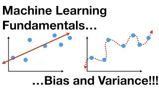
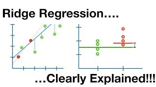
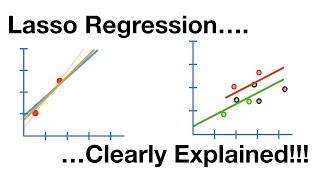

A flexible enough model can fit its training stations almost perfectly and still predict
new sites no better than the average count. Its error on the data it was fitted to says
little about new data, and the gap grows with how freely the model can bend. Each page in
this section takes one step, on the same simulated survey as the rest of the course:

- **training error and the error on new data**, two scores from one model, and the gap
  between them;
- **underfitting and overfitting**, the two ways to fail on new data, and the signs each
  leaves in the two errors;
- **model complexity**, the setting in each method that controls how freely it bends, and
  the reason counting parameters measures it only for a linear model;
- **the bias–variance trade-off**, which splits the error on new data into bias, variance
  and noise;
- **regularisation**, a penalty that makes a linear model simpler: ridge regression shrinks
  every coefficient, and the lasso sets some to zero;
- **hyperparameter selection**, choosing a setting by cross-validation by site, with the
  test sites kept for one final score.

The section picks up threads from earlier ones.
[Decision trees](../03-supervised-learning/decision-trees.qmd) chose a tree's depth on
validation sites, and [Underfitting and overfitting](underfitting-and-overfitting.qmd)
shows the cost of choosing badly. The penalty in [Regularisation](regularisation.qmd) is
the prior from [Priors and ridge regression](../04-how-algorithms-learn/map-and-priors.qmd).
[Splitting the data](../02-marine-data/splitting-data.qmd) set validation sites aside for
choosing a model; [Hyperparameter selection](hyperparameter-selection.qmd) replaces them
with cross-validation, which lets every training site take a turn.

## Pages in this section

::: {#pages}
:::

## Further resources

**Documentation**

- [Tune model parameters](https://www.tidymodels.org/start/tuning/), tidymodels. `tune()`, a grid, and resampling used honestly.
- [Underfitting versus overfitting](https://scikit-learn.org/stable/auto_examples/model_selection/plot_underfitting_overfitting.html), scikit-learn. Three polynomial fits to the same points, which is this section's argument in one figure.
- [Tuning the hyper-parameters of an estimator](https://scikit-learn.org/stable/modules/grid_search.html), scikit-learn user guide.

**Video**

::: {.video-list}
- [{.video-thumb fig-alt="Machine Learning Fundamentals: Bias and Variance, on YouTube" loading="lazy"}](https://www.youtube.com/watch?v=EuBBz3bI-aA)

  [Machine Learning Fundamentals: Bias and Variance](https://www.youtube.com/watch?v=EuBBz3bI-aA), StatQuest with Josh Starmer.

- [{.video-thumb fig-alt="Regularization Part 1: Ridge (L2) Regression, on YouTube" loading="lazy"}](https://www.youtube.com/watch?v=Q81RR3yKn30)

  [Regularization Part 1: Ridge (L2) Regression](https://www.youtube.com/watch?v=Q81RR3yKn30), StatQuest with Josh Starmer. Why the penalty shrinks coefficients towards zero.

- [{.video-thumb fig-alt="Regularization Part 2: Lasso (L1) Regression, on YouTube" loading="lazy"}](https://www.youtube.com/watch?v=NGf0voTMlcs)

  [Regularization Part 2: Lasso (L1) Regression](https://www.youtube.com/watch?v=NGf0voTMlcs), StatQuest with Josh Starmer. Why this penalty can set a coefficient to zero exactly, which makes it a selection method.
:::
