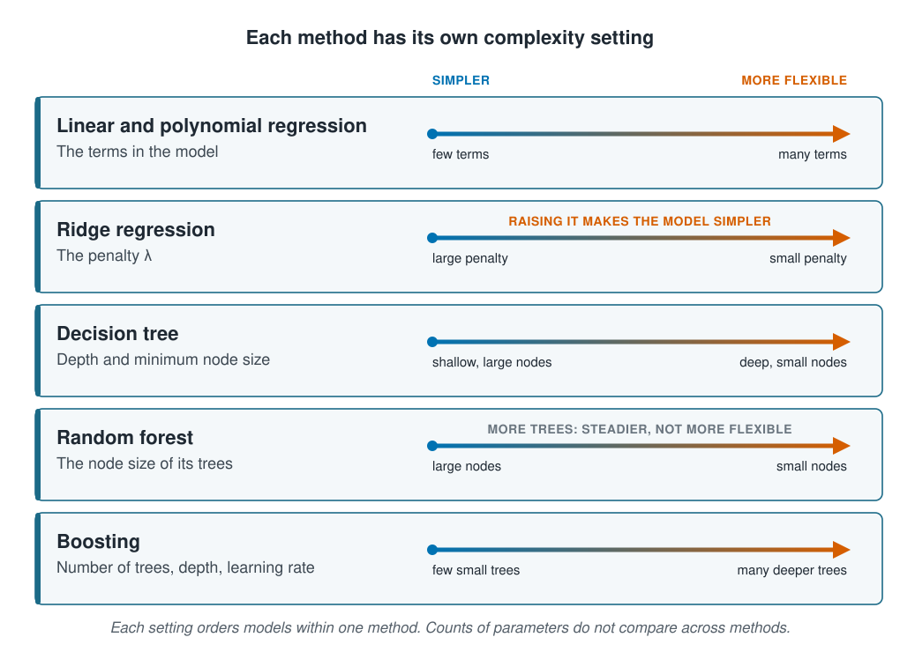

```{r}
#| label: setup
#| include: false
library(tidymodels)
library(tidyverse)
library(patchwork)
source(here::here("R/theme.R"))
source(here::here("R/data.R"))
source(here::here("R/python-tabs.R"))
set.seed(123)
```



## Adding a little bias on purpose

[Underfitting and overfitting](underfitting-and-overfitting.qmd) moved a decision tree from
rigid to flexible with one setting, and [The bias–variance trade-off](bias-variance.qmd)
found that a random forest cuts variance by averaging many trees. Regularisation cuts it
another way. It charges the model for large coefficients, so the model fits its own data a
little worse, and new data better.

This page first sets out the setting that moves each method from rigid to flexible, and
why every input added to a linear model makes it more flexible, even a column of random
numbers. It then introduces the two penalties in common use, ridge regression and the lasso.
It shows that they can rescue a regression swamped by useless inputs, and what the lasso's
choice of inputs can and cannot tell you.





## One setting moves each method from rigid to flexible

A model's flexibility, also called its complexity, is how wide a family of shapes it can
take. A straight line fits only data that lie near a line. A tree with one station in each
leaf fits any data at all, even counts drawn at random, so when it fits the survey
closely, that says nothing about the survey.

Each method has [hyperparameters](../03-supervised-learning/nearest-neighbours.qmd),
settings fixed before the fit, that set how flexible it can be. Turning one moves the
model from rigid to flexible.

::: {.diagram}
{fig-alt="Five rows, one per method, each with an arrow from simpler on the left to more flexible on the right. Linear and polynomial regression: the terms in the model, from few terms to many terms. Ridge regression: the penalty lambda, from large penalty to small penalty, marked: raising it makes the model simpler. Decision tree: depth and minimum node size, from shallow with large nodes to deep with small nodes. Random forest: the node size of its trees, from large nodes to small nodes, marked: more trees, steadier, not more flexible. Boosting: number of trees, depth and learning rate, from few small trees to many deeper trees. A note says each setting orders models within one method, and counts of parameters do not compare across methods."}
:::

Two of these settings are easy to misread. Raising the penalty of ridge regression, set
out below, makes the model simpler, since it pulls every coefficient towards zero. And the
number of trees in a random forest is not a complexity setting at all. Each tree is as
flexible as before, and averaging more of them steadies the prediction without letting it
bend further. Boosting is different, because each new tree fits part of what the trees
before it got wrong, so more trees do make it more flexible.

## Counting parameters works for a linear model

In a linear model, each input adds one coefficient, and each coefficient gives the fitted
surface one more way to bend. Its complexity is close to its number of coefficients. That
holds even for an input that carries no information: the fit still gives it a
coefficient, and uses it to follow whatever noise it can match.

For other methods the count is a poor guide. A forest of 500 trees has thousands of split
points, far more than any linear model in the course has coefficients, yet adding more
trees does not make it overfit. A ridge model keeps every one of its coefficients, but the
penalty stops them moving freely. So complexity is compared within one method, by turning
its setting. Between methods, the fair comparison is the error on new data.

## Ridge regression shrinks coefficients and the lasso removes them

Least squares chooses the coefficients that make the squared error on the data as small
as possible, and looks at nothing else. **Regularisation** adds a second term, a
**penalty** that grows with the size of the coefficients, and minimises the two together:

$$\text{squared error} + \lambda \times \text{penalty}$$

The weight λ (lambda) sets how hard the penalty pulls. With λ at zero the model is plain
least squares, the most flexible it can be. As λ grows, the coefficients are pulled
towards zero, and with a large enough λ every coefficient is zero and the model predicts
the average. λ is a complexity setting, like a tree's node size: raising it adds bias
and removes variance.

Two penalties are in common use:

- **Ridge regression** charges the sum of the squared coefficients.
  [Likelihood and priors](../04-how-algorithms-learn/likelihood-and-priors.qmd) derives
  it from a Normal prior. A squared penalty is heavy on large coefficients and light on
  small ones, so it shrinks every coefficient but sets none to exactly zero.
- **The lasso** charges the sum of their absolute values. The same page shows that it
  comes from a Laplace prior, which has a sharp peak at zero. The price of each unit is
  the same all the way down to zero, so a small coefficient that does little for the fit
  is cheaper to drop than to keep. The lasso sets such coefficients to exactly zero, and
  the input is gone from the model.

**Elastic net** charges a mixture of the two. In tidymodels, `mixture` sets the share:
0 is ridge, 1 is the lasso.

::: {.diagram}
{fig-alt="Three cards, each with six coefficient bars about a zero line. Least squares, no penalty: bars of different heights. Ridge regression, squared penalty: every bar shorter than its least-squares outline, none at zero. Lasso, absolute penalty: the three large bars shorter, the three small ones exactly zero and drawn as open circles, so those inputs are dropped. Below, a card says the weight lambda sets how hard the penalty pulls, from lambda equals zero, least squares and the most flexible, to a large lambda, where every coefficient is zero and the model predicts the average. Raising lambda adds bias and removes variance. A note says to standardise the inputs first, because the penalty is charged per unit of each input."}
:::

Both penalties add up coefficients, and a coefficient's size depends on the units of its
input: an effect per metre of depth is a thousand times one per millimetre. The inputs are
therefore standardised before a penalised fit, so that the penalty treats each one alike.

## Worked example

The data and splits are those of the earlier pages: 20 random splits of the training sites
into fitting sites and new sites, with each error averaged over the 20. The test sites are
still unused.

The model is a linear regression on the four measured inputs: depth, temperature,
chlorophyll and salinity. Columns of random numbers are then added to it as extra inputs.
Each column holds one number per station, drawn at random, so it belongs to the stations
just as a measurement does, but by construction it carries no information about the
catch. The first part adds more and more of them. The second gives the regression 200 and
lets the penalties hold them back, and the third checks which inputs the lasso kept.

### Preparing the data

::: {.panel-tabset group="language"}

## R

```{r}
#| label: prepare
survey <- load_coastal_survey_clean()

split <- group_initial_split(survey, group = site_id, prop = 0.75)
train <- training(split)

# 20 random splits of the training sites: fitting sites and new sites
splits <- group_mc_cv(train, group = site_id, prop = 0.75, times = 20)

measured <- c("depth_m", "temperature_c", "chlorophyll_mg_m3", "salinity_psu")

# 460 columns of random numbers, one number per training station
noise <- matrix(rnorm(nrow(train) * 460), nrow = nrow(train),
                dimnames = list(NULL, paste0("noise", 1:460)))
noise_columns <- bind_cols(select(train, station_id), as_tibble(noise))

# the inputs for the penalties: the measured four and the first 200 random columns
inputs <- c(measured, colnames(noise)[1:200])

# impute, then standardise, so the penalty treats every input alike
inputs_recipe <- function(data, columns) {
  recipe(abundance ~ ., data = data[c("abundance", columns)]) |>
    step_impute_median(all_numeric_predictors()) |>
    step_normalize(all_numeric_predictors())
}
```

## Python

```{python}
import numpy as np
import pandas as pd
from sklearn.impute import SimpleImputer
from sklearn.linear_model import ElasticNet, Lasso, LinearRegression, Ridge
from sklearn.metrics import r2_score, root_mean_squared_error
from sklearn.model_selection import GroupShuffleSplit
from sklearn.pipeline import Pipeline
from sklearn.preprocessing import StandardScaler

from mlbasic_data import load_coastal_survey_clean

survey = load_coastal_survey_clean()

grouper = GroupShuffleSplit(n_splits=1, train_size=0.75, random_state=123)
train_rows, test_rows = next(grouper.split(survey, groups=survey["site_id"]))
train = survey.iloc[train_rows].reset_index(drop=True)

# 20 random splits of the training sites: fitting sites and new sites
splitter = GroupShuffleSplit(n_splits=20, train_size=0.75, random_state=123)
splits = list(splitter.split(train, groups=train["site_id"]))

measured = ["depth_m", "temperature_c", "chlorophyll_mg_m3", "salinity_psu"]

# 460 columns of random numbers, one number per training station
rng = np.random.default_rng(123)
noise = pd.DataFrame(rng.standard_normal((len(train), 460)),
                     columns=[f"noise{i}" for i in range(1, 461)])
data = pd.concat([train, noise], axis=1)

# the inputs for the penalties: the measured four and the first 200 random columns
inputs = measured + list(noise.columns[:200])

# impute, then standardise, so the penalty treats every input alike
def inputs_pipeline(model):
    return Pipeline([("impute", SimpleImputer(strategy="median")),
                     ("standardise", StandardScaler()),
                     ("model", model)])
```

:::

### Random columns raise R² and the error on new sites

For each split, the regression is fitted with no random columns, then with 5, 10 and on
up to 400. The last setting adds as many as the fitting stations allow: one coefficient
for every fitting station, counting the intercept. Each fit is scored on the fitting
stations, by $R^2$ and by RMSE, and on the new sites by RMSE.

::: {.panel-tabset group="language"}

## R

```{r}
#| label: noise-sweep
column_counts <- c(0, 5, 10, 25, 50, 100, 200, 300, 400, Inf)

score_columns <- function(s) {
  fitting <- analysis(s) |> left_join(noise_columns, by = "station_id")
  new     <- assessment(s) |> left_join(noise_columns, by = "station_id")
  map(column_counts, \(asked) {
    # at most one coefficient per fitting station, counting the intercept
    k <- min(asked, nrow(fitting) - length(measured) - 1)
    columns <- c("abundance", measured, colnames(noise)[seq_len(k)])
    line_recipe <- recipe(abundance ~ ., data = fitting[columns]) |>
      step_impute_median(all_numeric_predictors())
    fitted <- workflow(line_recipe, linear_reg()) |> fit(fitting[columns])
    fitted_values <- predict(fitted, fitting)$.pred
    tibble(asked,
           noise     = k,
           r_squared = rsq_trad_vec(fitting$abundance, fitted_values),
           training  = rmse_vec(fitting$abundance, fitted_values),
           average   = rmse_vec(new$abundance, rep(mean(fitting$abundance), nrow(new))),
           new       = rmse_vec(new$abundance, predict(fitted, new)$.pred))
  }) |>
    list_rbind()
}

noise_sweep <- map(splits$splits, score_columns) |>
  list_rbind() |>
  group_by(asked) |>
  summarise(across(c(noise, r_squared, training, average, new), mean)) |>
  select(-asked)

noise_sweep |>
  select(-average) |>
  mutate(noise = round(noise), r_squared = round(r_squared, 3),
         across(c(training, new), \(x) round(x, 2)))
```

## Python

```{python}
column_counts = [0, 5, 10, 25, 50, 100, 200, 300, 400, np.inf]

rows = []
for fitting_rows, new_rows in splits:
    fitting, new = data.iloc[fitting_rows], data.iloc[new_rows]
    for asked in column_counts:
        # at most one coefficient per fitting station, counting the intercept
        k = int(min(asked, len(fitting) - len(measured) - 1))
        columns = measured + [f"noise{i}" for i in range(1, k + 1)]
        model = Pipeline([("impute", SimpleImputer(strategy="median")),
                          ("model", LinearRegression())])
        fitted = model.fit(fitting[columns], fitting["abundance"])
        fitted_values = fitted.predict(fitting[columns])
        rows.append({
            "asked": asked,
            "noise": k,
            "r_squared": r2_score(fitting["abundance"], fitted_values),
            "training": root_mean_squared_error(fitting["abundance"], fitted_values),
            "new": root_mean_squared_error(new["abundance"],
                                           fitted.predict(new[columns])),
        })

noise_sweep = (pd.DataFrame(rows).groupby("asked", as_index=False).mean()
               .drop(columns="asked"))
noise_sweep.round({"noise": 0, "r_squared": 3, "training": 2, "new": 2})
```

:::

```{r}
#| label: noise-numbers
#| include: false
f2 <- function(x) sprintf("%.2f", x)
in_words <- function(n) {
  if (n > 10) return(as.character(n))
  c("one", "two", "three", "four", "five", "six", "seven", "eight", "nine", "ten")[n]
}
row_at <- function(n) filter(noise_sweep, noise == n)
baseline <- mean(noise_sweep$average)
none <- row_at(0)
few <- row_at(10)
full <- slice_max(noise_sweep, noise)
# the fewest random columns with which the regression does worse than the average
first_worse <- noise_sweep |> filter(new > baseline) |> slice_min(noise)
```

::: {.panel-tabset group="language"}

## R

```{r}
#| label: fig-noise
#| fig-cap: "A linear regression on the four measured inputs, with columns of random numbers added, averaged over 20 splits of the training sites. Above, its R² on the fitting stations. Below, its RMSE on new sites, on a log scale; the dashed line is the error of predicting the fitting stations' average count."
#| fig-alt: !expr glue::glue("Two stacked panels sharing a horizontal axis of random columns added, from 0 to about {round(full$noise)} on a square-root scale. Above, R-squared on the fitting stations rises from {sprintf('%.2f', none$r_squared)} with no random columns, slowly at first and then steeply, to exactly 1 at the right. Below, on a log scale, RMSE on new sites rises from {f2(none$new)} with no random columns, crosses a dashed line at {f2(baseline)} for predicting the average at about {first_worse$noise} columns, and climbs ever faster to {f2(full$new)} at the right.")
#| fig-width: 7
#| fig-height: 5.2
breaks <- c(0, 25, 100, 200, 300, 400)

fit_panel <- ggplot(noise_sweep, aes(noise, r_squared)) +
  geom_line(linewidth = 1, colour = ml_palette[["blue"]]) +
  geom_point(size = 2, colour = ml_palette[["blue"]]) +
  scale_x_sqrt(breaks = breaks) +
  labs(x = NULL, y = "R² on the\nfitting stations",
       title = "The fit to the fitting stations only improves")

new_panel <- ggplot(noise_sweep, aes(noise, new)) +
  geom_hline(yintercept = baseline, linetype = "dashed",
             colour = ml_palette[["grey"]]) +
  geom_line(linewidth = 1, colour = ml_palette[["vermilion"]]) +
  geom_point(size = 2, colour = ml_palette[["vermilion"]]) +
  annotate("text", x = 150, y = baseline / 1.18, label = "predict the average",
           hjust = 0, colour = ml_palette[["grey"]], size = 3.4) +
  scale_x_sqrt(breaks = breaks) +
  scale_y_log10() +
  labs(x = "Columns of random numbers added", y = "RMSE on new sites\n(individuals)",
       title = "The error on new sites only worsens",
       subtitle = "Log scale")

fit_panel / new_panel
```

:::

**The fit only improves.** With no random columns, the regression's $R^2$ on the fitting
stations is `r sprintf("%.3f", none$r_squared)`. Every column added raises it, and with
`r round(full$noise)` columns, on average, it reaches `r sprintf("%.3f", full$r_squared)`.
This is not chance: adding a column can never lower $R^2$ on the stations the model was
fitted to. The fit could always give the new coefficient a value of zero and do exactly
as well as before, so it takes whatever small match with the catch the random numbers
happen to offer. A higher $R^2$ after adding an input is therefore no evidence that the
input matters.

**Every column costs on new sites.** Ten random columns already raise the error on new
sites from `r f2(none$new)` to `r f2(few$new)`. With about `r first_worse$noise` columns
the regression does worse than predicting the average count, `r f2(baseline)`, and the
error climbs ever faster from there. There is no number of useless inputs small enough to
be free.

**The perfect fit is the worst model.** With one coefficient for every fitting station,
the regression passes through every station: its $R^2$ is 1 and its training error
`r f2(full$training)`. On new sites its error is `r f2(full$new)`, about
`r round(full$new / baseline)` times that of predicting the average. It has found
nothing; it has simply run out of stations to be wrong about.

### The lasso predicts as well as knowing the real inputs

Now the regression gets the first 200 random columns, and the penalties have to hold them
back. For each split, ridge regression, the lasso and an elastic net with `mixture = 0.5`
are fitted to all 204 inputs, and each is scored on the new sites at 61 values of λ. Three
models without a penalty set the scale: the regression on all 204 inputs, the regression
on the four measured inputs alone, and predicting the fitting stations' average.

::: {.panel-tabset group="language"}

## R

```{r}
#| label: sweep
lambdas <- 10^seq(-3, 3, length.out = 61)

# glmnet fits every λ in one go; predict() then picks one
penalised_model <- function(mixture) {
  linear_reg(penalty = 1, mixture = mixture) |>
    set_engine("glmnet", path_values = lambdas)
}

score_split <- function(s) {
  fitting <- analysis(s) |> left_join(noise_columns, by = "station_id")
  new     <- assessment(s) |> left_join(noise_columns, by = "station_id")
  error_on_new <- function(fitted, ...) {
    rmse_vec(new$abundance, predict(fitted, new, ...)$.pred)
  }
  fit_to <- function(columns, model) {
    workflow(inputs_recipe(fitting, columns), model) |>
      fit(fitting[c("abundance", columns)])
  }

  penalised <- map(c(`Ridge regression` = 0, Lasso = 1, `Elastic net` = 0.5), \(m) {
    fitted <- fit_to(inputs, penalised_model(m))
    tibble(lambda = lambdas,
           new    = map_dbl(lambdas, \(l) error_on_new(fitted, penalty = l)))
  }) |>
    list_rbind(names_to = "model")

  unpenalised <- tibble(
    model = c("Linear regression, all inputs", "Linear regression, measured only",
              "predict the average"),
    new   = c(error_on_new(fit_to(inputs, linear_reg())),
              error_on_new(fit_to(measured, linear_reg())),
              rmse_vec(new$abundance, rep(mean(fitting$abundance), nrow(new)))))

  bind_rows(penalised, unpenalised)
}

sweep <- map(splits$splits, score_split) |>
  list_rbind() |>
  group_by(model, lambda) |>
  summarise(new = mean(new), .groups = "drop")

best <- sweep |>
  group_by(model) |>
  slice_min(new) |>
  ungroup() |>
  arrange(new)

best |> mutate(lambda = signif(lambda, 2), new = round(new, 2))
```

## Python

```{python}
lambdas = 10 ** np.linspace(-3, 3, 61)

# scikit-learn's Ridge puts no 1/n in front of the squared error, as glmnet
# does, so its alpha is λ times the number of stations
penalised = {
    "Ridge regression": lambda lam, n: Ridge(alpha=lam * n),
    "Lasso": lambda lam, n: Lasso(alpha=lam),
    "Elastic net": lambda lam, n: ElasticNet(alpha=lam, l1_ratio=0.5),
}

def error_on_new(fitted, new, columns):
    return root_mean_squared_error(new["abundance"], fitted.predict(new[columns]))

rows = []
for fitting_rows, new_rows in splits:
    fitting, new = data.iloc[fitting_rows], data.iloc[new_rows]
    for name, make in penalised.items():
        for lam in lambdas:
            fitted = inputs_pipeline(make(lam, len(fitting))).fit(
                fitting[inputs], fitting["abundance"])
            rows.append({"model": name, "lambda": lam,
                         "new": error_on_new(fitted, new, inputs)})
    for name, columns in [("Linear regression, all inputs", inputs),
                          ("Linear regression, measured only", measured)]:
        fitted = inputs_pipeline(LinearRegression()).fit(
            fitting[columns], fitting["abundance"])
        rows.append({"model": name, "lambda": np.nan,
                     "new": error_on_new(fitted, new, columns)})
    average = np.repeat(fitting["abundance"].mean(), len(new))
    rows.append({"model": "predict the average", "lambda": np.nan,
                 "new": root_mean_squared_error(new["abundance"], average)})

sweep = (pd.DataFrame(rows)
         .groupby(["model", "lambda"], dropna=False, as_index=False)["new"].mean())
best = (sweep.loc[sweep.groupby("model")["new"].idxmin()]
        .sort_values("new").reset_index(drop=True))
best.round({"lambda": 3, "new": 2})
```

:::

```{r}
#| label: sweep-numbers
#| include: false
error_of <- function(m) best$new[best$model == m]
lambda_of <- function(m) best$lambda[best$model == m]
average <- error_of("predict the average")
all_inputs <- error_of("Linear regression, all inputs")
measured_only <- error_of("Linear regression, measured only")
ridge_error <- error_of("Ridge regression")
lasso_error <- error_of("Lasso")
lasso_lambda <- lambda_of("Lasso")
```

::: {.panel-tabset group="language"}

## R

```{r}
#| label: fig-sweep
#| fig-cap: "Error on new sites against the penalty weight λ, for ridge regression and the lasso on the four measured inputs and 200 random columns, averaged over 20 splits of the training sites. The horizontal lines are the three models without a penalty."
#| fig-alt: !expr glue::glue("Two curves of RMSE on new sites against lambda on a log scale from 0.001 to 1000. Both curves start on the left at a line for the regression on all inputs, at {f2(all_inputs)}. The lasso curve falls to its lowest point, {f2(lasso_error)}, near lambda {signif(lasso_lambda, 2)}, then rises to the average line and stays there. The ridge curve falls later and more slowly, to {f2(ridge_error)} near lambda {signif(lambda_of('Ridge regression'), 2)}, then creeps back up towards the average line. A dashed line for predicting the average sits at {f2(average)}, and a line for the regression on the measured inputs alone at {f2(measured_only)}, level with the bottom of the lasso curve.")
#| fig-width: 7
#| fig-height: 4.5
reference <- best |>
  filter(is.na(lambda)) |>
  # each label where no curve crosses it
  mutate(x = if_else(model == "Linear regression, all inputs", 1000, 0.001),
         hjust = if_else(model == "Linear regression, all inputs", 1, 0))

sweep |>
  filter(!is.na(lambda), model != "Elastic net") |>
  ggplot(aes(lambda, new, colour = model)) +
  geom_hline(data = reference, aes(yintercept = new), linetype = "dashed",
             colour = ml_palette[["grey"]]) +
  geom_text(data = reference, aes(x = x, y = new, label = model, hjust = hjust),
            inherit.aes = FALSE, vjust = -0.5, size = 3.4,
            colour = ml_palette[["grey"]]) +
  geom_line(linewidth = 1) +
  scale_x_log10(breaks = 10^(-3:3),
                labels = scales::label_number(drop0trailing = TRUE,
                                              big.mark = ",")) +
  scale_colour_manual(values = c(`Ridge regression` = ml_palette[["blue"]],
                                 Lasso = ml_palette[["vermilion"]])) +
  labs(x = "λ (log scale)", y = "RMSE on new sites (individuals)", colour = NULL,
       title = "The lasso throws out the random columns; ridge only shrinks them")
```

:::

**Unchecked, the random columns cost dearly.** The regression on all 204 inputs has an
error on new sites of `r f2(all_inputs)`, worse than predicting the average,
`r f2(average)`, as the first part found.

**The penalty is a complexity setting.** Both curves start at that regression on the
left, where λ is small, and head for the average on the right, where λ is so large that
every coefficient is zero or close to it. The lowest error lies in between, as it did for
a tree's node size on [Underfitting and overfitting](underfitting-and-overfitting.qmd).

**The lasso did as well as knowing which columns were random.** At its best λ, the lasso
scores `r f2(lasso_error)`, against `r f2(measured_only)` for a regression given only the
four measured inputs. It got there by setting nearly all the random columns to zero. The
elastic net lands close to the lasso, at a larger λ, since half its penalty is the
lasso's.

**Ridge regression helped less.** Its best error is `r f2(ridge_error)`. It keeps all 204
coefficients, yet does far better than least squares with the same 204: the penalty stops
them moving freely, so counting coefficients no longer measures the model's complexity.
But ridge only shrinks each random column, and 200 small coefficients still add up. Ridge
suits data in which many inputs each matter a little; the lasso suits data in which a few
matter and the rest are noise, as here.

The best λ was chosen by the same errors the table reports, which flatters it a little.
[Hyperparameter selection](hyperparameter-selection.qmd) shows how to choose a setting such
as λ and still get an honest error.

### The lasso's list of inputs is not evidence of what matters

It is tempting to read the inputs the lasso keeps as the ones that matter. Here we know
which columns are random, so we can check. The lasso is fitted to each split's fitting
stations again at its best λ, and each kept input is counted.

::: {.panel-tabset group="language"}

## R

```{r}
#| label: kept
kept <- map(splits$splits, \(s) {
  fitting <- analysis(s) |> left_join(noise_columns, by = "station_id")
  workflow(inputs_recipe(fitting, inputs), penalised_model(1)) |>
    fit(fitting[c("abundance", inputs)]) |>
    tidy(penalty = lasso_lambda) |>
    filter(term != "(Intercept)", estimate != 0)
}) |>
  list_rbind(names_to = "split")

kept |>
  count(term, name = "splits", sort = TRUE) |>
  head(8)
```

## Python

```{python}
lasso_lambda = best.loc[best["model"] == "Lasso", "lambda"].item()

kept = []
for split_number, (fitting_rows, new_rows) in enumerate(splits):
    fitting = data.iloc[fitting_rows]
    fitted = inputs_pipeline(Lasso(alpha=lasso_lambda)).fit(
        fitting[inputs], fitting["abundance"])
    coefficients = fitted.named_steps["model"].coef_
    kept += [{"split": split_number, "term": term}
             for term, b in zip(inputs, coefficients) if b != 0]
kept = pd.DataFrame(kept)

(kept["term"].value_counts().rename("splits").rename_axis("term")
     .reset_index().head(8))
```

:::

```{r}
#| label: kept-numbers
#| include: false
kept_counts <- count(kept, term, name = "splits")
splits_with <- function(t) sum(kept_counts$splits[kept_counts$term == t])
random_kept <- kept |> filter(str_starts(term, "noise"))
per_split <- random_kept |> count(split)
top_random <- random_kept |> count(term, name = "splits") |> slice_max(splits, n = 1, with_ties = FALSE)
always <- measured[map_int(measured, splits_with) == length(splits$splits)]
dropped <- setdiff(measured, kept$term)
names_of <- c(depth_m = "depth", temperature_c = "temperature",
              chlorophyll_mg_m3 = "chlorophyll", salinity_psu = "salinity")
depth_temperature <- cor(train$depth_m, train$temperature_c, use = "complete.obs")
```

**The lasso kept random columns.** On average it kept `r in_words(round(mean(per_split$n)))`
random columns per split, and `r n_distinct(random_kept$term)` different ones across the
20. One of them, `r top_random$term`, was kept in `r top_random$splits` of the 20 splits,
almost as often as `r knitr::combine_words(names_of[always])`. The splits share most of their
sites, so a chance match between a random column and the counts at those sites turns up
again and again. Keeping an input, even in split after split, does not show that it
matters.

**The lasso dropped measured inputs.** It kept
`r knitr::combine_words(names_of[always])` in every split, and dropped
`r knitr::combine_words(names_of[dropped])` in every one. Dropping an input does not show
that it is useless either. Temperature falls with depth on this shelf (their correlation
is `r sub("^-", "−", sprintf("%.2f", depth_temperature))`), so once depth is in the model, temperature
adds little that depth has not already said, and the lasso drops whichever of the pair
helps less.

The lasso is a way to predict well from many inputs. Its list of inputs is one draw from
the data, and a different set of stations would give a different list.

## Key points

::: {.key-points}
- Each method has its own setting for how flexible it is. Only for a linear model does
  the number of coefficients measure it; across methods, compare the error on new data.
- $R^2$ on the fitting data never falls when an input is added, even a column of random
  numbers, yet every random column made the regression worse on new sites.
- Regularisation adds a penalty on the size of the coefficients, weighted by λ. Raising
  λ adds bias and removes variance. Standardise the inputs first, so the penalty treats
  each one alike.
- Ridge regression shrinks every coefficient; the lasso sets some to exactly zero. With
  200 random columns among its inputs, the lasso predicted about as well as a regression
  told which inputs were measured, and ridge regression less well.
- The lasso kept some random columns and dropped some measured inputs. Its list of
  inputs is not evidence of which ones matter.
:::

## Try it yourself

1. Give each split fewer fitting sites by adding
   `fitting <- fitting |> filter(site_id %in% sample(unique(site_id), 30))` after the line
   that sets `fitting` in `score_columns()`. With fewer stations, how many random columns
   does it take before the regression does worse than predicting the average?
2. Give the penalties 50 random columns instead of 200, with `1:50` in place of `1:200`
   in the line that sets `inputs`. Does the lasso still beat ridge regression by as much?
3. Remove `"depth_m"` from `measured` and rerun the penalties and the count. Does the
   lasso now keep temperature?
