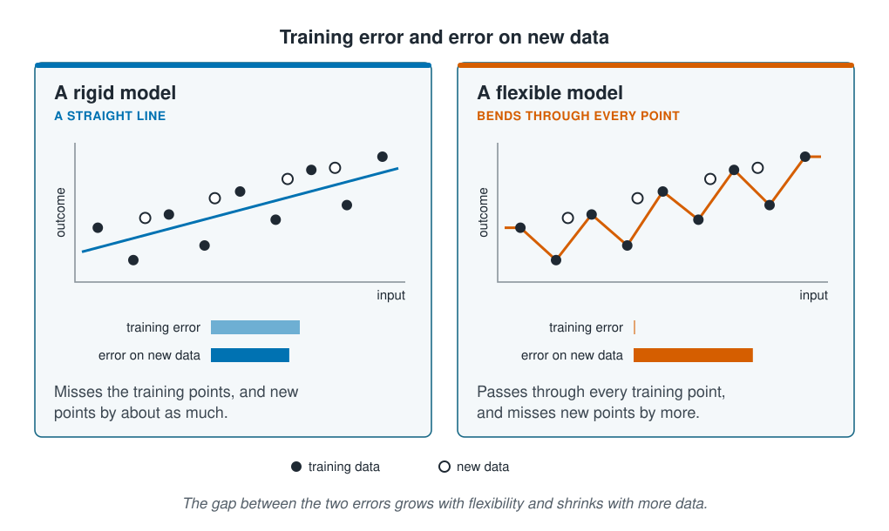

```{r}
#| label: setup
#| include: false
library(tidymodels)
library(tidyverse)
library(patchwork)
source(here::here("R/theme.R"))
source(here::here("R/data.R"))
source(here::here("R/python-tabs.R"))
options(knitr.kable.NA = "")
set.seed(123)
```

## Training error flatters a model

Every fitted model can report its error on the data it was fitted to. That number comes
free, and it is easy to read as a measure of how good the model is. This page shows that
it is a poor guide to how a model will do on new sites, and that the more flexible the
model, the poorer the guide. Five models from [section 3](../03-supervised-learning/index.qmd),
ranked by that number, come out nearly upside down.





## Training error and the error on new data

The **training error** is a model's error on the examples it was fitted to. The **error on
new data** is its error on examples it has never seen, and it is the one that matters: a
model is fitted to be used on new data.

Data hold two kinds of pattern. **Signal** is the part that will appear again in new data,
such as warmer water holding more of a species. **Noise** is the part peculiar to the
examples at hand: a lucky haul, a sensor reading slightly off. A model cannot tell the two
apart, and fitting noise lowers the training error just as fitting signal does. But only the
signal carries over to new data.

So the training error is usually lower than the error on new data, and the difference
between them is called the **optimism**. A rigid model, such as a straight line, has little
room to fit noise, so its two errors stay close. A flexible model can bend through every
training example, so its training error can fall to zero while its error on new data does
not. More data shrinks the optimism, since noise in many examples is harder to fit than
noise in a few.

::: {.diagram}
{fig-alt="Two cards, each showing the same nine training points and four new points. A rigid model, a straight line: it misses the training points and the new points by about as much, and two bars, training error and error on new data, are about the same length. A flexible model, bending through every point: its training error bar is empty and its error on new data bar is the longest. A note says the gap between the two errors grows with flexibility and shrinks with more data."}
:::

## Worked example

The data and the split by site are those of [Decision trees](../03-supervised-learning/decision-trees.qmd):
three quarters of the monitoring sites for training and a quarter held back as test sites.
This page uses only the training sites; the test sites are kept for the end of the
section.

Each model is fitted to some of the training sites and scored on the rest, which play the
part of new sites. One such split leaves only a few dozen sites to score on, and by chance
they can be easier or harder to predict than the others. So the training sites are split
20 times at random, by site, three quarters for fitting and a quarter as new sites, and
each error is averaged over the 20 splits.

### Preparing the data

::: {.panel-tabset group="language"}

## R

```{r}
#| label: prepare
survey <- load_coastal_survey_clean()

split <- group_initial_split(survey, group = site_id, prop = 0.75)
train <- training(split)

# 20 random splits of the training sites: fitting sites and new sites
splits <- group_mc_cv(train, group = site_id, prop = 0.75, times = 20)

predictors <- abundance ~ depth_m + temperature_c + chlorophyll_mg_m3 +
  salinity_psu + substrate + season

tree_recipe <- recipe(predictors, data = train) |>
  step_impute_median(all_numeric_predictors())
boost_recipe <- tree_recipe |>
  step_dummy(all_nominal_predictors())

c(training_sites = n_distinct(train$site_id), splits = nrow(splits))
```

## Python

```{python}
import numpy as np
import pandas as pd
from sklearn.compose import ColumnTransformer
from sklearn.ensemble import GradientBoostingRegressor, RandomForestRegressor
from sklearn.impute import SimpleImputer
from sklearn.linear_model import LinearRegression
from sklearn.metrics import root_mean_squared_error
from sklearn.model_selection import GroupShuffleSplit
from sklearn.pipeline import Pipeline
from sklearn.preprocessing import OneHotEncoder, PolynomialFeatures
from sklearn.tree import DecisionTreeRegressor

from mlbasic_data import load_coastal_survey_clean

survey = load_coastal_survey_clean()

numeric = ["depth_m", "temperature_c", "chlorophyll_mg_m3", "salinity_psu"]
categorical = ["substrate", "season"]
predictors = numeric + categorical

grouper = GroupShuffleSplit(n_splits=1, train_size=0.75, random_state=123)
train_rows, test_rows = next(grouper.split(survey, groups=survey["site_id"]))
train = survey.iloc[train_rows]

# scikit-learn's models need numbers, so one recipe serves all five.
tree_recipe = ColumnTransformer([
    ("numeric", SimpleImputer(strategy="median"), numeric),
    ("categorical", OneHotEncoder(drop="first", sparse_output=False), categorical),
])

# 20 random splits of the training sites: fitting sites and new sites
splitter = GroupShuffleSplit(n_splits=20, train_size=0.75, random_state=123)
splits = list(splitter.split(train, groups=train["site_id"]))

{"training_sites": train["site_id"].nunique(), "splits": len(splits)}
```

:::

### Each model scored on its own stations and on new sites

The five models run from rigid to flexible: linear regression; a decision tree three
questions deep; a decision tree grown out until each leaf holds a single station; a random
forest of 500 trees; and boosting with 500 trees, each six questions deep. The boosted model
is deliberately large, so that it has room to fit the noise. Each is fitted to the fitting
sites of every split and scored twice, on the stations it was fitted to and on the new sites.
Predicting the fitting stations' average count everywhere, with no inputs at all, gives a
baseline.

::: {.panel-tabset group="language"}

## R

```{r}
#| label: five-models
tree_model <- function(depth) {
  decision_tree(mode = "regression", tree_depth = depth,
                min_n = 2, cost_complexity = 0)
}
forest_model <- rand_forest(mode = "regression", trees = 500) |>
  set_engine("ranger", seed = 123)
boost_model <- boost_tree(mode = "regression", trees = 500,
                          tree_depth = 6, learn_rate = 0.1)

models <- list(
  "Linear regression"        = workflow(tree_recipe, linear_reg()),
  "Decision tree, depth 3"   = workflow(tree_recipe, tree_model(3)),
  "Decision tree, grown out" = workflow(tree_recipe, tree_model(30)),
  "Random forest"            = workflow(tree_recipe, forest_model),
  "Boosting"                 = workflow(boost_recipe, boost_model)
)

score_split <- function(s) {
  fitting <- analysis(s)
  new     <- assessment(s)
  imap(models, \(w, model) {
    fitted <- fit(w, fitting)
    tibble(model    = model,
           training = rmse_vec(fitting$abundance, predict(fitted, fitting)$.pred),
           new      = rmse_vec(new$abundance, predict(fitted, new)$.pred),
           # ranger's out-of-bag error, used further down
           oob      = if (model == "Random forest")
                        sqrt(extract_fit_engine(fitted)$prediction.error) else NA)
  }) |>
    list_rbind() |>
    add_row(model = "Predict the average", training = NA,
            new = rmse_vec(new$abundance, rep(mean(fitting$abundance), nrow(new))))
}

scores <- map(splits$splits, score_split) |> list_rbind()

results <- scores |>
  group_by(model) |>
  summarise(across(c(training, new, oob), mean)) |>
  mutate(optimism = new - training) |>
  arrange(training)

results |> select(-oob) |> mutate(across(where(is.double), \(x) round(x, 2)))
```

## Python

```{python}
def pipeline(model):
    return Pipeline([("recipe", tree_recipe), ("model", model)])

models = {
    "Linear regression": lambda: pipeline(LinearRegression()),
    "Decision tree, depth 3": lambda: pipeline(
        DecisionTreeRegressor(max_depth=3, random_state=123)),
    "Decision tree, grown out": lambda: pipeline(
        DecisionTreeRegressor(random_state=123)),
    # oob_score keeps the out-of-bag predictions used further down.
    "Random forest": lambda: pipeline(RandomForestRegressor(
        n_estimators=500, max_features="sqrt", min_samples_leaf=5,
        oob_score=True, random_state=123)),
    "Boosting": lambda: pipeline(GradientBoostingRegressor(
        n_estimators=500, max_depth=6, learning_rate=0.1, random_state=123)),
}

rmse = root_mean_squared_error
rows = []
for fit_rows, new_rows in splits:
    fitting, new = train.iloc[fit_rows], train.iloc[new_rows]
    for name, make in models.items():
        fitted = make().fit(fitting[predictors], fitting["abundance"])
        forest = fitted["model"]
        rows.append({
            "model": name,
            "training": rmse(fitting["abundance"],
                             fitted.predict(fitting[predictors])),
            "new": rmse(new["abundance"], fitted.predict(new[predictors])),
            "oob": (rmse(fitting["abundance"], forest.oob_prediction_)
                    if name == "Random forest" else np.nan),
        })
    rows.append({"model": "Predict the average", "training": np.nan,
                 "new": rmse(new["abundance"],
                             np.full(len(new), fitting["abundance"].mean()))})

results = (pd.DataFrame(rows).groupby("model", as_index=False).mean()
           .assign(optimism=lambda d: d["new"] - d["training"])
           .sort_values("training", na_position="last")
           .reset_index(drop=True))

results.drop(columns="oob").round(2)
```

:::

```{r}
#| label: scores
#| include: false
at <- function(m, column = "new") results[[column]][results$model == m]
baseline <- at("Predict the average")
f2 <- function(x) sprintf("%.2f", x)
in_words <- function(n) c("one", "two", "three", "four", "five")[n]
beat_baseline <- results |>
  filter(new < baseline, model != "Predict the average") |>
  pull(model)
```

::: {.panel-tabset group="language"}

## R

```{r}
#| label: fig-crossing
#| fig-cap: "Each model's RMSE on the stations it was fitted to and on new sites, averaged over 20 splits of the training sites. Every line rises, but by very different amounts, so the order changes. The dashed line is the error of predicting the fitting stations' average count."
#| fig-alt: "A slope chart with two positions, training on the left and new sites on the right, and RMSE on the vertical axis. Five lines join each model's training error to its error on new sites. The grown-out tree and boosting start at zero and rise steeply; the grown-out tree ends highest of all. The random forest starts at about 2 and rises to the lowest point on the right. The depth-3 tree and linear regression start highest, about 4 to 4.5, and rise gently. A dashed line marks predicting the average, about 5."
#| fig-width: 7
#| fig-height: 4.8
results |>
  filter(model != "Predict the average") |>
  pivot_longer(c(training, new), names_to = "set", values_to = "rmse") |>
  mutate(set = factor(set, levels = c("training", "new"),
                      labels = c("Fitting stations", "New sites"))) |>
  ggplot(aes(set, rmse, group = model, colour = model)) +
  geom_hline(yintercept = baseline, linetype = "dashed",
             colour = ml_palette[["grey"]]) +
  geom_line(linewidth = 1) +
  geom_point(size = 2.6) +
  annotate("text", x = 1.5, y = baseline + 0.25, label = "predict the average",
           colour = ml_palette[["grey"]], size = 3.4) +
  guides(colour = guide_legend(nrow = 2)) +
  labs(x = NULL, y = "RMSE (individuals)", colour = NULL,
       title = "The order on new sites is not the order on the fitting stations")
```

:::

### The best fits to their own stations do worst on new sites

By training error, the grown-out tree comes first with an RMSE of exactly
zero, and boosting second at
`r f2(at("Boosting", "training"))`. Both have fitted their stations almost perfectly.
On new sites they are among the worst. The grown-out tree comes last, at
`r f2(at("Decision tree, grown out"))`, well above the
`r f2(baseline)` from predicting the average with no inputs at all, and boosting, at
`r f2(at("Boosting"))`, does no better than that average. Linear regression, last by
training error at `r f2(at("Linear regression", "training"))`, is close to the best on
new sites at `r f2(at("Linear regression"))`, behind only the random forest at
`r f2(at("Random forest"))`. Only `r in_words(length(beat_baseline))` of the five models beat the
baseline: `r str_to_lower(knitr::combine_words(beat_baseline))`.

A tree with one station in each leaf predicts every fitting station as that station's own
count, so its training error is zero. It has stored the data rather than learned a
relationship from it, and the stored counts are mostly noise.

### The out-of-bag error estimates a forest's error on new sites

A random forest has a third error to offer. Each of its trees is grown on a bootstrap sample
of the fitting stations, which leaves out about a third of them. Predicting each station
with only the trees that never saw it gives the **out-of-bag error**, and the forest
computes it while it is fitted.

::: {.panel-tabset group="language"}

## R

```{r}
#| label: oob
results |>
  filter(model == "Random forest") |>
  select(training, out_of_bag = oob, new) |>
  mutate(across(everything(), \(x) round(x, 2)))
```

## Python

```{python}
(results.query("model == 'Random forest'").reset_index(drop=True)
 [["training", "oob", "new"]].rename(columns={"oob": "out_of_bag"}).round(2))
```

:::

The forest's training error is `r f2(at("Random forest", "training"))`, but its
out-of-bag error is `r f2(at("Random forest", "oob"))`, much closer to its
`r f2(at("Random forest"))` on new sites. It is not a perfect stand-in, since stations
from the same site share a tree's sample, but it costs nothing: when a forest is fitted, its
out-of-bag error is the one to quote, not its training error.

### More sites shrink the gap for regression but not for a forest

The optimism depends on the amount of data as well as on the model. To see this, each split's
fitting sites are cut down to a few at random, from 5 sites to 80, and two models are fitted
to them: [polynomial regression](../03-supervised-learning/linear-and-polynomial-regression.qmd),
with squared depth and temperature, and a random forest. Both use the four measured inputs
only, so that a small sample cannot miss a category that the new sites contain.

::: {.panel-tabset group="language"}

## R

```{r}
#| label: by-sites
measured <- abundance ~ depth_m + temperature_c + chlorophyll_mg_m3 + salinity_psu

measured_recipe <- recipe(measured, data = train) |>
  step_impute_median(all_numeric_predictors())
curve_recipe <- measured_recipe |>
  step_poly(depth_m, temperature_c, degree = 2, options = list(raw = TRUE))

two_models <- list(
  "Polynomial regression" = workflow(curve_recipe, linear_reg()),
  "Random forest"         = workflow(measured_recipe,
                                     rand_forest(mode = "regression", trees = 300))
)

site_counts <- c(5, 10, 20, 40, 80)

by_sites <- map(splits$splits, \(s) {
  fitting <- analysis(s)
  new     <- assessment(s)
  map(site_counts, \(n) {
    some <- fitting |> filter(site_id %in% sample(unique(site_id), n))
    imap(two_models, \(w, model) {
      fitted <- fit(w, some)
      tibble(model = model, sites = n,
             training = rmse_vec(some$abundance, predict(fitted, some)$.pred),
             new      = rmse_vec(new$abundance, predict(fitted, new)$.pred))
    }) |> list_rbind()
  }) |> list_rbind()
}) |>
  list_rbind() |>
  group_by(model, sites) |>
  summarise(across(c(training, new), mean), .groups = "drop") |>
  mutate(optimism = new - training)

by_sites |> mutate(across(where(is.double), \(x) round(x, 2)))
```

## Python

```{python}
measured = ["depth_m", "temperature_c", "chlorophyll_mg_m3", "salinity_psu"]

def squared(column):
    return (column, Pipeline([
        ("impute", SimpleImputer(strategy="median")),
        ("poly", PolynomialFeatures(degree=2, include_bias=False)),
    ]), [column])

two_models = {
    "Polynomial regression": lambda: Pipeline([
        ("recipe", ColumnTransformer([
            squared("depth_m"),
            squared("temperature_c"),
            ("numeric", SimpleImputer(strategy="median"),
             ["chlorophyll_mg_m3", "salinity_psu"]),
        ])),
        ("model", LinearRegression())]),
    "Random forest": lambda: Pipeline([
        ("recipe", SimpleImputer(strategy="median")),
        ("model", RandomForestRegressor(n_estimators=300, max_features="sqrt",
                                        min_samples_leaf=5, random_state=123))]),
}

rng = np.random.default_rng(123)
rows = []
for fit_rows, new_rows in splits:
    fitting, new = train.iloc[fit_rows], train.iloc[new_rows]
    for n in [5, 10, 20, 40, 80]:
        chosen = rng.choice(fitting["site_id"].unique(), n, replace=False)
        some = fitting[fitting["site_id"].isin(chosen)]
        for name, make in two_models.items():
            fitted = make().fit(some[measured], some["abundance"])
            rows.append({
                "model": name, "sites": n,
                "training": rmse(some["abundance"], fitted.predict(some[measured])),
                "new": rmse(new["abundance"], fitted.predict(new[measured])),
            })

by_sites = (pd.DataFrame(rows).groupby(["model", "sites"], as_index=False).mean()
            .assign(optimism=lambda d: d["new"] - d["training"]))

by_sites.round(2)
```

:::

::: {.panel-tabset group="language"}

## R

```{r}
#| label: fig-by-sites
#| fig-cap: "RMSE on the fitting stations and on new sites against the number of fitting sites, averaged over 20 splits. The polynomial model's two errors draw together as sites are added; the forest's stay apart."
#| fig-alt: "Two panels sharing a horizontal axis of fitting sites from 5 to 80. In the polynomial regression panel, the error on new sites starts high at 5 sites and falls quickly, while the training error rises a little, so the two curves meet closely by 40 sites. In the random forest panel, the error on new sites falls slightly and the training error stays flat near 2, so a wide gap remains at every number of sites."
#| fig-width: 7.5
#| fig-height: 4
by_sites |>
  pivot_longer(c(training, new), names_to = "set", values_to = "rmse") |>
  mutate(set = factor(set, levels = c("training", "new"),
                      labels = c("Fitting stations", "New sites"))) |>
  ggplot(aes(sites, rmse, colour = set)) +
  geom_line(linewidth = 1) +
  geom_point(size = 1.8) +
  facet_wrap(~model) +
  labs(x = "Fitting sites", y = "RMSE (individuals)", colour = NULL,
       title = "More sites close the gap for one model but not the other")
```

:::

```{r}
#| label: gaps
#| include: false
gap <- function(m, n) by_sites$optimism[by_sites$model == m & by_sites$sites == n]
```

With 5 sites, polynomial regression's error on new sites is
`r f2(gap("Polynomial regression", 5))` higher than its training error. With 80 sites
the gap is `r f2(gap("Polynomial regression", 80))`: the model has a fixed number of
coefficients, and the more stations they are fitted to, the less noise they can absorb.

The forest's gap barely moves, from `r f2(gap("Random forest", 5))` at 5 sites to
`r f2(gap("Random forest", 80))` at 80. Its trees split until their leaves hold only a
few stations, however many stations there are, so it fits some noise at any sample size and
its training error stays low. More data improves the forest on new sites, but its training
error never becomes a fair estimate of that.

## Key points

::: {.key-points}
- **Training error** is a model's error on the data it was fitted to. It is not an estimate of
  its error on new data and not a basis for choosing between models.
- The gap between the two errors is the **optimism**. It grows with the model's flexibility,
  because a flexible model fits noise as well as signal.
- On the survey, the two models that fitted their stations almost perfectly, the grown-out
  tree and boosting, did no better on new sites than predicting the average count.
- A random forest's **out-of-bag error** comes free with the fit and is far closer to its error
  on new sites than its training error is.
- More data shrinks the optimism of a model with a fixed number of coefficients, but not that
  of a forest, whose leaves stay small however many stations there are.
:::

## Try it yourself

1. Change `times = 20` to `times = 5` and re-run. How much do the averages move, and does the
   order of the five models on new sites stay the same?
2. Give the grown-out tree `min_n = 20` in place of `min_n = 2`, so a node needs 20 stations
   before it may split. What happens to its training error and to its error on new sites?
   [The next page](underfitting-and-overfitting.qmd) turns this setting into a curve.
