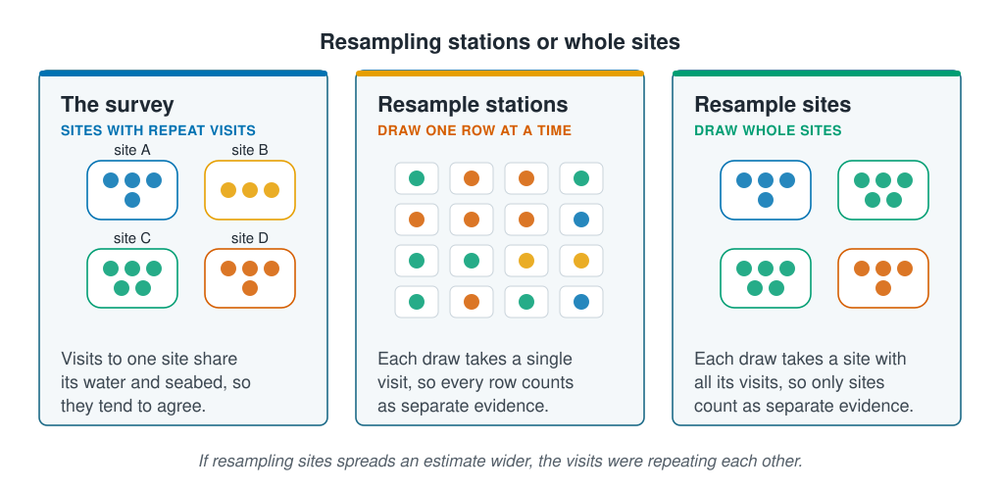

```{r}
#| label: setup
#| include: false
library(tidymodels)
library(tidyverse)
source(here::here("R/theme.R"))
source(here::here("R/data.R"))
source(here::here("R/python-tabs.R"))
set.seed(123)
```



## Rows that share conditions are not separate evidence

Two observations are independent when one says nothing about the other beyond what
their inputs say. **Dependent data** share conditions, so one does say something about
the other. [The coastal survey](../02-marine-data/the-coastal-survey.qmd#repeat-visits-to-the-same-sites-are-not-independent)
found that its rows come from far fewer monitoring sites, and called treating repeat
visits as separate observations pseudo-replication; that is why
[Splitting the data](../02-marine-data/splitting-data.qmd) keeps each site's rows
together.

This page measures what the survey's rows are worth as evidence. The same problem
appears wherever one unit is sampled several times:

| What is repeated | What the rows share | The unit to count |
| --- | --- | --- |
| Visits to a fixed station | Depth, seabed, local water | The station |
| Sub-samples from one grab | The grab | The grab |
| Fish measured from one haul | The haul, the gear, the day | The haul |
| Readings down one CTD cast | The water column | The cast |





## Resampling whole groups measures the effective sample size

A [bootstrap sample](../03-supervised-learning/forests-and-boosting.qmd#a-random-forest-averages-trees-grown-on-resampled-data)
draws rows at random with replacement, as many as the data has. Drawing many and
computing an average in each shows how far that average moves from one sample of the
survey to the next.

Drawing single rows treats every row as independent. Drawing whole sites, each with all
its visits, treats only the sites as independent. If drawing whole sites spreads the
average wider, the visits to a site were partly repeating each other.

The difference converts into a number of stations. An average's spread shrinks with the
square root of the number of independent observations, so a spread $k$ times wider means
the rows are worth $k^2$ times fewer: the **effective sample size**.

::: {.diagram}
{fig-alt="Three cards. The survey, sites with repeat visits: four sites, A to D, each a box holding three to five visits drawn as dots in the site's colour; visits to one site share its water and seabed, so they tend to agree. Resample stations, draw one row at a time: sixteen draws of a single visit each, with the colours mixed, so every row counts as separate evidence. Resample sites, draw whole sites: four draws of a whole site with all its visits, one site drawn twice and one not at all, so only sites count as separate evidence. A note says if resampling sites spreads an estimate wider, the visits were repeating each other."}
:::

## Worked example

The whole survey is used, since nothing on this page is a final score. Five hundred
bootstrap samples are drawn by station, and five hundred by site.

### Preparing the data

::: {.panel-tabset group="language"}

## R

```{r}
#| label: prepare
survey <- load_coastal_survey_clean()

resamples <- list(
  "Single stations" = bootstraps(survey, times = 500),
  "Whole sites"     = group_bootstraps(survey, group = site_id, times = 500)
)

# how far the average of some values moves from one resample to the next,
# for each way of resampling
spread_of <- function(values) {
  map_dbl(resamples, \(r) {
    sd(map_dbl(r$splits, \(s) mean(values[as.integer(s)])))
  })
}

tibble(stations = nrow(survey), sites = n_distinct(survey$site_id))
```

## Python

```{python}
import numpy as np
import pandas as pd

from mlbasic_data import load_coastal_survey_clean

survey = load_coastal_survey_clean()

rng = np.random.default_rng(123)
levels = {"Single stations": "station_id", "Whole sites": "site_id"}

def resamples(column, times=500):
    """Row numbers of each bootstrap sample that draws whole groups."""
    rows_of = list(survey.groupby(column).indices.values())
    samples = []
    for _ in range(times):
        drawn = rng.integers(0, len(rows_of), len(rows_of))
        samples.append(np.concatenate([rows_of[i] for i in drawn]))
    return samples

samples = {level: resamples(column) for level, column in levels.items()}

def spread_of(values):
    values = np.asarray(values)
    return pd.Series({level: np.std([values[rows].mean() for rows in drawn],
                                    ddof=1)
                      for level, drawn in samples.items()})

pd.DataFrame({"stations": [len(survey)],
              "sites": [survey["site_id"].nunique()]})
```

:::

### Visits to one site repeat each other's catch

The estimate is the simplest one: the average catch per station, in each of the
bootstrap samples.

::: {.panel-tabset group="language"}

## R

```{r}
#| label: average-catch
catch_spread <- tibble(resampled = names(resamples),
                       spread = spread_of(survey$abundance)) |>
  mutate(wider = spread / first(spread),
         worth = nrow(survey) / wider^2)

catch_spread |>
  mutate(across(spread:wider, \(x) round(x, 2)), worth = round(worth))
```

## Python

```{python}
catch_spread = spread_of(survey["abundance"]).rename("spread").to_frame()
catch_spread["wider"] = catch_spread["spread"] / catch_spread["spread"].iloc[0]
catch_spread["worth"] = len(survey) / catch_spread["wider"] ** 2
catch_spread.round({"spread": 2, "wider": 2, "worth": 0}).reset_index(
    names="resampled")
```

:::

```{r}
#| label: catch-numbers
#| include: false
two <- \(x) sprintf("%.2f", x)
by_site <- catch_spread[catch_spread$resampled == "Whole sites", ]
n_sites <- n_distinct(survey$site_id)
```

The `r nrow(survey)` stations come from only `r n_sites` sites. Drawing whole sites
spreads the average catch `r two(by_site$wider)` times wider than drawing single
stations, so for this estimate the stations are worth about
`r round(by_site$worth, -1)` independent ones. An interval for the average built as if
all `r nrow(survey)` were independent would be too narrow: the survey would look surer
than it is.

A site's depth and seabed stay much the same from one visit to the next, so a deep
muddy site is rich every time it is sampled and a shallow rocky one poor every time. Its
visits partly repeat each other.

A model's score has the same problem. A held-out visit predicted by a model fitted to
the same site's other visits has been helped by them, and looks easier than a new site
would be. That is why the course scores models on whole sites held out, as
[Splitting the data](../02-marine-data/splitting-data.qmd) and
[Hyperparameter selection](../05-generalisation/hyperparameter-selection.qmd) did.

## Neighbouring sites and years share conditions too

Neighbouring sites share a water mass and a stretch of seabed, and samples from one
year share its weather. [Spatial and temporal cross-validation](../07-validation/spatial-and-temporal-cv.qmd)
holds out whole areas of the map and whole years for them.

Resampling by group needs enough groups, and it needs to know which group each row came
from. Datasets often lose the grab, haul or cast a row came from when they are
summarised, and once that column is gone the repeats cannot be found. Keep the
identifier of the unit sampled, and report both numbers: how many rows, and how many
sites.

## Key points

::: {.key-points}
- Visits to one site share its depth, seabed and water: they are **dependent data**,
  and are not fully separate evidence.
- Resampling whole sites instead of single stations measures the shortfall: a spread
  $k$ times wider means the rows are worth $k^2$ times fewer, the **effective sample
  size**. For the average catch, the `r nrow(survey)` stations were worth
  about `r round(by_site$worth, -1)`.
- A model must be scored on whole sites held out, or the site's other visits help it.
  Keep the identifier of every unit sampled.
:::

## Try it yourself

1. Measure what the stations are worth for the average depth, `survey$depth_m`, which
   changes little between visits to a site. How does the answer compare with the number
   of sites?
2. Do the same for the average temperature, which changes with the season; add
   `na.rm = TRUE` to the `mean()` inside `spread_of()` (`np.nanmean()` in Python),
   since a few temperatures are missing. Are the stations worth more or fewer for temperature than for depth, and
   why?
