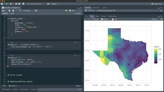

Every method takes something for granted about its data, and when that assumption is
wrong the model still gives an answer, which can be wrong. Machine-learning methods
assume less about the shape of a relationship than a linear model does, but they still
need data collected in a way that lets the stations stand for the sea. On the same
simulated survey as the rest of the course, the first two pages show machine learning
doing without straight lines and bell curves; the other three show what it cannot
escape: visits to one site that repeat each other, conditions the survey never reached,
and a rare answer that makes accuracy look good.



## Pages in this section

::: {#pages}
:::

## Further resources

**Documentation**

- [spatialsample](https://spatialsample.tidymodels.org/), tidymodels. Blocked, clustered and buffered resampling for data with a location, for when neighbouring sites share conditions too.
- [Common pitfalls and recommended practices](https://scikit-learn.org/stable/common_pitfalls.html), scikit-learn. Independence is assumed silently in almost every default, and this page says where.

**Video**

::: {.video-list}
- [{.video-thumb fig-alt="Spatial resampling to understand drought in Texas, on YouTube" loading="lazy"}](https://www.youtube.com/watch?v=l-CfniOBDBc)

  [Spatial resampling to understand drought in Texas](https://www.youtube.com/watch?v=l-CfniOBDBc), Julia Silge. A random split and a spatial split on the same data, with the difference in the scores visible.
:::
