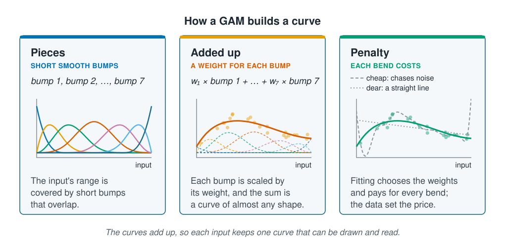

```{r}
#| label: setup
#| include: false
library(tidymodels)
library(tidyverse)
library(poissonreg)
library(mgcv)
library(patchwork)
source(here::here("R/theme.R"))
source(here::here("R/data.R"))
source(here::here("R/python-tabs.R"))
set.seed(123)
```

## Only linear models assume straight lines

Few marine responses are straight lines. A species has a temperature it prefers, growth
levels off when food is plentiful, and oxygen has a level below which little survives.
Linearity is an assumption of one family of models: linear, polynomial, Poisson and
logistic regression from
[Supervised learning](../03-supervised-learning/index.qmd). Decision trees, random
forests and boosting do not make it. This page shows what dropping the assumption buys
on the survey, and the limit it leaves: a flexible model can draw any curve, but it
cannot tell which input the curve belongs to.





## Linear models give each input a fixed effect

A linear model predicts the outcome as a starting value plus a fixed amount for each
input. Two assumptions follow:

- **One shape for each input.** One more metre of depth has the same effect at 20 m as
  at 180 m. On the log scale of
  [Poisson regression](../03-supervised-learning/count-regression.qmd), the same holds
  for the log of the count.
- **No interactions.** The effects add up, so the effect of depth is the same in cold
  water and in warm.

A squared term relaxes the first. The curve then has one peak and falls the same way on
both sides, whatever the data say. A response that rises steeply and tails off slowly,
or levels off, does not fit that shape.

## Trees and forests make neither assumption

A [decision tree](../03-supervised-learning/decision-trees.qmd) splits the stations by
one input at a time, so its prediction can rise and fall with depth however the data
say. A split inside another split lets the effect of depth differ between cold water and
warm, so interactions come built in. A
[random forest](../03-supervised-learning/forests-and-boosting.qmd) averages many such
trees. This is what machine learning gains over a linear model: no shape has to be
chosen in advance.

The cost is that the model holds no single curve for depth. Its prediction across
depth depends on the values the other inputs are held at, because those can change the
effect of depth. Reading a forest's effects is the subject of
[Interpretation](../10-interpretation/index.qmd).

## A GAM keeps one readable curve for each input

A **generalised additive model (GAM)** sits between the two. It replaces each input's
straight line with a smooth curve, and adds the curves up as a linear model adds its
terms. The shape is free, as in a forest, but each input keeps one curve, the same
whatever the other inputs are. That makes the GAM a useful check beside a forest: its
curves can be drawn and compared with what is known about the species.

Each curve is built from short, smooth bumps spread along the input's range, each with
a weight, and the weighted bumps add up to a curve of almost any shape. A **penalty** on
bending, like the penalty in [Regularisation](../05-generalisation/regularisation.qmd),
stops the curve chasing the noise; its weight is chosen from the data.

::: {.diagram}
{fig-alt="Three cards. Pieces, short smooth bumps: seven bell-shaped curves overlap along the input's range. Added up, a weight for each bump: the bumps, each scaled by its weight, are drawn dashed, and their sum is a solid curve that rises and falls with the data points. Penalty, each bend costs: three curves through the same points; a dashed curve with bends made cheap chases the noise, a dotted straight line is what bends made dear give, and the solid curve between them follows the rise and fall. The text says fitting chooses the weights and pays for every bend, and the data set the price. A note says the curves add up, so each input keeps one curve that can be drawn and read."}
:::

Here the GAM counts on the log scale, as Poisson regression does, and gives depth and
temperature a curve each; chlorophyll, salinity, substrate and season keep a straight
line or a level.

## Worked example

Four models are fitted to the survey with the inputs of
[Count regression](../03-supervised-learning/count-regression.qmd). Two are linear
models: Poisson regression with a straight line for every input, and with squared terms
for depth and temperature, as that page used. Two drop the straight lines: the GAM, and
a random forest of 500 trees, as in
[Forests and boosting](../03-supervised-learning/forests-and-boosting.qmd). All four
are scored with ten-fold cross-validation by site, from
[Hyperparameter selection](../05-generalisation/hyperparameter-selection.qmd), on the
training sites.

### Preparing the data

::: {.panel-tabset group="language"}

## R

```{r}
#| label: prepare
survey <- load_coastal_survey_clean()

split <- group_initial_split(survey, group = site_id, prop = 0.75)
train <- training(split)
folds <- group_vfold_cv(train, group = site_id, v = 10)

straight_recipe <- recipe(
  abundance ~ depth_m + temperature_c + chlorophyll_mg_m3 + salinity_psu +
    substrate + season,
  data = train
) |>
  step_impute_median(all_numeric_predictors()) |>
  step_relevel(substrate, ref_level = "sand")

squared_recipe <- straight_recipe |>
  step_poly(depth_m, temperature_c, degree = 2, options = list(raw = TRUE))

# s() asks mgcv for a smooth curve; it chooses the penalty's weight itself
smooth_terms <- abundance ~ s(depth_m) + s(temperature_c) +
  chlorophyll_mg_m3 + salinity_psu + substrate + season
gam_model <- gen_additive_mod() |>
  set_engine("mgcv", family = poisson, method = "REML") |>
  set_mode("regression")

models <- list(
  "Poisson with straight lines" = workflow(straight_recipe, poisson_reg()),
  "Poisson with squared terms" = workflow(squared_recipe, poisson_reg()),
  "GAM" = workflow(straight_recipe) |>
    add_model(gam_model, formula = smooth_terms),
  "Random forest" = workflow(straight_recipe,
                             rand_forest(trees = 500) |>
                               set_engine("ranger", seed = 123) |>
                               set_mode("regression"))
)
```

## Python

```{python}
import numpy as np
import pandas as pd
from sklearn.base import clone
from sklearn.compose import ColumnTransformer
from sklearn.ensemble import RandomForestRegressor
from sklearn.impute import SimpleImputer
from sklearn.linear_model import PoissonRegressor
from sklearn.metrics import root_mean_squared_error
from sklearn.model_selection import (GridSearchCV, GroupKFold,
                                     GroupShuffleSplit)
from sklearn.pipeline import Pipeline
from sklearn.preprocessing import (OneHotEncoder, PolynomialFeatures,
                                   SplineTransformer, StandardScaler)

from mlbasic_data import load_coastal_survey_clean

survey = load_coastal_survey_clean()

grouper = GroupShuffleSplit(n_splits=1, train_size=0.75, random_state=123)
train_rows, test_rows = next(grouper.split(survey,
                                           groups=survey["site_id"]))
train = survey.iloc[train_rows].reset_index(drop=True)
folds = GroupKFold(n_splits=10, shuffle=True, random_state=123)

categorical = ["substrate", "season"]
numeric = ["depth_m", "temperature_c", "chlorophyll_mg_m3", "salinity_psu"]
predictors = numeric + categorical

# shape() turns depth and temperature into columns: themselves, with their
# squares, or a set of spline bumps
def recipe(shape):
    def curved(column):
        steps = Pipeline([("impute", SimpleImputer(strategy="median")),
                          ("shape", shape),
                          ("scale", StandardScaler())])
        return (column, steps, [column])
    return ColumnTransformer([
        curved("depth_m"),
        curved("temperature_c"),
        ("numeric", Pipeline([("impute", SimpleImputer(strategy="median")),
                              ("scale", StandardScaler())]),
         ["chlorophyll_mg_m3", "salinity_psu"]),
        ("categorical",
         OneHotEncoder(drop=["sand", "spring"], sparse_output=False),
         categorical),
    ])

def poisson(shape, alpha=0.0):
    model = PoissonRegressor(alpha=alpha, max_iter=1000)
    return Pipeline([("recipe", recipe(shape)), ("model", model)])

# scikit-learn has no GAM. Spline bumps with a ridge penalty come close; the
# penalty's weight is chosen by five-fold cross-validation by site.
gam = GridSearchCV(poisson(SplineTransformer(n_knots=8)),
                   {"model__alpha": 10.0 ** np.arange(-4, 1)},
                   cv=GroupKFold(n_splits=5),
                   scoring="neg_root_mean_squared_error")

models = {
    "Poisson with straight lines": poisson("passthrough"),
    "Poisson with squared terms":
        poisson(PolynomialFeatures(2, include_bias=False)),
    "GAM": gam,
    # the forest needs no scaling, but the recipe's imputing and encoding
    "Random forest": Pipeline([
        ("recipe", recipe("passthrough")),
        ("model", RandomForestRegressor(n_estimators=500, random_state=123))]),
}
```

:::

### The random forest fits its own stations far better and new sites barely better

Each model is scored twice: on the training stations it was fitted to, and on new sites,
as the average over the ten folds. The last column is the standard error of that
average, from [Hyperparameter selection](../05-generalisation/hyperparameter-selection.qmd).

::: {.panel-tabset group="language"}

## R

```{r}
#| label: scores
score <- function(model) {
  fitted <- fit(model, train)
  on_new <- fit_resamples(model, folds, metrics = metric_set(rmse)) |>
    collect_metrics()
  tibble(fitting = rmse_vec(train$abundance, predict(fitted, train)$.pred),
         new = on_new$mean, std_err = on_new$std_err)
}

scores <- map(models, score) |> list_rbind(names_to = "model")
scores |> mutate(across(where(is.numeric), \(x) round(x, 2)))
```

## Python

```{python}
def fit(model, data):
    # only the GAM's search over its penalty needs the sites
    extra = {"groups": data["site_id"]} if model is gam else {}
    return clone(model).fit(data[predictors], data["abundance"], **extra)

def score(name, model):
    fitted = fit(model, train)
    fitting = root_mean_squared_error(train["abundance"],
                                      fitted.predict(train[predictors]))
    errors = []
    for fit_rows, new_rows in folds.split(train, groups=train["site_id"]):
        fold_fit = fit(model, train.iloc[fit_rows])
        new = train.iloc[new_rows]
        predicted = fold_fit.predict(new[predictors])
        errors.append(root_mean_squared_error(new["abundance"], predicted))
    std_err = np.std(errors, ddof=1) / np.sqrt(len(errors))
    return {"model": name, "fitting": round(fitting, 2),
            "new": round(np.mean(errors), 2), "std_err": round(std_err, 2)}

pd.DataFrame([score(name, model) for name, model in models.items()])
```

:::

```{r}
#| label: score-numbers
#| include: false
straight <- filter(scores, model == "Poisson with straight lines")
squared  <- filter(scores, model == "Poisson with squared terms")
smooth   <- filter(scores, model == "GAM")
forest   <- filter(scores, model == "Random forest")
gam_fit <- fit(models[["GAM"]], train)
squared_fit <- fit(models[["Poisson with squared terms"]], train)
forest_fit <- fit(models[["Random forest"]], train)
two <- \(x) format(round(x, 2), nsmall = 2)
# the gap between the best and worst score on new sites, against the smallest
# standard error
new_gap <- diff(range(scores$new))
within_one_se <- new_gap < min(scores$std_err)
```

On the stations it was fitted to, the random forest's error is `r two(forest$fitting)`,
far below the GAM's `r two(smooth$fitting)` and Poisson regression's
`r two(squared$fitting)` with squared terms and `r two(straight$fitting)` with straight
lines. On new sites the four come close together: `r two(forest$new)` for the forest,
`r two(smooth$new)` for the GAM, and `r two(squared$new)` and `r two(straight$new)` for
Poisson regression`r if (within_one_se) ", all within one standard error of each other" else ""`.
Curves of any kind, from squared terms, a GAM or a forest, helped the predictions a
little over straight lines. Most of the forest's extra freedom went into its own
stations, the memorising that
[Training error and the error on new data](../05-generalisation/training-versus-new-data.qmd)
warned of.

### Every model's depth curve peaks in shallow water

What do the models say about depth and temperature? @fig-curves shows each model's
prediction across each input, with the other inputs held at typical values. For the
random forest this is one slice: held at other values, its curve could change shape.

::: {.panel-tabset group="language"}

## R

```{r}
#| label: fig-curves
#| fig-cap: "Predicted count across the survey's depths and temperatures, with the other inputs held at typical values (sand, summer, the median of the rest). The ticks along the bottom are the training stations. All three models put a temperature peak in mid-range. For depth, the squared terms fall from the shallowest station, and the GAM and the random forest both peak in shallow water and fall offshore. The forest's curve moves in steps, as its trees' splits do."
#| fig-alt: "Two panels of predicted count. Left, against depth from 5 to about 195 metres: Poisson with squared terms is highest at the shallowest depth and falls steadily; the GAM rises to a peak at a shallow depth, falls with a small second bump, and is low beyond 150 metres; the random forest's stepped line is highest in shallow water and falls in steps offshore. Right, against temperature from about 2 to 16 degrees: all three curves rise to a peak in mid-range and fall again, the forest's in steps. Ticks along the bottom of each panel mark the training stations."
#| fig-width: 8
#| fig-height: 4
typical <- train |>
  summarise(across(c(depth_m, temperature_c, chlorophyll_mg_m3,
                     salinity_psu), \(x) median(x, na.rm = TRUE))) |>
  mutate(substrate = factor("sand", levels = levels(train$substrate)),
         season    = factor("summer", levels = levels(train$season)))

across_input <- function(input) {
  values <- range(train[[input]], na.rm = TRUE)
  steps <- tibble(!!input := seq(values[1], values[2], length.out = 200))
  grid <- typical |>
    select(-all_of(input)) |>
    cross_join(steps)
  bind_rows(
    augment(squared_fit, grid) |>
      mutate(model = "Poisson with squared terms"),
    augment(gam_fit, grid) |> mutate(model = "GAM"),
    augment(forest_fit, grid) |> mutate(model = "Random forest")
  ) |>
    transmute(model, value = .data[[input]], .pred)
}

curves <- list(depth_m = across_input("depth_m"),
               temperature_c = across_input("temperature_c"))

curve_plot <- function(input, x_label) {
  ggplot(curves[[input]], aes(value, .pred, colour = model)) +
    geom_rug(data = train, aes(.data[[input]]), inherit.aes = FALSE,
             sides = "b", alpha = 0.3, colour = ml_palette[["grey"]]) +
    geom_line(linewidth = 1.1) +
    scale_colour_manual(values = c(
      "Poisson with squared terms" = ml_palette[["orange"]],
      "GAM" = ml_palette[["blue"]],
      "Random forest" = ml_palette[["green"]])) +
    labs(x = x_label, y = "Predicted count", colour = NULL)
}

curve_plot("depth_m", "Depth (m)") +
  curve_plot("temperature_c", "Temperature (°C)") +
  plot_layout(guides = "collect") & theme(legend.position = "bottom")
```

:::

```{r}
#| label: curve-numbers
#| include: false
peak <- curves |>
  map(\(d) d |> group_by(model) |> slice_max(.pred, n = 1) |> select(model, value) |> deframe())
depth_range <- range(train$depth_m, na.rm = TRUE)
one <- \(x) format(round(x, 1), nsmall = 1)
```

The models agree on temperature: the count rises to a peak near
`r one(peak$temperature_c[["GAM"]])` °C (GAM),
`r one(peak$temperature_c[["Random forest"]])` °C (random forest) or
`r one(peak$temperature_c[["Poisson with squared terms"]])` °C (squared terms)
and falls on either side. On depth the two flexible models find a shape that squared
terms cannot: a peak at `r round(peak$depth_m[["GAM"]])` m (GAM) or
`r round(peak$depth_m[["Random forest"]])` m (random forest), then a long decline
offshore. The squared terms fall all the way from the shallowest station, at
`r round(depth_range[1])` m. Read at face value, all three say the species does best in
shallow water.

## The flexible models recover the temperature curve but not the depth curve

The survey is simulated, so the curves can be checked against the ones the simulation
used. For depth, the simulated count peaks at 80 m and falls away on either side; for
temperature, at 9 °C. No real study can make this check; it is the reason the course
uses a simulated survey.

Each curve in @fig-truth is divided by its own peak, so only its shape is compared.

::: {.panel-tabset group="language"}

## R

```{r}
#| label: fig-truth
#| fig-cap: "The curves of the GAM and the random forest against the curves the simulation used (dashed), each divided by its own peak. Temperature is close to the truth for both through the middle of its range. Depth is not: between the models' shallow peaks and the true peak at 80 m, their curves stay level or fall while the true one rises."
#| fig-alt: "Two panels, each with a GAM curve, a stepped random forest curve and a dashed true curve, scaled so each peaks at 1. Left, depth: the true curve is an arch peaking at 80 metres; both models' curves peak in shallow water and are level or falling where the true curve peaks; beyond about 150 metres the GAM's curve falls with the true one and the forest's levels off. Right, temperature: the true curve is an arch peaking at 9 degrees and both models' curves follow it through the middle of the range, peaking a little cooler; the forest's moves in steps and levels off at both ends."
#| fig-width: 8
#| fig-height: 4
# the curves R/make-example-data.R used, on the log scale
true_curve <- list(
  depth_m       = \(depth) -0.55 * ((depth - 80) / 60)^2,
  temperature_c = \(temperature) -0.60 * ((temperature - 9) / 3)^2
)

shapes <- map(names(curves), \(name) {
  truth <- true_curve[[name]]
  fitted <- curves[[name]] |>
    filter(model %in% c("GAM", "Random forest")) |>
    mutate(relative = .pred / max(.pred), .by = model)
  simulated <- distinct(fitted, value) |>
    mutate(model = "Simulation",
           relative = exp(truth(value)) / max(exp(truth(value))))
  bind_rows(fitted, simulated) |>
    transmute(input = name, value, curve = model, relative)
}) |>
  list_rbind()

shape_plot <- function(which, x_label) {
  ggplot(filter(shapes, input == which),
         aes(value, relative, colour = curve, linetype = curve)) +
    geom_line(linewidth = 1.1) +
    scale_colour_manual(values = c(GAM = ml_palette[["blue"]],
                                   "Random forest" = ml_palette[["green"]],
                                   Simulation = ml_palette[["grey"]])) +
    scale_linetype_manual(values = c(GAM = "solid", "Random forest" = "solid",
                                     Simulation = "dashed")) +
    labs(x = x_label, y = "Count relative to its peak", colour = NULL,
         linetype = NULL)
}

shape_plot("depth_m", "Depth (m)") +
  shape_plot("temperature_c", "Temperature (°C)") +
  plot_layout(guides = "collect") & theme(legend.position = "bottom")
```

:::

```{r}
#| label: truth-numbers
#| include: false
middle <- mean(between(train$depth_m, peak$depth_m[["GAM"]], 80), na.rm = TRUE)
```

Temperature comes back close to the truth for both models in the middle of its range,
where most stations lie, their peaks a little cool.
Depth does not. Between the GAM's peak at `r round(peak$depth_m[["GAM"]])` m and the
true one at 80 m, where `r round(100 * middle)`% of the training stations lie, both
models' curves stay level or fall while the true one rises. A manager reading the depth
panel would send effort to the shallowest water, which the simulation made among the
poorer places for this species.

Nothing in the scores warned of this. The random forest fitted its stations best and
predicted new sites as well as any model here.

## Confounding with position gives depth the wrong curve

The method was the same for both inputs. The difference is in the data.

```{r}
#| label: confounding
#| include: false
complete <- drop_na(train, depth_m, temperature_c)
depth_temperature <- cor(complete$depth_m, complete$temperature_c)
depth_longitude <- cor(complete$depth_m, complete$longitude)
within_band <- complete |>
  group_by(band = cut(depth_m, seq(0, 200, 50))) |>
  summarise(sd = sd(temperature_c))
```

- **Temperature changes for reasons other than depth.** Season and latitude move it, so
  within any 50 m band of depth it still varies, with a standard deviation of
  `r round(min(within_band$sd), 1)`–`r round(max(within_band$sd), 1)` °C. Stations at the
  same depth but different temperatures let the model separate temperature's effect
  from the rest.
- **Depth has no such independent variation.** It follows position closely: its
  correlation with longitude is `r two(depth_longitude)`, because the shelf
  deepens offshore. It also moves with temperature
  (`r two(depth_temperature)`) and with chlorophyll. Anything that differs between
  inshore and offshore water, measured or not, can end up in depth's curve.

This is **confounding**, met in
[Prediction and explanation](../01-introduction/prediction-and-explanation.qmd): a
variable tied to both an input and the outcome lends the input an effect that is not
its own. Here the culprit is something about position that none of the inputs
measures; [Spatial and temporal dependence](spatial-and-temporal-dependence.qmd) looks
for it. Flexibility does not help. A random forest or a GAM can draw any shape, but
neither can tell which input a shape belongs to, and a flexible wrong curve looks more convincing than a rigid
wrong one.

The new-site scores could not catch it either. Depth stands in for position, so a
curve that is wrong about depth can still predict well, as long as depth and position
keep their link at the new sites.

## Additive curves cannot show interactions

A GAM's curves add up, which is what makes each one readable. If the species' preferred
temperature shifted with depth, which is common in benthic species, no set of separate
curves could show it. A random forest can, since a split inside a split lets one input
change the effect of another, but then no single curve describes depth: the slice in
@fig-curves is one of many. Each model gives up something; neither gives up the
confounding.

## Key points

::: {.key-points}
- Linear, polynomial, Poisson and logistic regression give each input one fixed effect
  and let the effects add up. Trees, random forests and boosting assume neither.
- A **GAM** drops the straight lines but keeps the adding up, so each input keeps one
  curve that can be drawn and read.
- On the survey the random forest fitted its own stations far better than any other
  model, and predicted new sites about as well as Poisson regression with squared
  terms.
- Checked against the simulation, the GAM and the forest both got temperature about
  right and put depth's peak in shallow water, far from the true 80 m.
- The cause was **confounding**: depth follows position, which carries an effect no
  input measures. Dropping an assumption about shape does not remove the limits of the
  data, and a good score on new sites does not show that a curve is right.
:::

## Try it yourself

1. Build a recipe like `straight_recipe` with `longitude` and `latitude` added, refit
   the random forest with it, and redraw its depth curve. Does the curve move towards
   the simulation's once position is an input of its own?
2. In `across_input()`, hold temperature at its lower quartile instead of its median,
   then at its upper quartile, and redraw the depth curves. Does the forest's curve
   change shape? Does the GAM's?
