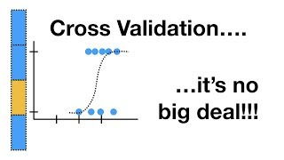
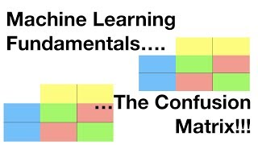
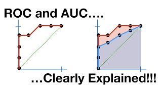

A performance number is a claim about the future: *this is roughly how well the model will do
on data it has not seen.* Validation is the process of earning the right to make that claim.

Done casually it produces flattering nonsense. Randomly splitting autocorrelated survey data
puts near-identical observations on both sides of the split, so the model is tested on what it
has effectively already seen. Reporting a measure chosen by default rewards whichever model
happens to suit that default.

[Section 5](../05-generalisation/index.qmd) chose complexity by looking at the test set on
every page, and said so each time. [Section 6](../06-assumptions-limitations/index.qmd)
diagnosed dependence and deferred the remedy. This section settles both debts, and then asks
the question neither of them did: what should the number have been measuring in the first
place?

## Pages in this section

::: {#pages}
:::

## Findings from this section

- Forty different 75/25 splits of the same 720 stations put the same model's R² anywhere
  between **0.079 and 0.346**. Ten-fold cross-validation put it between 0.195 and 0.239.
- A search over 100 candidate models reported a cross-validated RMSE of 4.472. Nested
  cross-validation put the honest figure at **4.851**, and a fixed model with no search at all
  beat the searched one on **all five** outer folds.
- Scores fall steadily with the distance between held-out and training stations: R² 0.200 when
  the nearest training station is four kilometres away, **0.114** at twenty-five. There is no
  single true score, only the question you chose.
- The same negative binomial model scored RMSE between **3.51 and 5.92** across ten folds, and
  R² between **−0.42 and +0.46**. Fold RMSE correlated 0.78 with how spread out that fold's
  counts were.
- Ten classification measures from one confusion matrix ranged from **0.058 to 0.995**, and F1
  scored a rule that flags every station at 0.878 against the fitted model's 0.882.
- Comparing two models unpaired gave a confidence interval **1.54 wide** that covered zero.
  Pairing the identical numbers fold by fold gave one **0.33 wide**.
- A model that lost on RMSE won the fifty-station shortlist, 481 individuals against 456, and
  leaving a decision threshold at 0.5 cost up to **eight times** the cheapest threshold.

::: {.callout-important}
The three numbers in any tuned analysis are different: the winner's score tells you which
candidate to use, a nested estimate tells you how the procedure will perform, and the final
model refitted on everything has no score of its own. Quoting the first as the second is the
most common validation error in applied work.
:::

::: {.callout-note}
Two habits make everything on these pages comparable, and nothing here works without them.
**Pool the out-of-fold predictions before computing a metric**, so every scheme is scored on
identical rows. This is the proper fix for the trap
[section 6 hit three times](../06-assumptions-limitations/index.qmd). And **use the same
resamples object for every model you intend to compare**, so the fold cancels out of the
difference.
:::

## Further resources

**Documentation**

- [Evaluate your model with resampling](https://www.tidymodels.org/start/resampling/), tidymodels.
- [rsample](https://rsample.tidymodels.org/) and [yardstick](https://yardstick.tidymodels.org/), tidymodels. Every resampling scheme, and every metric with its definition.
- [Cross-validation](https://scikit-learn.org/stable/modules/cross_validation.html) and [metrics and scoring](https://scikit-learn.org/stable/modules/model_evaluation.html), scikit-learn user guide. The cross-validation page's section on grouped data is the one to read alongside section 6.

**Video**

::: {.video-list}
- [{.video-thumb fig-alt="Machine Learning Fundamentals: Cross Validation, on YouTube" loading="lazy"}](https://www.youtube.com/watch?v=fSytzGwwBVw)

  [Machine Learning Fundamentals: Cross Validation](https://www.youtube.com/watch?v=fSytzGwwBVw), StatQuest with Josh Starmer.

- [{.video-thumb fig-alt="Machine Learning Fundamentals: The Confusion Matrix, on YouTube" loading="lazy"}](https://www.youtube.com/watch?v=Kdsp6soqA7o)

  [Machine Learning Fundamentals: The Confusion Matrix](https://www.youtube.com/watch?v=Kdsp6soqA7o), StatQuest with Josh Starmer.

- [{.video-thumb fig-alt="ROC and AUC, Clearly Explained, on YouTube" loading="lazy"}](https://www.youtube.com/watch?v=4jRBRDbJemM)

  [ROC and AUC, Clearly Explained](https://www.youtube.com/watch?v=4jRBRDbJemM), StatQuest with Josh Starmer. Builds the curve one threshold at a time, which is what makes the area mean something.
:::
