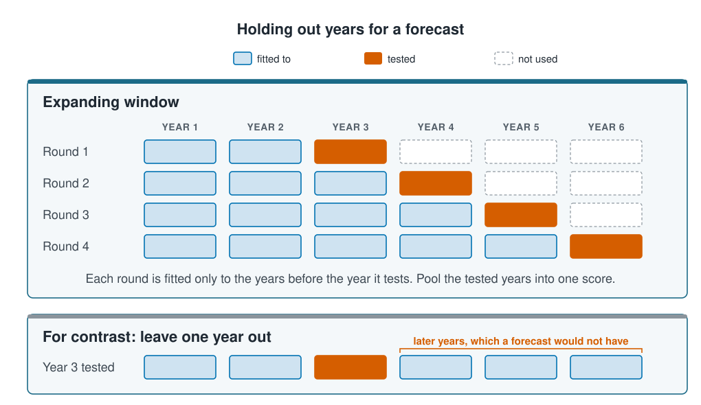

```{r}
#| label: setup
#| include: false
library(tidymodels)
library(tidyverse)
library(ranger)
source(here::here("R/theme.R"))
source(here::here("R/data.R"))
source(here::here("R/python-tabs.R"))
options(knitr.kable.NA = "")
set.seed(123)
```



## Folds decide how far each prediction has to reach

[Dependent data](../06-assumptions-limitations/dependent-data.qmd) found that visits to
one site repeat each other, so a model is scored on whole sites held out. Neighbouring
sites can share conditions too, a water mass or a stretch of seabed. This page holds out
**spatial blocks**, squares of the map with every site in them, and holds out time for a
model that forecasts. A cross-validated score says
how well a model predicts stations as far from its fitted data as the held-out ones
were, so choosing the folds means choosing that distance to match the model's use.





## Held-out stations further from the fitted data are predicted worse

For every held-out station, the **distance to the nearest fitted station** is how far
away the closest station the model was fitted to lies. Folds of single stations often
leave the station's own site in the fitted data, so that distance is short. Folds of
sites push it out to the next site, and blocks push it across the block. The further away
the fitted data, the less a model can lean on what its neighbours caught, and the larger
its error.

::: {.diagram}
{fig-alt="Two cards showing the same map of 44 sites. Cross-validation by site, hold out scattered sites: seven held-out sites are scattered across the map, each joined by a short dashed line to the nearest site used for fitting, so a held-out site's position alone says a lot about it. Spatial blocks, hold out whole areas: the map is cut into six squares and every site in the top middle square is held out; their neighbours are held out with them and their dashed lines to the nearest fitted site are longer, so position says less about them. A note says blocks test what a model knows about areas it has not seen."}
:::

No distance is right in general. A model that fills the gaps between monitored sites is
used close to its data, and folds of sites match that use. A habitat map of an area
nobody has surveyed is used far from its data, and blocks match it. Choose the folds
whose distance matches the use, and report the distance with the score. Each scheme on
this page holds out every station once, so its pooled score, from
[Cross-validation](cross-validation.qmd), can be compared with the others'.

## Blocks are wide enough to hold out a site's neighbours

A held-out site is predicted too well when a fitted site nearby shares what the inputs
miss, such as the same patch of water. Blocks take that help away only if each is wide
enough that a held-out site's close neighbours are held out with it. Set the size from
the use of the model, before looking at the score: a size chosen for the score it gives
makes the score a choice as well.

## An expanding window fits each round only to earlier years

Holding out one year at a time fits each model to all the other years, later ones
included. A forecast never has the later years. An **expanding window** fits the model
to the first years, tests it on the next, and adds a year each round, so every tested year
comes after the years its model was fitted to.

::: {.diagram}
{fig-alt="Two ways of holding out years, over six years of a survey. Expanding window, in four rounds: round 1 is fitted to years 1 and 2 and tests year 3; round 2 is fitted to years 1 to 3 and tests year 4; round 3 is fitted to years 1 to 4 and tests year 5; round 4 is fitted to years 1 to 5 and tests year 6. Later years are never used, and the tested years are pooled into one score. Below, for contrast, leave one year out: year 3 is tested by a model fitted to years 1, 2, 4, 5 and 6, so years 4 to 6, which a forecast would not have, help to predict it."}
:::

The first rounds fit to few years, so the window starts once there is enough data to fit
a model. Each round's tested year is a forecast one year ahead; pooled, they score the
model as it would be used.

## Worked example

The model is the random forest of
[Random forests and boosting](../03-supervised-learning/forests-and-boosting.qmd). As on
[Cross-validation](cross-validation.qmd), it uses all the survey's sites, and every
scheme has five folds. Each forest has 100 trees, so that the many refits stay quick.

### Preparing the data

Each site's position is the centre of its stations. Distances are worked out in
kilometres from longitude and latitude, using the length of a degree at the survey's
latitude, 42° N.

::: {.panel-tabset group="language"}

## R

```{r}
#| label: prepare
survey <- load_coastal_survey_clean() |>
  # the centre of each site's stations
  mutate(site_lon = mean(longitude), site_lat = mean(latitude), .by = site_id)

environment <- c("depth_m", "temperature_c", "chlorophyll_mg_m3", "salinity_psu",
                 "substrate", "season")
all_eight <- c(environment, "longitude", "latitude")

forest_on <- function(vars) {
  recipe(reformulate(vars, "abundance"), data = survey) |>
    step_impute_median(all_numeric_predictors()) |>
    workflow(rand_forest(trees = 100) |>
               set_engine("ranger", seed = 1) |>
               set_mode("regression"))
}

# every station's out-of-fold prediction, in the survey's order
out_of_fold <- function(vars, folds) {
  fit_resamples(forest_on(vars), folds,
                control = control_resamples(save_pred = TRUE)) |>
    collect_predictions() |>
    arrange(.row)
}

km_between <- function(lon1, lat1, lon2, lat2) {
  sqrt(((lat1 - lat2) * 111)^2 + ((lon1 - lon2) * 111 * cos(42 * pi / 180))^2)
}

# for each held-out station, the distance to the nearest fitted station
nearest_km <- function(split) {
  fitted <- analysis(split)
  held <- assessment(split)
  map2_dbl(held$longitude, held$latitude,
           \(lon, lat) min(km_between(lon, lat, fitted$longitude, fitted$latitude)))
}

tibble(stations = nrow(survey), sites = n_distinct(survey$site_id),
       years = n_distinct(survey$survey_year))
```

## Python

```{python}
import numpy as np
import pandas as pd
from sklearn.compose import ColumnTransformer
from sklearn.ensemble import RandomForestRegressor
from sklearn.impute import SimpleImputer
from sklearn.metrics import root_mean_squared_error
from sklearn.model_selection import GroupKFold, KFold, cross_val_predict
from sklearn.pipeline import Pipeline
from sklearn.preprocessing import OneHotEncoder

from mlbasic_data import load_coastal_survey_clean

survey = load_coastal_survey_clean()
# the centre of each site's stations
centre = survey.groupby("site_id")[["longitude", "latitude"]].transform("mean")
survey["site_lon"] = centre["longitude"]
survey["site_lat"] = centre["latitude"]
observed = survey["abundance"].to_numpy()

environment = ["depth_m", "temperature_c", "chlorophyll_mg_m3", "salinity_psu",
               "substrate", "season"]
all_eight = environment + ["longitude", "latitude"]
categorical = ["substrate", "season"]

def forest_on(columns):
    numeric = [c for c in columns if c not in categorical]
    recipe = ColumnTransformer([
        ("numeric", SimpleImputer(strategy="median"), numeric),
        ("nominal", OneHotEncoder(handle_unknown="ignore"), categorical),
    ])
    return Pipeline([("recipe", recipe),
                     # max_features="sqrt" draws a few inputs at each question, as ranger does.
                     ("model", RandomForestRegressor(n_estimators=100, max_features="sqrt",
                                                     min_samples_leaf=5, random_state=1))])

# every station's out-of-fold prediction, in the survey's order
def out_of_fold(columns, folds):
    return cross_val_predict(forest_on(columns), survey[columns], observed, cv=folds)

def km_between(lon1, lat1, lon2, lat2):
    return np.sqrt(((lat1 - lat2) * 111) ** 2
                   + ((lon1 - lon2) * 111 * np.cos(np.radians(42))) ** 2)

lon = survey["longitude"].to_numpy()
lat = survey["latitude"].to_numpy()

# for each held-out station, the distance to the nearest fitted station
def nearest_km(fit_rows, held_rows):
    return km_between(lon[held_rows, None], lat[held_rows, None],
                      lon[None, fit_rows], lat[None, fit_rows]).min(axis=1)

pd.DataFrame({"stations": [len(survey)], "sites": [survey["site_id"].nunique()],
              "years": [survey["survey_year"].nunique()]})
```

:::

```{r}
#| label: helpers
#| include: false
f2 <- function(x) sprintf("%.2f", x)
# a half-degree block, in km, at the survey's latitude
half_degree_ew <- 0.5 * 111 * cos(42 * pi / 180)
half_degree_ns <- 0.5 * 111
```

### The error grows from folds of stations to half-degree blocks

The forest on all eight inputs, position included, is cross-validated in three ways:
folds of stations, folds of sites, and blocks half a degree wide, about
`r round(half_degree_ew)` km from west to east and `r round(half_degree_ns)` km from south
to north. Each run lays the grid of
blocks on the map at a random offset, so that the score does not depend on one grid.
Every scheme is run 10 times with new folds, because a single run's score depends on how
the folds happen to fall. Each run records the pooled RMSE and the median distance to
the nearest fitted station.

::: {.panel-tabset group="language"}

## R

```{r}
#| label: distance-runs
score_folds <- function(folds) {
  predicted <- out_of_fold(all_eight, folds)
  tibble(rmse = rmse_vec(predicted$abundance, predicted$.pred),
         nearest_km = median(unlist(map(folds$splits, nearest_km))))
}

block_folds <- function(size) {
  # squares `size` degrees wide, laid at a random offset
  shift <- runif(2, 0, size)
  blocked <- mutate(survey, block = paste(floor((site_lon + shift[1]) / size),
                                          floor((site_lat + shift[2]) / size)))
  group_vfold_cv(blocked, group = block, v = 5)
}

set.seed(2)
distance_runs <- map(1:10, \(run) {
  list("Stations" = vfold_cv(survey, v = 5),
       "Sites" = group_vfold_cv(survey, group = site_id, v = 5),
       "Half-degree blocks" = block_folds(0.5)) |>
    map(score_folds) |>
    list_rbind(names_to = "folds")
}) |>
  list_rbind(names_to = "run")

distance_runs |>
  summarise(`nearest fitted station (km)` = mean(nearest_km),
            `pooled RMSE` = mean(rmse), `spread across runs` = sd(rmse),
            .by = folds) |>
  mutate(across(where(is.double), \(x) round(x, 2)))
```

## Python

```{python}
def score_folds(folds):
    predicted = out_of_fold(all_eight, folds)
    distance = np.concatenate([nearest_km(fit_rows, held_rows)
                               for fit_rows, held_rows in folds])
    return {"rmse": root_mean_squared_error(observed, predicted),
            "nearest_km": np.median(distance)}

rng = np.random.default_rng(2)

def block_folds(size, run):
    # squares size degrees wide, laid at a random offset
    shift = rng.uniform(0, size, 2)
    block = (np.floor((survey["site_lon"] + shift[0]) / size).astype(int).astype(str)
             + " "
             + np.floor((survey["site_lat"] + shift[1]) / size).astype(int).astype(str))
    return list(GroupKFold(n_splits=5, shuffle=True, random_state=run)
                .split(survey, groups=block))

runs = []
for run in range(10):
    schemes = {
        "Stations": list(KFold(n_splits=5, shuffle=True, random_state=run)
                         .split(survey)),
        "Sites": list(GroupKFold(n_splits=5, shuffle=True, random_state=run)
                      .split(survey, groups=survey["site_id"])),
        "Half-degree blocks": block_folds(0.5, run),
    }
    runs += [{"run": run, "folds": name, **score_folds(folds)}
             for name, folds in schemes.items()]
distance_runs = pd.DataFrame(runs)

(distance_runs.groupby("folds", sort=False)
    .agg(**{"nearest fitted station (km)": ("nearest_km", "mean"),
            "pooled RMSE": ("rmse", "mean"),
            "spread across runs": ("rmse", "std")})
    .reset_index()
    .round(2))
```

:::

```{r}
#| label: distance-numbers
#| include: false
by_scheme <- distance_runs |>
  summarise(km = mean(nearest_km), rmse = mean(rmse), .by = folds)
at <- function(scheme, col) by_scheme[[col]][by_scheme$folds == scheme]
runs_of <- function(scheme) distance_runs$rmse[distance_runs$folds == scheme]
highest_sites_run <- max(runs_of("Sites"))
lowest_blocks_run <- min(runs_of("Half-degree blocks"))
```

::: {.panel-tabset group="language"}

## R

```{r}
#| label: fig-distance
#| fig-cap: "The pooled RMSE of the forest on all eight inputs against the median distance from each held-out station to the nearest fitted station. Small points are single runs, large points the average of the 10 runs of each scheme."
#| fig-alt: !expr glue::glue("A scatter plot of median distance to the nearest fitted station in kilometres, along the bottom, against pooled RMSE in individuals up the side. Three clouds of 10 small points each, with a large point for each average, run from left to right and upwards. Folds of stations sit at {round(at('Stations', 'km'))} km and {f2(at('Stations', 'rmse'))}; folds of sites at {round(at('Sites', 'km'))} km and {f2(at('Sites', 'rmse'))}; and half-degree blocks at {round(at('Half-degree blocks', 'km'))} km and {f2(at('Half-degree blocks', 'rmse'))}. Neighbouring clouds overlap up and down.")
#| fig-width: 7.5
#| fig-height: 4.6
ggplot(distance_runs, aes(nearest_km, rmse)) +
  geom_point(colour = ml_palette[["blue"]], alpha = 0.3, size = 1.6) +
  geom_point(data = by_scheme, aes(km, rmse), colour = ml_palette[["blue"]],
             size = 4) +
  ggrepel::geom_text_repel(data = by_scheme, aes(km, rmse, label = folds),
                           size = 3.4, seed = 4, box.padding = 0.6,
                           min.segment.length = 0.2) +
  labs(x = "Median distance to the nearest fitted station (km)",
       y = "Pooled RMSE (individuals)",
       title = "The error grows as the fitted data lie further away")
```

:::

Folds of stations score `r f2(at("Stations", "rmse"))`, with the nearest fitted station
about `r round(at("Stations", "km"))` km away, often at the held-out station's own site.
Folds of sites push that to `r round(at("Sites", "km"))` km and the error to
`r f2(at("Sites", "rmse"))`. Half-degree blocks push it to
`r round(at("Half-degree blocks", "km"))` km and the error to
`r f2(at("Half-degree blocks", "rmse"))`: that is the score to report for a habitat map
of new areas.

Single runs overlap. The worst run with folds of sites, `r f2(highest_sites_run)`, scored
higher than the best with blocks, `r f2(lowest_blocks_run)`, so one run of each could
have ranked them the other way. Averaged over ten runs, the order follows the distance.

### Forecasting a later year costs little in this survey

The survey runs from `r min(survey$survey_year)` to `r max(survey$survey_year)`. The
expanding window fits the forest to 2018 and 2019 and tests 2020, then adds a year each
round up to 2023. For contrast, each of those years is also predicted by a forest fitted
to all the other years, later ones included.

::: {.panel-tabset group="language"}

## R

```{r}
#| label: forecast
forecast <- map(2020:2023, \(y) {
  tested <- filter(survey, survey_year == y)
  predict_from <- function(fitting) {
    predict(fit(forest_on(all_eight), fitting), tested)$.pred
  }
  tibble(year = y, abundance = tested$abundance,
         earlier = predict_from(filter(survey, survey_year < y)),
         all_others = predict_from(filter(survey, survey_year != y)),
         stations_fitted = sum(survey$survey_year < y),
         site_seen = tested$site_id %in% survey$site_id[survey$survey_year < y])
}) |>
  list_rbind()

forecast |>
  mutate(year = as.character(year)) |>
  bind_rows(mutate(forecast, year = "2020–2023", stations_fitted = NA)) |>
  summarise(`stations fitted, earlier years` = first(stations_fitted),
            `RMSE, earlier years` = rmse_vec(abundance, earlier),
            `RMSE, all other years` = rmse_vec(abundance, all_others),
            .by = year) |>
  mutate(across(starts_with("RMSE"), \(x) round(x, 2)))
```

## Python

```{python}
years = survey["survey_year"].to_numpy()
sites = survey["site_id"].to_numpy()

def predict_from(fit_rows, tested):
    fitted = forest_on(all_eight).fit(survey.iloc[fit_rows][all_eight],
                                      observed[fit_rows])
    return fitted.predict(survey.iloc[tested][all_eight])

rounds = []
for y in range(2020, 2024):
    tested = np.flatnonzero(years == y)
    rounds.append(pd.DataFrame({
        "year": str(y), "abundance": observed[tested],
        "earlier": predict_from(np.flatnonzero(years < y), tested),
        "all_others": predict_from(np.flatnonzero(years != y), tested),
        "stations_fitted": (years < y).sum(),
        "site_seen": np.isin(sites[tested], sites[years < y])}))
forecast = pd.concat(rounds, ignore_index=True)

def rmse_pair(g):
    return {"RMSE, earlier years": root_mean_squared_error(g["abundance"],
                                                           g["earlier"]),
            "RMSE, all other years": root_mean_squared_error(g["abundance"],
                                                             g["all_others"])}

table = pd.DataFrame(
    [{"year": y, "stations fitted, earlier years": g["stations_fitted"].iloc[0],
      **rmse_pair(g)} for y, g in forecast.groupby("year")]
    + [{"year": "2020–2023", "stations fitted, earlier years": "",
        **rmse_pair(forecast)}])
table.round(2)
```

:::

```{r}
#| label: forecast-numbers
#| include: false
forward <- rmse_vec(forecast$abundance, forecast$earlier)
sideways <- rmse_vec(forecast$abundance, forecast$all_others)
seen_share <- mean(forecast$site_seen)
```

Fitted only to earlier years, the forest scores `r f2(forward)` over the four tested
years. Fitted to all the other years, it scores `r f2(sideways)`. The gap of
`r f2(forward - sideways)` is small, though the first round was fitted to
`r forecast$stations_fitted[1]` stations rather than about
`r round(nrow(survey) * 5 / 6, -1)`. In this survey a later year looks much like an
earlier one, so a model fitted to the past forecasts about as well as one fitted to the
other years. That is worth knowing before the model is used next year. Where conditions
drift, through warming or a change of gear, the expanding window measures the cost, and
leaving one year out hides it, because its models are fitted to the later years that
already carry the change.

Of the tested stations, `r round(100 * seen_share)`% lie at sites visited in an earlier
year, so this scores forecasts for the sites already monitored. A forecast for new sites
in a later year needs folds of sites inside each round as well.

## Key points

::: {.key-points}
- A cross-validated score says how well a model predicts stations as far from its fitted
  data as the held-out ones were. Report the **distance to the nearest fitted station**
  with the score, and choose the folds whose distance matches the use: sites to fill
  gaps in a survey, **spatial blocks** to map new areas.
- Averaged over ten runs, the forest's error grew from `r f2(at("Stations", "rmse"))`
  with folds of stations to `r f2(at("Sites", "rmse"))` with folds of sites and
  `r f2(at("Half-degree blocks", "rmse"))` with half-degree blocks. Single runs
  overlapped, so compare schemes over several runs.
- An **expanding window** tests a forecast only on years after those its model was fitted
  to. Here it scored `r f2(forward)`, against `r f2(sideways)` when later years were
  allowed in.
:::

## Try it yourself

1. Add blocks a whole degree wide to the ten runs, with `block_folds(1)`. Predict first:
   does the error keep growing, and do the runs spread more or less than with
   half-degree blocks, now that the sites fall into fewer blocks?
2. Make the expanding window forecast new sites: in each round, also leave out of the
   fitted years every visit to the tested year's sites. How much does the forecast's
   score change?
