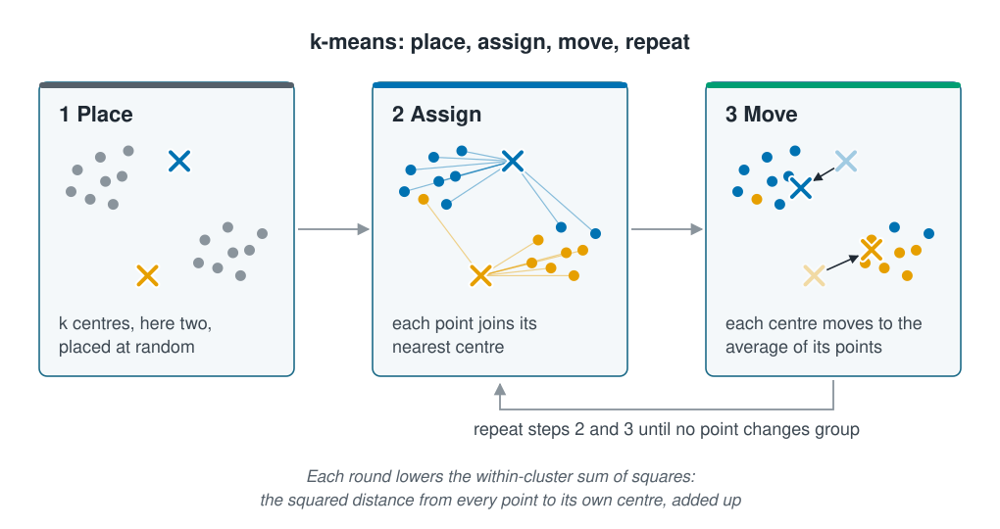

```{r}
#| label: setup
#| include: false
library(tidymodels)
library(tidyclust)
library(tidyverse)
source(here::here("R/theme.R"))
source(here::here("R/data.R"))
source(here::here("R/python-tabs.R"))
```

## Clustering sorts unlabelled stations into groups

Many marine datasets come without an answer column. A benthic survey returns grab
samples full of animals, and the first question is which kinds of seabed community it
covers. A CTD programme returns thousands of profiles, and the question is which water
masses they sample. **Clustering** sorts rows into groups so that rows in the same group
resemble each other more than rows in other groups, with no labels to learn from.

[Types of learning](../01-introduction/types-of-learning.qmd) ran **k-means**, the most
widely used clustering method, on temperature, salinity and depth. This page shows what
k-means is doing, then gives it a harder table, two dozen species counted at every
station, and finds the kinds of seabed in it without ever being told what they are.





## The idea

k-means needs one number from you: $k$, the number of groups. It places $k$ centres at
random, then repeats two steps: every point joins its nearest centre, and every centre
moves to the average of its points. It stops when no point changes group.

::: {.diagram}
{fig-alt="Three cards joined by arrows, each showing the same sixteen points in two loose groups. 1 Place: the points are grey, and two centres, one blue and one orange, sit at random places among them. 2 Assign: each point is coloured by its nearest centre and joined to it by a thin line; a few points of the lower group are blue. 3 Move: each centre has moved from its faded old position, along a short arrow, to the average of its points. An arrow from the third card back to the second reads repeat steps 2 and 3 until no point changes group. A note says each round lowers the within-cluster sum of squares: the squared distance from every point to its own centre, added up."}
:::

Each round makes the groups tighter. The quantity that falls is the **within-cluster sum
of squares**: take every point's distance to the centre of its own group, square it, and
add them all up. Small means every group is compact.

Where k-means ends depends on where the centres started, and a poor start can settle on
poor groups. So the usual practice is to run it many times from different random starts
and keep the run with the smallest sum. R calls the number of starts `nstart`;
scikit-learn calls it `n_init`.

"Nearest" is ordinary straight-line distance across all the columns at once. As
[Scaling and encoding](../02-marine-data/scaling-and-encoding.qmd) showed for every
method that measures distance, the columns need a common scale first, or the column with
the largest numbers decides every group.

::: {.callout-note collapse="true"}
## The maths, if you want it
For points $x_i$, groups $C_1,\dots,C_k$ and centres $\mu_j$, k-means minimises

$$W = \sum_{j=1}^{k} \sum_{i \in C_j} \lVert x_i - \mu_j \rVert^2$$

where $\lVert \cdot \rVert$ is straight-line (Euclidean) distance. Because a centre is an
average and distances are squared, $W$ is smallest for round groups of similar spread,
and k-means tends to find groups of that shape. $W$ also falls every time $k$ rises,
reaching zero when every point is its own group, so $W$ alone cannot say what $k$ should
be. That is the subject of [the next page](choosing-the-number-of-clusters.qmd).
:::

## Worked example

### A community matrix holds 24 taxon counts per station

This section adds a second table to the coastal survey: the same 800 stations, each with
counts of 24 benthic taxa, `tax01` to `tax24`. It is simulated too, built on the
survey's stations by `R/make-community-data.R`. One row per station and one column per
taxon is the usual shape of a **community matrix**.

::: {.panel-tabset group="language"}

## R

```{r}
#| label: community
survey <- load_coastal_survey_clean()
community <- load_coastal_community()
taxa_only <- community |> dplyr::select(starts_with("tax"))

tibble(stations = nrow(taxa_only),
       taxa = ncol(taxa_only),
       `zero counts (%)` = round(100 * mean(as.matrix(taxa_only) == 0)),
       `taxa per station (median)` = median(rowSums(taxa_only > 0)),
       `largest count` = max(taxa_only))
```

## Python

```{python}
import numpy as np
import pandas as pd

from mlbasic_data import load_coastal_community, load_coastal_survey_clean

survey = load_coastal_survey_clean()
community = load_coastal_community()
taxa_only = community.filter(like="tax")

pd.DataFrame({
    "stations": [len(taxa_only)],
    "taxa": [taxa_only.shape[1]],
    "zero counts (%)": [round(100 * (taxa_only == 0).to_numpy().mean())],
    "taxa per station (median)": [(taxa_only > 0).sum(axis=1).median()],
    "largest count": [taxa_only.to_numpy().max()],
})
```

:::

```{r}
#| label: community-numbers
#| include: false
zero_share <- round(100 * mean(as.matrix(taxa_only) == 0))
per_station <- median(rowSums(taxa_only > 0))
```

The counts are like the survey's single species, only more so: `r zero_share`% of them
are zero, a typical station holds `r per_station` of the 24 taxa, and a few counts are
far larger than the rest.

### Counts are logged and standardised in a recipe

Two steps prepare the counts, both from
[Scaling and encoding](../02-marine-data/scaling-and-encoding.qmd). A log transform pulls
in the few large counts, and standardising gives every taxon the same weight in the
distance, so the commonest taxa do not decide the groups alone. `log(count + 1)` keeps
the zeros at zero.

The clustering itself comes from **tidyclust**, the tidymodels package for clustering. It
keeps the shape used for every model so far: a recipe, a model specification, a workflow
and a fit. The engine is R's own `kmeans()`, run from 25 random starts. This page sets
$k$ to 2; [the next page](choosing-the-number-of-clusters.qmd) asks how to choose it.

::: {.panel-tabset group="language"}

## R

```{r}
#| label: fit-clusters
cluster_recipe <- recipe(~ ., data = taxa_only) |>
  step_log(all_numeric_predictors(), offset = 1) |>
  step_normalize(all_numeric_predictors())

kmeans_spec <- k_means(num_clusters = 2) |>
  set_engine("stats", nstart = 25, iter.max = 100)

set.seed(41)
habitat_fit <- workflow() |>
  add_recipe(cluster_recipe) |>
  add_model(kmeans_spec) |>
  fit(data = taxa_only)

assignments <- extract_cluster_assignment(habitat_fit)
count(assignments, .cluster)
```

## Python

```{python}
from sklearn.cluster import KMeans
from sklearn.pipeline import Pipeline
from sklearn.preprocessing import FunctionTransformer, StandardScaler

# step_log(offset = 1) then step_normalize.
cluster_recipe = Pipeline([
    ("log", FunctionTransformer(np.log1p, feature_names_out="one-to-one")),
    ("normalise", StandardScaler()),
])

# n_init is nstart: 25 random starts, keeping the best.
habitat_fit = Pipeline([
    ("recipe", cluster_recipe),
    ("model", KMeans(n_clusters=2, n_init=25, max_iter=100, random_state=41)),
]).fit(taxa_only)

# Number the clusters from 1, as tidyclust does.
assignments = pd.Series(habitat_fit["model"].labels_ + 1, name="cluster")
assignments.value_counts().sort_index().reset_index(name="n")
```

:::

```{r}
#| label: cluster-numbers
#| include: false
sizes <- sort(table(assignments$.cluster), decreasing = TRUE)
```

k-means returns two groups, of `r sizes[[1]]` and `r sizes[[2]]` stations. The cluster
numbers are only labels, in whatever order the run found them.

### Two k-means clusters recover the hard and soft seabed

k-means saw only the counts. The survey also recorded each station's seabed, so the
clusters can be compared with something k-means never saw. Rock and gravel are **hard
bottom**; sand and mud are **soft bottom**.

::: {.panel-tabset group="language"}

## R

```{r}
#| label: check-seabed
stations <- community |>
  mutate(cluster = assignments$.cluster) |>
  inner_join(dplyr::select(survey, station_id, depth_m, substrate),
             by = "station_id") |>
  mutate(bottom = if_else(substrate %in% c("rock", "gravel"), "hard", "soft"))

stations |>
  summarise(stations = n(),
            `hard bottom` = sum(bottom == "hard"),
            `soft bottom` = sum(bottom == "soft"),
            `median depth (m)` = round(median(depth_m)),
            `depth, 10th to 90th percentile (m)` =
              paste(round(quantile(depth_m, 0.1)), "to", round(quantile(depth_m, 0.9))),
            .by = cluster) |>
  arrange(cluster)
```

## Python

```{python}
stations = community.assign(cluster=assignments).merge(
    survey[["station_id", "depth_m", "substrate"]], on="station_id")
stations["bottom"] = np.where(stations["substrate"].isin(["rock", "gravel"]),
                              "hard", "soft")

(stations.groupby("cluster")
    .apply(lambda g: pd.Series({
        "stations": len(g),
        "hard bottom": (g["bottom"] == "hard").sum(),
        "soft bottom": (g["bottom"] == "soft").sum(),
        "median depth (m)": round(g["depth_m"].median()),
        "depth, 10th to 90th percentile (m)":
            f"{round(g['depth_m'].quantile(0.1))} to "
            f"{round(g['depth_m'].quantile(0.9))}",
    }), include_groups=False)
    .reset_index())
```

:::

```{r}
#| label: seabed-numbers
#| include: false
seabed <- stations |>
  count(cluster, bottom) |>
  mutate(majority = n == max(n), .by = cluster)
misplaced <- sum(seabed$n[!seabed$majority])
hard_cluster <- seabed |> filter(bottom == "hard", majority) |> pull(cluster)
depths <- stations |>
  summarise(median = median(depth_m), low = quantile(depth_m, 0.1),
            high = quantile(depth_m, 0.9), .by = cluster) |>
  mutate(group = if_else(cluster == hard_cluster, "hard", "soft"))
hard_depth <- filter(depths, group == "hard")
soft_depth <- filter(depths, group == "soft")
```

One cluster is the hard bottom and the other the soft bottom: only `r misplaced` of the
`r nrow(stations)` stations sit in the other kind's cluster. From the counts alone, k-means
has found the one real grouping built into the simulation, where six taxa live only on
rock and gravel and eight only on sand and mud.

::: {.panel-tabset group="language"}

## R

```{r}
#| label: fig-clusters
#| fig-cap: "Each station's depth and its cluster, coloured by the seabed the survey recorded. The clusters follow the seabed, not depth: each covers most of the depth range."
#| fig-alt: !expr 'glue::glue("A strip chart with depth in metres on the horizontal axis and the two clusters on the vertical axis, each station a jittered point coloured by hard or soft bottom. The hard-bottom cluster is almost all one colour and the soft-bottom cluster almost all the other, with {misplaced} stations out of place. The hard-bottom cluster runs from about {round(hard_depth$low)} to {round(hard_depth$high)} metres for most of its stations and the soft-bottom cluster from about {round(soft_depth$low)} to {round(soft_depth$high)}, so the two overlap over most of the shelf.")'
#| fig-width: 7.5
#| fig-height: 3.4
stations |>
  mutate(cluster = if_else(cluster == hard_cluster, "Hard-bottom cluster",
                           "Soft-bottom cluster"),
         bottom = paste(str_to_sentence(bottom), "bottom")) |>
  ggplot(aes(depth_m, cluster, colour = bottom)) +
  geom_point(position = position_jitter(width = 0, height = 0.25, seed = 1),
             size = 1.4, alpha = 0.7) +
  labs(x = "depth (m)", y = NULL, colour = "recorded seabed")
```

:::

The clusters did not follow depth. The hard-bottom cluster is shallower on average, with a
median of `r round(hard_depth$median)` m against `r round(soft_depth$median)` m, because
rock and gravel lie shallower on this shelf, but most of its stations span
`r round(hard_depth$low)` to `r round(hard_depth$high)` m and most of the other's
`r round(soft_depth$low)` to `r round(soft_depth$high)` m.

That does not make depth unimportant to these taxa.
[Principal component analysis](principal-component-analysis.qmd) finds a strong depth
pattern in the same counts. But species change with depth gradually, with no depth at
which one set gives way to another, so there is no gap for k-means to split on. The
seabed is a clean break between two kinds of ground. The difference between a group and
a gradient runs through this section, up to
[Checking a pattern before reporting it](interpreting-patterns.qmd).

## k-means returns groups in any table

k-means always returns $k$ groups. Asked for four groups in points scattered at random,
it returns four tidy ones, and nothing in its output says the groups are not really
there; [Choosing the number of clusters](choosing-the-number-of-clusters.qmd) builds
that check. It also gives every station a group, however far it sits from any centre.
And its straight-line distance treats two stations that both lack a taxon as alike,
which is why community ecologists often use other distances, such as Bray–Curtis.

## Key points

::: {.key-points}
- **Clustering** sorts rows into groups of similar rows, with no labels to learn from.
- **k-means** repeats two steps, assign each point to its nearest centre and move each
  centre to the average of its points, and so lowers the **within-cluster sum of
  squares**. It is run from many random starts, and the best run is kept.
- Distances need a common scale: log and standardise the counts in a recipe first.
- On the community matrix, two clusters recovered the hard and soft seabed with
  `r misplaced` stations out of place, from counts alone.
- They did not split by depth, which changes the species gradually, with no gap to split
  on.
:::

## Try it yourself

1. Remove `step_normalize()` from `cluster_recipe` and refit. How many stations change
   cluster, and do the clusters still follow the seabed?
2. Fit k-means with `nstart = 1` under five different seeds and compare
   `extract_fit_engine(habitat_fit)$tot.withinss` across them. Do the runs all end at the
   same sum of squares?
