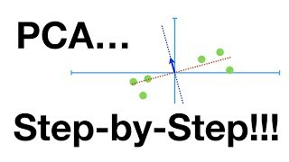
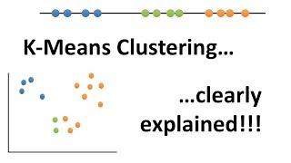
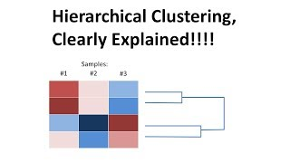
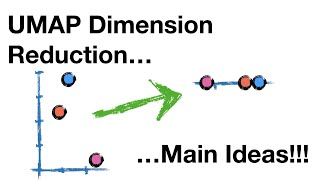

## Overview

Sometimes there is no answer to learn from: counts of two dozen taxa at every station
and no list of the habitats they come from. Unsupervised methods look for structure in
the data itself, and they return an answer for any table, so checking what they find
matters as much as finding it. This section works on the taxon counts of the same
simulated survey as the rest of the course: three pages on sorting stations into groups,
two on principal components, which turn many columns into a map, and one on the checks a
pattern must pass before it is reported.

## A short tour



## Pages in this section

::: {#pages}
:::

## Further resources

**Documentation**

- [tidyclust](https://tidyclust.tidymodels.org/), tidymodels. Clustering in the same specification and workflow idiom as the rest of the course.
- [Clustering](https://scikit-learn.org/stable/modules/clustering.html), scikit-learn user guide. The comparison figure near the top, showing ten methods on the same six datasets, is worth more than the text.
- [Decomposing signals in components](https://scikit-learn.org/stable/modules/decomposition.html), scikit-learn user guide. PCA and its relatives.

**Video**

::: {.video-list}
- [{.video-thumb fig-alt="StatQuest: Principal Component Analysis (PCA), Step-by-Step, on YouTube" loading="lazy"}](https://www.youtube.com/watch?v=FgakZw6K1QQ)

  [StatQuest: Principal Component Analysis (PCA), Step-by-Step](https://www.youtube.com/watch?v=FgakZw6K1QQ), StatQuest with Josh Starmer.

- [{.video-thumb fig-alt="StatQuest: K-means clustering, on YouTube" loading="lazy"}](https://www.youtube.com/watch?v=4b5d3muPQmA)

  [StatQuest: K-means clustering](https://www.youtube.com/watch?v=4b5d3muPQmA), StatQuest with Josh Starmer. The algorithm step by step, and what the choice of k does.

- [{.video-thumb fig-alt="StatQuest: Hierarchical Clustering, on YouTube" loading="lazy"}](https://www.youtube.com/watch?v=7xHsRkOdVwo)

  [StatQuest: Hierarchical Clustering](https://www.youtube.com/watch?v=7xHsRkOdVwo), StatQuest with Josh Starmer. The dendrogram, and what the height of a join means.

- [{.video-thumb fig-alt="UMAP Dimension Reduction, Main Ideas, on YouTube" loading="lazy"}](https://www.youtube.com/watch?v=eN0wFzBA4Sc)

  [UMAP Dimension Reduction, Main Ideas](https://www.youtube.com/watch?v=eN0wFzBA4Sc), StatQuest with Josh Starmer. Useful before trusting any UMAP picture, including the one on this site.
:::
