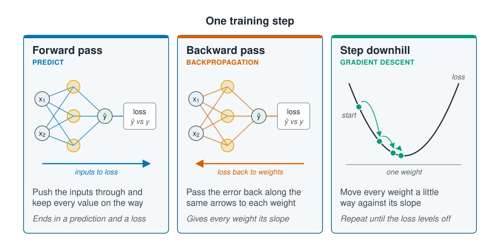

```{r}
#| label: setup
#| include: false
library(tidymodels)
library(tidyverse)
source(here::here("R/theme.R"))
source(here::here("R/data.R"))
```



## A network learns by walking downhill

A network finds its weights the way
[Gradient descent](../04-how-algorithms-learn/gradient-descent.qmd) found the slopes of
a straight line: measure the loss, find which way is downhill for every weight, take a
small step, and repeat. The new part is finding the slopes, because a weight in the
hidden layer reaches the prediction only through other weights. **Backpropagation**
solves this by passing the error back through the network, layer by layer. This page
writes a small network out in base R, checks its slopes, and trains it until it beats
linear regression.



## Backpropagation passes the error back layer by layer

Each training step has three parts.

- **Forward propagation** pushes the inputs through the network, as on
  [Neurons, layers and activations](what-a-network-is.qmd), and keeps every value on
  the way: each hidden unit's weighted sum and its value after the bend. It ends in a
  prediction, and the loss compares the prediction with the observed value.
- **Backpropagation** walks the same arrows in reverse. It starts with how far off each
  prediction was and asks, for each layer in turn, how much the loss would change if
  that layer's values changed. Each answer gives the slopes of the weights feeding that
  layer, and is passed one layer further back.
- **The step** moves every weight a little way against its slope, as in gradient
  descent.

::: {.diagram}
{fig-alt="Three cards. Forward pass, predict: a small network with two inputs, three hidden units and an output feeds a box comparing the prediction with the observed value, the loss; an arrow runs from the inputs to the loss; push the inputs through and keep every value on the way; it ends in a prediction and a loss. Backward pass, backpropagation: the same network, with an arrow running from the loss back to the weights; pass the error back along the same arrows to each weight; it gives every weight its slope. Step downhill, gradient descent: a U-shaped curve of the loss against one weight, with dots stepping from a start point down to the bottom; move every weight a little way against its slope; repeat until the loss levels off."}
:::

The backward pass is quick because the forward pass has already computed everything it
needs. Both passes together cost about twice a forward pass, however many weights the
network has, which is what makes networks with millions of weights trainable.

## Worked example

We predict abundance on a log scale from depth, temperature and chlorophyll, each
standardised, with one hidden layer of four units. The hidden units use tanh, the
S-shaped activation from minus one to one.

### Both passes fit in a few lines of base R

```{r}
#| label: data
survey <- load_coastal_survey_clean()

model_data <- survey |>
  select(abundance, depth_m, temperature_c, chlorophyll_mg_m3) |>
  drop_na()

X <- cbind(depth       = as.numeric(scale(model_data$depth_m)),
           temperature = as.numeric(scale(model_data$temperature_c)),
           chlorophyll = as.numeric(scale(log1p(model_data$chlorophyll_mg_m3))))
y <- log1p(model_data$abundance)

n_hidden <- 4

# Small random weights, so the hidden units start different from one another.
# The output bias starts at the mean, so the untrained network predicts the
# average.
initialise <- function(seed) {
  set.seed(seed)
  list(W1 = matrix(rnorm(ncol(X) * n_hidden, 0, 0.5), ncol(X), n_hidden),
       b1 = rep(0, n_hidden),
       w2 = rnorm(n_hidden, 0, 0.5),
       b2 = mean(y))
}
```

`W1` and `b1` are the hidden layer's weights and biases, `w2` and `b2` the output's.
The weights start random because hidden units that start the same receive the same
slopes and stay the same; randomness lets four units learn four different bends.

The forward pass is two matrix multiplications and a bend. The loss is the mean squared
error from [Loss functions](../04-how-algorithms-learn/loss-functions.qmd).

```{r}
#| label: forward
forward <- function(par, X) {
  Z1 <- sweep(X %*% par$W1, 2, par$b1, "+")  # weighted sums into the units
  A1 <- tanh(Z1)                             # the units' values after the bend
  list(Z1 = Z1, A1 = A1,
       prediction = as.numeric(A1 %*% par$w2 + par$b2))
}

loss <- function(par, X, y) mean((y - forward(par, X)$prediction)^2)
```

The backward pass starts from the error and works towards the inputs, reusing `A1` from
the forward pass at every step.

```{r}
#| label: backward
backward <- function(par, X, y) {
  f <- forward(par, X)
  n <- nrow(X)

  # How the loss responds to each prediction, passed back through the output
  # weights, then through the bend (tanh's slope).
  d_prediction <- -2 * (y - f$prediction) / n
  d_A1 <- outer(d_prediction, par$w2)
  d_Z1 <- d_A1 * (1 - f$A1^2)

  list(W1 = t(X) %*% d_Z1,
       b1 = colSums(d_Z1),
       w2 = as.numeric(t(f$A1) %*% d_prediction),
       b2 = sum(d_prediction))
}

par <- initialise(3)
gradients <- backward(par, X, y)
```

Each weight's slope is the error arriving at its layer times the value entering it: the
output weights' slopes use the hidden units' values, the hidden weights' slopes use the
inputs. The activation appears in one line only, as its slope, `1 - A1^2` for tanh.

### Nudging each weight confirms the slopes

A slope worked out by hand can be checked by arithmetic: nudge one weight up and down
by a tiny amount and see how much the loss moves. If the backward pass is right, the two
agree.

```{r}
#| label: gradient-check
numerical_gradient <- function(par, X, y, eps = 1e-6) {
  imap(par, \(values, name) {
    out <- values
    for (i in seq_along(values)) {
      up <- par; down <- par
      up[[name]][i]   <- values[i] + eps
      down[[name]][i] <- values[i] - eps
      out[i] <- (loss(up, X, y) - loss(down, X, y)) / (2 * eps)
    }
    out
  })
}

nudged <- numerical_gradient(par, X, y)

check <- tibble(Weights = c("Hidden weights (W1)", "Hidden biases (b1)",
                            "Output weights (w2)", "Output bias (b2)"),
                `Largest difference` = map_dbl(names(par), \(nm) {
                  max(abs(as.numeric(gradients[[nm]]) -
                            as.numeric(nudged[[nm]])))
                }))
check |> mutate(`Largest difference` = sprintf("%.1e", `Largest difference`))
```

```{r}
#| label: check-numbers
#| include: false
n_weights    <- sum(lengths(par))
check_places <- floor(-log10(max(check$`Largest difference`)))
```

All `r n_weights` slopes agree to `r check_places` decimal places. The nudges cost two
forward passes per weight, which is cheap for `r n_weights` weights and far too slow for
training a large network; the backward pass gets every slope from one pass. Run this
check whenever you write a gradient yourself: a wrong one still trains, only to the
wrong place.

### The hand-written network overtakes linear regression

The training loop runs a forward pass, a backward pass and a step, again and again. Each
step here uses all `r nrow(X)` stations.

```{r}
#| label: train
train <- function(par, X, y, learning_rate = 0.2, steps = 3000) {
  history <- numeric(steps)
  for (step in seq_len(steps)) {
    gradient <- backward(par, X, y)
    for (nm in names(par)) {
      par[[nm]] <- par[[nm]] - learning_rate * gradient[[nm]]
    }
    history[step] <- loss(par, X, y)
  }
  list(par = par, history = history)
}

fitted_net <- train(initialise(3), X, y)
linear_mse <- mean(resid(lm(y ~ X))^2)
```

```{r}
#| label: fig-descent
#| fig-cap: "Training loss over 3,000 gradient-descent steps, against linear regression on the same three inputs. The steps are on a log scale, so the early ones are spread out. After a quick first drop the loss pauses on a plateau, falls again, then improves slowly."
#| fig-alt: "A line against gradient-descent steps on a log scale from one to three thousand. It falls from about 0.76 at the first step to about 0.69 by step fifty, flattens into a near-horizontal plateau until about step one hundred, falls again to about 0.575 by step three hundred, then declines slowly to about 0.558 at step three thousand, with one small brief spike near step two thousand two hundred. A horizontal dashed line at about 0.68 marks linear regression's error; the training curve crosses it at about step eighty."
#| fig-width: 7
#| fig-height: 4.2
tibble(step = seq_along(fitted_net$history), mse = fitted_net$history) |>
  ggplot(aes(step, mse)) +
  geom_hline(yintercept = linear_mse, linetype = "dashed", colour = "#9aa5ad") +
  geom_line(colour = ml_palette[["blue"]], linewidth = 0.8) +
  annotate("text", x = 3000, y = linear_mse, label = "Linear regression  ",
           hjust = 1, vjust = -0.6, size = 3.3, colour = "#77818a") +
  scale_x_log10(breaks = c(1, 10, 100, 1000, 3000),
                labels = scales::label_comma()) +
  labs(x = "Gradient-descent step (log scale)",
       y = "Training mean squared error")
```

```{r}
#| label: descent-numbers
#| include: false
passes_at <- which(fitted_net$history < linear_mse)[1]
final_mse <- tail(fitted_net$history, 1)
spike_at  <- which.max(diff(fitted_net$history)) + 1
```

The network overtakes linear regression (mean squared error `r round(linear_mse, 3)`) at
step `r passes_at` and ends at `r round(final_mse, 3)` after 3,000 steps. It was built
from nothing but the two passes above, with every slope checked.

Two features of the curve are common in network training. The **plateau** after the
first drop is a nearly flat stretch of the loss, where the slopes are tiny and progress
pauses; a run stopped there would have looked no better than a straight line. The slow
crawl at the end is why training longer rarely rescues a disappointing network. The
small spike at step `r format(spike_at, big.mark = ",")` is a step that overshot the
valley; the loss rose for a moment and recovered.
[Training a network](training-a-network.qmd) shows when to stop and how much the random
start changes the result.

## Software works out the backward pass for you

Real software works out the backward pass automatically from the forward pass, so you
never write it. What an engine does with the slopes can differ. The `nnet` package used
on these pages passes them to **BFGS**, a search that also tracks how the slopes change
from step to step and chooses its own step size, so it needs no learning rate.

The bend's slope matters too. Where a tanh or logistic unit's weighted sum is large, the
curve is flat and its slope is near zero, so little error passes back through the unit
and its weights barely move. In networks with many layers this shrinking compounds, the
**vanishing gradient**; ReLU, whose slope is one wherever it is active, is the usual
remedy.

::: {.callout-note collapse="true"}
## The maths, if you want it

Write $\hat y$ for the predictions, $L = \frac{1}{n}\sum (y - \hat y)^2$ for the loss,
$Z_1 = XW_1 + b_1$ and $A_1 = \tanh(Z_1)$. The chain rule gives, from the output back:

1. $\partial L / \partial \hat y = -2(y - \hat y)/n$
2. $\partial L / \partial w_2 = A_1^{\top}(\partial L/\partial \hat y)$
3. $\partial L / \partial A_1 = (\partial L/\partial \hat y)\, w_2^{\top}$
4. $\partial L / \partial Z_1 = \partial L/\partial A_1 \odot (1 - A_1^2)$, since
   $\tanh'(z) = 1 - \tanh^2(z)$
5. $\partial L / \partial W_1 = X^{\top}(\partial L/\partial Z_1)$

The bias slopes are the column sums of the same quantities. Each line reuses the one
above it, which is why the backward pass costs no more than a forward pass.
:::

## Key points

::: {.key-points}
- A network is trained by gradient descent: forward pass, backward pass, a small
  step for every weight, repeated.
- **Forward propagation** computes the prediction and keeps every value on the way.
  **Backpropagation** passes the error back through the same arrows and gives every
  weight its slope in one pass.
- The activation enters the backward pass only as its slope.
- Check a hand-written gradient against small nudges of each weight; here all
  `r n_weights` slopes agreed to `r check_places` decimal places.
- The loss can pause on a **plateau** before falling again, so a run stopped early can
  look no better than a straight line.
:::

## Try it yourself

1. Replace tanh with ReLU: `A1 <- pmax(Z1, 0)` in `forward()`, and
   `d_Z1 <- d_A1 * (Z1 > 0)` in `backward()`. Run the check against small nudges again.
   Does it still agree?
2. Set `par$W1[] <- 0` before training. How many of the four hidden units end up
   different from each other, and why?
