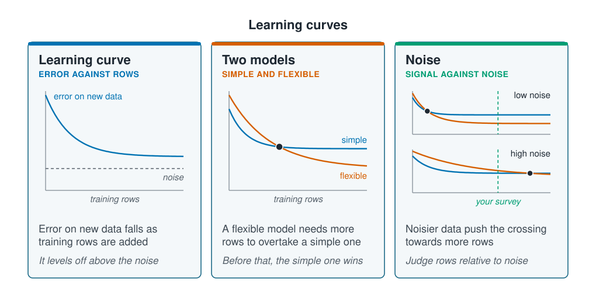

```{r}
#| label: setup
#| include: false
library(tidymodels)
library(tidyverse)
source(here::here("R/theme.R"))
source(here::here("R/data.R"))
f2 <- \(x) sprintf("%.2f", x)
in_words <- \(n) c("one", "two", "three", "four", "five", "six", "seven",
                   "eight")[n]
```

## Learning curves show how error falls with more data

"Neural networks need a lot of data" is common advice, but it does not say how much, and
marine surveys usually have hundreds of rows, not millions. This page measures it on a
survey of that size. The answer depends on how noisy the response is as much as on the
number of rows, and that tells you when a network is worth trying on your own data.



A **learning curve** plots a model's error on new data against the number of rows it was
trained on. The error falls as rows are added and levels off above the **noise**, the part
of each value that no model can predict; [The bias–variance
trade-off](../05-generalisation/bias-variance.qmd) showed that on this survey the noise is
the largest part of the error. A flexible model such as a network usually starts behind a
simple one, because with few rows its many weights fit the noise. With more rows it can
overtake, and the noisier the response, the more rows that takes.

::: {.diagram}
{fig-alt="Three cards. Learning curve, error against rows: a curve of error on new data falls steeply, then levels off above a dashed line marked noise. Two models, simple and flexible: the simple model's curve falls fast and levels off; the flexible model's curve starts higher, falls further and crosses below it at a marked point. Noise, signal against noise: two small panels with the same two curves and a dashed line marked your survey. With low noise the curves cross after few rows, well before the line; with high noise they cross only after it. A note says to judge rows relative to noise."}
:::

## Worked example

Three models predict abundance from eight inputs: depth, temperature, chlorophyll,
salinity, substrate, season, longitude and latitude. They are linear regression, the
random forest from [Random forests and
boosting](../03-supervised-learning/forests-and-boosting.qmd) and the network that `mlp()`
fitted on [Training a network](training-a-network.qmd), with eight hidden units and a
small penalty. A quarter of the sites are held back as test sites, split by site as on
[Splitting the data](../02-marine-data/splitting-data.qmd).

```{r}
#| label: prepare
survey <- load_coastal_survey_clean() |>
  select(station_id, site_id, abundance, depth_m, temperature_c,
         chlorophyll_mg_m3, salinity_psu, substrate, season,
         longitude, latitude) |>
  drop_na()

set.seed(99)
split <- group_initial_split(survey, group = site_id, prop = 0.75)
train <- training(split)
test  <- testing(split)

predictors <- abundance ~ depth_m + temperature_c + chlorophyll_mg_m3 +
  salinity_psu + substrate + season + longitude + latitude

base_recipe <- recipe(predictors, data = train) |>
  step_dummy(all_nominal_predictors()) |>
  step_zv(all_predictors()) |>
  step_normalize(all_numeric_predictors())

baseline <- rmse_vec(test$abundance, rep(mean(train$abundance), nrow(test)))
c(training = nrow(train), test = nrow(test))
```

`step_zv()` drops any column with the same value in every row, which a 0/1 column for a
rare substrate can be in a small sample. Predicting the mean count of the training
stations at every test station gives an RMSE of `r f2(baseline)` individuals: a model has
to beat that to have learned anything.

### The forest leads at every survey size

Training sets of 40, 80, 160 and 320 stations are drawn from the `r nrow(train)` training
stations, ten draws at each size, and each model is scored on the same test stations. The
ten fits with all the stations differ only in their random seed, which for the network
sets its starting weights.

```{r}
#| label: learning-curves
models <- list(
  `Linear regression` = linear_reg(),
  `Random forest`     = rand_forest(trees = 500) |>
    set_engine("ranger", seed = 1) |>
    set_mode("regression"),
  `Neural network`    = mlp(hidden_units = 8, penalty = 0.01, epochs = 500) |>
    set_engine("nnet") |>
    set_mode("regression")
)

sizes <- c(40, 80, 160, 320, nrow(train))

learning_curve <- function(recipe, target) {
  map_dfr(1:10, \(draw) map_dfr(sizes, \(n) {
    set.seed(1000 * draw + n)
    rows <- train[sample(nrow(train), n), ]
    map_dfr(names(models), \(model) {
      set.seed(draw)
      fitted <- fit(workflow(recipe, models[[model]]), rows)
      tibble(draw, n, model,
             rmse = rmse_vec(test[[target]], predict(fitted, test)$.pred))
    })
  }))
}

curves <- learning_curve(base_recipe, "abundance")

curves |>
  summarise(rmse = round(mean(rmse), 2), .by = c(n, model)) |>
  pivot_wider(names_from = model, values_from = rmse) |>
  rename(`Training stations` = n)
```

```{r}
#| label: curve-numbers
#| include: false
at <- \(size, m) curves |> filter(n == size, model == m) |> pull(rmse) |> mean()
spread <- curves |>
  filter(model == "Neural network", n < nrow(train)) |>
  summarise(sd = sd(rmse), .by = n) |>
  slice_max(sd)
worst <- curves |>
  filter(model == "Neural network") |>
  summarise(rmse = mean(rmse), .by = n) |>
  slice_max(rmse)
n_inputs <- ncol(bake(prep(base_recipe), new_data = NULL)) - 1
n_weights <- (n_inputs + 1) * 8 + 9
```

```{r}
#| label: fig-learning-curves
#| fig-cap: "Test RMSE against the number of training stations, ten draws at each size; at the largest size the draws use all the training stations and differ only in their seed. Ribbons span the lowest to highest of the ten draws. The dashed line is the score for predicting the mean."
#| fig-alt: !expr glue::glue("Three lines with shaded ribbons, test RMSE against training stations on a log scale from 40 to {nrow(train)}. A dashed line at {f2(baseline)} marks predicting the mean. The random forest is lowest at every size, from {f2(at(40, 'Random forest'))} at 40 stations to {f2(at(nrow(train), 'Random forest'))} with all of them. Linear regression starts at {f2(at(40, 'Linear regression'))}, above the dashed line, falls quickly and ends at {f2(at(nrow(train), 'Linear regression'))}. The neural network is highest, with the widest ribbon; it rises to {f2(worst$rmse)} at {worst$n} stations, then falls steeply to {f2(at(nrow(train), 'Neural network'))}.")
#| fig-width: 7.8
#| fig-height: 4.6
curves |>
  summarise(lower = min(rmse), upper = max(rmse), rmse = mean(rmse),
            .by = c(n, model)) |>
  ggplot(aes(n, rmse, colour = model, fill = model)) +
  geom_hline(yintercept = baseline, linetype = "dashed",
             colour = ml_palette[["grey"]]) +
  geom_ribbon(aes(ymin = lower, ymax = upper), alpha = 0.15, colour = NA) +
  geom_line(linewidth = 0.9) +
  geom_point(size = 1.8) +
  annotate("text", x = 90, y = baseline, label = "Predict the mean",
           hjust = 0, vjust = -0.6, size = 3.4,
           colour = ml_palette[["grey"]]) +
  scale_x_log10(breaks = sizes) +
  labs(x = "Training stations (log scale)", y = "RMSE on test sites (individuals)",
       colour = NULL, fill = NULL) +
  theme(legend.position = "bottom")
```

With 40 stations, linear regression scores `r f2(at(40, "Linear regression"))` and the
network `r f2(at(40, "Neural network"))`, both worse than predicting the mean; only the
forest beats it. Small samples are hard on every model that estimates many numbers, not
only on networks. Linear regression improves quickly and levels off at
`r f2(at(nrow(train), "Linear regression"))`. The forest, which averages 500 trees, leads
at every size and ends at `r f2(at(nrow(train), "Random forest"))`.

The network has `r n_weights` weights, and its curve shows what that costs on a few
hundred noisy counts. Its scores vary most between draws of the same size, by a standard
deviation of `r f2(spread$sd)` at `r spread$n` stations, so a single fit of it can be
far from typical. After `r worst$n` stations it improves the fastest of the three, from
`r f2(worst$rmse)` to `r f2(at(nrow(train), "Neural network"))` with all
`r nrow(train)`, and its curve is still falling steeply where the data run out.

### Cross-validation shrinks the network to one unit

The eight-unit network was not tuned. Cross-validation by site, as on [Hyperparameter
selection](../05-generalisation/hyperparameter-selection.qmd), chooses the number of
hidden units and the penalty from the training stations.

```{r}
#| label: tuning
tunable <- mlp(hidden_units = tune(), penalty = tune(), epochs = 500) |>
  set_engine("nnet") |>
  set_mode("regression")

set.seed(11)
folds <- group_vfold_cv(train, group = site_id, v = 5)

set.seed(12)
searched <- tune_grid(
  workflow(base_recipe, tunable),
  resamples = folds,
  grid = expand_grid(hidden_units = c(1, 2, 4, 8),
                     penalty = c(0.01, 0.1, 1)),
  metrics = metric_set(rmse)
)

show_best(searched, metric = "rmse", n = 4) |>
  transmute(`Hidden units` = hidden_units, Penalty = penalty,
            `Mean RMSE` = round(mean, 2), `Standard error` = round(std_err, 2))
```

```{r}
#| label: tuned-network
best <- select_best(searched, metric = "rmse")

set.seed(7)
tuned <- workflow(base_recipe, tunable) |>
  finalize_workflow(best) |>
  fit(train)

tuned_rmse <- rmse_vec(test$abundance, predict(tuned, test)$.pred)
tibble(`Test RMSE` = round(tuned_rmse, 2))
```

The search chooses **`r in_words(best$hidden_units)` hidden unit with a penalty of
`r best$penalty`**, the smallest network on the grid with the largest penalty. That is
cross-validation doing its job: with this much noise, the extra flexibility costs more in
variance than it gains, so the search picks the network closest to a straight line. On the
test sites it scores `r f2(tuned_rmse)`, against `r f2(at(nrow(train), "Neural network"))`
for the untuned network and `r f2(at(nrow(train), "Linear regression"))` for linear
regression.

### The expected counts show what the network learned

A real survey stops there. This one is simulated, so each station's **expected count**,
the average the simulation drew its count from, is known, as on [The bias–variance
trade-off](../05-generalisation/bias-variance.qmd). Refitting the three models with the
expected count as the target, and scoring them against the expected counts at the test
sites, removes the noise and shows how well each model learned the response itself. It is
a check only: no real dataset has this column.

```{r}
#| label: expected-counts
check_data <- load_coastal_survey_truth()
train <- left_join(train, check_data, by = "station_id")
test  <- left_join(test, check_data, by = "station_id")

expected_recipe <- recipe(update(predictors, true_mean ~ .), data = train) |>
  step_dummy(all_nominal_predictors()) |>
  step_zv(all_predictors()) |>
  step_normalize(all_numeric_predictors())

checked <- learning_curve(expected_recipe, "true_mean")

checked |>
  summarise(rmse = round(mean(rmse), 2), .by = c(n, model)) |>
  pivot_wider(names_from = model, values_from = rmse) |>
  rename(`Training stations` = n)
```

```{r}
#| label: check-numbers
#| include: false
at_check <- \(size, m) checked |>
  filter(n == size, model == m) |> pull(rmse) |> mean()
full <- nrow(train)
leads <- checked |>
  summarise(rmse = mean(rmse), .by = c(n, model)) |>
  summarise(net_best = model[which.min(rmse)] == "Neural network", .by = n) |>
  arrange(desc(n)) |>
  filter(cumprod(net_best) == 1) |>
  pull(n) |>
  min()
gain <- round(100 * (1 - at_check(full, "Neural network") /
                       at_check(full, "Linear regression")))
```

The order turns round. From `r leads` stations on, the network is the closest of the three
to the expected counts: this is the crossing in the diagram above. With all `r full`
stations it scores `r f2(at_check(full, "Neural network"))`, against
`r f2(at_check(full, "Random forest"))` for the forest and
`r f2(at_check(full, "Linear regression"))` for linear regression, `r gain`% better than
linear regression. Linear regression levels off because a straight line cannot follow the
humped responses in the survey; the network can, and from a few hundred stations it did.

So the network was **short of signal, not of rows**. It learned the response well; on the
observed counts the noise around each expected count hid that gain.

## Judge a survey's size against its noise

The number of rows alone does not say whether a network will pay off. What matters is how
much of the response is signal. You cannot compute expected counts for real data, but you
can estimate the noise: from duplicate tows, replicate grabs, or two observers counting the
same sample. A response measured with little noise, such as a well-calibrated sensor
reading, leaves much more signal per row than a count, and there a network reaches its
advantage with far fewer stations.

Two signs in your own learning curves help. If the network's curve is still falling with
all the data, more stations would help it. If cross-validation picks the smallest network
on the grid, a simpler model will do as well for now. [When a network is the right
tool](when-to-use-one.qmd) shows a problem where a network wins with a few hundred rows.

::: {.callout-note collapse="true"}
## The maths, if you want it

Each observed count is its expected count plus noise, $y = \mu(x) + \varepsilon$. On new
data the expected squared error of a model $\hat f$ is
$E[(y - \hat f(x))^2] = \text{bias}^2 + \text{variance} + \sigma^2$, where $\sigma^2$ is
the variance of the noise. More rows shrink the variance, and a flexible model has the
smaller bias, but $\sigma^2$ stays. When $\sigma^2$ is large, the flexible model's lower
bias is a small share of the error, and its larger variance can cost more than it gains.
Scoring against $\mu(x)$ instead of $y$ removes $\sigma^2$ and shows the bias and
variance alone.
:::

## Key points

::: {.key-points}
- A **learning curve** plots error on new data against the number of training rows. It
  shows whether more data would help and where one model overtakes another.
- With `r nrow(train)` training stations, the random forest led at every size and the
  eight-unit network varied most between draws.
- **Cross-validation shrank the network** to `r in_words(best$hidden_units)` hidden unit with the
  largest penalty, close to linear regression, because the counts are noisy.
- Scored against the expected counts, the network learned the response best, `r gain`%
  better than linear regression. It was **short of signal, not of rows**.
- Judge a survey's size against its noise: the less noisy the response, the fewer rows a
  network needs.
:::

## Try it yourself

1. Replace `abundance` with the presence column `present` and RMSE with `roc_auc`, using
   `set_mode("classification")`. Presence is less noisy than the count: does the network
   catch up with the forest sooner?
2. Add `mlp(hidden_units = 8, penalty = 1)` to `models`. How much of the eight-unit
   network's spread between draws does the larger penalty remove?
