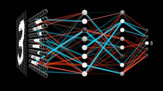
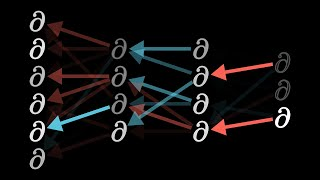
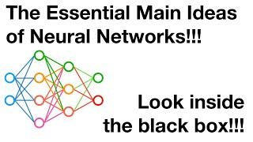

## Overview

Every part of a neural network is something the course has already met: weighted sums
like those of linear regression, each followed by a bend, with weights learned by the
same walk downhill as gradient descent. This section builds a small network by hand and
checks it against arithmetic, trains one on the same simulated survey as the rest of the
course, and compares it with a random forest to find when a network is worth it. It ends
with an autoencoder, a network that learns with no response to predict.

## A short tour



## Lecture notes

- [Summary slides](../../slides/09-neural-networks.qmd) cover each page of the section
  in two or three slides, with speaker notes, for teaching the section or a quick
  review.

## Pages in this section

::: {#pages}
:::

## Further resources

**Documentation**

- [`mlp()`](https://parsnip.tidymodels.org/reference/mlp.html), parsnip. The multilayer perceptron in the same specification idiom as every other model in the course.
- [Neural network models (supervised)](https://scikit-learn.org/stable/modules/neural_networks_supervised.html), scikit-learn user guide. Includes the tips section on scaling and on how little data these need before they overfit.

**Video**

::: {.video-list}
- [{.video-thumb fig-alt="But what is a neural network?, on YouTube" loading="lazy"}](https://www.youtube.com/watch?v=aircAruvnKk)

  [But what is a neural network?](https://www.youtube.com/watch?v=aircAruvnKk), 3Blue1Brown. Deep Learning chapter 1, and the clearest account anywhere of what the layers are doing.

- [{.video-thumb fig-alt="Backpropagation calculus, on YouTube" loading="lazy"}](https://www.youtube.com/watch?v=tIeHLnjs5U8)

  [Backpropagation calculus](https://www.youtube.com/watch?v=tIeHLnjs5U8), 3Blue1Brown. Deep Learning chapter 4, for readers who want the derivative rather than the metaphor.

- [{.video-thumb fig-alt="The Essential Main Ideas of Neural Networks, on YouTube" loading="lazy"}](https://www.youtube.com/watch?v=CqOfi41LfDw)

  [The Essential Main Ideas of Neural Networks](https://www.youtube.com/watch?v=CqOfi41LfDw), StatQuest with Josh Starmer. A slower path to the same place.
:::
