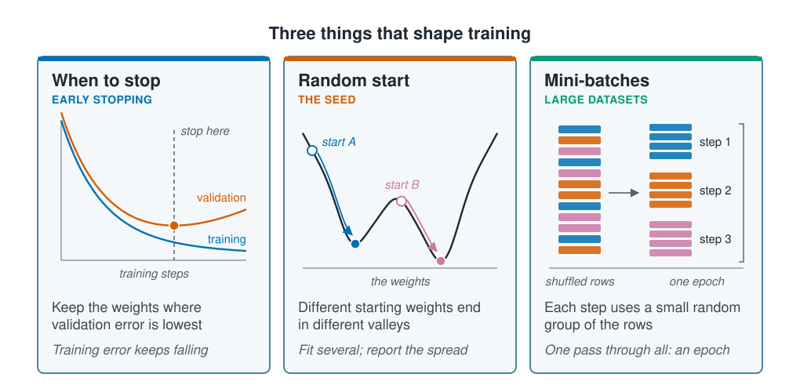

```{r}
#| label: setup
#| include: false
library(tidymodels)
library(tidyverse)
source(here::here("R/theme.R"))
source(here::here("R/data.R"))
f3 <- \(x) sprintf("%.3f", x)
```

## Three settings decide how well a network trains

Backpropagation gives every weight its slope, and gradient descent walks downhill. How
well the walk ends depends on three settings the data cannot choose: how long each step
is, how long to keep walking, and where the walk starts. This page shows what each one
does to the same small network, and how to choose it by watching the loss.



::: {.diagram}
{fig-alt="Three cards. Learning rate, step size: a U-shaped loss curve with two walks down it, short steps that settle at the bottom and long steps that jump from side to side; too small crawls, too large overshoots. When to stop, early stopping: two curves of error against training steps, training error falling all the way and validation error falling then rising, with a dashed line at its lowest point; keep the weights where validation error is lowest. Random start, the seed: a wavy loss curve with two valleys and two starting points, each rolling into a different valley; different starts end in different valleys."}
:::

The learning rate and the number of steps are hyperparameters, chosen like the node size
on [Hyperparameter selection](../05-generalisation/hyperparameter-selection.qmd). The
starting weights are random, so they are not chosen at all; what matters is how much
they change the result.

All the inputs are standardised first. [Gradient
descent](../04-how-algorithms-learn/gradient-descent.qmd) showed that inputs in their
measured units make the walk many times longer, because the step has to suit the
steepest direction. A network has one learning rate for all its weights, so it needs
standardised inputs even more: put `step_normalize()` in every network's recipe.

## Worked example

The network is the one from [Forward propagation and
backpropagation](forward-and-backward.qmd): depth, temperature and chlorophyll,
standardised, predict abundance on a log scale through one hidden layer of tanh units.
This time 200 stations are held back as validation data, so we can watch the network on
stations it is not fitted to. `train()` now records the loss on both sets at every step.

```{r}
#| label: network
survey <- load_coastal_survey_clean()

model_data <- survey |>
  select(abundance, depth_m, temperature_c, chlorophyll_mg_m3) |>
  drop_na()

X <- cbind(depth       = as.numeric(scale(model_data$depth_m)),
           temperature = as.numeric(scale(model_data$temperature_c)),
           chlorophyll = as.numeric(scale(log1p(model_data$chlorophyll_mg_m3))))
y <- log1p(model_data$abundance)

set.seed(20)
validation <- sample(nrow(X), 200)
X_train <- X[-validation, ]; y_train <- y[-validation]
X_valid <- X[validation, ];  y_valid <- y[validation]

# The same network and passes as on Forward propagation and backpropagation
initialise <- function(seed, n_hidden) {
  set.seed(seed)
  list(W1 = matrix(rnorm(ncol(X) * n_hidden, 0, 0.5), ncol(X), n_hidden),
       b1 = rep(0, n_hidden),
       w2 = rnorm(n_hidden, 0, 0.5),
       b2 = mean(y_train))
}

forward <- function(par, X) {
  A1 <- tanh(sweep(X %*% par$W1, 2, par$b1, "+"))
  list(A1 = A1, prediction = as.numeric(A1 %*% par$w2 + par$b2))
}

loss <- function(par, X, y) mean((y - forward(par, X)$prediction)^2)

backward <- function(par, X, y) {
  f <- forward(par, X)
  d_prediction <- -2 * (y - f$prediction) / nrow(X)
  d_Z1 <- outer(d_prediction, par$w2) * (1 - f$A1^2)
  list(W1 = t(X) %*% d_Z1, b1 = colSums(d_Z1),
       w2 = as.numeric(t(f$A1) %*% d_prediction), b2 = sum(d_prediction))
}

# Gradient descent on the training stations, scoring both sets after every step
train <- function(par, learning_rate, steps) {
  training <- validation <- numeric(steps)
  for (step in seq_len(steps)) {
    gradient <- backward(par, X_train, y_train)
    for (nm in names(par)) {
      par[[nm]] <- par[[nm]] - learning_rate * gradient[[nm]]
    }
    training[step]   <- loss(par, X_train, y_train)
    validation[step] <- loss(par, X_valid, y_valid)
  }
  list(par = par, training = training, validation = validation)
}

linear_mse <- mean(resid(lm(y_train ~ X_train))^2)
```

Linear regression on the same three inputs has a training mean squared error of
`r f3(linear_mse)` on the `r nrow(X_train)` training stations, the mark every run below
has to beat.

### The learning rate trades speed for stability

Five networks with four hidden units start from the same weights and differ only in the
learning rate.

```{r}
#| label: learning-rates
rates <- c(0.01, 0.05, 0.2, 0.5, 2)

sweeps <- map_dfr(rates, \(rate) {
  run <- train(initialise(3, 4), rate, steps = 1500)
  tibble(rate, step = seq_along(run$training), mse = run$training)
})

rate_summary <- sweeps |>
  summarise(`Passes linear regression at step` = which(mse < linear_mse)[1],
            `Lowest training MSE` = round(min(mse, na.rm = TRUE), 3),
            `Final training MSE`  = round(last(mse), 3),
            .by = rate) |>
  mutate(rate = as.character(rate)) |>
  rename(`Learning rate` = rate)
rate_summary
```

```{r}
#| label: rate-numbers
#| include: false
at_rate <- \(column, rate) {
  rate_summary[[column]][rate_summary$`Learning rate` == rate]
}
passes  <- \(rate) {
  format(at_rate("Passes linear regression at step", rate), big.mark = ",")
}
lowest  <- \(rate) f3(at_rate("Lowest training MSE", rate))
final   <- \(rate) f3(at_rate("Final training MSE", rate))

runaway   <- filter(sweeps, rate == 2)
over_1000 <- which(runaway$mse > 1000)[1]
nan_at    <- which(!is.finite(runaway$mse))[1]
```

The larger the rate, the sooner the network overtakes linear regression: at step
`r passes(0.01)` with a rate of 0.01, and at step `r passes(0.5)` with 0.5. Speed is not
everything, though. At 0.5 the steps are too long to settle: the run reaches
`r lowest(0.5)`, then bounces around the valley floor and ends at `r final(0.5)`. A rate
of 0.2 goes lowest, to `r final(0.2)`. At 2 every step overshoots further than the last:
the loss passes 1,000 at step `r over_1000` and becomes `NaN`, R's "not a number", at
step `r nan_at`, with no error or warning.

```{r}
#| label: fig-rates
#| fig-cap: "Training loss at four learning rates from the same starting weights, with the steps on a log scale. The dashed line is linear regression. The run at a rate of 2 became NaN and is left out."
#| fig-alt: !expr glue::glue("Four curves of training mean squared error against gradient-descent steps on a log scale from 1 to 1,500, all starting near 1.0. The rate 0.01 curve declines slowly and crosses the dashed linear-regression line at {linear_mse |> round(2)} only at step {passes(0.01)}. The rate 0.05 curve crosses it at step {passes(0.05)} and ends at {final(0.05)}. The rate 0.2 curve crosses at step {passes(0.2)} and ends lowest, at {final(0.2)}. The rate 0.5 curve drops earliest, crossing at step {passes(0.5)}, then throws tall narrow spikes and ends in a jagged band at {final(0.5)}.")
#| fig-width: 7.5
#| fig-height: 4.4
sweeps |>
  filter(rate < 2) |>
  mutate(rate = factor(rate)) |>
  ggplot(aes(step, mse, colour = rate)) +
  geom_hline(yintercept = linear_mse, linetype = "dashed", colour = "#9aa5ad") +
  geom_line(linewidth = 0.8) +
  annotate("text", x = 1, y = linear_mse, label = "Linear regression",
           hjust = 0, vjust = 1.6, size = 3.3, colour = "#77818a") +
  scale_x_log10(breaks = c(1, 10, 100, 1000),
                labels = scales::label_comma()) +
  coord_cartesian(ylim = c(0.5, 0.9)) +
  labs(x = "Gradient-descent step (log scale)",
       y = "Training mean squared error", colour = "Learning rate")
```

Choose the learning rate like any other hyperparameter, trying values a few times apart,
and look at the curve as well as the final number: a jagged curve says the rate is too
high even when the final score looks good.

### Early stopping keeps the weights with the lowest validation error

This network has 40 hidden units for `r nrow(X_train)` training stations, far more than
it needs, and trains for 8,000 steps.

```{r}
#| label: long-run
big <- train(initialise(5, 40), learning_rate = 0.05, steps = 8000)
best_step <- which.min(big$validation)
```

```{r}
#| label: stop-numbers
#| include: false
last_step <- length(big$validation)
fmt_step  <- \(s) format(s, big.mark = ",")
worse_pct <- round(100 * (big$validation[last_step] /
                            big$validation[best_step] - 1))
saved_pct <- round(100 * (1 - best_step / last_step))
```

```{r}
#| label: fig-early-stopping
#| fig-cap: !expr glue::glue("A network with 40 hidden units trained for 8,000 steps. Training error falls throughout. Validation error is lowest at step {fmt_step(best_step)} and then rises.")
#| fig-alt: !expr glue::glue("Two curves of mean squared error against gradient-descent steps on a log scale. Both start high, training at {f3(big$training[1])} and validation at {f3(big$validation[1])}, and fall together. The training curve keeps falling, to {f3(big$training[last_step])} at step 8,000. The validation curve reaches its lowest point, {f3(big$validation[best_step])}, at step {fmt_step(best_step)}, where a dashed vertical line is drawn, then turns upward to {f3(big$validation[last_step])}, leaving a widening gap.")
#| fig-width: 7.5
#| fig-height: 4.4
tibble(step = seq_along(big$training),
       Training = big$training, Validation = big$validation) |>
  pivot_longer(-step, names_to = "set", values_to = "mse") |>
  ggplot(aes(step, mse, colour = set)) +
  geom_vline(xintercept = best_step, linetype = "dashed", colour = "#9aa5ad") +
  geom_line(linewidth = 0.8) +
  annotate("text", x = best_step, y = 0.95, hjust = 1, size = 3.3,
           colour = "#77818a",
           label = paste0("Lowest validation error: step ",
                          fmt_step(best_step), "  ")) +
  scale_x_log10(breaks = c(1, 10, 100, 1000, 8000),
                labels = scales::label_comma()) +
  labs(x = "Gradient-descent step (log scale)", y = "Mean squared error",
       colour = NULL)
```

Training error falls from `r f3(big$training[1])` to `r f3(big$training[last_step])` and
is still falling at the end. Validation error is lowest at step `r fmt_step(best_step)`,
at `r f3(big$validation[best_step])`, and rises to `r f3(big$validation[last_step])` by
step 8,000, `r worse_pct`% worse. After step `r fmt_step(best_step)` the network is
learning the training stations' noise. **Early stopping** keeps the weights from the step
where validation error was lowest; here it also saves `r saved_pct`% of the steps.

Early stopping is a form of regularisation. The weights start small, and a network with
small weights is close to linear; training grows them. Stopping early limits how far
they grow, which is what the ridge penalty of
[Regularisation](../05-generalisation/regularisation.qmd) does directly.

### The random start changes the score

Ten networks with eight hidden units are trained the same way, differing only in the
seed that draws their starting weights. Averaging their predictions gives an eleventh
model.

```{r}
#| label: seeds
seed_runs <- map(1:10, \(seed)
  train(initialise(seed, 8), learning_rate = 0.2, steps = 3000))
seed_mse  <- map_dbl(seed_runs, \(run) last(run$validation))

averaged <- map(seed_runs, \(run) forward(run$par, X_valid)$prediction) |>
  reduce(`+`) / length(seed_runs)
averaged_mse <- mean((y_valid - averaged)^2)

tibble(Model = c("Best single network", "Worst single network",
                 "Average of all ten"),
       `Validation MSE` = round(c(min(seed_mse), max(seed_mse),
                                  averaged_mse), 3))
```

```{r}
#| label: seed-numbers
#| include: false
seed_spread <- f3(max(seed_mse) - min(seed_mse))
n_beaten    <- sum(seed_mse > averaged_mse)
```

The ten networks share the data, the settings and the number of steps, yet their
validation MSE spans `r seed_spread`. That is the seed alone: a network's loss has many
valleys, and each start rolls into a different one. Averaging the ten networks'
predictions scores `r f3(averaged_mse)`, better than
`r xfun::numbers_to_words(n_beaten)` of the ten single networks, the same idea as the
many trees of [Random forests and
boosting](../03-supervised-learning/forests-and-boosting.qmd).

Fit a network several times from different seeds and report the spread. It comes on top
of the spread that [Uncertainty and stability](../07-validation/uncertainty-and-stability.qmd)
measures by drawing the sites again. On this survey, a difference between two networks
smaller than `r seed_spread` could be the seed alone.

## Large datasets are trained in mini-batches

Every step on this page uses all `r nrow(X_train)` training stations to compute the
slopes. With hundreds of thousands of rows that is slow, so large networks are trained on
**mini-batches**: the rows are shuffled and split into small groups, say of 32, and each
step uses one group. This is the **stochastic gradient descent** that [Gradient
descent](../04-how-algorithms-learn/gradient-descent.qmd) named. Each step's slopes are
then a noisy estimate, but they cost a fraction of the time, and the noise evens out over
many steps. One pass through all the groups is an **epoch**, the usual unit for how long
a network trains.

## `mlp()` takes the settings as arguments

In tidymodels a network is specified with `mlp()`, a multilayer perceptron, the usual
name for the networks on these pages.

```{r}
#| label: tidymodels-mlp
network <- mlp(hidden_units = 8, penalty = 0.01, epochs = 500) |>
  set_engine("nnet") |>
  set_mode("regression")

network_data <- mutate(model_data, log_abundance = log1p(abundance))

network_recipe <- recipe(
    log_abundance ~ depth_m + temperature_c + chlorophyll_mg_m3,
    data = network_data) |>
  step_log(chlorophyll_mg_m3, offset = 1) |>
  step_normalize(all_numeric_predictors())

set.seed(6)
fitted_network <- workflow(network_recipe, network) |>
  fit(data = network_data[-validation, ])

mlp_predictions <- augment(fitted_network, network_data[validation, ])
mlp_mse <- mean((mlp_predictions$log_abundance - mlp_predictions$.pred)^2)
tibble(`Validation MSE` = round(mlp_mse, 3))
```

With a small penalty and no early stopping, this network scores `r f3(mlp_mse)`, behind
the averaged networks above; the second exercise below tries other penalties.

`step_normalize()` standardises the inputs, and `penalty` is the ridge penalty on the
weights. `hidden_units` and `penalty` take `tune()` and are chosen by cross-validation, as
[How much data a network needs](how-much-data.qmd) does. `epochs` means something
slightly different here: the `nnet` engine does not use gradient descent but BFGS, the
search described on [Forward propagation and backpropagation](forward-and-backward.qmd),
so it has no learning rate, and `epochs` sets its maximum number of iterations
(`maxit`). It still says how long to search.

::: {.callout-note collapse="true"}
## The maths, if you want it

Each step of gradient descent moves every weight $w$ against its slope,
$w \leftarrow w - \eta \, \partial L / \partial w$, where $\eta$ is the learning rate.
With mini-batches, $L$ is the loss on one batch $B$ of rows,
$L_B = \frac{1}{|B|} \sum_{i \in B} (y_i - \hat y_i)^2$, so every step sees a different
batch. A ridge penalty $\lambda$ adds $\lambda \sum w^2$ to the loss, and the step
becomes $w \leftarrow w - \eta \, (\partial L / \partial w + 2 \lambda w)$: every step
also pulls each weight a little towards zero. Early stopping limits the same growth by
limiting the number of steps.
:::

## Key points

::: {.key-points}
- Three settings decide how a network trains: the **learning rate**, the **number of
  steps** and the **random starting weights**.
- The learning rate trades speed for stability: here 0.2 went lowest, 0.5 bounced around
  the valley floor and 2 became `NaN` without a warning. Look at the curve, not only the
  final number.
- **Early stopping** keeps the weights from the step where validation error is lowest,
  here step `r fmt_step(best_step)` of 8,000. It restrains the weights as a penalty does.
- Ten runs differing only in their seed varied by `r seed_spread` in validation MSE.
  Report the spread across seeds, or average several networks.
- Standardise the inputs, and train on large datasets in **mini-batches**; an **epoch**
  is one pass through all of them.
:::

## Try it yourself

1. Re-run the learning-rate sweep with 16 hidden units instead of 4. Does 0.2 still go
   lowest, or does the larger network need a smaller rate?
2. Change `penalty` in `mlp()` to 0 and then to 1. Which gives the lowest validation MSE,
   and how does it compare with the averaged networks?
