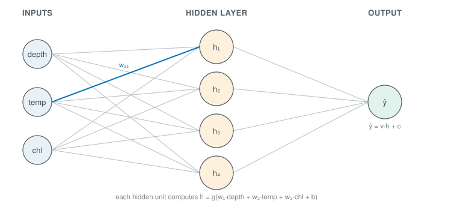

```{r}
#| label: setup
#| include: false
library(tidymodels)
library(tidyverse)
library(nnet)
library(patchwork)
source(here::here("R/theme.R"))
source(here::here("R/data.R"))
```

## A network is built from regressions

Neural networks sound like a new kind of method, but they are built from one you
already know. This page shows that a single neuron is linear regression, and that a
layer of neurons, each with a bend, can follow a temperature optimum that a straight
line misses, without being told what shape to look for. The next pages show how such a
network learns its weights.



## A neuron is a weighted sum and a bend

A **neuron** multiplies each input by a **weight**, adds the products and a constant
called the **bias**, and passes the total through an **activation function** $g$:

$$h = g(w_1 x_1 + w_2 x_2 + \dots + w_p x_p + b)$$

Without the activation, this is linear regression: the weights are the coefficients and
the bias is the intercept. With the logistic function as $g$, it is logistic regression.

A **hidden layer** is several neurons that read the same inputs. An output neuron adds
up their results, each with a weight of its own, to make the prediction. The layer is
hidden because nothing outside the network sees its values, and its neurons are called
**hidden units**. Inputs, one hidden layer and an output make the simplest **neural
network**.

::: {.diagram}
{#fig-schematic fig-alt="Three cards. One neuron, a regression: inputs x1 to x3, each multiplied by a weight w1 to w3, enter a circle that adds them and a bias and passes the total through an S-shaped bend to give the output; a weighted sum of the inputs plus a bias, through a bend; with no bend, it is linear regression. A hidden layer, several neurons: three inputs, each joined to four hidden units, each joined to one output; several neurons read the same inputs and the output adds them up; every arrow is a weight to fit. Bends add up to curves, the activation: a rising S-curve plus a falling S-curve equals a hump; opposing bends add up to a shape no straight line can follow; without the bend, it is still a line."}
:::

The bend is what makes a network more than a regression. A weighted sum of weighted
sums is still a weighted sum, so without a bend, any number of neurons and layers adds
up to one straight line. With a bend, a rising curve and a falling one can add up to a
hump, and many bends can follow almost any shape.

## Activation functions are bends

```{r}
#| label: fig-activations
#| fig-cap: "Four activation functions. The identity leaves the weighted sum as it is, so a network built on it stays a straight line. The other three bend."
#| fig-alt: "Four small line plots side by side over an input range of minus four to four. Identity is a straight diagonal line. Logistic is an S-curve rising from zero to one, centred at zero. Tanh is a similar S-curve rising from minus one to one. ReLU is flat at zero for negative inputs then rises as a straight diagonal for positive ones, giving a sharp corner at zero."
#| fig-width: 8.5
#| fig-height: 2.8
grid_z <- seq(-4, 4, length.out = 400)

tibble(z = rep(grid_z, 4),
       value = c(grid_z, plogis(grid_z), tanh(grid_z), pmax(grid_z, 0)),
       activation = rep(c("Identity", "Logistic", "Tanh", "ReLU"),
                        each = length(grid_z))) |>
  mutate(activation = fct_inorder(activation)) |>
  ggplot(aes(z, value)) +
  geom_hline(yintercept = 0, colour = "#c9d1d7", linewidth = 0.4) +
  geom_line(colour = ml_palette[["blue"]], linewidth = 0.9) +
  facet_wrap(~ activation, nrow = 1, scales = "free_y") +
  labs(x = "Weighted sum entering the neuron", y = NULL)
```

The **logistic** function and **tanh** are S-shaped: flat, rising, then flat again. They
differ only in range, zero to one against minus one to one. **ReLU** (rectified linear
unit) is flat below zero and a straight line above it; it is the usual choice in large
networks because it is quick to compute. The networks on this page are fitted with the
`nnet` package, whose hidden units use the logistic function.

## Worked example

We predict abundance on a log scale, $\log(1 + \text{abundance})$, so that a few large
catches do not dominate the fit. All inputs are standardised, as
[Gradient descent](../04-how-algorithms-learn/gradient-descent.qmd) recommends for any
model fitted by a walk.

### One neuron reproduces linear regression

A network with no hidden layer, its inputs wired straight to an output neuron with no
bend, should give the same answer as `lm()`.

```{r}
#| label: one-neuron
survey <- load_coastal_survey_clean()

d <- survey |>
  transmute(y           = log1p(abundance),
            depth       = as.numeric(scale(depth_m)),
            temperature = as.numeric(scale(temperature_c)),
            chlorophyll = as.numeric(scale(log1p(chlorophyll_mg_m3)))) |>
  drop_na()

linear <- lm(y ~ depth + temperature + chlorophyll, data = d)

# size = 0 and skip = TRUE: no hidden layer, inputs wired to the output.
# linout = TRUE: no bend on the output.
set.seed(1)
one_neuron <- nnet(y ~ depth + temperature + chlorophyll, data = d,
                   size = 0, skip = TRUE, linout = TRUE,
                   maxit = 2000, trace = FALSE)

tibble(Term = c("Intercept (bias)", "Depth", "Temperature", "Chlorophyll"),
       `Linear regression` = coef(linear),
       `One neuron` = as.numeric(coef(one_neuron)))
```

```{r}
#| label: one-neuron-numbers
#| include: false
largest_gap <- max(abs(coef(linear) - coef(one_neuron)))
```

The two sets of weights agree to `r floor(-log10(largest_gap))` decimal places: they are
the same model. `nnet` found its weights by a search rather than by the formula `lm()`
uses, and the search arrived at the same place.

### Two hidden units follow the temperature optimum

Abundance in this survey rises with temperature to a peak and falls beyond it. A straight
line cannot turn over. We fit networks with zero to ten hidden units on temperature
alone and compare how closely each follows the stations it was fitted to.

```{r}
#| label: temperature-sweep
temp_data <- survey |>
  transmute(y           = log1p(abundance),
            temperature = as.numeric(scale(temperature_c))) |>
  drop_na()

# Zero hidden units is linear regression. decay adds a small ridge penalty
# on the weights, which keeps the larger networks from following noise.
fit_units <- function(h) {
  set.seed(9)
  if (h == 0) {
    nnet(y ~ temperature, data = temp_data, size = 0, skip = TRUE,
         linout = TRUE, maxit = 2000, trace = FALSE)
  } else {
    nnet(y ~ temperature, data = temp_data, size = h, decay = 1e-4,
         linout = TRUE, maxit = 2000, trace = FALSE)
  }
}

sweep <- map_dfr(c(0, 1, 2, 3, 5, 10), \(h) {
  fit <- fit_units(h)
  fitted_y <- as.numeric(predict(fit, temp_data))
  tibble(`Hidden units` = h,
         Weights = length(coef(fit)),
         `Training RMSE` = round(sqrt(mean((temp_data$y - fitted_y)^2)), 3))
})
sweep
```

```{r}
#| label: sweep-numbers
#| include: false
rmse_at <- function(h) {
  format(sweep$`Training RMSE`[sweep$`Hidden units` == h], nsmall = 3)
}
```

`decay` is the ridge penalty of [Regularisation](../05-generalisation/regularisation.qmd),
applied to the network's weights. The training RMSE barely moves from zero hidden units
(`r rmse_at(0)`) to one (`r rmse_at(1)`), then drops to `r rmse_at(2)` with two. Three,
five and ten units add almost nothing more (`r rmse_at(10)` with ten).

```{r}
#| label: fig-hump
#| fig-cap: "Fitted temperature response with zero, one and two hidden units, over the stations' mean abundance in each one-degree bin. A straight line cannot turn over, and one bend cannot come back down; two can."
#| fig-alt: "A scatter of grey binned mean points forming a hump: about 0.3 at three and a half degrees, rising to a peak of about 1.6 between eight and nine degrees, then falling to about 0.65 at fourteen and a half. Three fitted lines are overlaid. The zero-unit line is straight and rises gently from about 1.0 on the left to about 1.4 on the right, passing through the hump without following it. The one-unit line is nearly flat at about 1.3 across most of the range, then bends down after about eleven degrees. The two-unit line climbs steeply from near zero at the left edge to a peak of about 1.65 just below nine degrees, then falls to about 0.4 at the right, following the binned points."
#| fig-width: 7.5
#| fig-height: 4.4
temp_mean <- mean(survey$temperature_c, na.rm = TRUE)
temp_sd   <- sd(survey$temperature_c, na.rm = TRUE)

grid <- tibble(temperature = seq(min(temp_data$temperature),
                                 max(temp_data$temperature),
                                 length.out = 300)) |>
  mutate(temperature_c = temperature * temp_sd + temp_mean)

curves <- map_dfr(c(0, 1, 2), \(h) {
  grid |> mutate(y = as.numeric(predict(fit_units(h), grid)),
                 units = factor(h))
})

binned <- survey |>
  drop_na(temperature_c) |>
  mutate(bin = cut(temperature_c, breaks = seq(2, 18, by = 1))) |>
  summarise(temperature_c = mean(temperature_c), y = mean(log1p(abundance)),
            n = n(), .by = bin) |>
  filter(n >= 10)

ggplot(curves, aes(temperature_c, y)) +
  geom_point(data = binned, colour = "#9aa5ad", size = 2.4) +
  geom_line(aes(colour = units), linewidth = 0.9) +
  labs(x = "Temperature (°C)", y = "log(1 + abundance)",
       colour = "Hidden units")
```

```{r}
#| label: hump-numbers
#| include: false
two_units <- curves |> filter(units == "2")
peak_c    <- two_units$temperature_c[which.max(two_units$y)]
top_bin   <- binned |> slice_max(y, n = 1)
top_low   <- floor(top_bin$temperature_c)
```

The two-unit network peaks at `r round(peak_c, 1)` °C, inside the
`r top_low`–`r top_low + 1` °C bin where the stations' mean abundance is highest. The
straight line rises gently instead, because the coldest stations hold fewer animals than
the warmest; it misses the optimum altogether.
[Linear and polynomial regression](../03-supervised-learning/linear-and-polynomial-regression.qmd)
found such a peak by adding the square of temperature as a column, which works once you
know which input to bend and how. The network was told neither: it found the shape from
the data with `r length(coef(fit_units(2)))` weights.

### A rising and a falling bend make the hump

Each hidden unit is one logistic bend in temperature, multiplied by its weight into the
output. Drawing the two separately shows how they make the hump.

```{r}
#| label: fig-bends
#| fig-cap: "The two-unit network taken apart. Top: each hidden unit's contribution to the prediction, its logistic bend times its weight into the output. Bottom: their sum plus the output bias, which is the network's prediction."
#| fig-alt: "Two stacked panels sharing a temperature axis from about three to sixteen degrees. Top: two S-shaped curves of opposite sign and similar size. Unit 1 rises from about minus five in cold water to near zero in warm water, mostly between four and ten degrees. Unit 2 falls from about plus five in cold water to near zero in warm water, a few degrees later, mostly between six and thirteen degrees. Bottom: their sum, a hump peaking at about 1.65 just below nine degrees, over the grey binned station means."
#| fig-width: 7.5
#| fig-height: 5.6
w <- coef(fit_units(2))

# Each unit: its weight into the output times its logistic bend.
unit_part <- function(k) {
  w[[paste0("h", k, "->o")]] *
    plogis(w[[paste0("b->h", k)]] + w[[paste0("i1->h", k)]] * grid$temperature)
}

parts <- grid |>
  mutate(`Unit 1` = unit_part(1),
         `Unit 2` = unit_part(2),
         Prediction = w[["b->o"]] + `Unit 1` + `Unit 2`)

top <- parts |>
  pivot_longer(c(`Unit 1`, `Unit 2`),
               names_to = "unit", values_to = "contribution") |>
  ggplot(aes(temperature_c, contribution, colour = unit)) +
  geom_hline(yintercept = 0, colour = "#c9d1d7", linewidth = 0.4) +
  geom_line(linewidth = 0.9) +
  scale_colour_manual(values = unname(ml_palette[c("blue", "vermilion")])) +
  labs(x = NULL, y = "Contribution", colour = NULL)

bottom <- ggplot(parts, aes(temperature_c, Prediction)) +
  geom_point(data = binned, aes(y = y), colour = "#9aa5ad", size = 2.4) +
  geom_line(linewidth = 0.9) +
  labs(x = "Temperature (°C)", y = "log(1 + abundance)")

top / bottom
```

```{r}
#| label: bend-numbers
#| include: false
out_w <- round(c(w[["h1->o"]], w[["h2->o"]]), 1)
```

Unit 1 enters the output with weight `r out_w[1]` and rises towards zero as the water
warms; unit 2 enters with weight `r out_w[2]` and falls towards zero, a few degrees
later. In cold water the two nearly cancel. Between their switches, unit 1 has already
risen while unit 2 has not yet fallen, and that gap is the hump. A network with more
hidden units builds more complex shapes the same way, by adding and subtracting bends
placed at different points.

## A network has many more weights than a regression

Every arrow in @fig-schematic is a weight, and every hidden and output neuron has a bias.
With $p$ inputs and $H$ hidden units, a network with one hidden layer has

$$(p + 1)H + H + 1$$

weights, against $p + 1$ for linear regression.

```{r}
#| label: weight-count
#| include: false
n_weights <- function(p, h) (p + 1) * h + h + 1
```

The network in the diagram, three inputs and four hidden units, has
`r n_weights(3, 4)` weights against `r 3 + 1` for linear regression; with ten inputs and
twenty hidden units it has `r n_weights(10, 20)`. That flexibility is what lets a network
find shapes nobody specified, and it is why networks are fitted with a penalty such as
`decay`. It also means a single weight has no meaning on its own, as a coefficient
does: the effect of temperature is spread across every unit it feeds.
[Feature importance](../10-interpretation/feature-importance.qmd) shows how to ask a
fitted network which inputs matter.

::: {.callout-note collapse="true"}
## The maths, if you want it
With $H$ hidden units, weights $W \in \mathbb{R}^{p \times H}$, hidden biases
$b \in \mathbb{R}^{H}$, output weights $v \in \mathbb{R}^{H}$ and output bias $c$, the
network computes

$$\hat y = v^{\top} g(W^{\top} x + b) + c$$

where $g$ is applied to each element. If $g$ is the identity this is
$\hat y = (Wv)^{\top} x + (v^{\top}b + c)$, a linear model with coefficients $Wv$, no
matter how large $H$ is.
:::

## Key points

::: {.key-points}
- A **neuron** is a weighted sum of its inputs plus a bias, passed through an
  **activation function**. With no bend it is linear regression; with the logistic
  function it is logistic regression.
- A **hidden layer** is several neurons reading the same inputs; the output adds up
  their results.
- **The activation's bend does the work.** Without it, any number of layers adds up to
  a straight line; with it, opposing bends add up to curves.
- Two hidden units, `r length(coef(fit_units(2)))` weights, found the temperature
  optimum without being told its shape. One unit was not enough, and more added little.
- Weights multiply quickly: inputs times hidden units. Networks are fitted with a
  penalty, and their weights are not read one by one.
:::

## Try it yourself

1. Refit the temperature sweep with `decay = 0`. How much does the ten-unit training
   RMSE improve, and what happens to the fitted curve between the binned points?
2. Replace `log1p(abundance)` with the `present` column coded as 0 and 1, and
   `linout = TRUE` with `entropy = TRUE`. Does one neuron with no hidden layer
   reproduce `glm(family = binomial)`?
