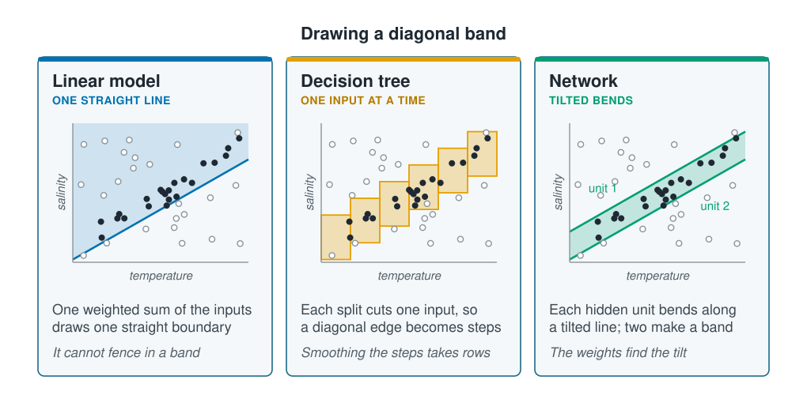

```{r}
#| label: setup
#| include: false
library(tidymodels)
library(tidyverse)
library(patchwork)
source(here::here("R/theme.R"))
source(here::here("R/data.R"))
f3 <- \(x) sprintf("%.3f", x)
```

## A network wins when the inputs work in combination

On the coastal survey's counts the random forest matched or beat the network, as [How
much data a network needs](how-much-data.qmd) showed. This page shows a problem where a
network wins clearly and names the property that makes it win, so you can look for that
property in your own data.

Sometimes what separates two classes is not any one input but a **combination** of them.
Oceanographers meet this on the **T–S diagram**, which plots temperature against salinity.
A water mass shows up on it as a diagonal band, because what identifies the water is how
temperature and salinity go together, not a threshold on either one.

The three kinds of model the course has fitted draw such a boundary in different ways. A
linear model such as logistic regression adds up its weighted inputs, so its boundary is
one straight line: it can say which side of the line a point lies, but not that it lies
between two lines. A decision tree splits on one input at a time, so every edge it draws
is horizontal or vertical, and a diagonal edge becomes a staircase. A hidden unit takes a
weighted sum of all its inputs before it bends ([Neurons, layers and
activations](what-a-network-is.qmd)), so its bend runs along a tilted line. Two opposing
bends leave a band between them, just as two bends made a hump in temperature on that page.

::: {.diagram}
{fig-alt="Three cards, each a scatter of temperature against salinity in which the filled points lie in a diagonal band and the open points lie outside it. Linear model, one straight line: a single blue line runs along the lower edge of the band and everything above it is shaded, open points included; one weighted sum of the inputs draws one straight boundary, and it cannot fence in a band. Decision tree, one input at a time: six orange rectangles step up along the band, covering it with some open points inside the steps; each split cuts one input, so a diagonal edge becomes steps, and smoothing the steps takes rows. Network, tilted bends: two parallel green lines labelled unit 1 and unit 2 run along the two edges of the band, with the band shaded between them; each hidden unit bends along a tilted line and two make a band, and the weights find the tilt."}
:::

## Worked example

We simulate a water mass rather than use the coastal survey, which has no structure of
this kind. Salinity rises with temperature across the stations, and a station belongs to
the water-mass **core** when its T–S point falls inside a narrow diagonal band.

```{r}
#| label: water-mass
make_water_mass <- function(n, seed) {
  set.seed(seed)
  temperature_c <- runif(n, 2, 16)
  salinity_psu  <- 33.0 + 0.10 * temperature_c + rnorm(n, 0, 0.45)
  in_core <- abs(salinity_psu - 33.0 - 0.16 * temperature_c + 0.32) < 0.30
  tibble(temperature_c, salinity_psu,
         water_mass = factor(if_else(in_core, "core", "outside"),
                             levels = c("core", "outside")))
}

train <- make_water_mass(200, seed = 1)
test  <- make_water_mass(2000, seed = 2)

mean(train$water_mass == "core")
```

`r nrow(train)` stations train the models and `r format(nrow(test), big.mark = ",")` test
them; `r round(100 * mean(train$water_mass == "core"))`% of the training stations are in
the core. Only two inputs are involved, and the band's edges are straight. The task is not
hard; it is just not lined up with either input.

### Two hidden units draw the diagonal band

Four models are fitted with their usual settings: logistic regression, a decision tree, a
500-tree random forest and a network with two hidden units, one for each edge of the
band.

```{r}
#| label: fit-four
water_recipe <- recipe(water_mass ~ temperature_c + salinity_psu,
                       data = train) |>
  step_normalize(all_numeric_predictors())

specs <- list(
  `Logistic regression` = logistic_reg(),
  `Decision tree`  = decision_tree(tree_depth = 8, min_n = 5) |>
    set_mode("classification"),
  `Random forest`  = rand_forest(trees = 500) |>
    set_engine("ranger", seed = 1) |>
    set_mode("classification"),
  `Neural network` = mlp(hidden_units = 2, penalty = 0.001, epochs = 800) |>
    set_engine("nnet") |>
    set_mode("classification")
)

fits <- map(specs, \(spec) {
  set.seed(5)
  fit(workflow(water_recipe, spec), train)
})

scores <- imap_dfr(fits, \(fitted, model) {
  scored <- augment(fitted, test)
  tibble(Model = model,
         `Test ROC AUC` = roc_auc_vec(test$water_mass, scored$.pred_core),
         `Test accuracy` = accuracy_vec(test$water_mass, scored$.pred_class))
})
scores |> mutate(across(where(is.numeric), \(x) round(x, 3)))
```

```{r}
#| label: four-numbers
#| include: false
auc <- set_names(scores$`Test ROC AUC`, scores$Model)
n_weights <- length(extract_fit_engine(fits$`Neural network`)$wts)
```

The ROC AUC, from [Classification performance
measures](../07-validation/classification-metrics.qmd), scores how well a model ranks
core stations above the rest, from 0.5 for guessing to 1 for a perfect ranking. Logistic
regression reaches `r f3(auc["Logistic regression"])`, the decision tree
`r f3(auc["Decision tree"])` and the random forest `r f3(auc["Random forest"])`. The
network, with **`r n_weights` weights**, reaches `r f3(auc["Neural network"])`.

```{r}
#| label: fig-boundaries
#| fig-cap: "What each model predicts over the whole temperature–salinity plane, fitted to the 200 training stations shown as points. Logistic regression draws one straight line, the tree and the forest draw steps, and the network draws the band."
#| fig-alt: "Four panels of temperature on the horizontal axis against salinity on the vertical, each shaded by the predicted class, core or outside, with the training stations drawn as filled points for core and crosses for outside. The core stations form a narrow diagonal band rising from low temperature and salinity to high. Logistic regression shades one side of a single straight line as core, a wedge that includes much of the plane outside the band. The decision tree shades a few large rectangles along the band and a strip across the top at high salinity. The random forest shades a band with ragged, stepped edges along the core stations, widening into a block across the top right at high salinity. The neural network shades a clean straight-edged diagonal band along the core stations."
#| fig-width: 9.5
#| fig-height: 7.2
plane <- expand_grid(
  temperature_c = seq(2, 16, length.out = 220),
  salinity_psu  = seq(min(train$salinity_psu), max(train$salinity_psu),
                      length.out = 220)
)

panels <- imap(fits, \(fitted, model) {
  plane |>
    mutate(predicted = predict(fitted, plane)$.pred_class) |>
    ggplot(aes(temperature_c, salinity_psu)) +
    geom_raster(aes(fill = predicted), alpha = 0.45) +
    geom_point(data = train, aes(shape = water_mass), size = 1.3) +
    scale_fill_ml(labels = str_to_sentence) +
    scale_shape_manual(values = c(core = 16, outside = 4),
                       labels = str_to_sentence) +
    labs(x = "Temperature (°C)", y = "Salinity (PSU)", subtitle = model,
         fill = "Predicted", shape = "Station")
})

wrap_plots(panels, nrow = 2) + plot_layout(guides = "collect")
```

The panels show the diagram's three boundaries on real fits. Logistic regression can only
call one side of its line core. The tree covers the band with a few large rectangles, and
the forest, averaging 500 trees, with many small steps that still leave ragged edges. The
network's two hidden units sit along the band's two edges.

### More stations help the forest but not logistic regression

A staircase gets closer to a diagonal as the steps get smaller, and smaller steps need more
stations. Each model is refitted on new training sets of three sizes and scored on the same
test stations.

```{r}
#| label: sizes
by_size <- map_dfr(c(100, 400, 1600), \(n) {
  training <- make_water_mass(n, seed = 10 + n)
  imap_dfr(specs, \(spec, model) {
    set.seed(5)
    fitted <- fit(workflow(water_recipe, spec), training)
    tibble(`Training stations` = n, model,
           auc = roc_auc_vec(test$water_mass,
                             augment(fitted, test)$.pred_core))
  })
})

by_size |>
  pivot_wider(names_from = model, values_from = auc) |>
  mutate(across(-`Training stations`, \(x) round(x, 3)))
```

```{r}
#| label: size-numbers
#| include: false
at_size <- \(n, m) f3(by_size$auc[by_size$`Training stations` == n &
                                    by_size$model == m])
```

The network reaches `r at_size(100, "Neural network")` with only 100 training stations.
The forest climbs from `r at_size(100, "Random forest")` to
`r at_size(1600, "Random forest")` as its steps shrink, and needs 1,600 stations to come
close. Logistic regression stays near `r at_size(1600, "Logistic regression")` at every
size: more stations cannot give it a second line.

### A named combination lets logistic regression match the network

An oceanographer who knows the slope of the band on the T–S diagram can hand that
combination to a simpler model as a new column. Building inputs from domain knowledge like
this is called **feature engineering**. A band is a range of the combination, so the
recipe adds its square too (`step_poly()`, as in [Linear and polynomial
regression](../03-supervised-learning/linear-and-polynomial-regression.qmd)).

```{r}
#| label: named-combination
named_recipe <- recipe(water_mass ~ temperature_c + salinity_psu,
                       data = train) |>
  step_mutate(combination = salinity_psu - 0.16 * temperature_c) |>
  step_rm(temperature_c, salinity_psu) |>
  step_normalize(combination) |>
  step_poly(combination, degree = 2, options = list(raw = TRUE))

# Run on its own, glm() warns here: the combination separates the two
# classes completely.
named_fit <- fit(workflow(named_recipe, logistic_reg()), train)
named_auc <- roc_auc_vec(test$water_mass,
                         augment(named_fit, test)$.pred_core)
round(named_auc, 3)
```

```{r}
#| label: named-numbers
#| include: false
n_coefficients <- c("one", "two", "three", "four")[nrow(tidy(named_fit))]
```

Run on its own, `glm()` warns that the fit did not converge and that some fitted
probabilities are 0 or 1. The combination separates core from outside completely, which [Finding the
parameters](../04-how-algorithms-learn/parameter-estimation.qmd#separation-leaves-no-lowest-point) calls **separation**: the coefficients
grow without limit, but the ranking is right. With the named combination, logistic
regression reaches a ROC AUC of `r f3(named_auc)` with `r n_coefficients` coefficients,
level with the network.

When you can name the combination, feature engineering beats a network: fewer coefficients,
and each one can be read. A network's value is that it finds combinations for you when
you cannot name them. That value grows with the number of inputs, because the number of
possible combinations grows with them.

## Look for combinations nobody can name

The same property explains why networks lead on images and sound. A single pixel means
little; an edge is a combination of neighbouring pixels, and a fish is a combination of
edges. Nobody can list those combinations, and there are millions of candidates.

**A network is worth trying when:**

- The inputs are raw and many, such as imagery, spectra, acoustic echoes or DNA sequences,
  and the useful features are combinations nobody can list. Much marine imaging work starts
  from a network already trained on millions of general images and retrains it on a few
  hundred of its own (**transfer learning**), which needs far fewer labelled examples.
- The response carries more signal than noise. On [How much data a network
  needs](how-much-data.qmd) the network learned the expected counts best, but the noise in
  the counts hid that gain.

**A forest or a simpler model is the better start when:**

- The data are a table of a few hundred rows of ecological covariates with a noisy
  response, as on the coastal survey, where the random forest led.
- You need to report effects or repeat a result exactly. A network's weights mean little
  one by one, and its random start changes the result between runs; [Feature
  importance](../10-interpretation/feature-importance.qmd) works on its predictions
  instead.

Real water masses are curved and overlap, and there a forest closes much of the gap; the
straight band makes the mechanism easy to see. The networks in this section have one small
hidden layer. The networks behind marine image analysis are far larger, but they win for
the same reason.

::: {.callout-note collapse="true"}
## The maths, if you want it

A hidden unit computes $h = g(w_1 T + w_2 S + b)$ from temperature $T$ and salinity $S$.
It takes the same value everywhere along a line $w_1 T + w_2 S = c$, so its bend runs
across the plane along a tilted line whose slope is set by $w_1$ and $w_2$. A network with
two hidden units predicts $\sigma(v_1 h_1 + v_2 h_2 + b_0)$. If both units share the same
tilt, with their bends at two different values of $c$ and $v_1$, $v_2$ of opposite sign,
the sum is high only between the two lines: a band. A tree's split $T < t$ or $S < s$ is
the special case $w_2 = 0$ or $w_1 = 0$, which is why it can only cut along the axes.
:::

## Key points

::: {.key-points}
- A network wins when what matters is a **combination of the inputs** that nobody has
  named, such as a water mass's diagonal band on a T–S diagram.
- A **hidden unit bends along a tilted line**, so two of them can fence in a band.
  Logistic regression draws one straight line, and a tree cuts one input at a time.
- On the simulated band, a network with `r n_weights` weights reached a ROC AUC of
  `r f3(auc["Neural network"])` from `r nrow(train)` stations, where the random forest
  reached `r f3(auc["Random forest"])`.
- If you can name the combination, add it as a column (**feature engineering**):
  logistic regression then matches the network.
- Start with a forest for a few hundred rows of noisy ecological covariates; try a network
  for raw, many-input data such as images, spectra and sound.
:::

## Try it yourself

1. Set `hidden_units = 1` in the network. What can one tilted bend draw, and how does its
   ROC AUC compare with logistic regression's?
2. Curve the band: in `make_water_mass()`, replace `0.16 * temperature_c` with a quadratic
   in temperature and refit all four models. Does the network keep its lead, and does the
   forest close the gap?
