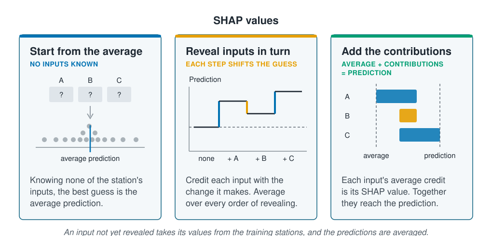

```{r}
#| label: setup
#| include: false
library(tidymodels)
library(tidyverse)
library(patchwork)
library(kernelshap)
source(here::here("R/theme.R"))
source(here::here("R/data.R"))
source(here::here("R/python-tabs.R"))
set.seed(123)
```



## One prediction needs its own explanation

[Feature importance](feature-importance.qmd) and [partial effects](partial-effects.qmd)
describe a model over every station at once. Often the question is about one station:
a manager asks what makes the model predict many animals at a proposed monitoring
site, or a reviewer wants to check a prediction that looks too high. The answer has
to say which of that station's inputs moved its prediction, and by how much. This
page splits one prediction into a share for each input.





## SHAP values share a prediction out among the inputs

Imagine revealing a station's inputs to the model one at a time. Knowing none of
them, its best guess is its average prediction over the training stations. Each
input revealed moves the prediction up or down, and that move is credited to the
input. The credit depends on the order: temperature revealed first may move the
prediction more than temperature revealed after season, which carries some of the
same information. So the moves are averaged over every order of revealing. An
input's average move is its **SHAP value**, named after Shapley values, a way of
sharing out a team's winnings fairly among its players.

::: {.diagram}
{fig-alt="Three cards. Start from the average, no inputs known: three cells for inputs A, B and C, each showing a question mark, above a row of grey dots for the training stations' predictions with a blue line at their average. Reveal inputs in turn, each step shifts the guess: a step line that starts at a dashed average level, steps up when A is revealed, down a little when B is revealed and up again when C is revealed. Add the contributions, average plus contributions equals prediction: a bar for each input running from a dashed line at the average to a dashed line at the prediction, A and C blue and pointing right, B orange and pointing left. A note says that an input not yet revealed takes its values from the training stations, and the predictions are averaged."}
:::

A model cannot leave an input blank, so an input not yet revealed takes each
training station's value in turn, and the predictions are averaged. Because every
order ends with all the inputs revealed, the SHAP values add up exactly: the average
prediction plus every input's SHAP value equals the station's prediction. A positive
value lifts the prediction above the average and a negative one pulls it below.

## Worked example

A random forest of 500 trees, as in [Feature importance](feature-importance.qmd),
predicts abundance from six inputs and is fitted to the training sites of the same
split by site. Two of the test stations are explained: one the forest predicts many
animals for and one it predicts few for.

### Preparing the data

::: {.panel-tabset group="language"}

## R

```{r}
#| label: prepare
survey <- load_coastal_survey_clean()

inputs <- c("depth_m", "temperature_c", "chlorophyll_mg_m3", "salinity_psu",
            "substrate", "season")

split <- group_initial_split(survey, group = site_id, prop = 0.75)
train <- training(split)
test <- testing(split)

forest_recipe <- recipe(reformulate(inputs, "abundance"), data = train) |>
  step_impute_median(all_numeric_predictors())
forest_model <- rand_forest(trees = 500) |>
  set_engine("ranger", seed = 123) |>
  set_mode("regression")

forest <- workflow(forest_recipe, forest_model) |> fit(train)
```

## Python

```{python}
import numpy as np
import pandas as pd
import shap
from sklearn.compose import ColumnTransformer
from sklearn.ensemble import RandomForestRegressor
from sklearn.impute import SimpleImputer
from sklearn.model_selection import GroupShuffleSplit
from sklearn.pipeline import Pipeline
from sklearn.preprocessing import OneHotEncoder

from mlbasic_data import load_coastal_survey_clean

survey = load_coastal_survey_clean()

grouper = GroupShuffleSplit(n_splits=1, train_size=0.75, random_state=123)
train_rows, test_rows = next(grouper.split(survey,
                                           groups=survey["site_id"]))
train = survey.iloc[train_rows].reset_index(drop=True)
test = survey.iloc[test_rows].reset_index(drop=True)

numeric = ["depth_m", "temperature_c", "chlorophyll_mg_m3", "salinity_psu"]
categorical = ["substrate", "season"]
inputs = numeric + categorical

recipe = ColumnTransformer(
    [("numeric", SimpleImputer(strategy="median"), numeric),
     ("categorical", OneHotEncoder(drop="first", sparse_output=False),
      categorical)])
# max_features and min_samples_leaf match ranger's defaults
model = RandomForestRegressor(n_estimators=500, max_features="sqrt",
                              min_samples_leaf=5, random_state=123)
forest = Pipeline([("recipe", recipe), ("model", model)]).fit(
    train[inputs], train["abundance"])
```

:::

### Shallow water lifts one station and warm water sinks another

The high station is the test station whose prediction is above 90% of the others',
and the low station the one whose prediction is above only 10%. With six inputs there
are few enough orders to average over all of them, so the SHAP values are exact.

::: {.panel-tabset group="language"}

## R

```{r}
#| label: explain
test$.pred <- predict(forest, test)$.pred

# the test stations whose predictions sit nearest the 90th and 10th
# percentiles: one predicted high, one predicted low
nearest <- \(p) which.min(abs(test$.pred - quantile(test$.pred, p)))
chosen <- test[c(nearest(0.9), nearest(0.1)), ]

# SHAP values for the two stations; an input not yet revealed takes each
# training station's value, and the predictions are averaged
explained <- kernelshap(forest, X = chosen[inputs], bg_X = train[inputs],
                        pred_fun = \(fitted, x) predict(fitted, x)$.pred,
                        verbose = FALSE)

# each station's inputs as recorded, beside their SHAP values
shown <- \(row) map_chr(inputs, \(x) {
  value <- row[[x]]
  if (is.numeric(value)) format(round(value, 1), nsmall = 1) else as.character(value)
})
tibble(Input = c(inputs, "Average prediction", "Prediction"),
       `High: value` = c(shown(chosen[1, ]), "", ""),
       `High: SHAP` = c(explained$S[1, ], explained$baseline, chosen$.pred[1]),
       `Low: value` = c(shown(chosen[2, ]), "", ""),
       `Low: SHAP` = c(explained$S[2, ], explained$baseline, chosen$.pred[2])) |>
  mutate(across(where(is.numeric), \(x) round(x, 2)))
```

## Python

```{python}
predicted = forest.predict(test[inputs])

# the test stations whose predictions sit nearest the 90th and 10th
# percentiles: one predicted high, one predicted low
nearest = lambda p: np.abs(predicted - np.quantile(predicted, p)).argmin()
chosen = test.iloc[[nearest(0.9), nearest(0.1)]]

# TreeExplainer computes exact SHAP values from the trees; an input not yet
# revealed takes each training station's value
explainer = shap.TreeExplainer(
    forest["model"], data=forest["recipe"].transform(train[inputs]),
    feature_perturbation="interventional")
values = explainer.shap_values(forest["recipe"].transform(chosen[inputs]))

# add the one-hot columns of substrate and season back into one value each
columns = [next(x for x in inputs if name.split("__")[1].startswith(x))
           for name in forest["recipe"].get_feature_names_out()]
values = pd.DataFrame(values, columns=columns).T.groupby(level=0, sort=False).sum()

rows = inputs + ["Average prediction", "Prediction"]
shown = lambda row: [f"{v:.1f}" if isinstance(v, float) else v for v in row[inputs]]
pd.DataFrame({
    "Input": rows,
    "High: value": shown(chosen.iloc[0]) + ["", ""],
    "High: SHAP": list(values[0]) + [explainer.expected_value, predicted[nearest(0.9)]],
    "Low: value": shown(chosen.iloc[1]) + ["", ""],
    "Low: SHAP": list(values[1]) + [explainer.expected_value, predicted[nearest(0.1)]],
}).round(2)
```

:::

```{r}
#| label: explain-numbers
#| include: false
two <- \(x) format(round(x, 2), nsmall = 2)
one <- \(x) format(round(x, 1), nsmall = 1)
average <- explained$baseline
high <- set_names(explained$S[1, ], inputs)
low <- set_names(explained$S[2, ], inputs)

names_of <- c(depth_m = "Depth", temperature_c = "Temperature",
              chlorophyll_mg_m3 = "Chlorophyll", salinity_psu = "Salinity",
              substrate = "Substrate", season = "Season")
units_of <- c(depth_m = " m", temperature_c = " °C", chlorophyll_mg_m3 = " mg/m³",
              salinity_psu = "", substrate = "", season = "")

# "depth up 0.95, ..., substrate down 0.49", largest first, for the alt text
describe <- \(shap) {
  shap <- shap[order(-abs(shap))]
  paste0(str_to_lower(names_of[names(shap)]), if_else(shap > 0, " up ", " down "),
         two(abs(shap)), collapse = ", ")
}
```

```{r}
#| label: fig-waterfall
#| fig-cap: "SHAP values for the two test stations. Each bar starts where the one above it ends, from the forest's average prediction (left dashed line) to the station's prediction (right dashed line); blue bars lift the prediction and orange bars pull it down, by the SHAP value printed on the right. Each input is labelled with its value at the station."
#| fig-alt: !expr 'glue::glue("Two panels of horizontal bars, one bar per input, sharing a horizontal axis of predicted count. Each bar starts where the one above ends. Top, the high station: from the average prediction of {two(average)} the bars step {describe(high)}, ending at the prediction of {two(chosen$.pred[1])}. Bottom, the low station: from the same average they step {describe(low)}, ending at the prediction of {two(chosen$.pred[2])}.")'
#| fig-width: 8
#| fig-height: 6
waterfall <- function(row, title) {
  station <- chosen[row, ]
  steps <- tibble(input = inputs, shap = explained$S[row, ]) |>
    arrange(desc(abs(shap))) |>
    mutate(end = average + cumsum(shap), start = lag(end, default = average),
           label = paste0(names_of[input], " = ", shown(station)[match(input, inputs)],
                          units_of[input]),
           label = fct_rev(fct_inorder(label)),
           direction = if_else(shap > 0, "lifts", "pulls down"))
  ggplot(steps, aes(y = label)) +
    geom_vline(xintercept = c(average, station$.pred), linetype = "dashed",
               colour = ml_palette[["grey"]]) +
    geom_segment(aes(x = start, xend = end, yend = label, colour = direction),
                 linewidth = 7) +
    # each bar's SHAP value, in a column at the right
    geom_text(aes(x = 8.6, label = sprintf("%+.2f", shap), colour = direction),
              hjust = 1, size = 3.6) +
    scale_colour_manual(values = c(lifts = ml_palette[["blue"]],
                                   `pulls down` = ml_palette[["orange"]]),
                        guide = "none") +
    scale_x_continuous(limits = c(0, 8.6), breaks = seq(0, 8, 2)) +
    labs(title = title, x = "Predicted count (individuals)", y = NULL)
}

waterfall(1, glue::glue("High station: prediction {two(chosen$.pred[1])}")) /
  waterfall(2, glue::glue("Low station: prediction {two(chosen$.pred[2])}"))
```

The forest's average prediction over the training stations is `r two(average)`
individuals. At the high station, `r one(chosen$depth_m[1])` m deep, depth lifts the
prediction by `r two(high[["depth_m"]])`, and chlorophyll, temperature and salinity
add `r two(high[["chlorophyll_mg_m3"]] + high[["temperature_c"]] + high[["salinity_psu"]])`
between them; its `r chosen$substrate[1]` substrate pulls it down by `r two(-high[["substrate"]])`, ending at
`r two(chosen$.pred[1])`. The low station is in water of
`r one(chosen$temperature_c[2])` °C in `r chosen$season[2]`, and temperature alone
pulls its prediction down by `r two(-low[["temperature_c"]])`. Season, which carries
some of the same information, takes off another `r two(-low[["season"]])`, and
chlorophyll `r two(-low[["chlorophyll_mg_m3"]])`, ending at `r two(chosen$.pred[2])`.
Each station's bars add up exactly from the average to its prediction.

The same input can play different parts at different stations. Temperature lifts
one prediction and sinks the other, because the high station's water, at
`r one(chosen$temperature_c[1])` °C, lies on the hump in
[Partial effects](partial-effects.qmd), and the low station's lies beyond its warm
side.

## A SHAP value explains the prediction, not whether it is right

Chlorophyll lifts the high station's prediction by
`r two(high[["chlorophyll_mg_m3"]])` and pulls the low station's down by
`r two(-low[["chlorophyll_mg_m3"]])`, yet in [Feature importance](feature-importance.qmd)
shuffling it barely changed the forest's test error. The two measure different things. A SHAP value says what a prediction
rests on, whether or not the prediction is accurate; permutation importance says how
much the accuracy rests on an input. The forest uses chlorophyll in its predictions,
but its test error hardly depends on it. Like
the other tools in this section, SHAP values describe the model, not the species.
[Interpretable models and surrogates](interpretable-models.qmd) turns to models whose
parts can be read directly.

## Key points

::: {.key-points}
- A **SHAP value** is one input's share of one prediction: the change it makes when
  revealed, averaged over every order of revealing the inputs.
- The average prediction plus every input's SHAP value equals the prediction, so the
  values say exactly where a prediction comes from.
- An input not yet revealed takes the training stations' values in turn, and the
  predictions are averaged; this works for any model.
- On the survey, depth lifted the forest's prediction at a shallow station, and warm
  summer water pulled it down at another.
- A SHAP value explains a prediction, not whether it is right; permutation importance
  measures what the accuracy depends on.
:::

## Try it yourself

1. Explain the test station with the highest prediction. Which input lifts it most,
   and is its value common in the survey?
2. Explain the high station again, with only 50 training stations to fill in the
   inputs not yet revealed. How much do its SHAP values change?
