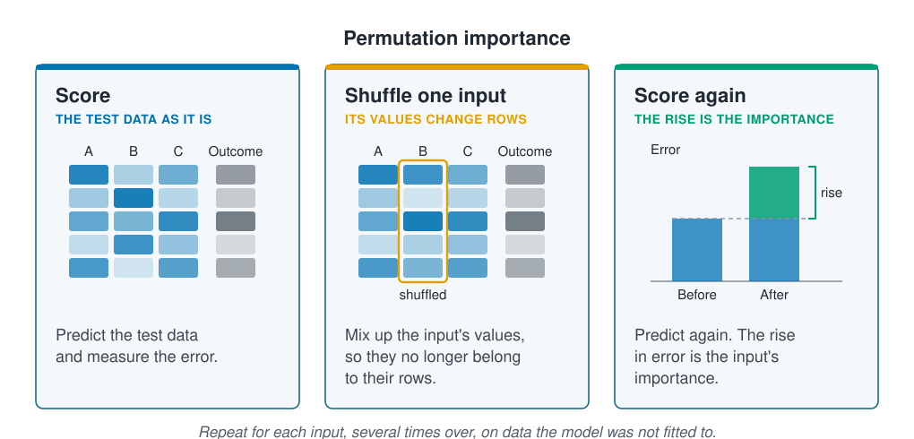

```{r}
#| label: setup
#| include: false
library(tidymodels)
library(tidyverse)
source(here::here("R/theme.R"))
source(here::here("R/data.R"))
source(here::here("R/python-tabs.R"))
set.seed(123)
```

## Importance scores say which inputs a model relies on

A linear model shows how much each input matters through its coefficients: one number
for each input, in the outcome's units. A random forest averages hundreds of trees and
has no such numbers. **Feature importance** gives every input a score for how much a
fitted model relies on it, and works for any model. This page measures it in two ways,
adds columns of random numbers to show what an unused input scores, and repeats the
measurement to find the scores that hold.





## Permutation importance shuffles an input and measures the rise in error

**Permutation importance** works on any fitted model. Predict the test data and
measure the error, here the
[RMSE](../01-introduction/what-is-machine-learning.qmd). Then shuffle one input: mix up
its values, so each row gets another row's value. The input's values are all still
there, but they no longer belong to their rows. If the model relied on that input, its
predictions get worse and the error rises; if it did not, the error stays about the
same. The rise is the input's importance.

::: {.diagram}
{fig-alt="Three cards. Score, the test data as it is: a small table with inputs A, B and C and an outcome column, each cell shaded, and the text predict the test data and measure the error. Shuffle one input, its values change rows: the same table with column B outlined in orange and its shades in a different order, labelled shuffled, and the text mix up the input's values, so they no longer belong to their rows. Score again, the rise is the importance: two error bars, before and after, with the after bar taller and the extra part marked as the rise. A note says repeat for each input, several times over, on data the model was not fitted to."}
:::

Shuffling is random, so it is repeated several times and the rises are averaged. It
is done on test data, so the score is about predicting new sites. A category such as
substrate is shuffled as one column, so it gets one score.

## Impurity importance scores inputs by a forest's own splits

A random forest has a quicker measure built in. Each split in a tree is chosen to lower
the squared errors on the training data, as in
[Decision trees](../03-supervised-learning/decision-trees.qmd). **Impurity importance**
adds up how much each input's splits lowered them, over every tree in the forest. It
comes free with the fit, but it is measured on the training data, which the trees have
already fitted, so it also credits splits that only fitted noise.

## Random columns show what an unused input scores

An importance score has no natural zero, and every input gets some score. Columns of
random numbers, unrelated to anything in the data, give a reference: they are added as
extra inputs, and an input that scores no higher than they do is used no more than
noise. [Choosing the number of clusters](../08-unsupervised-learning/choosing-the-number-of-clusters.qmd)
made the same move, shuffling the data to see what no groups would score.

## Worked example

A random forest of 500 trees, as in
[Random forests and boosting](../03-supervised-learning/forests-and-boosting.qmd),
predicts abundance from the six inputs of
[Regression for counts](../03-supervised-learning/count-regression.qmd) and three
columns of random numbers. The two measures are compared on one split by site, then
permutation importance is repeated on ten.

### Preparing the data

The random columns are drawn before the split, and the ten extra splits straight after
it.

::: {.panel-tabset group="language"}

## R

```{r}
#| label: prepare
survey <- load_coastal_survey_clean()

inputs <- c("depth_m", "temperature_c", "chlorophyll_mg_m3", "salinity_psu",
            "substrate", "season")

# three columns of random numbers, unrelated to anything in the survey
modelling <- survey |>
  select(site_id, abundance, all_of(inputs)) |>
  mutate(random_1 = rnorm(n()), random_2 = rnorm(n()), random_3 = rnorm(n()))

split <- group_initial_split(modelling, group = site_id, prop = 0.75)
train <- training(split)
test  <- testing(split)
splits <- group_mc_cv(modelling, group = site_id, prop = 0.75, times = 10)

forest_recipe <- recipe(abundance ~ ., data = train) |>
  update_role(site_id, new_role = "site") |>
  step_impute_median(all_numeric_predictors()) |>
  step_dummy(all_nominal_predictors())

forest_model <- rand_forest(trees = 500) |>
  set_engine("ranger", seed = 123, importance = "impurity") |>
  set_mode("regression")
```

## Python

```{python}
import numpy as np
import pandas as pd
from sklearn.compose import ColumnTransformer
from sklearn.ensemble import RandomForestRegressor
from sklearn.impute import SimpleImputer
from sklearn.inspection import permutation_importance
from sklearn.model_selection import GroupShuffleSplit
from sklearn.pipeline import Pipeline
from sklearn.preprocessing import OneHotEncoder

from mlbasic_data import load_coastal_survey_clean

survey = load_coastal_survey_clean()

# three columns of random numbers, unrelated to anything in the survey
rng = np.random.default_rng(123)
for i in (1, 2, 3):
    survey[f"random_{i}"] = rng.standard_normal(len(survey))

numeric = ["depth_m", "temperature_c", "chlorophyll_mg_m3", "salinity_psu",
           "random_1", "random_2", "random_3"]
categorical = ["substrate", "season"]
predictors = numeric + categorical

grouper = GroupShuffleSplit(n_splits=11, train_size=0.75, random_state=123)
first, *ten = grouper.split(survey, groups=survey["site_id"])
train = survey.iloc[first[0]]
test = survey.iloc[first[1]]

def new_forest():
    recipe = ColumnTransformer(
        [("numeric", SimpleImputer(strategy="median"), numeric),
         ("categorical", OneHotEncoder(drop="first", sparse_output=False),
          categorical)],
        verbose_feature_names_out=False)
    # max_features and min_samples_leaf match ranger's defaults
    model = RandomForestRegressor(n_estimators=500, max_features="sqrt",
                                  min_samples_leaf=5, random_state=123)
    return Pipeline([("recipe", recipe), ("model", model)])
```

:::

### Impurity importance ranks random numbers above the seabed

The forest is fitted to the training sites, and its impurity importance is divided by
the largest, so the top input scores 1. The recipe turns substrate and season into one
column for each level but the first, so each level gets its own score.

::: {.panel-tabset group="language"}

## R

```{r}
#| label: impurity
forest <- workflow(forest_recipe, forest_model) |> fit(train)

impurity <- extract_fit_engine(forest)$variable.importance
impurity_table <- tibble(input = names(impurity),
                         importance = impurity / max(impurity)) |>
  mutate(input = str_replace(input, "^(substrate|season)_", "\\1: ")) |>
  arrange(desc(importance))

impurity_table |> mutate(importance = round(importance, 2))
```

## Python

```{python}
forest = new_forest().fit(train[predictors], train["abundance"])

# feature_importances_ is impurity importance, scaled to sum to 1
impurity = pd.Series(forest["model"].feature_importances_,
                     index=forest["recipe"].get_feature_names_out())
impurity.index = impurity.index.str.replace(r"^(substrate|season)_", r"\1: ",
                                            regex=True)

(impurity.div(impurity.max())
    .sort_values(ascending=False)
    .round(2)
    .rename_axis("input")
    .reset_index(name="importance"))
```

:::

```{r}
#| label: impurity-numbers
#| include: false
impurity_rank <- impurity_table |> mutate(rank = row_number())
random_rank <- impurity_rank |>
  filter(str_starts(input, "random")) |>
  pull(rank)
below_random <- impurity_rank |>
  filter(!str_starts(input, "random"), rank > max(random_rank))
```

The three random columns rank `r min(random_rank)` to `r max(random_rank)` of
`r nrow(impurity_table)`. Below them come `r nrow(below_random)` real columns:
salinity and every level of substrate and season. A column of numbers drawn at random
looks more useful to the forest than the seabed.

This follows from how trees choose splits. A random column has a different value at
every station, so a tree can try hundreds of places to split it, and on the training
data some of them lower the error by chance. A level of substrate offers a single
split. Impurity importance favours inputs with many values, and the random columns
show by how much.

### On one split's test sites only temperature and the seabed beat the random columns

Each input is shuffled 20 times on the test sites, and its importance is the average
rise in RMSE. Substrate and season are shuffled as whole columns, before the recipe
turns them into levels.

::: {.panel-tabset group="language"}

## R

```{r}
#| label: shuffle
# the rise in test RMSE when an input is shuffled, averaged over the shuffles
shuffle_importance <- function(fitted, data, repeats = 10) {
  error <- \(d) rmse_vec(d$abundance, predict(fitted, d)$.pred)
  before <- error(data)
  columns <- setdiff(names(data), c("site_id", "abundance"))
  map(columns, \(input) {
    rises <- map_dbl(seq_len(repeats), \(i) {
      shuffled <- data
      shuffled[[input]] <- sample(shuffled[[input]])
      error(shuffled) - before
    })
    tibble(input, rise = mean(rises))
  }) |>
    list_rbind()
}

one_split <- shuffle_importance(forest, test, repeats = 20)
one_split |> arrange(desc(rise)) |> mutate(rise = round(rise, 3))
```

## Python

```{python}
# permutation_importance shuffles each column of test[predictors], so
# substrate and season are shuffled whole, before the recipe. Its score is
# minus the RMSE, so a rise in error is a positive importance.
def shuffle_importance(fitted, data, repeats=10):
    result = permutation_importance(
        fitted, data[predictors], data["abundance"], n_repeats=repeats,
        random_state=123, scoring="neg_root_mean_squared_error")
    return pd.DataFrame({"input": predictors,
                         "rise": result.importances_mean})

one_split = shuffle_importance(forest, test, repeats=20)
(one_split.sort_values("rise", ascending=False)
    .round(3)
    .reset_index(drop=True))
```

:::

```{r}
#| label: shuffle-numbers
#| include: false
three <- \(x) format(round(x, 3), nsmall = 3)
single <- deframe(one_split)
single_random <- max(single[str_starts(names(single), "random")])
input_names <- c(depth_m = "depth", temperature_c = "temperature",
                 chlorophyll_mg_m3 = "chlorophyll", salinity_psu = "salinity",
                 substrate = "substrate", season = "season")
real <- single[names(input_names)]
below_zero <- input_names[names(real)[real < 0]]
```

Shuffling temperature raises the RMSE by `r three(single[["temperature_c"]])`
individuals and shuffling substrate by `r three(single[["substrate"]])`. Every other
input scores less than the best of the random columns, `r three(single_random)`, and
`r knitr::combine_words(below_zero, oxford_comma = FALSE)` score below zero: on these test sites, the
forest predicted slightly better with them shuffled. This split held back
`r n_distinct(test$site_id)` sites, and on so few, chance can outweigh what the
forest learned from an input. Repeating the whole measurement on other splits shows
which scores hold.

### Ten splits show which inputs beat the random columns again and again

The forest is refitted on each of the ten splits, and each input is shuffled 10 times
on its test sites. On each split, an input either beats all three random columns or
it does not.

::: {.panel-tabset group="language"}

## R

```{r}
#| label: ten-splits
importance_on_split <- function(one) {
  fitted <- workflow(forest_recipe, forest_model) |> fit(training(one))
  shuffle_importance(fitted, testing(one))
}

repeated <- map(splits$splits, importance_on_split) |>
  list_rbind(names_to = "split") |>
  mutate(random_top = max(rise[str_starts(input, "random")]), .by = split)

beats <- repeated |>
  filter(!str_starts(input, "random")) |>
  summarise(splits_above_random = sum(rise > random_top),
            median_rise = median(rise), .by = input) |>
  arrange(desc(median_rise))

beats |> mutate(median_rise = round(median_rise, 3))
```

## Python

```{python}
rows = []
for number, (train_rows, test_rows) in enumerate(ten, start=1):
    part = survey.iloc[train_rows]
    fitted = new_forest().fit(part[predictors], part["abundance"])
    scores = shuffle_importance(fitted, survey.iloc[test_rows])
    random = scores["input"].str.startswith("random")
    scores["random_top"] = scores.loc[random, "rise"].max()
    rows.append(scores.assign(split=number))
repeated = pd.concat(rows, ignore_index=True)

real = repeated[~repeated["input"].str.startswith("random")]
(real.assign(above=real["rise"] > real["random_top"])
    .groupby("input")
    .agg(splits_above_random=("above", "sum"),
         median_rise=("rise", "median"))
    .sort_values("median_rise", ascending=False)
    .round(3)
    .reset_index())
```

:::

```{r}
#| label: fig-ten-splits
#| fig-cap: "Permutation importance on the test sites of ten splits by site, one point for each split. The random columns (grey) score close to zero; temperature scores well above them on every split, and the other inputs spread from below zero to well above the random columns."
#| fig-alt: "A dot plot with one row for each input and ten points per row, the rise in test RMSE on the horizontal axis. Temperature's points lie far to the right of all others. Chlorophyll, depth, substrate and season have points spread from around zero to well right of the random columns. Salinity's points sit among the three rows of random columns, which cluster around zero."
#| fig-width: 7.5
#| fig-height: 4.5
labels <- c(input_names, random_1 = "random 1", random_2 = "random 2",
            random_3 = "random 3")

repeated |>
  mutate(kind = if_else(str_starts(input, "random"), "Random column", "Input"),
         input = str_to_sentence(labels[input]),
         input = fct_reorder(input, rise, .fun = median)) |>
  ggplot(aes(rise, input, colour = kind)) +
  geom_vline(xintercept = 0, colour = ml_palette[["grey"]], linewidth = 0.4) +
  geom_point(size = 2.4, alpha = 0.7) +
  scale_colour_manual(values = c(Input = ml_palette[["blue"]],
                                 "Random column" = ml_palette[["grey"]])) +
  labs(x = "Rise in test RMSE when shuffled (individuals)", y = NULL,
       colour = NULL)
```

```{r}
#| label: ten-numbers
#| include: false
above <- deframe(select(beats, input, splits_above_random))
n_splits <- nrow(splits)
every <- \(k) {
  if (k == n_splits) paste("all", k) else paste(k, "of the", n_splits)
}
often <- above[names(above) %in% c("depth_m", "chlorophyll_mg_m3", "substrate")]
```

Temperature beats the random columns on `r every(above[["temperature_c"]])`
splits. Chlorophyll, depth and substrate beat them on
`r min(often)` to `r max(often)`, season on `r above[["season"]]` and salinity on
`r above[["salinity_psu"]]`. The split above was an unlucky one for chlorophyll and
depth, which most splits put clearly above the random columns, as @fig-ten-splits
shows.

A ranking from one split moves around; the count of splits on which an input beats the
random columns is steadier, and it is the number worth reporting.

## Importance shows what a model uses, not what the species needs

A high score means the fitted model leans on that input to predict. A low score means
the model managed without it, which can happen because another input carries the same
information: on the survey, deeper water is colder, saltier and lower in chlorophyll,
so a forest that has one of them can do without much of the others. Scores also say nothing about
the direction or shape of an effect, whether abundance rises or falls with depth.
[Partial effects](partial-effects.qmd) draws that shape.

## Key points

::: {.key-points}
- **Feature importance** scores how much a fitted model relies on each input, for any
  model.
- **Permutation importance** shuffles one input on test data and measures the rise in
  error. A forest's built-in **impurity importance** is measured on the training data
  and favours inputs with many values: on the survey it ranked three columns of random
  numbers above the seabed.
- **Columns of random numbers** show what an unused input scores. An input that does
  not beat them is used no more than noise.
- One split's test sites can mislead. **Repeat on several splits** and report how
  often each input beats the random columns.
- A score says what the model uses, not the direction of an effect or its cause.
:::

## Try it yourself

1. Swap the random forest for boosted trees (`boost_tree()` with the `xgboost`
   engine) and repeat the ten splits. Do the same inputs beat the random columns?
2. Leave `depth_m` out of the inputs and repeat the ten splits. Does chlorophyll or
   temperature score higher without it?
