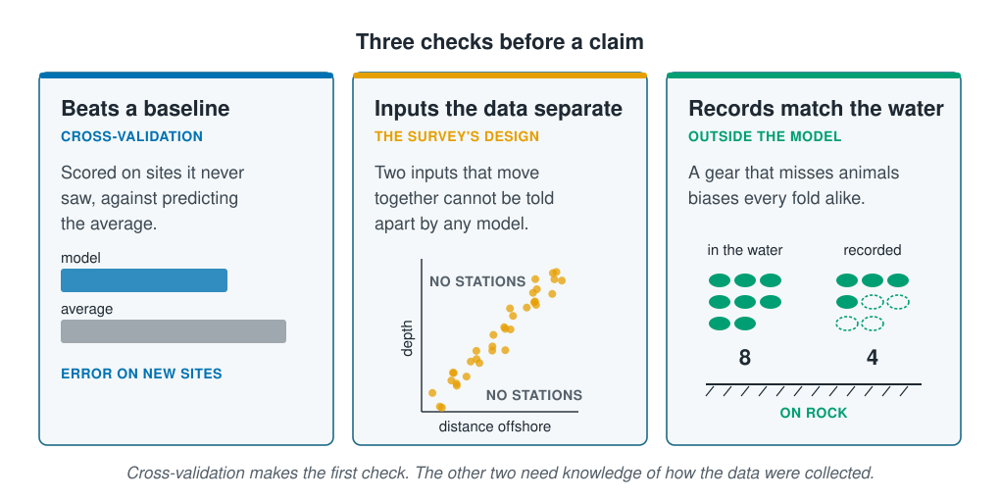

```{r}
#| label: setup
#| include: false
library(tidymodels)
library(tidyverse)
source(here::here("R/theme.R"))
source(here::here("R/data.R"))
source(here::here("R/python-tabs.R"))
set.seed(123)
```

## A claim puts a model's numbers into words

A study ends in sentences: a **Methods** paragraph that says what was done and a
**Results** paragraph that says what was found. Each sentence is a **claim**, and a
reader takes the claims away, not the numbers. A good claim says what was found, how
sure the finding is, and how far it reaches.

The earlier pages each gave part of the evidence: a score on new sites, curves and
multipliers to read, intervals and a re-runnable analysis. This page puts them
together for the survey, writes the two paragraphs, and checks which sentences the
survey can support.





## A claim passes three checks

A model's score says how well it predicts the records it is given. A claim is about the
species, and getting from one to the other takes three checks:

- **The model beats a baseline.** Scored on sites it never saw, it predicts better than
  the average does. [Cross-validation](../07-validation/cross-validation.qmd) makes this
  check.
- **The data separate the inputs.** Two inputs that move together on the survey cannot
  be told apart by any model. This is set by where the stations were placed.
- **The records match the water.** A gear that misses some animals changes the records
  at every station it fishes, and the model learns the change.

::: {.diagram}
{fig-alt="Three cards. Beats a baseline, checked by cross-validation: scored on sites it never saw, against predicting the average; two bars for the error on new sites, the model's shorter than the average's. Inputs the data separate, set by the survey's design: two inputs that move together cannot be told apart by any model; a scatter of stations along a diagonal band of depth against distance offshore, with the empty corners marked no stations. Records match the water, checked outside the model: a gear that misses animals biases every fold alike; eight animals in the water on rock, four recorded. A note says cross-validation makes the first check, and the other two need knowledge of how the data were collected."}
:::

## Worked example

The GAM of [Black boxes and interpretable models](black-box-or-not.qmd) is scored
against predicting the average by ten-fold cross-validation by site, then fitted to
every station. The two paragraphs are written from its results. The survey is
simulated, so its depth and temperature curves are checked against the ones the
simulation used. Last, the records are biased as a gear that misses half the animals
on rock would bias them, and the whole analysis is run again.

### Preparing the data

The folds are drawn inside a function with its own seed, as
[Reproducibility and transparent reporting](reproducibility.qmd) recommends, so the
biased records later get exactly the same folds.

::: {.panel-tabset group="language"}

## R

```{r}
#| label: prepare
survey <- load_coastal_survey_clean()

# whole sites in each fold, the same folds for any version of the records
site_folds <- function(data) {
  set.seed(123)
  group_vfold_cv(data, group = site_id, v = 10)
}

count_recipe <- recipe(
  abundance ~ depth_m + temperature_c + chlorophyll_mg_m3 + salinity_psu +
    substrate + season,
  data = survey
) |>
  step_impute_median(all_numeric_predictors()) |>
  step_relevel(substrate, ref_level = "sand")

gam <- workflow(count_recipe) |>
  add_model(
    gen_additive_mod() |>
      set_engine("mgcv", family = mgcv::nb(), method = "REML") |>
      set_mode("regression"),
    formula = abundance ~ s(depth_m) + s(temperature_c) +
      chlorophyll_mg_m3 + salinity_psu + substrate + season
  )

average <- workflow(count_recipe |> step_dummy(all_nominal_predictors()),
                    null_model(mode = "regression"))

# each fold's RMSE on the sites it left out
score <- function(model, folds) {
  fit_resamples(model, folds, metrics = metric_set(rmse)) |>
    collect_metrics(summarize = FALSE) |>
    pull(.estimate)
}
```

## Python

```{python}
import numpy as np
import pandas as pd
import statsmodels.api as sm
from sklearn.compose import ColumnTransformer
from sklearn.impute import SimpleImputer
from sklearn.metrics import root_mean_squared_error
from sklearn.model_selection import GroupKFold
from sklearn.pipeline import make_pipeline
from sklearn.preprocessing import OneHotEncoder, SplineTransformer

from mlbasic_data import load_coastal_survey_clean

survey = load_coastal_survey_clean()

# whole sites in each fold, the same folds for any version of the records
folds = list(GroupKFold(n_splits=10, shuffle=True, random_state=123)
             .split(survey, groups=survey["site_id"]))

numeric = ["depth_m", "temperature_c", "chlorophyll_mg_m3", "salinity_psu"]
categorical = ["substrate", "season"]
predictors = numeric + categorical

# scikit-learn has no GAM, so statsmodels fits the negative binomial, with
# spline curves for depth and temperature
def gam_recipe():
    curves = make_pipeline(SimpleImputer(strategy="median"),
                           SplineTransformer(n_knots=5, include_bias=False))
    return ColumnTransformer([
        ("curves", curves, ["depth_m", "temperature_c"]),
        ("lines", SimpleImputer(strategy="median"),
         ["chlorophyll_mg_m3", "salinity_psu"]),
        ("levels", OneHotEncoder(drop=["sand", "spring"],
                                 sparse_output=False), categorical),
    ])

def design(recipe, frame):
    columns = pd.DataFrame(recipe.transform(frame[predictors]),
                           columns=recipe.get_feature_names_out(),
                           index=frame.index)
    return sm.add_constant(columns, has_constant="add")

def fit_gam(frame):
    recipe = gam_recipe().fit(frame[predictors])
    model = sm.NegativeBinomial(frame["abundance"], design(recipe, frame))
    return recipe, model.fit(method="bfgs", maxiter=2000, disp=0)

def predict_gam(fitted, frame):
    recipe, model = fitted
    return model.predict(design(recipe, frame)).to_numpy()

# each fold's RMSE on the sites it left out, for the GAM and the average
def score(data):
    rows = []
    for fit_rows, held_rows in folds:
        fitting, held = data.iloc[fit_rows], data.iloc[held_rows]
        caught = held["abundance"]
        mean = np.full(len(held), fitting["abundance"].mean())
        rows.append({
            "GAM": root_mean_squared_error(
                caught, predict_gam(fit_gam(fitting), held)),
            "Predicting the average": root_mean_squared_error(caught, mean),
        })
    return pd.DataFrame(rows)
```

:::

### The Methods and Results paragraphs are written from the code

The GAM and the average are scored on the same folds, and the GAM is then fitted to
every station and read as in
[Black boxes and interpretable models](black-box-or-not.qmd): a curve for depth and
temperature over the middle 90% of each, and a multiplier with its 95% interval for
everything else.

::: {.panel-tabset group="language"}

## R

```{r}
#| label: score
folds <- site_folds(survey)
gam_rmse <- score(gam, folds)
average_rmse <- score(average, folds)

tibble(model = c("GAM", "Predicting the average"),
       rmse = c(mean(gam_rmse), mean(average_rmse)),
       folds_better_than_the_average = c(sum(gam_rmse < average_rmse), NA)) |>
  mutate(rmse = round(rmse, 2))
```

## Python

```{python}
scores = score(survey)

pd.DataFrame({
    "rmse": scores.mean().round(2),
    "folds_better_than_the_average":
        [(scores["GAM"] < scores["Predicting the average"]).sum(), None],
}).rename_axis("model").reset_index()
```

:::

::: {.panel-tabset group="language"}

## R

```{r}
#| label: read
gam_fit <- fit(gam, survey)
gam_engine <- extract_fit_engine(gam_fit)
prepared <- extract_recipe(gam_fit)

# the GAM's curve for one input, relative to its peak
curve_of <- function(input) {
  ends <- quantile(survey[[input]], c(0.05, 0.95), na.rm = TRUE)
  grid <- survey[rep(1, 60), ]
  grid[[input]] <- seq(ends[1], ends[2], length.out = 60)
  term <- predict(gam_engine, bake(prepared, grid), type = "terms")
  curve <- term[, paste0("s(", input, ")")]
  tibble(value = grid[[input]], relative = exp(curve - max(curve)))
}

curves <- map(c(depth_m = "depth_m", temperature_c = "temperature_c"),
              curve_of)

multipliers <- tidy(gam_engine, parametric = TRUE, conf.int = TRUE,
                    exponentiate = TRUE) |>
  filter(term != "(Intercept)") |>
  transmute(term, multiplier = estimate, conf_low = conf.low,
            conf_high = conf.high)

multipliers |> mutate(across(where(is.numeric), \(x) round(x, 2)))
```

## Python

```{python}
gam_fit = fit_gam(survey)
recipe, model = gam_fit

# the GAM's curve for one input, relative to its peak, at a typical station
typical = survey[numeric].median()

def curve_of(column):
    low, high = survey[column].quantile([0.05, 0.95])
    grid = pd.DataFrame({c: typical[c] for c in numeric}, index=range(60))
    grid[column] = np.linspace(low, high, 60)
    grid["substrate"], grid["season"] = "sand", "summer"
    predicted = predict_gam(gam_fit, grid)
    return pd.DataFrame({"value": grid[column],
                         "relative": predicted / predicted.max()})

curves = {column: curve_of(column) for column in ["depth_m", "temperature_c"]}

multipliers = np.exp(pd.concat([model.params, model.conf_int()], axis=1))
multipliers.columns = ["multiplier", "conf_low", "conf_high"]
kept = multipliers.index.str.startswith(("lines", "levels"))
multipliers[kept].rename(index=lambda term: term.split("__")[1]).round(2)
```

:::

```{r}
#| label: paragraph-numbers
#| include: false
two <- \(x) format(round(x, 2), nsmall = 2)
one <- \(x) format(round(x, 1), nsmall = 1)
pct <- \(x) scales::percent(x, accuracy = 1)
term_of <- \(t) multipliers |> filter(term == t)
mud <- term_of("substratemud")
rock <- term_of("substraterock")
summer <- term_of("seasonsummer")
chlorophyll <- term_of("chlorophyll_mg_m3")
salinity <- term_of("salinity_psu")
interval <- \(m) paste0(two(m$conf_low), " to ", two(m$conf_high))
temperature <- curves$temperature_c
temperature_peak <- temperature$value[which.max(temperature$relative)]
gain <- 1 - mean(gam_rmse) / mean(average_rmse)
```

Every number below comes from the code above, so the paragraphs change with the
analysis and cannot drift from it.

> **Methods.** We modelled the count of the species at `r nrow(survey)` stations from
> `r n_distinct(survey$site_id)` sites with a generalised additive model (GAM) with a
> negative binomial response, fitted with mgcv `r packageVersion("mgcv")` in
> R `r getRversion()`. Depth and temperature entered as smooth curves, chlorophyll and
> salinity as straight lines on the log scale, and substrate and season as levels,
> with sand and spring as the reference. Missing readings were filled with the median
> of the stations used to fit. The model was scored by ten-fold cross-validation with
> whole sites held out, against predicting the average on the same folds, drawn with
> seed 123. The data, the code and the package versions are archived with the paper.

> **Results.** On held-out sites the GAM's RMSE was `r two(mean(gam_rmse))` animals,
> against `r two(mean(average_rmse))` for predicting the average
> (`r pct(gain)` lower), and it was lower on `r sum(gam_rmse < average_rmse)` of the
> 10 folds. The count peaked in cool water, near `r one(temperature_peak)` °C, and
> fell to `r pct(first(temperature$relative))` of the peak at
> `r one(first(temperature$value))` °C and to `r pct(last(temperature$relative))` at
> `r one(last(temperature$value))` °C. Muddy stations held `r two(mud$multiplier)`
> times as many animals as sandy ones (95% interval `r interval(mud)`), and summer
> `r two(summer$multiplier)` times as many as spring (`r interval(summer)`). Each
> extra mg/m³ of chlorophyll multiplied the count by `r two(chlorophyll$multiplier)`
> (`r interval(chlorophyll)`). The survey could not tell whether rock holds more or
> fewer animals than sand (`r two(rock$multiplier)`, `r interval(rock)`), or whether
> salinity raises or lowers the count (`r interval(salinity)`). Counts were highest at
> the shallowest stations, but depth follows distance offshore on this survey, so the
> depth curve is not read as a response to depth.

The Methods paragraph gives what a reader needs to re-run the analysis, and the
baseline the score is judged against. The Results paragraph puts the score beside that
baseline, gives the temperature effect as a shape with its range, and gives each
multiplier with its interval. Where an interval includes 1 it says the survey cannot
tell, and it explains why the depth curve is not read.

### The simulation confirms the temperature curve but not a depth peak

No real study can check its curves against the truth. The survey is simulated, so its
GAM's curves can be checked against the ones the simulation used, as in
[Partial effects](partial-effects.qmd).

::: {.panel-tabset group="language"}

## R

```{r}
#| label: truth
# the curves the simulation used, on the log scale, and where they peak
true_curve <- list(
  depth_m       = \(depth) -0.55 * ((depth - 80) / 60)^2,
  temperature_c = \(temperature) -0.60 * ((temperature - 9) / 3)^2
)
true_peak <- c(depth_m = 80, temperature_c = 9)

checked <- imap(curves, \(curve, input) {
  peak <- curve$value[which.max(curve$relative)]
  nearest <- which.min(abs(curve$value - true_peak[[input]]))
  tibble(gam_peak = peak, simulation_peak = true_peak[[input]],
         simulation_at_gam_peak = exp(true_curve[[input]](peak)),
         gam_at_simulation_peak = curve$relative[nearest])
}) |>
  list_rbind(names_to = "input")

checked |> mutate(across(where(is.double), \(x) round(x, 2)))
```

## Python

```{python}
# the curves the simulation used, on the log scale, and where they peak
true_curve = {
    "depth_m": lambda depth: -0.55 * ((depth - 80) / 60) ** 2,
    "temperature_c": lambda temperature: -0.60 * ((temperature - 9) / 3) ** 2,
}
true_peak = {"depth_m": 80, "temperature_c": 9}

rows = []
for column, curve in curves.items():
    peak = curve["value"][curve["relative"].idxmax()]
    nearest = (curve["value"] - true_peak[column]).abs().idxmin()
    rows.append({"input": column, "gam_peak": peak,
                 "simulation_peak": true_peak[column],
                 "simulation_at_gam_peak": np.exp(true_curve[column](peak)),
                 "gam_at_simulation_peak": curve["relative"][nearest]})
pd.DataFrame(rows).round(2)
```

:::

```{r}
#| label: truth-numbers
#| include: false
check_of <- \(i) checked |> filter(input == i)
depth_check <- check_of("depth_m")
temperature_check <- check_of("temperature_c")
```

The temperature sentence holds. The GAM's curve peaks at
`r one(temperature_check$gam_peak)` °C and the simulation's at
`r temperature_check$simulation_peak` °C; at the GAM's peak the simulation's curve
stands at `r pct(temperature_check$simulation_at_gam_peak)` of its own peak. The shape,
a hump in cool water, is right. An optimum quoted as
`r one(temperature_check$gam_peak)` °C would be
`r one(temperature_check$simulation_peak - temperature_check$gam_peak)` °C out, which
is why the paragraph gives the curve and its range rather than an optimum.

The depth curve does not hold. The GAM's peaks at `r round(depth_check$gam_peak)` m,
the shallowest depth drawn, and the simulation's at
`r depth_check$simulation_peak` m, where the GAM's has fallen to
`r pct(depth_check$gam_at_simulation_peak)` of its peak. Deep stations are also far
offshore, and [Partial effects](partial-effects.qmd) found that no model separates the
two on this survey. The Results paragraph declined to read the depth curve, and the
check shows that was right.

The survey cannot support three other sentences that are often written:

- **"Salinity has no effect."** Its interval includes 1, which says the survey cannot
  tell, not that the effect is zero. The paragraph says "could not tell".
- **"Warming will reduce the count."** The model describes how the count varies across
  the stations sampled. Water warmer than any station is outside them, as
  [Uneven sampling and extrapolation](../06-assumptions-limitations/sampling-and-extrapolation.qmd)
  showed, and [Communicating uncertainty](communicating-uncertainty.qmd) found an
  interval that lost its coverage at stations unlike those that set it.
- **"Temperature drives the count."** Every curve here describes how the count varies
  with the inputs as they were found together. A cause needs an experiment or
  knowledge of the species.

### A gear that misses animals on rock improves the score

Grabs and dredges often catch fewer of the animals on hard ground. Suppose the survey's
gear kept each animal on rock with a chance of one half and every other animal. The
records on rock would be halved, with nothing else changed, and the whole analysis is
run again on the same folds.

::: {.panel-tabset group="language"}

## R

```{r}
#| label: gear
set.seed(77)
# on rock the gear keeps each animal with a chance of one half
biased <- survey |>
  mutate(abundance = if_else(substrate == "rock",
                             rbinom(n(), abundance, 0.5), abundance))

check <- function(data) {
  folds <- site_folds(data)
  gam_scores <- score(gam, folds)
  average_scores <- score(average, folds)
  on_rock <- tidy(extract_fit_engine(fit(gam, data)), parametric = TRUE,
                  conf.int = TRUE, exponentiate = TRUE) |>
    filter(term == "substraterock")
  tibble(gam_rmse = mean(gam_scores), average_rmse = mean(average_scores),
         folds_better = sum(gam_scores < average_scores),
         rock = on_rock$estimate, rock_low = on_rock$conf.low,
         rock_high = on_rock$conf.high)
}

gear <- bind_rows("As recorded" = check(survey),
                  "Half missed on rock" = check(biased), .id = "records")

gear |> mutate(across(where(is.double), \(x) round(x, 2)))
```

## Python

```{python}
rng = np.random.default_rng(77)
# on rock the gear keeps each animal with a chance of one half
biased = survey.copy()
on_rock = biased["substrate"] == "rock"
biased.loc[on_rock, "abundance"] = rng.binomial(
    biased.loc[on_rock, "abundance"].to_numpy(), 0.5)

def check(data):
    scores = score(data)
    _, model = fit_gam(data)
    rock = "levels__substrate_rock"
    low, high = np.exp(model.conf_int().loc[rock])
    return {"gam_rmse": scores["GAM"].mean(),
            "average_rmse": scores["Predicting the average"].mean(),
            "folds_better": (scores["GAM"]
                             < scores["Predicting the average"]).sum(),
            "rock": np.exp(model.params[rock]),
            "rock_low": low, "rock_high": high}

pd.DataFrame([check(survey), check(biased)],
             index=["As recorded", "Half missed on rock"]).round(2)
```

:::

```{r}
#| label: gear-numbers
#| include: false
recorded <- gear |> filter(records == "As recorded")
missed <- gear |> filter(records == "Half missed on rock")
gain_of <- \(g) 1 - g$gam_rmse / g$average_rmse
range_of <- \(g) paste0(two(g$rock_low), " to ", two(g$rock_high))
```

As recorded, rock's multiplier is `r two(recorded$rock)`, with an interval from
`r range_of(recorded)`: the survey cannot tell rock from sand. With half the animals
on rock missed it is `r two(missed$rock)`, from `r range_of(missed)`, and the Results
paragraph would now say that rock holds about half as many animals as sand, with an
interval well clear of 1. The change is the gear's, not the species'.

The score did not warn of it. The GAM's RMSE went from `r two(recorded$gam_rmse)` to
`r two(missed$gam_rmse)`, its lead over the average from `r pct(gain_of(recorded))` to
`r pct(gain_of(missed))`, and it still beat the average on
`r missed$folds_better` of the 10 folds. Cross-validation compares the model with the
records, and every fold carries the same bias: the held-out sites lose the same half
on rock as the sites used to fit. The smaller counts on rock are also easier to
predict, so the score improved.

Checks on the records come from outside the model:

- **Comparing gears.** Fishing the same ground with two gears, or with a gear of known
  catch, measures how much each misses on each kind of ground.
- **An independent method.** Video, acoustics or divers count the animals another way,
  and a model that agrees with them on rock has not learned the gear.
- **Reporting the gear and the effort.** A reader who knows how the animals were
  caught can judge how far the records match the water.

[Exploring and cleaning the data](../02-marine-data/exploring-and-cleaning.qmd) compared records
by group, such as vessel or gear, and so finds a gear that differs from the rest. A
bias shared by every haul shows up only against one of the checks above.

## A claim reports a finding with its certainty and reach

The two paragraphs on this page follow from the whole course. The score is given beside
a baseline, on sites the model never saw. The effects are given as shapes and
multipliers, each with an interval, and "could not tell" is written where an interval
includes 1. Sentences the design cannot support, such as the depth peak, are left out
with the reason. The report of
[Reproducibility and transparent reporting](reproducibility.qmd) lets a reader re-run
all of it, and the gear and effort let a reader judge how far the records match the
water.

## Key points

::: {.key-points}
- A **Methods** paragraph says what was done and what the score is judged against;
  a **Results** paragraph gives the score beside its baseline, each effect with its
  interval, and "could not tell" where the survey cannot.
- Written from the code with inline numbers, the paragraphs cannot drift from the
  analysis: here the GAM's RMSE was `r two(mean(gam_rmse))` against
  `r two(mean(average_rmse))` for the average.
- The simulation confirmed the temperature curve, a hump in cool water, but not a
  depth peak: depth follows distance offshore, and no model separates the two on this
  survey.
- A gear that missed half the animals on rock turned "cannot tell" into a rock
  multiplier of `r two(missed$rock)`, and the cross-validated score improved.
  Validation compares a model with the records, not the records with the water.
- Checks on the records come from outside the model: comparing gears, an independent
  method, and reporting the gear and the effort.
:::

## Try it yourself

1. Make the gear miss half the animals on mud instead of rock. How do mud's multiplier
   and the cross-validated score change?
2. Write the Results paragraph for the random forest of
   [Black boxes and interpretable models](black-box-or-not.qmd) instead of the GAM.
   Which sentences can you still write, and what is missing without intervals?
