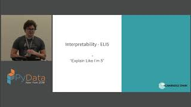
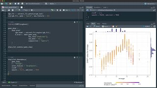

## Overview

A score says how well a model predicts, not what it learned. This section reads a fitted
random forest from the outside, by changing its inputs and watching its predictions,
then reads a model from its parts, on the same simulated survey as the rest of the
course. It ends with the report that goes with a model: everything needed to re-run the
analysis, and a model card that says what the model is for and where it holds.

## A short tour



## Lecture notes

- [Summary slides](../../slides/10-interpretation.qmd) cover each page of the section in
  two or three slides, with speaker notes, for teaching the section or a quick review.

## Pages in this section

::: {#pages}
:::

## Further resources

**Documentation**

- [Explaining models and predictions](https://www.tmwr.org/explain.html), Tidy Modeling with R. Local and global explanations through `DALEX`, in tidymodels idiom.
- [DALEX](https://modeloriented.github.io/DALEX/), Przemyslaw Biecek and others. Model-agnostic explanation for R and Python both.
- [Permutation importance](https://scikit-learn.org/stable/modules/permutation_importance.html) and [partial dependence and ICE](https://scikit-learn.org/stable/modules/partial_dependence.html), scikit-learn user guide. The permutation page shows what inputs that move together do to the scores.
- [SHAP](https://shap.readthedocs.io/), Scott Lundberg and others. The Python package for SHAP values, with worked examples for many kinds of model.
- [Interpretable Machine Learning](https://christophm.github.io/interpretable-ml-book/), Christoph Molnar. A free book, and the standard reference for every method named here.
- [Model Cards for Model Reporting](https://arxiv.org/abs/1810.03993), Margaret Mitchell and others (2019). The paper that proposed the model card.

**Video**

::: {.video-list}
- [{.video-thumb fig-alt="Open the Black Box: an Introduction to Model Interpretability with LIME and SHAP, on YouTube" loading="lazy"}](https://www.youtube.com/watch?v=C80SQe16Rao)

  [Open the Black Box: an Introduction to Model Interpretability with LIME and SHAP](https://www.youtube.com/watch?v=C80SQe16Rao), Kevin Lemagnen at PyData.

- [{.video-thumb fig-alt="Feature engineering and interpretability for xgboost with board game ratings, on YouTube" loading="lazy"}](https://www.youtube.com/watch?v=HTJ0nt3codo)

  [Feature engineering and interpretability for xgboost with board game ratings](https://www.youtube.com/watch?v=HTJ0nt3codo), Julia Silge. Importance and explanation computed on a real model rather than a toy one.
:::
