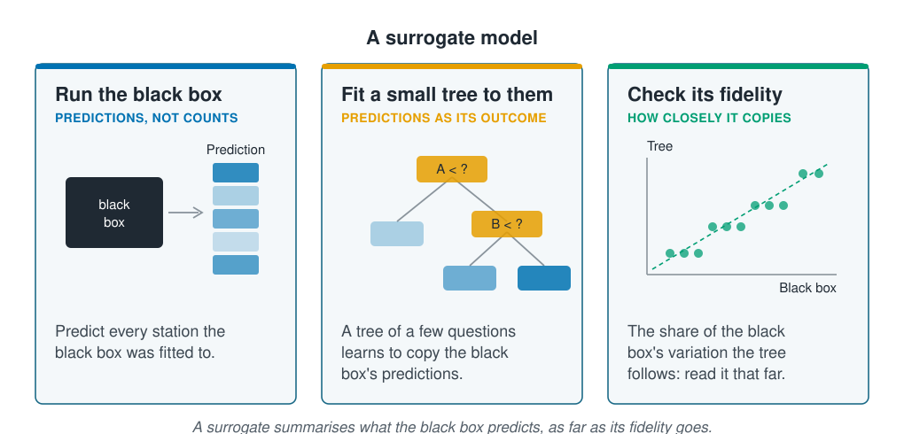

```{r}
#| label: setup
#| include: false
library(tidymodels)
library(tidyverse)
library(patchwork)
library(rpart.plot)
source(here::here("R/theme.R"))
source(here::here("R/data.R"))
source(here::here("R/python-tabs.R"))
set.seed(123)
```



## Some models can be read from their parts

An **interpretable model** is one whose fitted parts can be read directly. Linear
regression gives each input a slope; a GAM, below, gives each input a curve; a small
tree gives a few questions. A **black box**, such as a random forest of 500 trees,
boosting or a neural network, has no part that means anything alone. The earlier
pages of this section read one from outside, by changing its inputs and watching its
predictions.

This page reads a model from inside, in two ways: fit a readable model to the data in
place of the black box, or fit a readable model to the black box's own predictions.





## A GAM gives each input one smooth curve

A **generalised additive model (GAM)** replaces each input's straight line in a linear
model with a smooth curve, and adds the curves up as a linear model adds its terms. The
shape is free, as in a forest, but each input keeps one curve, the same whatever the
other inputs are, so the curves can be drawn and compared with what is known about the
species.

Each curve is built from short, smooth bumps spread along the input's range, each with
a weight, and the weighted bumps add up to a curve of almost any shape. A penalty on
bending, like the penalty in [Regularisation](../05-generalisation/regularisation.qmd),
stops the curve chasing the noise; its weight is chosen from the data.

::: {.diagram}
{fig-alt="Three cards. Pieces, short smooth bumps: seven bell-shaped curves overlap along the input's range. Added up, a weight for each bump: the bumps, each scaled by its weight, are drawn dashed, and their sum is a solid curve that rises and falls with the data points. Penalty, each bend costs: three curves through the same points; a dashed curve with bends made cheap chases the noise, a dotted straight line is what bends made dear give, and the solid curve between them follows the rise and fall. The text says fitting chooses the weights and pays for every bend, and the data set the price. A note says the curves add up, so each input keeps one curve that can be drawn and read."}
:::

## A surrogate model copies a black box in a readable form

Where the black box is the model to keep, a readable model can still describe it. A
**surrogate model** is a small, readable model fitted to the black box's predictions
in place of the recorded outcomes. It learns what the black box predicts, not what
the survey counted, and its parts summarise the black box.

A summary can leave things out, so a surrogate is read together with its
**fidelity**: how closely its predictions follow the black box's, measured as the
[R²](../02-marine-data/information-leakage.qmd) between the two. A fidelity of 1 means
the surrogate copies the black box exactly; 0.5 means it follows half of the
variation in the black box's predictions, and the rest is detail it does not show.

::: {.diagram}
{fig-alt="Three cards. Run the black box, predictions not counts: a dark box labelled black box with an arrow to a column of blue cells headed prediction. Fit a small tree to them, predictions as its outcome: a tree with a question on input A at the top, a question on input B below it, and three blue leaves of different shades. Check its fidelity, how closely it copies: a scatter of green points, the tree's prediction against the black box's, lying in steps along a dashed diagonal. A note says a surrogate summarises what the black box predicts, as far as its fidelity goes."}
:::

## Worked example

The black box is the random forest of 500 trees from
[Feature importance](feature-importance.qmd), fitted to the training sites of the same
split by site. A GAM is fitted to the same stations and read curve by curve. Then a
tree of three levels is fitted to the forest's predictions and read as its surrogate.

### Preparing the data

The GAM gives depth and temperature a curve each and the other inputs a straight
line or a level, and uses the negative binomial of
[Regression for counts](../03-supervised-learning/count-regression.qmd), which suits
counts that spread more than Poisson expects.

::: {.panel-tabset group="language"}

## R

```{r}
#| label: prepare
survey <- load_coastal_survey_clean()

inputs <- c("depth_m", "temperature_c", "chlorophyll_mg_m3", "salinity_psu",
            "substrate", "season")

split <- group_initial_split(survey, group = site_id, prop = 0.75)
train <- training(split)
test <- testing(split)

forest_recipe <- recipe(reformulate(inputs, "abundance"), data = train) |>
  step_impute_median(all_numeric_predictors())
forest_model <- rand_forest(trees = 500) |>
  set_engine("ranger", seed = 123) |>
  set_mode("regression")
forest <- workflow(forest_recipe, forest_model) |> fit(train)

# s() asks mgcv for a smooth curve; nb() is the negative binomial
gam_recipe <- forest_recipe |> step_relevel(substrate, ref_level = "sand")
gam_model <- gen_additive_mod() |>
  set_engine("mgcv", family = mgcv::nb(), method = "REML") |>
  set_mode("regression")
gam <- workflow(gam_recipe) |>
  add_model(gam_model, formula = abundance ~ s(depth_m) + s(temperature_c) +
              chlorophyll_mg_m3 + salinity_psu + substrate + season) |>
  fit(train)
```

## Python

```{python}
import numpy as np
import pandas as pd
from sklearn.compose import ColumnTransformer
from sklearn.ensemble import RandomForestRegressor
from sklearn.impute import SimpleImputer
from sklearn.linear_model import PoissonRegressor
from sklearn.metrics import r2_score, root_mean_squared_error
from sklearn.model_selection import GroupShuffleSplit
from sklearn.pipeline import Pipeline
from sklearn.preprocessing import (OneHotEncoder, SplineTransformer,
                                   StandardScaler)
from sklearn.tree import DecisionTreeRegressor, export_text

from mlbasic_data import load_coastal_survey_clean

survey = load_coastal_survey_clean()

grouper = GroupShuffleSplit(n_splits=1, train_size=0.75, random_state=123)
train_rows, test_rows = next(grouper.split(survey,
                                           groups=survey["site_id"]))
train = survey.iloc[train_rows].reset_index(drop=True)
test = survey.iloc[test_rows].reset_index(drop=True)

numeric = ["depth_m", "temperature_c", "chlorophyll_mg_m3", "salinity_psu"]
categorical = ["substrate", "season"]
inputs = numeric + categorical

recipe = ColumnTransformer(
    [("numeric", SimpleImputer(strategy="median"), numeric),
     ("categorical", OneHotEncoder(drop="first", sparse_output=False),
      categorical)])
# max_features and min_samples_leaf match ranger's defaults
model = RandomForestRegressor(n_estimators=500, max_features="sqrt",
                              min_samples_leaf=5, random_state=123)
forest = Pipeline([("recipe", recipe), ("model", model)]).fit(
    train[inputs], train["abundance"])

# scikit-learn has no GAM. Spline bumps for depth and temperature with a
# ridge penalty on their weights come close; the Poisson stands in for the
# negative binomial.
def curved(column):
    return (column, Pipeline([("impute", SimpleImputer(strategy="median")),
                              ("bumps", SplineTransformer(n_knots=8)),
                              ("scale", StandardScaler())]), [column])

gam_recipe = ColumnTransformer([
    curved("depth_m"),
    curved("temperature_c"),
    ("numeric", Pipeline([("impute", SimpleImputer(strategy="median")),
                          ("scale", StandardScaler())]),
     ["chlorophyll_mg_m3", "salinity_psu"]),
    ("categorical", OneHotEncoder(drop=["sand", "spring"], sparse_output=False),
     categorical)])
gam = Pipeline([("recipe", gam_recipe),
                ("model", PoissonRegressor(alpha=0.01, max_iter=1000))]).fit(
    train[inputs], train["abundance"])
```

:::

### The GAM's curves read as a habitat description

A GAM's parts are curves and multipliers, and each can be put in words. The curves for
depth and temperature are drawn relative to their peaks, over the middle 90% of each
input as in [Partial effects](partial-effects.qmd).

::: {.panel-tabset group="language"}

## R

```{r}
#| label: gam-curves
gam_engine <- extract_fit_engine(gam)
prepared <- extract_recipe(gam)

# the GAM's own curve for one input; on the log scale it adds the same
# amount at every station, so one row of the survey shows its shape
gam_curve <- function(input) {
  ends <- quantile(train[[input]], c(0.05, 0.95), na.rm = TRUE)
  grid <- train[rep(1, 40), ]
  grid[[input]] <- seq(ends[1], ends[2], length.out = 40)
  curve <- predict(gam_engine, bake(prepared, grid),
                   type = "terms")[, paste0("s(", input, ")")]
  tibble(value = grid[[input]], .pred = exp(curve - max(curve)))
}

curves <- list(depth_m = gam_curve("depth_m"),
               temperature_c = gam_curve("temperature_c"))

# where each curve peaks, and how low it falls at either end
imap(curves, \(curve, input) tibble(
  Input = input, `Peak at` = curve$value[which.max(curve$.pred)],
  `At the low end` = first(curve$.pred), `At the high end` = last(curve$.pred))) |>
  list_rbind() |>
  mutate(across(where(is.numeric), \(x) round(x, 2)))
```

## Python

```{python}
# a GAM's curve has the same shape at every station, so one typical
# station, swept along the input, shows it
typical = train[inputs].iloc[[0] * 40].reset_index(drop=True)
typical[numeric] = train[numeric].median().values

rows = []
for column in ["depth_m", "temperature_c"]:
    grid = typical.copy()
    grid[column] = np.linspace(*train[column].quantile([0.05, 0.95]), 40)
    curve = gam.predict(grid[inputs])
    curve = curve / curve.max()
    rows.append({"Input": column, "Peak at": grid[column][curve.argmax()],
                 "At the low end": curve[0], "At the high end": curve[-1]})
pd.DataFrame(rows).round(2)
```

:::

```{r}
#| label: curve-numbers
#| include: false
one <- \(x) format(round(x, 1), nsmall = 1)
two <- \(x) format(round(x, 2), nsmall = 2)
pct <- \(x) scales::percent(x, accuracy = 1)
gam_peak <- curves$temperature_c$value[which.max(curves$temperature_c$.pred)]
gam_cold <- slice(curves$temperature_c, 1)
gam_warm <- slice(curves$temperature_c, n())
gam_deep <- slice(curves$depth_m, n())
multiplier <- exp(coef(gam_engine))
test_rmse <- \(fitted) rmse_vec(test$abundance, predict(fitted, test)$.pred)
```

```{r}
#| label: fig-gam-curves
#| fig-cap: "The GAM's curves for depth and temperature, each relative to its peak, over the middle 90% of each input's values. The expected count is highest in shallow water and in cool water."
#| fig-alt: !expr 'glue::glue("Two panels, each a blue curve scaled to peak at 1. Depth, left: highest at the shallowest depth drawn and falling to {pct(gam_deep$.pred)} of that at {round(gam_deep$value)} metres. Temperature, right: a hump that peaks near {one(gam_peak)} degrees, falling to {pct(gam_cold$.pred)} of the peak in the coldest water drawn and {pct(gam_warm$.pred)} in the warmest.")'
#| fig-width: 8
#| fig-height: 3.6
curve_plot <- function(which, x_label) {
  ggplot(curves[[which]], aes(value, .pred)) +
    geom_line(colour = ml_palette[["blue"]], linewidth = 1.2) +
    expand_limits(y = 0) +
    labs(x = x_label, y = "Count relative\nto its peak")
}

curve_plot("depth_m", "Depth (m)") + curve_plot("temperature_c", "Temperature (°C)")
```

In words, from the GAM:

- **Temperature.** The expected count peaks near `r one(gam_peak)` °C. It falls to
  `r pct(gam_cold$.pred)` of the peak at `r one(gam_cold$value)` °C and to
  `r pct(gam_warm$.pred)` at `r one(gam_warm$value)` °C, the coldest and warmest
  water drawn.
- **Depth.** The expected count is highest at the shallowest stations and falls to
  `r pct(gam_deep$.pred)` of that by `r round(gam_deep$value)` m.
- **Substrate.** A muddy station is expected to hold
  `r two(multiplier[["substratemud"]])` times the count of a sandy one, a multiplier
  read as in [Regression for counts](../03-supervised-learning/count-regression.qmd).

These are the shapes the forest's partial dependence drew in
[Partial effects](partial-effects.qmd), here read straight off the model. Reading
costs nothing in accuracy on this survey: on the test sites the GAM's RMSE is
`r two(test_rmse(gam))` individuals and the forest's `r two(test_rmse(forest))`.
The survey's effects are of the kind a GAM assumes, smooth curves that add up.

### A three-level tree copies half of what the forest predicts

The surrogate is a tree of at most three levels, fitted to the forest's predictions
for the training stations in place of their counts.

::: {.panel-tabset group="language"}

## R

```{r}
#| label: surrogate
# the forest's predictions replace the counts as the outcome
copied <- train |> mutate(forest = predict(forest, train)$.pred)

surrogate_recipe <- recipe(reformulate(inputs, "forest"), data = copied) |>
  step_impute_median(all_numeric_predictors())
surrogate_model <- decision_tree(tree_depth = 3, min_n = 20,
                                 cost_complexity = 0) |>
  set_engine("rpart") |>
  set_mode("regression")
surrogate <- workflow(surrogate_recipe, surrogate_model) |> fit(copied)

# fidelity: the R² between the tree's predictions and the forest's
fidelity <- rsq_trad_vec(copied$forest, predict(surrogate, copied)$.pred)
round(fidelity, 2)
```

## Python

```{python}
# the forest's predictions replace the counts as the outcome
copied = forest.predict(train[inputs])

prepared = forest["recipe"].transform(train[inputs])
surrogate = DecisionTreeRegressor(max_depth=3, min_samples_split=20,
                                  min_samples_leaf=7, random_state=123)
surrogate = surrogate.fit(prepared, copied)

# fidelity: the R² between the tree's predictions and the forest's
print(f"fidelity {r2_score(copied, surrogate.predict(prepared)):.2f}")
print(export_text(surrogate, decimals=1,
                  feature_names=list(forest["recipe"].get_feature_names_out())))
```

:::

```{r}
#| label: surrogate-numbers
#| include: false
tree_engine <- extract_fit_engine(surrogate)
nodes <- tree_engine$frame |> rownames_to_column("node") |> as_tibble()
node <- \(i) filter(nodes, node == as.character(i))
leaf_n <- \(x) x$n

# rpart lists each question's competitors and stand-ins after it, so the
# questions asked sit at these rows of its splits table
inner <- filter(nodes, var != "<leaf>")
asked <- cumsum(c(1, head(1 + inner$ncompete + inner$nsurrogate, -1)))
cut_at <- set_names(tree_engine$splits[asked, "index"], inner$node)

first_cut <- cut_at[["1"]]
top_leaf <- node(3)
temp_cut <- cut_at[["2"]]
cold <- node(4)
warm <- node(5)
summer <- node(10)
other_seasons <- node(11)
```

```{r}
#| label: fig-surrogate
#| fig-cap: !expr 'glue::glue("The surrogate tree: three levels of questions fitted to the random forest''s predictions for the training stations. Each box gives the average forest prediction for its stations, with their number and share. Its fidelity is {two(fidelity)}.")'
#| fig-alt: !expr 'glue::glue("A tree of questions. The first sets apart {leaf_n(top_leaf)} stations with chlorophyll of {one(first_cut)} mg per cubic metre or more, where the forest predicts {one(top_leaf$yval)} individuals on average. The rest are split by temperature at {one(temp_cut)} degrees: colder stations average {one(cold$yval)}, warmer ones {one(warm$yval)}, and each side is split once more, the cold side by depth and the warm side by season.")'
#| fig-width: 9
#| fig-height: 5
rpart.plot(tree_engine, roundint = FALSE, type = 2, extra = 101,
           box.palette = "Blues", branch.lty = 3, cex = 0.8)
```

Read the tree from the top. The forest's highest predictions,
`r one(top_leaf$yval)` individuals on average, are for the `r top_leaf$n` training
stations with chlorophyll above `r one(first_cut)` mg/m³, the rare, very high values
that lifted single predictions in
[Explaining one prediction](explaining-one-prediction.qmd). Among the rest, the forest
predicts `r one(cold$yval)` in water colder than `r one(temp_cut)` °C and
`r one(warm$yval)` in warmer water; in warmer water it predicts
`r one(summer$yval)` in summer and `r one(other_seasons$yval)` in the other seasons.
A few questions give the broad shape of what the forest predicts.

The fidelity of `r two(fidelity)` says how far to trust that summary: the tree follows
`r pct(fidelity)` of the variation in the forest's predictions, and the rest is
detail that three questions cannot hold. A deeper tree follows more of it but has more
to read; the right depth is the shallowest one whose fidelity is high enough for the
question at hand.

## A black box earns its place where inputs work in combination

A GAM's curves add up, so it cannot show an effect of one input that depends on
another, and a surrogate tree shows only the broad strokes of a black box. A black
box earns its place in three kinds of work.

- **Inputs that work in combination.** A water mass is a diagonal band in temperature
  and salinity. In
  [When a network pays off](../09-neural-networks/when-a-network-pays-off.qmd) a
  network draws it from a few hundred stations, while logistic regression matches it
  only once the combination is named as an input.
- **Raw inputs.** Images, sound and spectra have no input whose curve means anything
  alone, so there is nothing to give up by using a black box.
- **Prediction as the whole job.** An operational forecast or a tool to plan survey
  effort is judged by its predictions, and a surrogate fitted beside it still says
  roughly what it does.

Whichever way a model is read, from its parts or through a surrogate, the reading
describes the model. It describes the species only as far as the data let each input
vary on its own.

## Key points

::: {.key-points}
- An **interpretable model** is read from its parts, such as a GAM's curves and
  multipliers. A **black box** has no part that means anything alone.
- A **GAM** gives each input one smooth curve and adds them up, so each curve can be
  drawn and read. On the survey it read as a habitat description and predicted the
  test sites as well as the forest.
- A **surrogate model** is a readable model fitted to a black box's predictions, so
  its parts summarise the black box rather than the data.
- Read a surrogate with its **fidelity**, the R² between its predictions and the black
  box's. The survey's three-level tree followed about half of the forest's
  variation.
- A black box earns its place where inputs work in combination, where inputs are raw,
  or where prediction is the whole job.
:::

## Try it yourself

1. Fit the surrogate with `tree_depth = 2` and `tree_depth = 5`. How does the fidelity
   change, and which questions does the deeper tree add?
2. Give chlorophyll a curve as well, with `s(chlorophyll_mg_m3)` in the GAM's
   formula. What shape does the new curve have, and does it pick up the very high
   values the surrogate's first question found?
