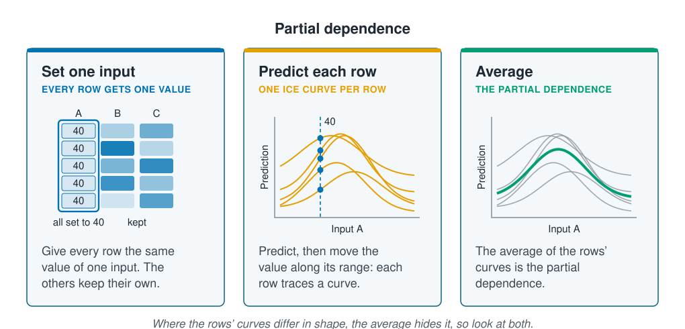

```{r}
#| label: setup
#| include: false
library(tidymodels)
library(tidyverse)
library(patchwork)
source(here::here("R/theme.R"))
source(here::here("R/data.R"))
source(here::here("R/python-tabs.R"))
set.seed(123)
```



## Partial effects draw how a prediction changes along one input

[Feature importance](feature-importance.qmd) says how much a model relies on an input,
but not whether the prediction rises or falls with it, or where it peaks. **Partial
effects** draw that shape: how the model's prediction changes as one input moves. This
page draws them two ways, averaged over every station and station by station, and
shows what each can and cannot tell you.





## A partial dependence plot averages the curve over every station

A **partial dependence plot** starts from the data the model was fitted to. Set one
input to the same value in every row, keep every other input as it was recorded, and
predict each row. The average of those predictions is one point on the curve. Repeat
for each value along the input's range, and the points make the curve. It works for
any model, because it only needs predictions.

::: {.diagram}
{fig-alt="Three cards. Set one input, every row gets one value: a small table with inputs A, B and C, where every cell of column A reads 40 and the shaded cells of B and C are kept. Predict each row, one ICE curve per row: five orange humped curves of different heights against input A, with a dashed line at 40 marking where each row's prediction was made. Average, the partial dependence: the same five curves in grey with a thick green curve through their middle, their average. A note says that where the rows' curves differ in shape, the average hides it, so look at both."}
:::

Setting an input to its extreme values in every row builds stations the survey never
had, such as the shallowest depth paired with the coldest water, so the curves on this
page run only over the middle 90% of each input's values, where most stations lie.

## ICE curves show the same sweep station by station

Before averaging, each row has its own curve: its prediction as the one input moves
and the rest of the row stays put. These are **individual conditional expectation
(ICE) curves**, and the partial dependence is their average. If they share one shape
and differ only in height, the average describes them well. If they peak in different
places or cross, the effect of the input depends on the others, an
[interaction](../06-assumptions-limitations/linearity-and-nonlinearity.qmd), and the
average alone would hide it.

## Worked example

A random forest of 500 trees, as in
[Feature importance](feature-importance.qmd), predicts abundance from the six inputs
of [Regression for counts](../03-supervised-learning/count-regression.qmd) and is
fitted to the training sites of the same split by site. Its partial dependence is
drawn for the two inputs it relied on most, temperature and depth, then its ICE
curves for temperature.

### Preparing the data

::: {.panel-tabset group="language"}

## R

```{r}
#| label: prepare
survey <- load_coastal_survey_clean()

inputs <- c("depth_m", "temperature_c", "chlorophyll_mg_m3", "salinity_psu",
            "substrate", "season")

split <- group_initial_split(survey, group = site_id, prop = 0.75)
train <- training(split)

forest_recipe <- recipe(reformulate(inputs, "abundance"), data = train) |>
  step_impute_median(all_numeric_predictors())
forest_model <- rand_forest(trees = 500) |>
  set_engine("ranger", seed = 123) |>
  set_mode("regression")

forest <- workflow(forest_recipe, forest_model) |> fit(train)
```

## Python

```{python}
import numpy as np
import pandas as pd
from sklearn.compose import ColumnTransformer
from sklearn.ensemble import RandomForestRegressor
from sklearn.impute import SimpleImputer
from sklearn.inspection import partial_dependence
from sklearn.model_selection import GroupShuffleSplit
from sklearn.pipeline import Pipeline
from sklearn.preprocessing import OneHotEncoder

from mlbasic_data import load_coastal_survey_clean

survey = load_coastal_survey_clean()

grouper = GroupShuffleSplit(n_splits=1, train_size=0.75, random_state=123)
train_rows, test_rows = next(grouper.split(survey,
                                           groups=survey["site_id"]))
train = survey.iloc[train_rows].reset_index(drop=True)

numeric = ["depth_m", "temperature_c", "chlorophyll_mg_m3", "salinity_psu"]
categorical = ["substrate", "season"]

recipe = ColumnTransformer(
    [("numeric", SimpleImputer(strategy="median"), numeric),
     ("categorical", OneHotEncoder(drop="first", sparse_output=False),
      categorical)])
# max_features and min_samples_leaf match ranger's defaults
model = RandomForestRegressor(n_estimators=500, max_features="sqrt",
                              min_samples_leaf=5, random_state=123)
forest = Pipeline([("recipe", recipe), ("model", model)]).fit(
    train[numeric + categorical], train["abundance"])
```

:::

### The forest predicts most animals in cool water and at shallow depths

Each input is set in turn to 40 values across the middle 90% of its range, and every
training station is predicted at each. The partial dependence is the average at each
value.

::: {.panel-tabset group="language"}

## R

```{r}
#| label: sweep
# every training station's prediction with one input set to each of 40
# values over the middle 90% of its range
sweep <- function(fitted, input) {
  ends <- quantile(train[[input]], c(0.05, 0.95), na.rm = TRUE)
  map(seq(ends[1], ends[2], length.out = 40), \(level) {
    swept <- train
    swept[[input]] <- level
    tibble(station = swept$station_id, value = level,
           .pred = predict(fitted, swept)$.pred)
  }) |>
    list_rbind()
}

ice <- list(depth_m = sweep(forest, "depth_m"),
            temperature_c = sweep(forest, "temperature_c"))

# the partial dependence is the average over the stations
partial <- map(ice, \(d) summarise(d, .pred = mean(.pred), .by = value))

peak_of <- \(d) d$value[which.max(d$.pred)]
tibble(Input = c("Depth (m)", "Temperature (°C)"),
       `Highest prediction at` = map_dbl(partial, peak_of),
       `Highest` = map_dbl(partial, \(d) max(d$.pred)),
       `Lowest` = map_dbl(partial, \(d) min(d$.pred))) |>
  mutate(across(-Input, \(x) round(x, 1)))
```

## Python

```{python}
# every training station's prediction with one input set to each of 40
# values over the middle 90% of its range
def sweep(fitted, column, kind="average"):
    result = partial_dependence(
        fitted, train[numeric + categorical], [column], kind=kind,
        percentiles=(0.05, 0.95), grid_resolution=40)
    return result["grid_values"][0], result[kind][0]

rows = []
for column, name in [("depth_m", "Depth (m)"),
                     ("temperature_c", "Temperature (°C)")]:
    grid, average = sweep(forest, column)
    rows.append({"Input": name, "Highest prediction at": grid[average.argmax()],
                 "Highest": average.max(), "Lowest": average.min()})
pd.DataFrame(rows).round(1)
```

:::

```{r}
#| label: fig-partial
#| fig-cap: "The random forest's partial dependence on depth and on temperature, over the middle 90% of each input's values: the average prediction over every training station as one input is set to each value."
#| fig-alt: !expr 'glue::glue("Two panels of predicted count against an input. Left, depth: the curve is highest, about {one(max(partial$depth_m$.pred))} individuals, at the shallowest depth drawn, and falls in steps to about {one(min(partial$depth_m$.pred))} at the deepest. Right, temperature: the curve is low in the coldest water, rises steeply between 6 and 7 degrees to a peak of about {one(max(partial$temperature_c$.pred))} at {one(peak_of(partial$temperature_c))} degrees, and falls again in the warmest water.")'
#| fig-width: 8
#| fig-height: 3.6
one <- \(x) format(round(x, 1), nsmall = 1)

curve_plot <- function(which, x_label) {
  ggplot(partial[[which]], aes(value, .pred)) +
    geom_line(colour = ml_palette[["blue"]], linewidth = 1.2) +
    expand_limits(y = 0) +
    labs(x = x_label, y = "Average prediction\n(individuals)")
}

curve_plot("depth_m", "Depth (m)") + curve_plot("temperature_c", "Temperature (°C)")
```

```{r}
#| label: partial-numbers
#| include: false
shallowest <- min(partial$depth_m$value)
deepest <- max(partial$depth_m$value)
depth_drop <- 1 - min(partial$depth_m$.pred) / max(partial$depth_m$.pred)
```

The forest predicts the most animals at `r one(peak_of(partial$temperature_c))` °C, in
cool water, and fewer in both colder and warmer water: temperature has a hump. Depth
works one way only: the prediction is highest at `r round(shallowest)` m, the
shallowest value drawn, and falls by `r percent(depth_drop)` towards
`r round(deepest)` m. A single coefficient could not draw the hump; the plot reads both
shapes straight off the fitted forest.

### ICE curves show the temperature hump at nearly every station

The same sweep, before averaging, gives one curve for each of the
`r nrow(train)` training stations. @fig-ice draws them for temperature. For each
station, the table below measures the rise from the coldest temperature drawn to the
partial dependence's peak, and the fall from there to the warmest.

::: {.panel-tabset group="language"}

## R

```{r}
#| label: ice
# each station's rise from the coldest value drawn to the partial
# dependence's peak, and its fall from there to the warmest
top <- peak_of(partial$temperature_c)
changes <- ice$temperature_c |>
  summarise(rise = .pred[value == top] - first(.pred),
            fall = .pred[value == top] - last(.pred), .by = station)

changes |>
  pivot_longer(c(rise, fall), names_to = "change", values_to = "size") |>
  summarise(`Above zero` = percent(mean(size > 0)),
            Lowest = round(min(size), 1),
            Median = round(median(size), 1),
            Highest = round(max(size), 1), .by = change) |>
  mutate(change = str_to_sentence(change)) |>
  rename(Change = change)
```

## Python

```{python}
grid, curves = sweep(forest, "temperature_c", kind="individual")

# each station's rise from the coldest value drawn to the partial
# dependence's peak, and its fall from there to the warmest
top = curves.mean(axis=0).argmax()
changes = pd.DataFrame({"rise": curves[:, top] - curves[:, 0],
                        "fall": curves[:, top] - curves[:, -1]})

(pd.DataFrame({"Above zero": (changes > 0).mean().map("{:.0%}".format),
               "Lowest": changes.min().round(1),
               "Median": changes.median().round(1),
               "Highest": changes.max().round(1)})
    .set_axis(["Rise", "Fall"])
    .rename_axis("Change"))
```

:::

```{r}
#| label: fig-ice
#| fig-cap: "ICE curves for temperature: the random forest's prediction for each training station as its temperature is moved and the rest of the station stays as recorded, with their average, the partial dependence, in blue. Almost every curve rises between 6 and 7 °C, stays high to about 10 °C and then falls; the curves differ mostly in height."
#| fig-alt: "Several hundred thin grey curves against temperature from about 4 to 13.5 degrees, most between 1 and 10 predicted individuals, a few reaching 17 to 25. Nearly all are level below about 5.5 degrees, rise between 6 and 7 degrees, stay high with small wiggles to about 10.4 degrees, then drop and level off towards the warm end. Higher curves rise and fall by more. A thick blue curve, their average, runs through the lower middle of the bundle with the same shape, from about 3 up to nearly 6 and back to about 3.4."
#| fig-width: 7
#| fig-height: 4.2
ggplot(ice$temperature_c, aes(value, .pred)) +
  geom_line(aes(group = station), colour = ml_palette[["grey"]],
            alpha = 0.25, linewidth = 0.3) +
  geom_line(data = partial$temperature_c, colour = ml_palette[["blue"]],
            linewidth = 1.4) +
  labs(x = "Temperature (°C)", y = "Predicted count (individuals)")
```

```{r}
#| label: ice-numbers
#| include: false
# "every station", or "all but k of the n stations"
share <- \(x) {
  if (all(x)) "every station" else
    paste("all but", sum(!x), "of the", length(x), "stations")
}
```

The curve rises from the coldest water to the partial dependence's peak on
`r share(changes$rise > 0)`, and falls again towards the warmest on
`r share(changes$fall > 0)`. The size of the rise differs far more: half the
stations rise by less than `r one(median(changes$rise))` individuals, the largest by
`r one(max(changes$rise))`.
Stations where the forest predicts many animals anyway gain most from the right
temperature, so the curves share a shape and differ in scale. The partial dependence
shows where the hump lies; how large it is depends on the station.

## Partial effects describe the model

A partial dependence plot and its ICE curves are a faithful picture of what a model
predicts, not a measurement of the species. As
[Feature importance](feature-importance.qmd) showed, inputs that carry the same
information share the work, and the forest may give an effect to either of them. A
curve reads as the species' response only where the data let that input vary on its
own. [Interpretable models and surrogates](interpretable-models.qmd) turns to models
whose parts can be read directly.

## Key points

::: {.key-points}
- A **partial dependence plot** sets one input to each value in turn in every row,
  predicts, and averages. It works for any model and shows the direction and shape of
  an effect.
- **ICE curves** are the same sweep for each row before averaging. Curves that share a
  shape show the average describes them; curves that peak in different places show an
  interaction.
- Draw the curves where the data are: a sweep pairs each value with every row's other
  inputs, including combinations the survey never had.
- On the survey the forest predicted most animals in cool water and in shallow water,
  and the temperature hump appeared at nearly every station, at different heights.
- The curves describe the model; they describe the species only where the data let
  the input vary on its own.
:::

## Try it yourself

1. Draw the partial dependence of `substrate`: set every training station to each
   level in turn and average the predictions. Which level does the forest predict
   most animals on?
2. Draw the ICE curves for depth. Do the stations share one shape, as they did for
   temperature?
